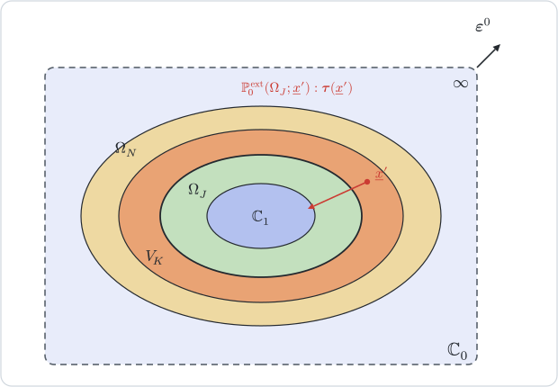

```@meta
EditURL = "../../../../scripts/74_coated_inclusion_estimates.jl"
```

# [Coated inclusions: closures on the mean strains, and the exact solution](@id app-coated-estimates)

!!! tip "The whole page as one script"
    Every block of this page, in order, is [`scripts/74_coated_inclusion_estimates.jl`](https://github.com/MicroPoroChemoMechanics/MeanFieldHomogenization.jl/blob/main/scripts/74_coated_inclusion_estimates.jl).
    From a clone of the repository, `julia --project=docs -e 'using Pkg; Pkg.instantiate()'`
    once, then `julia scripts/74_coated_inclusion_estimates.jl`, runs it end to end.

!!! info "Before this page"
    [Layered inclusions](@ref man-layered), which gives the exact solutions
    used here, and [Custom inclusions](@ref man-custom-inclusions), through
    which the estimates of this page enter the schemes.

An inclusion surrounded by coatings can be treated in two ways. The first
keeps one unknown per layer, its mean strain, and closes the problem by an
assumption on the field of the coatings: it applies to any ellipsoid and
costs a linear system. The second solves the field in each layer, which is
what the layered inclusions of the package do, for the shapes where that
field is known. This page writes two closures of the first kind, the
multi-inclusion model of [Hori and Nemat-Nasser](@cite horiMM1993) and the
formulation of [Dinzart, Sabar and Berbenni](@cite dinzartIJES2016), with
which that of [Lipinski, Barhdadi and Cherkaoui](@cite lipinskiPM2006)
coincides, states
the assumption of each, and measures what it costs against the exact
solution: on composites of coated spheres, with the parameters of the second
article, then in conduction on confocal spheroids [bonfohAMM2020](@cite).

````@example coated_inclusion_estimates
using MeanFieldHomogenization
using TensND
using LinearAlgebra
using StaticArrays
using Printf
using Plots
gr()
nothing #hide
````

## The composite inclusion and its mean strains

The composite inclusion is made of ``N`` layers: a core, of stiffness
``\mathbb{C}_1``, and coatings ``\mathbb{C}_2,\dots,\mathbb{C}_N``. The
layers ``1`` to ``J`` fill an ellipsoid ``\Omega_J``; ``\Omega_N`` is the
whole inclusion, in which the layer ``K`` has the volume fraction
``\varphi_K``. The inclusion is embedded in a medium of stiffness
``\mathbb{C}_0`` under the remote strain ``\boldsymbol{\varepsilon}^0``, and
the unknowns are the mean strains ``\bar{\boldsymbol{\varepsilon}}^K`` of
the layers.



*The composite inclusion in the medium ``\mathbb{C}_0``: the ellipsoid
``\Omega_J`` of the layers 1 to ``J``, a layer ``V_K`` outside it, and a point
``\underline{x}'`` of that layer, whose polarization acts on the mean strain of
``\Omega_J``.*

One relation is exact: the mean strain of the whole inclusion, since the
Hill tensor ``\mathbb{P}_0(\Omega_N)`` of an ellipsoid is uniform inside it,

```math
\sum_K\varphi_K\,\bar{\boldsymbol{\varepsilon}}^K
= \boldsymbol{\varepsilon}^0 - \mathbb{P}_0(\Omega_N):\sum_K\varphi_K\,(\mathbb{C}_K-\mathbb{C}_0):\bar{\boldsymbol{\varepsilon}}^K .
```

The ``N-1`` other relations come from the same integral equation, written
for the mean strain of an inner ellipsoid ``\Omega_J``. With
``\boldsymbol{\tau}=(\mathbb{C}-\mathbb{C}_0):\boldsymbol{\varepsilon}`` the
polarization and ``\boldsymbol{\Gamma}_0`` the Green operator of the medium,

```math
\bar{\boldsymbol{\varepsilon}}^{\Omega_J}
= \boldsymbol{\varepsilon}^0 - \mathbb{P}_0(\Omega_J):\bar{\boldsymbol{\tau}}^{\Omega_J}
- \sum_{K>J}\int_{V_K}\mathbb{P}_0^{\mathrm{ext}}(\Omega_J;\underline{x}'):\boldsymbol{\tau}(\underline{x}')\,\frac{\mathrm{d}V'}{|\Omega_J|},
\qquad
\mathbb{P}_0^{\mathrm{ext}}(\Omega_J;\underline{x}')=\int_{\Omega_J}\boldsymbol{\Gamma}_0(\underline{x}-\underline{x}')\,\mathrm{d}V ,
```

which is exact. The last term is the effect of the layers ``V_K`` outside
``\Omega_J``: the tensor ``\mathbb{P}_0^{\mathrm{ext}}`` of a point outside the
ellipsoid varies with that point, so that the term needs the field of the
coatings and not only its mean. Each estimate closes it by an assumption.

**The multi-inclusion model.** The polarization of each outer layer is
replaced by its mean in that term (equation (3.5b) of [horiMM1993](@cite) for
one coating, equation (25) of [dinzartIJES2016](@cite) for several). The
integral of ``\mathbb{P}_0^{\mathrm{ext}}(\Omega_J;\cdot)`` over the layer
``V_K`` is ``|\Omega_J|\,(\mathbb{P}_0(\Omega_K)-\mathbb{P}_0(\Omega_{K-1}))``,
and, for ``J<N``, with ``\omega_J`` the volume of ``\Omega_J`` divided by that
of ``\Omega_N``,

```math
\frac{1}{\omega_J}\sum_{K\le J}\varphi_K\,\bar{\boldsymbol{\varepsilon}}^K
= \boldsymbol{\varepsilon}^0
- \frac{1}{\omega_J}\,\mathbb{P}_0(\Omega_J):\sum_{K\le J}\varphi_K\,(\mathbb{C}_K-\mathbb{C}_0):\bar{\boldsymbol{\varepsilon}}^K
- \sum_{K>J}\bigl(\mathbb{P}_0(\Omega_K)-\mathbb{P}_0(\Omega_{K-1})\bigr):(\mathbb{C}_K-\mathbb{C}_0):\bar{\boldsymbol{\varepsilon}}^K .
```

The relation is exact when the polarization of each coating is uniform, as its
authors state. It is in particular when the outer layer is a shell of matrix
and the medium is the matrix itself, the polarization of the shell being
zero; with the effective medium around the shell, as in a self-consistent
scheme, the term left out is the one that carries the interaction between
the inclusion and its matrix [aboutajeddineMM2005](@cite).

**The revisited formulation.** The same equation is written for
``\Omega_{J+1}`` and for ``\Omega_J`` with the coating ``J+1`` as the medium
of the Green operator, and the two are subtracted (equations (30) to (32) of
[dinzartIJES2016](@cite)). The polarization of the coating ``J+1`` is then
zero, and the terms of the layers beyond it,

```math
\sum_{K>J+1}\int_{V_K}\Bigl(\frac{\mathbb{P}_{J+1}^{\mathrm{ext}}(\Omega_{J+1};\underline{x}')}{|\Omega_{J+1}|}-\frac{\mathbb{P}_{J+1}^{\mathrm{ext}}(\Omega_J;\underline{x}')}{|\Omega_J|}\Bigr):\boldsymbol{\tau}(\underline{x}')\,\mathrm{d}V' ,
```

are left out. What remains is, for ``J<N``,

```math
\frac{1}{\omega_{J+1}}\sum_{K\le J+1}\varphi_K\,\bar{\boldsymbol{\varepsilon}}^K
- \frac{1}{\omega_J}\sum_{K\le J}\varphi_K\,\bar{\boldsymbol{\varepsilon}}^K
= \frac{\varphi_{J+1}}{\omega_J\,\omega_{J+1}}\;\mathbb{T}_{J+1}:\sum_{K\le J}\varphi_K\,(\mathbb{C}_K-\mathbb{C}_{J+1}):\bar{\boldsymbol{\varepsilon}}^K ,
\qquad
\mathbb{T}_{J+1} = \mathbb{P}_{J+1}(\Omega_{J+1}) - \frac{\omega_{J+1}}{\varphi_{J+1}}\bigl(\mathbb{P}_{J+1}(\Omega_{J+1})-\mathbb{P}_{J+1}(\Omega_J)\bigr) ,
```

where ``\mathbb{P}_{J+1}`` is the Hill tensor in the medium
``\mathbb{C}_{J+1}``. The relation is exact when the two exterior tensors,
each divided by the volume of its ellipsoid, are equal at the points of the
outer layers. In conduction they are for confocal ellipsoids, whose exterior
potentials are in the ratio of their volumes [bonfohAMM2020](@cite). In
elasticity the Green operator also involves the biharmonic potential, which
does not have that property: for a sphere of radius ``a`` and volume ``V``
it is ``V\,(r+a^2/(5r))`` outside, where the radius remains.

**The jump across an interface.** [lipinskiPM2006](@cite) start from the
strain on the two sides of the interface between ``\Omega_J`` and its
coating, which are related at each point by the interface operator of the
coating. Replacing the strain of the inner side by its mean and averaging
the operator over the coating gives (their equations (30), (35) and (45))

```math
\bar{\boldsymbol{\varepsilon}}^{J+1}
= \frac{1}{\omega_J}\sum_{K\le J}\varphi_K\,\bigl[\mathbb{I}-\mathbb{T}'_{J+1}:(\mathbb{C}_{J+1}-\mathbb{C}_K)\bigr]:\bar{\boldsymbol{\varepsilon}}^K ,
\qquad
\mathbb{T}'_{J+1} = \mathbb{P}_{J+1}(\Omega_J) - \frac{\omega_J}{\varphi_{J+1}}\bigl(\mathbb{P}_{J+1}(\Omega_{J+1})-\mathbb{P}_{J+1}(\Omega_J)\bigr) .
```

Since ``\omega_{J+1}\,\bar{\boldsymbol{\varepsilon}}^{\Omega_{J+1}}=\omega_J\,\bar{\boldsymbol{\varepsilon}}^{\Omega_J}+\varphi_{J+1}\,\bar{\boldsymbol{\varepsilon}}^{J+1}``,
the relation of the revisited formulation has the same form with
``\mathbb{T}_{J+1}`` in place of ``\mathbb{T}'_{J+1}``, and

```math
\mathbb{T}_{J+1}-\mathbb{T}'_{J+1}
=\Bigl(1-\frac{\omega_{J+1}-\omega_J}{\varphi_{J+1}}\Bigr)\bigl(\mathbb{P}_{J+1}(\Omega_{J+1})-\mathbb{P}_{J+1}(\Omega_J)\bigr)=0 ,
```

the volume fraction of the coating being ``\varphi_{J+1}=\omega_{J+1}-\omega_J``.
The two derivations lead to the same relations between the mean strains,
for ellipsoids of any shape; the system below checks it.

In the three cases the ``N`` relations are linear in the mean strains. They are
solved here as they stand, on the matrices of the tensors, rather than
through the recurrences of the articles. Nothing in them depends on the
order of the tensors: the same lines serve conduction, with the
conductivities in place of the stiffnesses.

````@example coated_inclusion_estimates
# Matrix of a property: Kelvin-Mandel at order 4, components at order 2.
km(t::TensND.AbstractTens{4}) = SMatrix{6, 6}(TensND.mandel(t, CanonicalBasis{3, eltype(t)}()))
km(t::TensND.AbstractTens{2}) = SMatrix{3, 3}(TensND.canonical_components(t))
hill(shape, C) = km(hill_tensor(shape, C))

abstract type Closure end
struct MultiInclusion <: Closure end        ## Hori and Nemat-Nasser (1993)
struct Revisited <: Closure end             ## Dinzart, Sabar and Berbenni (2016)
struct Interfacial <: Closure end           ## Lipinski, Barhdadi and Cherkaoui (2006)

# Row `J` of the system, as the 6×6 blocks that multiply each mean strain, and
# the factor of the remote strain on its right-hand side.
function relation(::MultiInclusion, J, shapes, C, C₀, φ, ω)
    P = [hill(s, C₀) for s in shapes]
    blocks = map(eachindex(C)) do K
        ΔC = km(C[K]) - km(C₀)
        K ≤ J ? (φ[K] / ω[J]) * (I + P[J] * ΔC) : (P[K] - P[K - 1]) * ΔC
    end
    return blocks, 1.0
end
# The tensor of a coating, from the Hill tensors of its two boundaries in its own medium.
interaction(::Revisited, outer, inner, ω_outer, ω_inner) = outer - (ω_outer / (ω_outer - ω_inner)) * (outer - inner)
interaction(::Interfacial, outer, inner, ω_outer, ω_inner) = inner - (ω_inner / (ω_outer - ω_inner)) * (outer - inner)
function relation(closure::Union{Revisited, Interfacial}, J, shapes, C, C₀, φ, ω)
    T = interaction(closure, hill(shapes[J + 1], C[J + 1]), hill(shapes[J], C[J + 1]), ω[J + 1], ω[J])
    blocks = map(eachindex(C)) do K
        K ≤ J ? φ[K] * ((1 / ω[J + 1] - 1 / ω[J]) * I - (φ[J + 1] / (ω[J] * ω[J + 1])) * T * (km(C[K]) - km(C[J + 1]))) :
            K == J + 1 ? (φ[K] / ω[J + 1]) * one(T) : zero(T)
    end
    return blocks, 0.0
end
# The exact relation on the whole inclusion.
function whole(shapes, C, C₀, φ)
    P = hill(last(shapes), C₀)
    return [φ[K] * (I + P * (km(C[K]) - km(C₀))) for K in eachindex(C)], 1.0
end

"""
    mean_strains(closure, shapes, C, C₀) -> (matrices, fractions)

Mean strain of each layer per unit remote strain, as a matrix, and the volume
fractions of the layers in the inclusion: `shapes[J]` is the ellipsoid of the
layers 1 to `J`, `C[K]` the property of the layer `K`, `C₀` that of the
surrounding medium.
"""
function mean_strains(closure::Closure, shapes, C, C₀)
    N, n = length(C), size(km(C₀), 1)
    volume(s) = prod(s.semi_axes)
    ω = [volume(s) / volume(last(shapes)) for s in shapes]
    φ = [ω[1]; diff(ω)]
    rows = [[relation(closure, J, shapes, C, C₀, φ, ω) for J in 1:(N - 1)]; [whole(shapes, C, C₀, φ)]]
    A = reduce(vcat, [reduce(hcat, blocks) for (blocks, _) in rows])
    b = reduce(vcat, [factor * Matrix(1.0I, n, n) for (_, factor) in rows])
    X = A \ b
    return [X[(n * (K - 1) + 1):(n * K), :] for K in 1:N], φ
end
````

For a sphere in one spherical coating the article gives the result in
closed form: with ``f`` the fraction of the core in the inclusion,
``\mathbb{P}_0`` and ``\mathbb{P}_2`` the Hill tensors of the sphere in the
surrounding medium and in the coating, the mean strain of the core is that
of the whole inclusion multiplied by
``[\mathbb{I}+(1-f)\,\mathbb{P}_2:(\mathbb{C}_1-\mathbb{C}_2)]^{-1}`` in the
revisited formulation (its equation (46)) and by
``[\mathbb{I}+\mathbb{P}_0:((1-f)(\mathbb{C}_1-\mathbb{C}_0)+f(\mathbb{C}_2-\mathbb{C}_0))]^{-1}:[\mathbb{I}+\mathbb{P}_0:(\mathbb{C}_2-\mathbb{C}_0)]``
in the multi-inclusion model. The system above returns both:

````@example coated_inclusion_estimates
let f = 0.3, C = [iso_stiffness(40.0, 12.0), iso_stiffness(3.0, 2.0)], C₀ = iso_stiffness(9.0, 5.0)
    shapes = [Ellipsoid(cbrt(f)), Ellipsoid(1.0)]
    P₀, P₂ = hill(shapes[2], C₀), hill(shapes[2], C[2])
    Δ₁, Δ₂, Δ₁₂ = km(C[1]) - km(C₀), km(C[2]) - km(C₀), km(C[1]) - km(C[2])
    closed = (Revisited() => inv(I + (1 - f) * P₂ * Δ₁₂), MultiInclusion() => inv(I + P₀ * ((1 - f) * Δ₁ + f * Δ₂)) * (I + P₀ * Δ₂))
    for (closure, A) in closed
        ε, φ = mean_strains(closure, shapes, C, C₀)
        @printf "%-15s  deviation from the closed form: %.1e\n" nameof(typeof(closure)) norm(ε[1] - A * sum(φ .* ε)) / norm(ε[1])
    end
end
````

The closure written from the jump across the interface gives the same mean
strains as the revisited formulation, here on a core and two coatings that
are spheroids of different aspect ratios:

````@example coated_inclusion_estimates
let C = [iso_stiffness(40.0, 12.0), iso_stiffness(3.0, 2.0), iso_stiffness(15.0, 9.0)], C₀ = iso_stiffness(9.0, 5.0)
    shapes = [Ellipsoid(0.3, 0.3, 0.9), Ellipsoid(0.6, 0.6, 1.1), Ellipsoid(1.0, 1.0, 1.3)]
    (ε, _), (ε′, _) = mean_strains(Revisited(), shapes, C, C₀), mean_strains(Interfacial(), shapes, C, C₀)
    @printf "largest relative difference between the mean strains: %.1e\n" maximum(norm(a - b) / norm(a) for (a, b) in zip(ε, ε′))
end
````

The estimate enters the schemes as a custom inclusion, by its two
concentration tensors: the mean strain and the mean stress of the whole
inclusion per unit remote strain.

````@example coated_inclusion_estimates
function coated_estimate(closure, shapes, C)
    strain(_, C₀; kw...) = (((ε, φ) = mean_strains(closure, shapes, C, C₀)); TensND.from_mandel(sum(φ .* ε)))
    stress(_, C₀; kw...) = (((ε, φ) = mean_strains(closure, shapes, C, C₀)); TensND.from_mandel(sum(φ[K] * km(C[K]) * ε[K] for K in eachindex(C))))
    return CustomInclusion(
        last(shapes).semi_axes; homogeneous = false,
        gradient_gradient_concentration = strain, flux_gradient_concentration = stress,
    )
end
nothing #hide
````

## The generalized self-consistent scheme

The examples of [dinzartIJES2016](@cite) are composites of spheres, whose
exact reference is the generalized self-consistent scheme: the composite
inclusion is the particle, its coatings and a shell of matrix, in the
proportions of the material, embedded in the effective medium. With the
layered sphere of the package this is the self-consistent scheme on a cell
of one phase; with an estimate it is the same scheme on the custom
inclusion. The parameters are those of section 4 of the article: all the
phases have the Poisson ratio 0.3, and the moduli are divided by the shear
modulus of the matrix.

````@example coated_inclusion_estimates
const ν = 0.3
stiffness(μ) = iso_stiffness(2μ * (1 + ν) / (3 * (1 - 2ν)), μ)
radii(fractions) = cbrt.(cumsum(fractions))                 ## of concentric spheres, the outer one of radius 1

# The iteration starts from the matrix: an estimate has no layers to average.
function effective(inclusion, C_matrix)
    rve = RVE()
    add_phase!(rve, :composite, inclusion, Dict(:C => C_matrix); fraction = 1.0)
    return isotropify(homogenize(rve, SelfConsistent(; init = C_matrix), :C))
end
effective_shear(inclusion, C_matrix) = shear_modulus(effective(inclusion, C_matrix))
effective_bulk(inclusion, C_matrix) = bulk_modulus(effective(inclusion, C_matrix))
exact(μs, fractions) = effective_shear(LayeredSphere(Tuple(radii(fractions)), Tuple(stiffness.(μs))), stiffness(last(μs)))
estimate(closure, μs, fractions) =
    effective_shear(coated_estimate(closure, [Ellipsoid(r) for r in radii(fractions)], stiffness.(μs)), stiffness(last(μs)))
nothing #hide
````

## Two phases: spheres in a matrix

Without a coating the composite inclusion is a sphere in a shell of matrix.
The effective shear modulus against the contrast of the inclusion, at the
volume fraction 0.2 (the case of Fig. 2a of the article):

````@example coated_inclusion_estimates
contrasts = 10 .^ range(-3, 3; length = 37)
models = ["exact" => nothing, "multi-inclusion" => MultiInclusion(), "revisited" => Revisited()]
shear(model, μs, fractions) = model === nothing ? exact(μs, fractions) : estimate(model, μs, fractions)
plot(; xscale = :log10, xlabel = "μ_I / μ_M", ylabel = "μ_eff / μ_M", legend = :topleft, title = "Two phases, f_I = 0.2", titlefontsize = 10, size = (600, 360))
for (name, model) in models
    plot!(contrasts, [shear(model, (μ, 1.0), (0.2, 0.8)) for μ in contrasts]; lw = 2, label = name, ls = model === nothing ? :solid : :dash)
end
current()
````

and against the volume fraction, at the contrast 25 (the case of its Fig. 3):

````@example coated_inclusion_estimates
fractions = range(0.02, 0.5; length = 13)
plot(; xlabel = "f_I", ylabel = "μ_eff / μ_M", legend = :topleft, title = "Two phases, μ_I / μ_M = 25", titlefontsize = 10, size = (600, 360))
for (name, model) in models
    plot!(fractions, [shear(model, (25.0, 1.0), (f, 1 - f)) for f in fractions]; lw = 2, label = name, ls = model === nothing ? :solid : :dash)
end
current()
````

The deviations from the exact solution, in percent:

````@example coated_inclusion_estimates
println("f_I    multi-inclusion   revisited")
for f in (0.1, 0.2, 0.3, 0.5)
    reference = exact((25.0, 1.0), (f, 1 - f))
    @printf "%.1f    %+8.2f %%       %+8.2f %%\n" f 100 * (estimate(MultiInclusion(), (25.0, 1.0), (f, 1 - f)) / reference - 1) 100 * (estimate(Revisited(), (25.0, 1.0), (f, 1 - f)) / reference - 1)
end
````

## Three phases: coated spheres

The inclusion, of contrast 6 and of volume fraction 0.2, has a coating whose
thickness is 0.2 times its radius. The effective shear modulus against the
shear modulus of the coating (the case of its Fig. 4):

````@example coated_inclusion_estimates
coated(f_I) = (f_c = f_I * (1.2^3 - 1); (f_I, f_c, 1 - f_I - f_c))      ## core, coating, matrix
coatings = 10 .^ range(-3, 3; length = 37)
plot(; xscale = :log10, xlabel = "μ_c / μ_M", ylabel = "μ_eff / μ_M", legend = :topleft, title = "Coated spheres, μ_I / μ_M = 6, f_I = 0.2", titlefontsize = 10, size = (600, 360))
for (name, model) in models
    plot!(coatings, [shear(model, (6.0, μ, 1.0), coated(0.2)) for μ in coatings]; lw = 2, label = name, ls = model === nothing ? :solid : :dash)
end
current()
````

and against the volume fraction of the inclusion, for a coating of contrast
25 (the case of its Fig. 5):

````@example coated_inclusion_estimates
fractions = range(0.02, 0.45; length = 12)
plot(; xlabel = "f_I", ylabel = "μ_eff / μ_M", legend = :topleft, title = "Coated spheres, μ_I / μ_M = 6, μ_c / μ_M = 25", titlefontsize = 10, size = (600, 360))
for (name, model) in models
    plot!(fractions, [shear(model, (6.0, 25.0, 1.0), coated(f)) for f in fractions]; lw = 2, label = name, ls = model === nothing ? :solid : :dash)
end
current()
````

The deviations of the effective shear modulus from the exact one on the
coated spheres, against the shear modulus of the coating, at two volume
fractions of the core:

````@example coated_inclusion_estimates
println("μ_c/μ_M    f_I     exact    multi-inclusion    revisited")
for f in (0.2, 0.4), μ in (1.0e-3, 1.0e-1, 1.0e1, 1.0e3)
    reference = exact((6.0, μ, 1.0), coated(f))
    deviation(closure) = 100 * (estimate(closure, (6.0, μ, 1.0), coated(f)) / reference - 1)
    @printf "%-9.0e  %.1f   %7.4f     %+8.1f %%      %+8.1f %%\n" μ f reference deviation(MultiInclusion()) deviation(Revisited())
end
````

## The field of a coating

Both closures describe a coating by one tensor. In the exact solution of
concentric spheres the displacement of each layer under a remote shear is a
combination of four radial functions, in ``r``, ``r^3``, ``r^{-2}`` and
``r^{-4}``, whose amplitudes follow from the continuity of the displacement
and of the stress vector at the interfaces
([Layered sphere](@ref th-layered-sphere)): the strain of a coating varies
with the radius and with the direction. It is drawn here for a sphere of
contrast 6 in a coating ten times softer than the matrix, of thickness 0.2
times its radius, alone in the matrix under the remote shear
``\varepsilon^0_{12}``: the ratio ``\varepsilon_{12}/\varepsilon^0_{12}`` along
the axis ``\underline{e}_1``, in the plane of the shear, and along
``\underline{e}_3``, normal to it.

````@example coated_inclusion_estimates
shear_ratio(A) = km(A)[6, 6]                                 ## ε₁₂ per unit remote ε₁₂
let μs = (6.0, 0.1), ω = (1 / 1.2^3, 1.0), C₀ = stiffness(1.0)
    sphere = LayeredSphere(Tuple(cbrt.(ω)), Tuple(stiffness.(μs)))
    fields = LayeredSphereFields(sphere, C₀)
    interface = cbrt(ω[1])
    r = [range(0.0, interface; length = 40); range(interface, 1.0; length = 60)]
    layers = [fill(1, 40); fill(2, 60)]
    along(direction) = [shear_ratio(local_gradient_gradient_concentration(fields, ρ .* direction; layer)) for (ρ, layer) in zip(r, layers)]
    in_plane, normal = along((1.0, 0.0, 0.0)), along((0.0, 0.0, 1.0))
    @printf "in the coating: %.2f to %.2f along e₁, %.2f to %.2f along e₃\n" extrema(in_plane[41:end])... extrema(normal[41:end])...
    plot(; xlabel = "r / R", ylabel = "ε₁₂ / ε⁰₁₂", legend = :topleft, size = (640, 380))
    plot!(r, in_plane; lw = 2, label = "exact, along e₁")
    plot!(r, normal; lw = 2, label = "exact, along e₃")
    means = [shear_ratio(gradient_gradient_concentration(sphere, C₀; layer)) for layer in 1:2]
    plot!([0, interface, interface, 1], [means[1], means[1], means[2], means[2]]; color = :black, ls = :dash, label = "exact mean of each layer")
    vline!([interface]; color = :gray, ls = :dot, label = "")
end
````

The strain of the coating changes several times over across its thickness
and from one direction to the other. A closure keeps its mean only.

## The mean strain of each layer

The effective moduli follow from the mean strains of the layers. They are
compared on the same coated sphere, alone in the matrix: the mean of
``\varepsilon_{12}/\varepsilon^0_{12}`` in the core and in the coating.

````@example coated_inclusion_estimates
let μs = (6.0, 0.1), ω = (1 / 1.2^3, 1.0), C₀ = stiffness(1.0)
    sphere = LayeredSphere(Tuple(cbrt.(ω)), Tuple(stiffness.(μs)))
    exact_strains = [shear_ratio(gradient_gradient_concentration(sphere, C₀; layer)) for layer in 1:2]
    @printf "%-16s  core %.4f   coating %.4f\n" "exact" exact_strains...
    for (name, closure) in ("multi-inclusion" => MultiInclusion(), "revisited" => Revisited())
        ε, _ = mean_strains(closure, [Ellipsoid(cbrt(w)) for w in ω], collect(stiffness.(μs)), C₀)
        @printf "%-16s  core %.4f   coating %.4f\n" name ε[1][6, 6] ε[2][6, 6]
    end
end
````

## A test with a known answer: the core behind a soft coating

A core surrounded by a coating whose stiffness tends to zero cannot be
loaded: the stress vector vanishes on its boundary, hence its mean stress,
whatever the shape and the moduli. Two consequences can be read without any
reference computation: the mean stress of the core tends to zero with the
stiffness of the coating, and the effective moduli no longer depend on the
core, the material being a porous one whose pores have the size of the
coated particle.

The first is tested on the coated sphere alone in the matrix, by the ratio
of the mean shear stress of the core to the remote one,
``\bar\sigma^1_{12}/\sigma^0_{12}=\mu_I\,\bar\varepsilon^1_{12}/(\mu_M\,\varepsilon^0_{12})``:

````@example coated_inclusion_estimates
println("μ_c/μ_M     exact     multi-inclusion   revisited")
for μ in (1.0e-1, 1.0e-2, 1.0e-3, 1.0e-4)
    μs, ω, C₀ = (6.0, μ), (1 / 1.2^3, 1.0), stiffness(1.0)
    sphere = LayeredSphere(Tuple(cbrt.(ω)), Tuple(stiffness.(μs)))
    core_stress(closure) = 6.0 * first(mean_strains(closure, [Ellipsoid(cbrt(w)) for w in ω], collect(stiffness.(μs)), C₀))[1][6, 6]
    @printf "%-8.0e  %9.2e   %9.2e       %9.2e\n" μ 6.0 * shear_ratio(gradient_gradient_concentration(sphere, C₀; layer = 1)) core_stress(MultiInclusion()) core_stress(Revisited())
end
````

The exact stress of the core decreases as the stiffness of the coating, and
so does that of the revisited formulation. For spheres the multi-inclusion
relation of the core does not contain the coating:
``\mathbb{P}_0(\Omega_2)-\mathbb{P}_0(\Omega_1)=0``, the core takes the
strain of a sphere alone in the medium, and its stress does not change down
the column.

The second is tested on the effective shear modulus of the coated spheres of
the last figures, with a coating ten thousand times softer than the matrix
and two cores, one a hundred times stiffer than the other:

````@example coated_inclusion_estimates
println("μ_I/μ_M     exact     multi-inclusion   revisited")
for μ_core in (6.0, 600.0)
    μs, fs = (μ_core, 1.0e-4, 1.0), coated(0.2)
    @printf "%-8.0f  %8.5f     %8.5f        %8.5f\n" μ_core exact(μs, fs) estimate(MultiInclusion(), μs, fs) estimate(Revisited(), μs, fs)
end
````

The exact modulus is the same for the two cores, and below that of the
matrix: the material is a porous one. The revisited formulation has both
properties. The multi-inclusion model returns a material stiffer than its
matrix, the more so as the unloaded core is stiffer.

## The bulk modulus

Under a hydrostatic loading the field of concentric spheres is radial and
known in closed form. The two estimates are compared with the exact bulk
modulus on the last example:

````@example coated_inclusion_estimates
μs, fs = (6.0, 25.0, 1.0), coated(0.2)
reference = effective_bulk(LayeredSphere(Tuple(radii(fs)), Tuple(stiffness.(μs))), stiffness(1.0))
for (name, closure) in ("multi-inclusion" => MultiInclusion(), "revisited" => Revisited())
    k = effective_bulk(coated_estimate(closure, [Ellipsoid(r) for r in radii(fs)], stiffness.(μs)), stiffness(1.0))
    @printf "%-16s  k_eff / k_exact - 1 = %+.1e\n" name k / reference - 1
end
````

The revisited formulation returns the exact bulk modulus, as its authors
show (their appendix A).

## Conduction: confocal spheroids

In conduction the fields of confocal ellipsoidal layers are known exactly,
and [bonfohAMM2020](@cite) show that a closure of this kind is then exact.
The two closures above are applied to the conductivities and set beside the
confocal spheroid of the package. The contrasts are those of section 5.1 of
that article, ``k_I/k_M=100`` and ``k_c/k_M=10``, for a prolate core of
aspect ratio 5 whose coating is a tenth of its volume; the inclusion is
alone in the matrix, and the numbers are the transverse and the axial
components of its mean gradient per unit remote gradient.

````@example coated_inclusion_estimates
let aspect = 5.0, focal² = aspect^2 - 1                        ## core of semi-axes (1, 1, 5)
    # The confocal spheroid whose volume is 1.1 times that of the core, by bisection on its transverse semi-axis.
    volume(b) = b^2 * sqrt(b^2 + focal²)
    lower, upper = 1.0, 2.0
    for _ in 1:60
        middle = (lower + upper) / 2
        volume(middle) < 1.1 * volume(1.0) ? (lower = middle) : (upper = middle)
    end
    disks = (1.0, lower)
    axes = sqrt.(disks .^ 2 .+ focal²)
    K, K₀ = [TensISO{3}(100.0), TensISO{3}(10.0)], TensISO{3}(1.0)
    exact_gradient = km(gradient_gradient_concentration(LayeredSpheroid(axes, disks, Tuple(K); Nseries = 8), K₀, K₀))
    @printf "%-16s  transverse %.6f   axial %.6f\n" "exact" exact_gradient[1, 1] exact_gradient[3, 3]
    shapes = [Ellipsoid(d, d, a) for (d, a) in zip(disks, axes)]
    for (name, closure) in ("multi-inclusion" => MultiInclusion(), "revisited" => Revisited())
        ε, φ = mean_strains(closure, shapes, K, K₀)
        A = sum(φ .* ε)
        @printf "%-16s  transverse %.6f   axial %.6f\n" name A[1, 1] A[3, 3]
    end
end
````

The revisited closure coincides with the exact solution here; in elasticity
the field of an ellipsoidal coating is not uniform even when the layers are
confocal, and no closure on the mean strains is exact.

## What follows for the package

A closure on the mean strains is exact where its assumption holds (the bulk
modulus of concentric spheres and the conduction of confocal ellipsoids for
the second one) and otherwise carries a deviation that grows with the
contrast and with the volume fraction, with no bound known beforehand. The
package therefore solves the field of the layers wherever it is known:
concentric spheres and coaxial cylinders ([`LayeredSphere`](@ref),
[`LayeredCylinder`](@ref)), with imperfect interfaces, and confocal
spheroids ([`LayeredSpheroid`](@ref)); for layers of any other shape it
computes a finite-element cell
([Finite-element inclusions](@ref man-fe-inclusions)). The closures of this
page are not part of it: they are written here in a few lines on its Hill
tensors, as any closure of the kind can be, and entered through the
[custom-inclusion interface](@ref man-custom-inclusions).

---

*This page was generated using [Literate.jl](https://github.com/fredrikekre/Literate.jl).*

