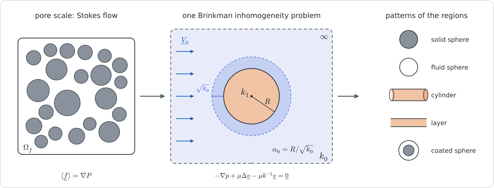

```@meta
EditURL = "../../../../scripts/71_brinkman_permeability.jl"
```

# [Stokes-to-Darcy permeability of porous media](@id app-stokes-darcy)

!!! tip "The whole page as one script"
    Every block of this page, in order, is [`scripts/71_brinkman_permeability.jl`](https://github.com/MicroPoroChemoMechanics/MeanFieldHomogenization.jl/blob/main/scripts/71_brinkman_permeability.jl).
    From a clone of the repository, `julia --project=docs -e 'using Pkg; Pkg.instantiate()'`
    once, then `julia scripts/71_brinkman_permeability.jl`, runs it end to end.

!!! info "Before this page"
    [Permeability from Stokes flow](@ref th-brinkman) for the Brinkman
    inhomogeneity problem and the schemes built on it, and
    [Brinkman inclusions](@ref man-brinkman) for their syntax.

The previous page showed that the shape chosen for the pores governs the
percolation of a self-consistent estimate in elasticity and conduction. The
permeability is more sensitive still to the pore structure, and it cannot be
obtained by Darcy–Darcy homogenization once the pores themselves are resolved:
the fluid in them obeys the Stokes equations, and a pore is not a phase of
finite permeability. [bignonnetIJES2022](@citet) proposed to estimate the
region averages of the Stokes problem from Brinkman inhomogeneity problems, so
that the schemes of conduction apply unchanged. This page follows that method
in two parts.

1. The inhomogeneity problems are solved symbolically, with the curvilinear
   operators of TensND and SymPy, and each solution is held to the `Brinkman*`
   inclusions of the package. Their symbolic consequences follow: the dilute
   and Mori–Tanaka estimates in closed form, the percolation threshold of the
   self-consistent scheme and its dilute expansion, and Stokes' paradox.
2. The schemes are applied to four families of microstructures (beds of
   impervious grains, mats of fibers, solids crossed by tubes or slits, and
   double-porosity media) with the parameters and the normalizations of
   [bignonnetIJES2022](@citet), so that the curves can be set against the
   figures of the paper. The simulation data shown there are not reproduced.



At the scale of the pores (left) the fluid obeys the Stokes equations, and a
body force ``\underline{f}`` of mean ``\nabla P`` keeps the solid at rest. Each region is
represented by a pattern (right) placed in an unbounded porous medium of
permeability ``k_0`` (center) where the flow obeys Brinkman's equation. The
viscous layer around the pattern has the thickness ``\sqrt{k_0}``, so that the
response of the pattern depends on ``\alpha_0 = R/\sqrt{k_0}``.

````@example stokes_darcy_permeability
using MeanFieldHomogenization
using TensND
using SymPyPythonCall
using SpecialFunctions
using ForwardDiff
using LinearAlgebra
using Printf
using Plots
gr()
nothing #hide
````

Three helpers: `iso(x)` is the isotropic tensor ``x\boldsymbol{1}``, `val(t)` reads
the scalar of an isotropic tensor, and `bisect` finds the root of a scalar
equation from a sign change. It serves as an independent reference for the
closed-form estimates.

````@example stokes_darcy_permeability
iso(x) = TensISO{3}(x)
val(t) = first(TensND.get_data(t))
function bisect(f, a, b; n = 200)
    fa = f(a)
    for _ in 1:n
        m = (a + b) / 2
        fm = f(m)
        (fm > 0) == (fa > 0) ? (a = m; fa = fm) : (b = m)
    end
    return (a + b) / 2
end
# Numerical value of a SymPy expression at given values of its symbols.
num(x, vals...) = Float64(N(subs(x, vals...)))
nothing #hide
````

## 1. The Brinkman sphere, solved symbolically

A sphere of radius ``R`` and permeability ``k_1 = \ell_1^2`` lies in a Brinkman
medium of permeability ``k_0 = \ell_0^2``, under the remote velocity
``V\underline{e}_3``. The load fixes the angular dependence, and incompressibility
then fixes the orthoradial velocity from the radial one:

```math
\underline{v} = u(r)\cos\theta\,\underline{e}_r
  - \Big(u + \frac{r u'}{2}\Big)\sin\theta\,\underline{e}_\theta ,
\qquad p = P(r)\cos\theta .
```

Everything below comes from the operators `symgrad` and `divergence` of TensND
in spherical coordinates, along the route of its tutorial
[The elastic sphere, solved symbolically](@extref TensND tut-sphere-problems).

````@example stokes_darcy_permeability
Spherical = coorsys_spherical()
θ, ϕ, r = get_coords(Spherical)
𝐞ᶿ, 𝐞ᵠ, 𝐞ʳ = unitvec(Spherical)
@set_coorsys Spherical
𝟏 = tens_Id2(Val(3), Val(Sym))
μ, ℓ, R = symbols("μ ℓ R", positive = true)
u = SymFunction("u", real = true)
P = SymFunction("P", real = true)

velocity(ue) = ue * cos(θ) * 𝐞ʳ - (ue + r * diff(ue, r) / 2) * sin(θ) * 𝐞ᶿ
𝐯 = velocity(u(r))
simplify(divergence(𝐯))
````

The stress is that of the Newtonian fluid, and Brinkman's drag
``-\mu\ell^{-2}\underline{v}`` acts as a body force. Both components of the momentum
balance lose their angular factor:

````@example stokes_darcy_permeability
𝛔 = -P(r) * cos(θ) * 𝟏 + 2μ * symgrad(𝐯)
balance = divergence(𝛔) - μ / ℓ^2 * 𝐯
eʳ = simplify(balance ⋅ 𝐞ʳ / cos(θ))
eᶿ = simplify(balance ⋅ 𝐞ᶿ / sin(θ))
nothing #hide
````

The orthoradial component gives the pressure, and the radial one becomes a
fourth-order equation for ``u``:

````@example stokes_darcy_permeability
Psol = solve(eᶿ, P(r))[1]
ode = simplify(subs(eʳ, P(r) => Psol).doit() * r)
````

Four independent solutions span it: ``1`` and ``r^{-3}`` are those of Stokes flow,
and the other two grow or decay over the screening length ``\ell``. Their
Wronskian does not vanish:

````@example stokes_darcy_permeability
basis = [Sym(1), r^-3, (ℓ - r) * exp(r / ℓ) / r^3, (ℓ + r) * exp(-r / ℓ) / r^3]
@assert all(iszero(simplify(subs(ode, u(r) => b).doit())) for b in basis)
simplify(det(Sym[diff(b, r, k) for k in 0:3, b in basis]))
````

Inside the sphere the solution must stay finite at the origin. That excludes
``r^{-3}`` and each exponential term alone, while their difference remains
finite:

````@example stokes_darcy_permeability
series(((ℓ - r) * exp(r / ℓ) - (ℓ + r) * exp(-r / ℓ)) / r^3, r, 0, 3)
````

The velocity, its radial derivative and the two traction components
``\underline{e}_r\cdot\boldsymbol{\sigma}\cdot\underline{e}_r`` and
``\underline{e}_\theta\cdot\boldsymbol{\sigma}\cdot\underline{e}_r`` are continuous at ``r = R``:

````@example stokes_darcy_permeability
function radial_fields(ue, Pe)
    t = (-Pe * cos(θ) * 𝟏 + 2μ * symgrad(velocity(ue))) ⋅ 𝐞ʳ
    return (ue, diff(ue, r), simplify((t ⋅ 𝐞ʳ) / cos(θ)), simplify(-(t ⋅ 𝐞ᶿ) / sin(θ)))
end
brinkman_fields(ue, ℓe) = radial_fields(ue, subs(subs(Psol, ℓ => ℓe), u(r) => ue).doit())

ℓ₀, ℓ₁ = symbols("ℓ₀ ℓ₁", positive = true)
a₁, a₃, b₂, b₄ = symbols("a₁ a₃ b₂ b₄")
u_in = a₁ + a₃ * ((ℓ₁ - r) * exp(r / ℓ₁) - (ℓ₁ + r) * exp(-r / ℓ₁)) / r^3
u_out = 1 + b₂ / r^3 + b₄ * (ℓ₀ + r) * exp(-r / ℓ₀) / r^3     ## unit remote velocity
F_in, F_out = brinkman_fields(u_in, ℓ₁), brinkman_fields(u_out, ℓ₀)
sol = solve([subs(F_in[k] - F_out[k], r => R) for k in 1:4], [a₁, a₃, b₂, b₄])
nothing #hide
````

By the divergence theorem the average velocity over the ball is
``|\omega|^{-1}\int_{\partial\omega}\underline{x}\,(\underline{v}\cdot\underline{n})\,dS = u(R)\,\underline{e}_3``.
This gives the velocity concentration of the porous sphere in terms of
``\alpha_i = R/\ell_i``. The package evaluates the same function, written so as to
stay accurate as ``\alpha_1 \to 0``:

````@example stokes_darcy_permeability
α₀, α₁ = symbols("α₀ α₁", positive = true)
A_porous = simplify(subs(subs(subs(u_in, r => R), sol), ℓ₀ => R / α₀, ℓ₁ => R / α₁))
for (a, b) in ((0.4, 2.0), (3.0, 0.7), (12.0, 25.0))
    A_mfh = val(gradient_gradient_concentration(BrinkmanSphere(1.3), iso((b / 1.3)^2), iso((a / 1.3)^2)))
    @printf("α₀ = %5.2f, α₁ = %5.2f :  symbolic %.15f   package %.15f\n", a, b, num(A_porous, α₀ => a, α₁ => b), A_mfh)
end
````

For a sphere much larger than both screening lengths (``\alpha_0 \to \infty`` at
fixed ``t = \alpha_1/\alpha_0 = \sqrt{k_0/k_1}``) the concentration is Darcy's,
``3k_1/(k_1 + 2k_0)``:

````@example stokes_darcy_permeability
t = symbols("t", positive = true)
simplify(limit(subs(A_porous, α₁ => α₀ * t), α₀ => oo))
````

Inside a Stokes sphere the screening terms disappear, and the regular solution
is ``u = a_1 + a_4 r^2``:

````@example stokes_darcy_permeability
Psol_stokes = subs(expand(Psol), ℓ => oo)
a₄ = symbols("a₄")
u_S = a₁ + a₄ * r^2
F_S = radial_fields(u_S, subs(Psol_stokes, u(r) => u_S).doit())
sol_S = solve([subs(F_S[k] - F_out[k], r => R) for k in 1:4], [a₁, a₄, b₂, b₄])
A_stokes = factor(simplify(subs(subs(subs(u_S, r => R), sol_S), ℓ₀ => R / α₀)))
````

For an impervious sphere the velocity vanishes at ``r = R``, and the average drag
density per unit ``\mu V`` is the force on the sphere over its volume,
``(T_r + 2T_\theta)/(\mu R)``. This is the drag computed by
[brinkmanASR1949](@citet):

````@example stokes_darcy_permeability
sol_I = solve([subs(F_out[1], r => R), subs(F_out[2], r => R)], [b₂, b₄])
drag = simplify(subs(factor(simplify(subs(subs((F_out[3] + 2F_out[4]) / (μ * R), r => R), sol_I))), ℓ₀ => R / α₀))
````

## 2. The cylinder and the layer

An infinite cylinder of axis ``\underline{e}_z`` carries two problems. Under an
axial body force ``F`` the velocity is axial, ``w(r)\,\underline{e}_z``, and obeys a
modified Bessel equation:

````@example stokes_darcy_permeability
Cyl = coorsys_cylindrical()
ρc, θc, z = get_coords(Cyl)
𝐞ᴿ, 𝐞ᶿᶜ, 𝐞ᶻ = unitvec(Cyl)
@set_coorsys Cyl
F = symbols("F", positive = true)
w = SymFunction("w", real = true)
σ_axial(we) = -F * z * 𝟏 + 2μ * symgrad(we * 𝐞ᶻ)
axial = simplify((divergence(σ_axial(w(ρc))) - μ / ℓ^2 * w(ρc) * 𝐞ᶻ) ⋅ 𝐞ᶻ)
````

It is solved by ``I_0(r/\ell_1)`` inside and ``K_0(r/\ell_0)`` outside, and the
continuity of the velocity and of the shear stress fixes both constants. The
average over the section, divided by the remote velocity
``V_0 = -F\ell_0^2/\mu``, is the axial concentration ``A_n``:

````@example stokes_darcy_permeability
c₁, c₂ = symbols("c₁ c₂")
w_in = -F * ℓ₁^2 / μ + c₁ * besseli(0, ρc / ℓ₁)
w_out = -F * ℓ₀^2 / μ + c₂ * besselk(0, ρc / ℓ₀)
@assert iszero(simplify(subs(axial, ℓ => ℓ₁, w(ρc) => w_in).doit()))
@assert iszero(simplify(subs(axial, ℓ => ℓ₀, w(ρc) => w_out).doit()))
τ_axial(we) = (σ_axial(we) ⋅ 𝐞ᴿ) ⋅ 𝐞ᶻ
sol_ax = solve([subs(w_in - w_out, ρc => R), subs(τ_axial(w_in) - τ_axial(w_out), ρc => R)], [c₁, c₂])
V₀ = -F * ℓ₀^2 / μ
A_n = simplify(subs(simplify(integrate(subs(w_in, sol_ax) * 2ρc, (ρc, 0, R)) / R^2 / V₀), ℓ₀ => R / α₀, ℓ₁ => R / α₁))
````

Under a transverse remote velocity the field
``u(r)\cos\theta\,\underline{e}_r - (r u)'\sin\theta\,\underline{e}_\theta`` is divergence-free,
and the radial equation has the solutions ``1``, ``r^{-2}``, ``K_1(r/\ell)/r`` and
``I_1(r/\ell)/r``:

````@example stokes_darcy_permeability
ut = SymFunction("u", real = true)
Pt = SymFunction("P", real = true)
velocity_t(ue) = ue * cos(θc) * 𝐞ᴿ - diff(ρc * ue, ρc) * sin(θc) * 𝐞ᶿᶜ
σ_t(ue, Pe) = -Pe * cos(θc) * 𝟏 + 2μ * symgrad(velocity_t(ue))
bal_t = divergence(σ_t(ut(ρc), Pt(ρc))) - μ / ℓ^2 * velocity_t(ut(ρc))
Psol_t = solve(simplify(bal_t ⋅ 𝐞ᶿᶜ / sin(θc)), Pt(ρc))[1]
ode_t = simplify(subs(simplify(bal_t ⋅ 𝐞ᴿ / cos(θc)), Pt(ρc) => Psol_t).doit())
[simplify(subs(ode_t, ut(ρc) => b).doit()) for b in (Sym(1), ρc^-2, besselk(1, ρc / ℓ) / ρc, besseli(1, ρc / ℓ) / ρc)]
````

Continuity at ``r = R`` gives the transverse concentration ``A_t``. Both
components coincide with the package:

````@example stokes_darcy_permeability
function fields_t(ue, ℓe)
    Pe = subs(subs(Psol_t, ℓ => ℓe), ut(ρc) => ue).doit()
    tr_ = σ_t(ue, Pe) ⋅ 𝐞ᴿ
    return (ue, diff(ue, ρc), simplify((tr_ ⋅ 𝐞ᴿ) / cos(θc)), simplify(-(tr_ ⋅ 𝐞ᶿᶜ) / sin(θc)))
end
d₁, d₄, e₂, e₃ = symbols("d₁ d₄ e₂ e₃")
ut_in = d₁ + d₄ * besseli(1, ρc / ℓ₁) / ρc
ut_out = 1 + e₂ / ρc^2 + e₃ * besselk(1, ρc / ℓ₀) / ρc
G_in, G_out = fields_t(ut_in, ℓ₁), fields_t(ut_out, ℓ₀)
sol_t = solve([subs(G_in[k] - G_out[k], ρc => R) for k in 1:4], [d₁, d₄, e₂, e₃])
A_t = simplify(subs(subs(subs(ut_in, ρc => R), sol_t), ℓ₀ => R / α₀, ℓ₁ => R / α₁))
for (a, b) in ((0.5, 3.0), (4.0, 0.3))
    A = canonical_components(gradient_gradient_concentration(BrinkmanCylinder(1.0), iso(b^2), iso(a^2)))
    @printf(
        "α₀ = %.1f, α₁ = %.1f :  Aₙ %.14f / %.14f   Aₜ %.14f / %.14f\n", a, b,
        num(A_n, α₀ => a, α₁ => b), A[3, 3], num(A_t, α₀ => a, α₁ => b), A[1, 1]
    )
end
````

The layer ``|z| < h`` needs no curvilinear system. The flow normal to it is
uniform (``A_n = 1``). Along it, the velocity ``w(z)`` satisfies
``\mu w'' - \mu w/\ell^2 = F`` in each medium and is even in ``z``:

````@example stokes_darcy_permeability
zc = symbols("z", real = true)
h = symbols("h", positive = true)
f₁, f₂ = symbols("f₁ f₂")
wl_in = ℓ₁^2 / ℓ₀^2 + f₁ * cosh(zc / ℓ₁)       ## per unit remote velocity
wl_out = 1 + f₂ * exp(-zc / ℓ₀)
sol_l = solve([subs(wl_in - wl_out, zc => h), subs(diff(wl_in - wl_out, zc), zc => h)], [f₁, f₂])
A_layer = simplify(subs(integrate(subs(wl_in, sol_l), (zc, 0, h)) / h, ℓ₀ => h / α₀, ℓ₁ => h / α₁))
for (a, b) in ((0.5, 3.0), (4.0, 0.3))
    A = canonical_components(gradient_gradient_concentration(BrinkmanLayer(1.0), iso(b^2), iso(a^2)))
    @printf("layer α₀ = %.1f, α₁ = %.1f :  Aₜ %.14f / %.14f\n", a, b, num(A_layer, α₀ => a, α₁ => b), A[1, 1])
end
````

Its limits are the clear-fluid slit, ``1 + \alpha_0 + \alpha_0^2/3``, and Darcy's
``k_1/k_0``:

````@example stokes_darcy_permeability
(simplify(limit(A_layer, α₁ => 0)), simplify(limit(subs(A_layer, α₁ => α₀ * t), α₀ => oo)))
````

## 3. The coated sphere

An impervious core of radius ``R`` in a Stokes shell of outer radius ``R/\eta`` is
the pattern of the cell models, here placed in a Brinkman medium. No slip on the
core and continuity at ``R/\eta`` fix the six constants of Lamb's solution in the
shell and of the outer field, and the averages run over the whole coated sphere:

````@example stokes_darcy_permeability
@set_coorsys Spherical
η = symbols("η", positive = true)
s₁, s₂, s₃, s₄ = symbols("s₁ s₂ s₃ s₄")
u_sh = s₁ + s₂ / r^3 + s₃ / r + s₄ * r^2
F_sh = radial_fields(u_sh, subs(Psol_stokes, u(r) => u_sh).doit())
R_out = R / η
conds = vcat([subs(F_sh[1], r => R), subs(F_sh[2], r => R)], [subs(F_sh[k] - F_out[k], r => R_out) for k in 1:4])
sol_C = solve(conds, [s₁, s₂, s₃, s₄, b₂, b₄])
A_coat = factor(simplify(subs(subs(subs(u_sh, r => R_out), sol_C), ℓ₀ => R / α₀)))
drag_coat = factor(simplify(subs(subs(subs((F_sh[3] + 2F_sh[4]) * R^2 / (μ * R_out^3), r => R), sol_C), ℓ₀ => R / α₀)))
for (a, e) in ((0.5, 1 / 3), (3.0, 2 / 3))
    c = BrinkmanCoatedSphere(1.0, 1 / e)
    @printf(
        "α₀ = %.1f, η = %.3f :  A %.14f / %.14f   ⟨r·A⟩ %.14f / %.14f\n", a, e,
        num(A_coat, α₀ => a, η => e), val(gradient_gradient_concentration(c, iso(0.0), iso(a^2))),
        num(drag_coat, α₀ => a, η => e, R => 1), val(flux_gradient_concentration(c, iso(0.0), iso(a^2)))
    )
end
````

## 4. Symbolic consequences

With the clear fluid as matrix (``\boldsymbol{r}_0 = \boldsymbol{0}``, hence ``\alpha_0 = 0``) and
impervious spheres at volume fraction ``f = 1 - \varphi``, the dilute and
Mori–Tanaka schemes accept symbols and return closed forms:

````@example stokes_darcy_permeability
fs = symbols("f", positive = true)
rve_sym = RVE(T = Sym)
add_phase!(rve_sym, :p, BrinkmanSphere(R, BrinkmanFluid()), Dict(:r => iso(Sym(0))); fraction = :rest)
add_phase!(rve_sym, :s, BrinkmanSphere(R, BrinkmanSolid()), Dict(:r => iso(Sym(0))); fraction = fs)
(dilute = simplify(val(homogenize(rve_sym, Dilute(:p), :r))), mori_tanaka = simplify(val(homogenize(rve_sym, MoriTanaka(:p), :r))))
````

The self-consistent scheme is the condition ``\sum_i \varphi_i \boldsymbol{R}_i = \boldsymbol{0}``
on the resistance contribution tensors
``\boldsymbol{R}_i = \langle\boldsymbol{r}\cdot\boldsymbol{A}\rangle_i - \boldsymbol{r}_0\cdot\boldsymbol{A}_i``,
evaluated in the effective medium. It is built here as a tensor from the
symbolic concentrations of the package, for grains and spherical pores of the
same radius, with ``\alpha = R\sqrt{r}``:

````@example stokes_darcy_permeability
α, φs = symbols("α φ", positive = true)
r_sc = α^2 / R^2
contribution(i, P₁) = flux_gradient_concentration(i, P₁, iso(r_sc)) - iso(r_sc) ⋅ gradient_gradient_concentration(i, P₁, iso(r_sc))
residual = (1 - φs) * contribution(BrinkmanSphere(R, BrinkmanSolid()), iso(Sym(0))) +
    φs * contribution(BrinkmanSphere(R, BrinkmanFluid()), iso(Sym(0)))
sc_equation = factor(simplify(val(residual) * R^2))
````

The resistance diverges (``\alpha \to \infty``) when the porosity falls to the
percolation threshold of spherical pores:

````@example stokes_darcy_permeability
solve(limit(sc_equation / α^2, α => oo), φs)
````

Near the dilute limit, the resistance departs from the dilute one by a term in
``\sqrt{1 - \varphi}`` whose coefficient ``3/\sqrt{2}`` is the one predicted for
sparse random beds of spheres [howellsJFM1974, hinchJFM1977, kimRusselJFM1985](@cite).
With ``\tau = \sqrt{1 - \varphi}`` and ``\alpha = c_1\tau + c_2\tau^2 + \dots``:

````@example stokes_darcy_permeability
τs = symbols("τ", positive = true)
c1, c2 = symbols("c1 c2")
eq_τ = subs(sc_equation, φs => 1 - τs^2, α => c1 * τs + c2 * τs^2)
ser = expand(series(eq_τ / τs^2, τs, 0, 2).removeO())
coef = [cc for cc in solve([ser.coeff(τs, 0), ser.coeff(τs, 1)], [c1, c2]) if N(cc[1]) > 0][1]
series(2 * (coef[1] * τs + coef[2] * τs^2)^2 / (9τs^2), τs, 0, 2)
````

The drag on an impervious cylinder vanishes as the reference tends to a clear
fluid (Stokes' paradox), so that fibers in a fluid matrix have no dilute,
Mori–Tanaka or differential estimate:

````@example stokes_darcy_permeability
limit(α₀ * (2 + α₀ * besselk(0, α₀) / besselk(1, α₀)) / (besselk(0, α₀) / besselk(1, α₀)), α₀ => 0)
````

## 5. Beds of impervious grains

Spheres of radius ``R`` fill a fraction ``1 - \varphi`` of the volume. The pore space
is the matrix of the dilute, Mori–Tanaka and differential schemes. The
self-consistent scheme needs a shape for it as well, chosen with the specific
surface of the grains: spheres of radius ``R``, or cylinders of radius ``2R/3``
[bignonnetIJES2022](@cite). Four classical estimates complete the comparison:
the coated sphere alone in a self-consistent scheme; the effective-medium
approximation, in which the same coated sphere sets
``\boldsymbol{r} = \langle\boldsymbol{r}\cdot\boldsymbol{A}\rangle``; the estimate of
[brinkmanASR1949](@citet), which keeps the grains only; and the cell model of
[happelAIChE1958](@citet), with stress-free tangential conditions, together with
its counterpart under a uniform velocity.

````@example stokes_darcy_permeability
Rg = 1.0
sc = SelfConsistent(algorithm = NewtonDefault(), init = iso(1.0), reltol = 1.0e-12)
k_of(rve, scheme) = 1 / val(homogenize(rve, scheme, :r))
function granular(φ, pore)
    rve = RVE()
    add_phase!(rve, :p, pore, Dict(:r => iso(0.0)); fraction = :rest, symmetrize = :iso)
    add_phase!(rve, :s, BrinkmanSphere(Rg, BrinkmanSolid()), Dict(:r => iso(0.0)); fraction = 1 - φ)
    return rve
end
function coated(φ)
    rve = RVE()
    add_phase!(rve, :c, BrinkmanCoatedSphere(Rg, Rg / cbrt(1 - φ)), Dict(:r => iso(0.0)); fraction = 1.0)
    return rve
end
function k_ema(φ)
    c = BrinkmanCoatedSphere(Rg, Rg / cbrt(1 - φ))
    return 1 / bisect(x -> val(flux_gradient_concentration(c, iso(0.0), iso(x))) - x, 1.0e-8, 1.0e8)
end
k_brinkman1947(φ) = 1 / bisect(x -> (1 - φ) * 3 * (3 + 3Rg * sqrt(x) + Rg^2 * x) / (2Rg^2) - x, 1.0e-8, 1.0e8)
k_cell_uniform(φ) = (η = cbrt(1 - φ); (1 - η)^3 * (4 + 7η + 4η^2) / (18η^3 * (1 + η + η^2 + η^3 + η^4)) * Rg^2)
k_cell_free(φ) = (η = cbrt(1 - φ); (1 - η)^3 * (1 + η) * (2 + η + 2η^2) / (3η^3 * (3 + 2η^5)) * Rg^2)

pore_s, pore_c = BrinkmanSphere(Rg, BrinkmanFluid()), BrinkmanCylinder(2Rg / 3, BrinkmanFluid())
φg = range(0.3, 0.99; length = 36)
granular_k = Dict(
    "dilute" => [k_of(granular(φ, pore_s), Dilute(:p)) for φ in φg],
    "Mori–Tanaka" => [k_of(granular(φ, pore_s), MoriTanaka(:p)) for φ in φg],
    "differential" => [k_of(granular(φ, pore_s), DifferentialScheme(:p)) for φ in φg],
    "SC, spherical pores" => [φ > 1 / 3 + 0.01 ? k_of(granular(φ, pore_s), sc) : NaN for φ in φg],
    "SC, cylindrical pores" => [k_of(granular(φ, pore_c), sc) for φ in φg],
    "SC, coated sphere" => [k_of(coated(φ), sc) for φ in φg],
    "EMA, coated sphere" => k_ema.(φg),
    "Brinkman 1947" => [φ > 1 / 3 + 0.01 ? k_brinkman1947(φ) : NaN for φ in φg],
    "cell, uniform velocity" => k_cell_uniform.(φg),
    "cell, stress-free" => k_cell_free.(φg),
)
nothing #hide
````

The differential scheme of the package coincides with the closed integration of
[wilkinsonPF1985](@citet), and the self-consistent one with the scalar equation
derived above:

````@example stokes_darcy_permeability
for φ in (0.9, 0.6, 0.4)
    αdif = bisect(a -> -1.5log(φ) - log(1 + a + a^2 / 3) + 2sqrt(3) * (atan((2a + 3) / sqrt(3)) - π / 3), 0.0, 1.0e3)
    rdif = val(homogenize(granular(φ, pore_s), DifferentialScheme(:p; reltol = 1.0e-11, abstol = 1.0e-13), :r))
    αsc = bisect(a -> num(sc_equation, α => a, φs => φ, R => Rg), 1.0e-6, 1.0e3)
    rsc = val(homogenize(granular(φ, pore_s), sc, :r))
    @printf("φ = %.2f :  differential %.10g / %.10g    SC %.10g / %.10g\n", φ, rdif, αdif^2, rsc, αsc^2)
end
````

As in the paper, the permeability is scaled on the left by the Mori–Tanaka
estimate ``k_{\mathrm{mt}} = 2R^2\varphi/(9(1 - \varphi))``, and the resistance on the
right by the dilute one, ``r_{\mathrm{dil}} = 9(1 - \varphi)/(2R^2)``. The dashed black
line on the right is the two-term expansion ``1 + (3/\sqrt{2})\sqrt{1 - \varphi}``:

````@example stokes_darcy_permeability
order = [
    "dilute", "Mori–Tanaka", "differential", "SC, spherical pores", "SC, cylindrical pores",
    "SC, coated sphere", "EMA, coated sphere", "Brinkman 1947", "cell, uniform velocity", "cell, stress-free",
]
style(name) = startswith(name, "SC") ? :dash : startswith(name, "cell") ? :dot :
    (startswith(name, "EMA") || startswith(name, "Brinkman")) ? :dashdot : :solid
k_mt(φ) = 2Rg^2 * φ / (9 * (1 - φ))
r_dil(φ) = 9 * (1 - φ) / (2Rg^2)
pl = plot(; xlabel = "porosity φ", ylabel = "k / k_mt", yscale = :log10, legend = :bottomright, legendfontsize = 7)
pr = plot(; xlabel = "porosity φ", ylabel = "r / r_dil", yscale = :log10, legend = false, xlims = (0.5, 1.0), ylims = (1, 1.0e3))
for (j, name) in enumerate(order)
    plot!(pl, φg, granular_k[name] ./ k_mt.(φg); label = name, lw = 2, ls = style(name), color = j)
    plot!(pr, φg, 1 ./ (granular_k[name] .* r_dil.(φg)); lw = 2, ls = style(name), color = j)
end
plot!(pr, φg, 1 .+ 3 / sqrt(2) .* sqrt.(1 .- φg); color = :black, ls = :dash, lw = 1)
plt_granular = plot(
    pl, pr; layout = (1, 2), size = (980, 440), palette = :tab10,
    left_margin = 6Plots.mm, bottom_margin = 6Plots.mm
)
plt_granular
````

The schemes on a clear-fluid reference (dilute, Mori–Tanaka) reproduce the drag
of an isolated grain and nothing of the others, and the differential scheme
lowers the permeability without changing that reference. The self-consistent
estimates screen the flow around each grain over ``\sqrt{k}``: with spherical pores
they reproduce the ``\sqrt{1 - \varphi}`` correction and percolate at
``\varphi_c = 1/3``, whereas cylindrical pores never percolate. The coated sphere,
self-consistent or in the effective-medium approximation, lies close to the
cell models: all three place the porosity as a regular shell around every
grain, and their correction near the dilute limit scales as
``(1 - \varphi)^{1/3}`` instead.

## 6. Mats of fibers

Impervious fibers of radius ``R`` with isotropic orientations make the fibrous
counterpart. Stokes' paradox leaves only the self-consistent scheme, with
cylindrical pores of the fiber radius or spherical pores of radius ``3R/2``
(equal specific surfaces). The package refuses the fluid matrix:

````@example stokes_darcy_permeability
try
    flux_gradient_concentration(BrinkmanCylinder(Rg, BrinkmanSolid()), iso(0.0), iso(0.0))
catch err
    println(first(sprint(showerror, err), 140), "…")
end
````

The cell models, with a coaxial fluid shell of radius ``R/\sqrt{1 - \varphi}``, give
an axial and a transverse permeability, averaged over the orientations as
``(k_n + 2k_t)/3``. Following the paper, the resistance is scaled by
``r_{\mathrm{asympt}} = 6(1 - \varphi)/(-\ln(1 - \varphi)R^2)``:

````@example stokes_darcy_permeability
function fibrous(φ, pore)
    rve = RVE()
    add_phase!(rve, :p, pore, Dict(:r => iso(0.0)); fraction = φ, symmetrize = :iso)
    add_phase!(rve, :s, BrinkmanCylinder(Rg, BrinkmanSolid()), Dict(:r => iso(0.0)); fraction = 1 - φ, symmetrize = :iso)
    return rve
end
function k_cell_fiber(φ, bc)
    η = sqrt(1 - φ)
    kn, kt = bc === :uniform ?
        (-(log(η) + (1 - η^2) / (1 + η^2)) / 2, -(log(η) + (1 - η^2) / (1 + η^2)) / 4) :
        (-(log(η) + (1 - η^2) * (3 - η^2) / 4) / 2, -(log(η) + (1 - η^4) / (2 * (1 + η^4))) / 4)
    return Rg^2 / η^2 * (kn + 2kt) / 3
end
r_asympt(φ) = 6 * (1 - φ) / (-log(1 - φ) * Rg^2)
φf = range(0.3, 0.995; length = 30)
k_sc_cyl = [k_of(fibrous(φ, BrinkmanCylinder(Rg, BrinkmanFluid())), sc) for φ in φf]
k_sc_sph = [φ > 0.37 ? k_of(fibrous(φ, BrinkmanSphere(1.5Rg, BrinkmanFluid())), sc) : NaN for φ in φf]
plt_fibrous = plot(
    φf, 1 ./ ([k_sc_cyl k_sc_sph k_cell_fiber.(φf, :uniform) k_cell_fiber.(φf, :free)] .* r_asympt.(φf));
    label = ["SC, cylindrical pores" "SC, spherical pores" "cell, uniform velocity" "cell, stress-free"],
    ls = [:dash :dash :dot :dot], lw = 2, palette = :tab10, color = [5 4 9 10], yscale = :log10,
    xlabel = "porosity φ", ylabel = "r / r_asympt", legend = :topright, size = (760, 440),
    left_margin = 4Plots.mm, bottom_margin = 4Plots.mm
)
plt_fibrous
````

Spherical pores make the self-consistent estimate percolate near
``\varphi \approx 0.35``, while cylindrical pores keep it connected at every porosity.

## 7. Tubes and slits in an impervious solid

The flow now runs only in tubes of radius ``R``, or in slits of thickness ``2R``,
with isotropic orientations. The matrix is impervious, ``\boldsymbol{k}_0 = \boldsymbol{0}``,
so the phases are described in the permeability form. In an impervious matrix
a tube carries Poiseuille's flow,
``\boldsymbol{k}\cdot\boldsymbol{B} = (R^2/8)\,\underline{n}\otimes\underline{n}``, and a slit
``(R^2/3)\,(\boldsymbol{1} - \underline{n}\otimes\underline{n})``, so that the Mori–Tanaka
estimates are ``R^2\varphi/(24(1 - \varphi))`` and ``2R^2\varphi/(9(1 - \varphi))``:

````@example stokes_darcy_permeability
Pf = PermeabilityForm()
function spanning(φ, pore; Rs = Rg)
    rve = RVE()
    add_phase!(rve, :s, BrinkmanSphere(Rs, BrinkmanSolid(); form = Pf), Dict(:k => iso(0.0)); fraction = :rest)
    add_phase!(rve, :p, pore, Dict(:k => iso(0.0)); fraction = φ, symmetrize = :iso)
    return rve
end
tube = BrinkmanCylinder(Rg, BrinkmanFluid(); form = Pf)
slit = BrinkmanLayer(Rg, BrinkmanFluid(); form = Pf)
kmt_tube(φ) = Rg^2 * φ / (24 * (1 - φ))
kmt_slit(φ) = 2Rg^2 * φ / (9 * (1 - φ))
(
    tubes = val(homogenize(spanning(0.2, tube), MoriTanaka(:s), :k)) / kmt_tube(0.2),
    slits = val(homogenize(spanning(0.2, slit), MoriTanaka(:s), :k)) / kmt_slit(0.2),
)
````

The differential scheme starts from the solid and adds pores. The
self-consistent scheme represents the solid by spheres of the specific surface
of the pores (radius ``3R/2`` for tubes, ``3R`` for slits). Both are scaled by
the Mori–Tanaka estimates, as in the paper:

````@example stokes_darcy_permeability
scK = SelfConsistent(algorithm = NewtonDefault(), init = iso(0.01), reltol = 1.0e-12)
φt = range(0.02, 0.9; length = 30)
plt_spanning = plot(;
    xlabel = "porosity φ", ylabel = "k / k_mt", legend = :topleft, size = (760, 440),
    palette = :tab10, left_margin = 4Plots.mm, bottom_margin = 4Plots.mm
)
for (pore, kmt, name, Rs, c) in ((tube, kmt_tube, "tubes", 1.5Rg, 1), (slit, kmt_slit, "slits", 3Rg, 2))
    plot!(
        plt_spanning, φt, [val(homogenize(spanning(φ, pore), DifferentialScheme(:s), :k)) / kmt(φ) for φ in φt];
        label = "differential, $name", lw = 2, color = c
    )
    plot!(
        plt_spanning, φt, [val(homogenize(spanning(φ, pore; Rs = Rs), scK, :k)) / kmt(φ) for φ in φt];
        label = "SC, $name", lw = 2, ls = :dash, color = c
    )
end
hline!(plt_spanning, [1.0]; label = "Mori–Tanaka", color = :black, lw = 1)
plt_spanning
````

The differential and self-consistent estimates exceed the Mori–Tanaka one, all
the more as the porosity grows: added pores connect through one another rather
than through the solid.

## 8. Double porosity

A microporous matrix of permeability ``k_\mu`` holds mesopores of radius ``R``.
The ratio ``\alpha = R/\sqrt{k_\mu}`` compares the mesopores with the screening
length of the matrix, and as ``\alpha \to \infty`` Darcy–Darcy homogenization is
recovered, where a mesopore is an inclusion of infinite permeability.

The paper treats two-dimensional media, disks in a plane. These are the
transverse sections of parallel cylinders, which the package handles in three
dimensions: the in-plane permeability is the transverse component. The
Mori–Tanaka scheme, whose reference is the isotropic matrix, applies directly.
Maxwell's scheme also needs the Hill tensor of the distribution shape, here an
infinite cylinder (a disk in the plane), which is that of conduction in the
permeability form. Both estimates are checked against their closed forms, at
the values ``\alpha = 7.4, 14.9, 29.7, 59.4`` of the paper:

````@example stokes_darcy_permeability
kμ = 1.0
axis_e1 = (π / 2, 0.0, 0.0)            ## ZYZ angles that put the axis of a Brinkman cylinder on e₁, as `Cylinder`'s
function mesopores_2d(φ, a; maxwell = false)
    Rm = a * sqrt(kμ)
    rve = maxwell ? RVE(; distribution_shape = Cylinder(1.0, 1.0)) : RVE()
    add_phase!(rve, :m, BrinkmanCylinder(Rm; form = Pf, euler_angles = axis_e1), Dict(:k => iso(kμ)); fraction = :rest)
    add_phase!(rve, :p, BrinkmanCylinder(Rm, BrinkmanFluid(); form = Pf, euler_angles = axis_e1), Dict(:k => iso(0.0)); fraction = φ)
    return rve
end
k_inplane(rve, scheme) = canonical_components(homogenize(rve, scheme, :k))[2, 2]
At_stokes(a) = (g = 8 + a^2 + 4a * besselk(0, a) / besselk(1, a); 2g / (g + 8))
mt_closed(φ, a) = kμ * ((1 - φ) + φ * At_stokes(a)) / (1 - φ)
maxwell_closed(φ, a) = kμ / (1 - 1 / (1 / 2 + 1 / (φ * At_stokes(a))))
for a in (7.4, 29.7)
    @printf(
        "α = %4.1f, φ = 0.3 :  MT %.12f / %.12f   Maxwell %.12f / %.12f\n", a,
        k_inplane(mesopores_2d(0.3, a), MoriTanaka(:m)), mt_closed(0.3, a),
        k_inplane(mesopores_2d(0.3, a; maxwell = true), Maxwell()), maxwell_closed(0.3, a)
    )
end
````

Maxwell's distribution carries no size whereas the mesopores do, and the
resulting estimate leaves the admissible range at large mesoporosity: it falls
below ``k_\mu/(1 - \varphi)``, the bound obtained by averaging the resistance
[bignonnetIJES2022](@cite), beyond ``\varphi \approx 0.9`` for ``\alpha = 7.4`` and later for
larger mesopores:

````@example stokes_darcy_permeability
φm = range(0.0, 0.95; length = 39)
plt_meso2d = plot(;
    xlabel = "mesoporosity φ", ylabel = "k / k_μ (in-plane)", yscale = :log10, legend = :topleft,
    yticks = ([1, 2, 5, 10, 20, 50], ["1", "2", "5", "10", "20", "50"]),
    size = (760, 440), palette = :tab10, left_margin = 4Plots.mm, bottom_margin = 4Plots.mm
)
for (j, a) in enumerate((7.4, 14.9, 29.7, 59.4))
    plot!(plt_meso2d, φm, [k_inplane(mesopores_2d(φ, a), MoriTanaka(:m)) for φ in φm]; label = "Mori–Tanaka, α = $a", color = j, lw = 2)
    plot!(plt_meso2d, φm, [k_inplane(mesopores_2d(φ, a; maxwell = true), Maxwell()) for φ in φm]; label = "Maxwell, α = $a", color = j, lw = 2, ls = :dashdot)
end
plot!(plt_meso2d, φm, kμ ./ (1 .- φm); label = "bound k_μ/(1 − φ)", color = :black, ls = :dot, lw = 1.5)
plt_meso2d
````

The differential and self-consistent schemes evolve the reference medium, which
parallel cylinders make transversely isotropic, while the closed forms of the
Brinkman inclusions hold in an isotropic reference only, so the package refuses
them there. They apply to an isotropic arrangement, for instance spherical
mesopores, which is the three-dimensional variant below, at ``\alpha = 7.4``:

````@example stokes_darcy_permeability
function mesopores_3d(φ, a; maxwell = false)
    Rm = a * sqrt(kμ)
    rve = maxwell ? RVE(; distribution_shape = Ellipsoid(1.0)) : RVE()
    add_phase!(rve, :m, BrinkmanSphere(Rm; form = Pf), Dict(:k => iso(kμ)); fraction = :rest)
    add_phase!(rve, :p, BrinkmanSphere(Rm, BrinkmanFluid(); form = Pf), Dict(:k => iso(0.0)); fraction = φ)
    return rve
end
a3 = 7.4
k3(φ, scheme; kw...) = val(homogenize(mesopores_3d(φ, a3; kw...), scheme, :k)) / kμ
sc3 = SelfConsistent(algorithm = NewtonDefault(), init = iso(kμ))
φ3 = range(0.0, 0.7; length = 36)
curves3d = [
[k3(φ, MoriTanaka(:m)) for φ in φ3] [k3(φ, DifferentialScheme(:m)) for φ in φ3] [φ < 0.6 ? k3(φ, sc3) : NaN for φ in φ3] [k3(φ, Maxwell(); maxwell = true) for φ in φ3] 1 ./ (1 .- φ3)
]
plt_meso3d = plot(
    φ3, curves3d;
    label = ["Mori–Tanaka" "differential" "self-consistent" "Maxwell" "bound k_μ/(1 − φ)"],
    ls = [:solid :solid :dash :dashdot :dot], color = [1 3 5 4 :black], lw = 2, yscale = :log10,
    xlabel = "mesoporosity φ", ylabel = "k / k_μ  (spherical mesopores, α = 7.4)", legend = :topleft,
    size = (760, 440), left_margin = 4Plots.mm, bottom_margin = 4Plots.mm
)
plt_meso3d
````

The ordering Mori–Tanaka < differential < self-consistent is that of
Darcy–Darcy homogenization, and the self-consistent estimate diverges where the
mesopores percolate.

## 9. Sensitivities

The inclusions are generic in their number type, so that ForwardDiff
differentiates an estimate through the self-consistent fixed point. At fixed
porosity the permeability scales as ``R^2`` when all sizes scale together,
which gives an exact check; the derivative with respect to the porosity has no
such shortcut.

````@example stokes_darcy_permeability
function k_sc(Rv, φ)
    rve = RVE()
    add_phase!(rve, :p, BrinkmanSphere(Rv, BrinkmanFluid()), Dict(:r => iso(0.0)); fraction = :rest)
    add_phase!(rve, :s, BrinkmanSphere(Rv, BrinkmanSolid()), Dict(:r => iso(0.0)); fraction = 1 - φ)
    return k_of(rve, sc)
end
(dlnk_dlnR = ForwardDiff.derivative(Rv -> log(k_sc(Rv, 0.6)), 1.0), dk_dφ = ForwardDiff.derivative(φ -> k_sc(1.0, φ), 0.6))
````

## Scope

The schemes inherit the assumptions of the Brinkman problem: the same viscosity
in every medium, and no stress jump between a clear fluid and a porous medium.
The available patterns are those with a separable solution (sphere, cylinder,
layer, coated sphere). The percolation threshold of a self-consistent estimate
follows from the shapes chosen for the pores, as on the
[previous page](@ref app-concave-pores), and is not a prediction for a real
material.

## Where to go next

The general concepts end here. The applications that follow are organized by
material, starting with
[Multiscale elasticity of a hydrating cement paste](@ref app-cement-paste); the
transport properties of the paste are estimated by the same schemes in
[Cement paste: chloride diffusivity and elasticity](@ref app-cement-paste-diffusion).

- [Permeability from Stokes flow](@ref th-brinkman) derives the inclusions used
  above.
- [Brinkman inclusions](@ref man-brinkman) gives their syntax.
- [Fractured permeability](@ref fe-permeability) treats Darcy flow through
  flowing cracks, the Darcy–Darcy counterpart.

---

*This page was generated using [Literate.jl](https://github.com/fredrikekre/Literate.jl).*

