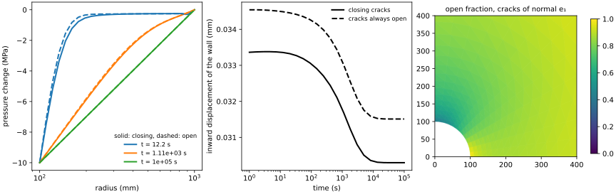

# [FEniCSx backend](@id fe-fenicsx)

!!! info "Before this page"
    [Materials](@ref fe-materials), for what a material computes at a
    quadrature point, and [Ferrite backend](@ref fe-backends), for the pieces
    of the coupling that belong to the package whatever the finite-element code.

[FEniCSx](https://fenicsproject.org) writes a problem in UFL and assembles it
in C++; the Python package `mfh_fenicsx`, in `python/mfh_fenicsx` of the
repository, lets the stress of such a problem be a material of this package:
a law of `MaterialLaws`, a nonlinear composite, a polycrystal. Julia runs
inside the Python process, through
[juliacall](https://github.com/JuliaPy/PythonCall.jl).

!!! tip "In short"
    1. [Install](@ref fe-fenicsx-install) Julia with this package, and Python with dolfinx and `mfh_fenicsx`.
    2. Write the residual of your problem in UFL with `stress.sigma` where the stress goes ([A load step](@ref fe-fenicsx-step)).
    3. Let `Newton` and `quasistatic` run the steps; read the stresses, the reactions and the internal variables.

    Every law of `MaterialLaws` works this way, a homogenized composite or a
    polycrystal as well as J2 plasticity, and so does a poroelastic material in a
    coupled displacement–pressure problem ([A coupled problem](@ref fe-fenicsx-up)).

## How it works

The stress is an *external operator* of
[dolfinx-external-operator](https://github.com/a-latyshev/dolfinx-external-operator)
[latyshevEtAl2025](@cite): a UFL object that stands for ``\boldsymbol{\sigma}(\boldsymbol{\varepsilon}(\underline{u}))``
in the forms, and whose values and derivative are supplied, at every quadrature
point, by a Python function. The residual is written with it as with any stress,

```math
\int_\Omega \boldsymbol{\sigma}(\boldsymbol{\varepsilon}(\underline{u})) : \boldsymbol{\varepsilon}(\underline{v})\,\mathrm{d}\Omega
- \int_{\partial\Omega} \underline{t}\cdot\underline{v}\,\mathrm{d}S = 0 ,
```

and its Jacobian is the derivative of the operator, the consistent tangent
``\mathbb{K} = \partial\boldsymbol{\sigma}/\partial\boldsymbol{\varepsilon}``.

At each Newton iteration the strains of **all** the quadrature points are
evaluated in one array and handed to Julia in **one** call,
[`update_points!`](@ref), which computes every stress and every tangent from
the states of the last converged step, on as many threads as Julia has, and
writes them into arrays that NumPy reads without a copy. The tangent the
Jacobian asks for is the one of that call: no point is integrated twice. The
states stay in Julia, in a [`QuadratureStates`](@ref), and a step is
committed or rolled back as with Ferrite.

| Python (`mfh_fenicsx`) | Julia |
|:--|:--|
| `mf.start()` | starts Julia, loads the package; installs nothing |
| `Material(material, ncells, nqp)` | the material and its [`QuadratureStates`](@ref) |
| `Stress(material, u)` | the external operator ``\boldsymbol{\sigma}(\boldsymbol{\varepsilon}(\underline{u}))`` and its quadrature space |
| `Poroelastic(material, u, p)` | the operators ``\boldsymbol{\sigma}(\boldsymbol{\varepsilon}, p)`` and ``\phi(\boldsymbol{\varepsilon}, p)`` of a coupled problem |
| `Newton(stress, residual, u, bcs)` | Newton's method on one step; MUMPS when PETSc has it |
| `quasistatic(newton, times, prescribe)` | the steps, a failing one halved, as [`quasistatic!`](@ref) |
| `stress.commit()`, `stress.rollback()` | [`commit!`](@ref), [`rollback!`](@ref) |
| `newton.reaction(dofs)` | the force of a Dirichlet condition |
| `stress.material.internal("p")` | the committed values of an internal variable |

## [Installation](@id fe-fenicsx-install)

Two environments meet: a **Julia project** that holds this package and
`PythonCall`, and a **Python environment** that holds dolfinx and `mfh_fenicsx`.
Nothing is downloaded at run time: both are prepared once.

**1. Julia and its project.** Install Julia with
[juliaup](https://github.com/JuliaLang/juliaup), then create a project with the
two packages:

```bash
julia --project=$HOME/mfh-fenicsx-julia -e 'using Pkg; Pkg.add(["MeanFieldHomogenization", "PythonCall"])'
```

**2. Python with dolfinx.** dolfinx comes from conda-forge; the other packages
from PyPI, and `mfh_fenicsx` from the repository of this package:

```bash
conda create -n fenicsx -c conda-forge python=3.12 fenics-dolfinx=0.10 mpich python-gmsh matplotlib-base pip
conda activate fenicsx
pip install dolfinx-external-operator==0.10.2 juliacall==0.9.37
pip install -e path/to/MeanFieldHomogenization.jl/python/mfh_fenicsx
```

**3. The environment of each session.** Tell juliacall which Julia and which
project to use, how many threads Julia has, and leave the other libraries one
thread each:

```bash
export PYTHON_JULIAPKG_EXE=$(which julia)               # the Julia to embed
export PYTHON_JULIAPKG_PROJECT=$HOME/mfh-fenicsx-julia  # the project of step 1
export PYTHON_JULIACALL_THREADS=4                        # Julia's threads
export OPENBLAS_NUM_THREADS=1 OMP_NUM_THREADS=1          # no threads competing with Julia's
```

The direct solver, MUMPS, factorizes with OpenMP threads when it may; their sums
change order from one run to the next, so that two runs differ in the last
digits. One OpenMP thread keeps the runs reproducible and leaves the cores to
Julia.

**4. A check.** This starts Julia, loads the package (a few seconds the first
time, while Julia compiles) and prints Julia's threads:

```bash
python -c "import mfh_fenicsx as mf; jl = mf.start(); print(jl.Threads.nthreads())"
```

## [A load step](@id fe-fenicsx-step)

The code below is the core of every example: a displacement field, the
material at its quadrature points, the residual, and the steps.

```python
import numpy as np
import ufl
from dolfinx import fem, mesh
from mpi4py import MPI

import mfh_fenicsx as mf
from mfh_fenicsx.fem import Newton, Stress, quasistatic, strain

mf.start()
domain = mesh.create_unit_cube(MPI.COMM_WORLD, 4, 4, 4)
V = fem.functionspace(domain, ("Lagrange", 1, (3,)))
u = fem.Function(V)

# The material, written in Julia; any material of the package goes there.
stress = Stress("J2Plasticity(; E = 200.0e3, ν = 0.3, σ₀ = 250.0, H = 2.0e3)", u)
residual = ufl.inner(stress.sigma, strain(ufl.TestFunction(V))) * stress.dx

# Clamped at the bottom, the top pulled along z.
bottom = fem.locate_dofs_geometrical(V, lambda x: np.isclose(x[2], 0.0))
top_facets = mesh.locate_entities_boundary(domain, 2, lambda x: np.isclose(x[2], 1.0))
top = fem.locate_dofs_topological(V.sub(2), 2, top_facets)
pull = fem.Constant(domain, 0.0)
bcs = [fem.dirichletbc(np.zeros(3), bottom, V), fem.dirichletbc(pull, top, V.sub(2))]

# The top is pulled to 4e-3 over ten steps of a "time" t from 0 to 1.
def prescribe(t):
    pull.value = 4.0e-3 * t

newton = Newton(stress, residual, u, bcs)
quasistatic(newton, np.linspace(0.0, 1.0, 11), prescribe)
print(newton.reaction(top))   # the force on the top
```

The units are those of the numbers you give: here MPa for the moduli and a
unit cube, so that the reaction is in MPa times the unit of area.

| code | what it does |
|:--|:--|
| `Stress(material, u)` | builds the quadrature space, the states, and the operator `stress.sigma` |
| `stress.dx` | the measure whose quadrature matches the space of the stress; use it in the forms |
| `Newton(...)` | compiles the forms once; `solve()` runs one step |
| `quasistatic(...)` | a step that fails (Newton, or a point that does not integrate) is rolled back and halved |
| `prescribe(t)` | sets the boundary values at the time `t`; `quasistatic` calls it at each step |
| `newton.reaction(top)` | the force that the condition on `top` exerts, summed over its degrees of freedom |

## [A coupled displacement–pressure problem](@id fe-fenicsx-up)

A poroelastic material ([`BiotPoroelasticity`](@ref),
[`ClosingCrackPoroelasticity`](@ref)) depends on the strain and on the pore
pressure ``p``, and gives the stress and the fluid content ``\phi``. The problem
then has two unknowns, ``\underline{u}`` and ``p``, in a mixed space, and two
balances: of the solid, with ``\boldsymbol\sigma``, and of the fluid, with the
change of ``\phi`` over the step and Darcy's flow,

```math
\int_\Omega \boldsymbol\sigma : \boldsymbol\varepsilon(\underline{v})\,\mathrm{d}\Omega = \text{(loads)},
\qquad
\int_\Omega (\phi - \phi_{\mathrm{old}})\,q\,\mathrm{d}\Omega
+ \Delta t \int_\Omega \frac{k}{\mu}\,\nabla p\cdot\nabla q\,\mathrm{d}\Omega = 0 .
```

```python
import basix.ufl
from mfh_fenicsx.fem import Poroelastic

cell = domain.basix_cell()
W = fem.functionspace(domain, basix.ufl.mixed_element([
    basix.ufl.element("Lagrange", cell, 2, shape=(3,)),   # u, quadratic
    basix.ufl.element("Lagrange", cell, 1),               # p, linear
]))
w = fem.Function(W)
u, p = ufl.split(w)
v, q = ufl.TestFunctions(W)

poro = Poroelastic("BiotPoroelasticity(; E = 10.0e3, ν = 0.25, b = 0.8, M = 5.0e3)", u, p)
dt = fem.Constant(domain, 1.0)
mobility = 1.0e-3                                          # k/μ
residual = (
    ufl.inner(poro.sigma, strain(v)) * poro.dx             # + the loads
    + (poro.phi - poro.phi_old) * q * poro.dx
    + dt * mobility * ufl.dot(ufl.grad(p), ufl.grad(q)) * poro.dx
)
```

`poro.phi_old` is the fluid content at the end of the last committed step: it is
updated by `poro.commit()`. The time step must be the same in the material and in
the residual: set `dt.value` in `prescribe`, from `poro.dt`, which `quasistatic`
sets before calling it. The test of Terzaghi's consolidation and the borehole
example below are complete programs of this kind.

## Conventions

- **Components.** The stress and the strain cross the boundary in
  Kelvin–Mandel components, ordered ``(11, 22, 33, \sqrt2\,23, \sqrt2\,13, \sqrt2\,12)``,
  the package's convention; `mandel_from_tensor`, `tensor_from_mandel` and
  `tensor4_from_mandel` convert from and to full tensors.
- **Points.** The points are ordered cell by cell, as a quadrature space of
  dolfinx orders them; the ghost cells of a process are included.
- **Two dimensions** mean plane strain: the material is integrated in three
  dimensions with ``\varepsilon_{13} = \varepsilon_{23} = \varepsilon_{33} = 0``,
  and the out-of-plane stress ``\sigma_{33}`` is kept in `stress.material.stress[2]`.
  Axisymmetry is not covered yet.
- **Poroelastic materials**, of gradients ``(\boldsymbol\varepsilon, p)`` and fluxes
  ``(\boldsymbol\sigma, \phi)`` ([`BiotPoroelasticity`](@ref),
  [`ClosingCrackPoroelasticity`](@ref)), go to `Poroelastic(material, u, p)`: its
  `sigma` and `phi` are two external operators on the same operands, whose values
  and derivatives come from one Julia call; `phi_old` holds the fluid content of
  the last committed step, for the storage term of the balance of the fluid.
- **Processes.** The tests and the examples run on one MPI process; Julia's
  threads do the parallel work of the materials.

!!! warning "gmsh and Julia's signals"
    Julia stops its threads at safepoints through the signal SIGSEGV.
    `gmsh.initialize()` resets SIGSEGV, SIGBUS, SIGILL, SIGFPE (and SIGINT) to
    their defaults, and the next garbage collection on several threads then
    kills the process without a message. `mfh_fenicsx` saves Julia's handlers
    when it starts and puts them back before every call into Julia and at exit.
    After such a library, call `mfh_fenicsx.restore_signals()` before calling
    Julia yourself.

## Common problems

| what happens | why, and what to do |
|:--|:--|
| `juliacall` downloads Julia or packages, or cannot find the package | `PYTHON_JULIAPKG_EXE` or `PYTHON_JULIAPKG_PROJECT` is not set: see step 3 of the installation |
| the first step takes seconds, the next ones milliseconds | Julia compiles the material on its first call; it is paid once per session |
| `JuliaError: LocalIntegrationError` | a point could not follow the step; `quasistatic` halves the step by itself, `Newton.solve` alone does not |
| `NewtonError` | the step is too large for the material, or the tangent is not consistent; use smaller steps or `quasistatic` |
| the process dies without a message after `gmsh.initialize()` | see the warning on signals above |
| two runs differ in the last digits | set `OMP_NUM_THREADS=1` (step 3) |
| `Stress` refuses the material | it is not purely mechanical: a poroelastic material goes to `Poroelastic` |

## What is checked

The tests of `python/mfh_fenicsx/tests` compare the coupling with references
that do not go through it:

| test | reference | agreement |
|:--|:--|:--|
| a homogeneous strain on a cube, 3-D and plane strain | Hooke's law; Julia's single-point update along a plastic path | to round-off |
| a plastic cube, clamped and pulled, the same hexahedral mesh and quadrature | the package's [Ferrite adapter](@ref fe-backends) | nodal displacements to ``10^{-10}`` of the pull |
| a cube of a Mori–Tanaka composite of tilted spheroids | a dolfinx solve written in UFL with the homogenized stiffness | ``10^{-12}`` |
| the thick cylinder under pressure, plane strain | Lamé's closed form | second-order convergence |
| a heterogeneous plastic problem | the order of convergence of Newton's method | about 2; an elastic tangent does not converge |
| Terzaghi's consolidation of a column, linear Biot law, mixed ``(\underline{u}, p)`` | the Fourier series of the one-dimensional diffusion | a few percent of the undrained pressure, halved with the time step (backward Euler) |

## Examples

Each example is a script of `python/mfh_fenicsx/examples`, which writes its
results and its figure in the directory `--out`;
`examples/run_all.sh` runs them all and copies the figures and the results
(`*.json`) here. The times below were measured on 8 logical CPUs (AMD
EPYC-Milan), Julia on 4 threads unless stated.

### A plate with a hole in a fiber composite

`01_plate_with_hole.py`. A plate with a hole, in plane strain, of an epoxy
reinforced by 30 % of glass spheroids aligned with the load, whose
Mori–Tanaka stiffness the package computes. The material at every point gives
the displacements of a dolfinx solve with the homogenized stiffness written in
UFL, to better than ``10^{-13}``; the stress concentration at the hole rises from
3.04 for the matrix alone to 3.65.


### A notched plate whose microcracks grow

`02_notched_plate_crack_growth.py`. Penny-shaped microcracks of all
orientations grow at Griffith's resistance, which decreases as they grow; the
growth is regularized by a viscosity of time ``\tau``
([`CrackGrowthDamage`](@ref)). With ``\tau = 0.1`` (the loading lasts 1) two
meshes give the same curve; with ``\tau = 0.01`` the cracks grow in a band
along the ligament and the meshes start to part, by about 1 % on the peak. The
law is local: as ``\tau`` decreases the band follows the elements, which no
mesh refinement cures.


### A borehole in a rock whose cracks close

`03_borehole_closing_cracks.py`. A saturated rock holds three families of
microcracks, of normals ``\underline{e}_1``, ``\underline{e}_2``, ``\underline{e}_3``,
which close as the effective stress compresses them across their planes
([`ClosingCrackPoroelasticity`](@ref)). The pressure in a borehole is lowered by
10 MPa and held; the problem is the coupled ``(\underline{u}, p)`` one, in plane
strain. Around the hole the effective stress rises and the cracks whose normal is
tangential to the wall close (down to 42 % open), which stiffens the rock: the
wall moves less than with cracks that stay open. At the end the flow is steady,
and the pressure is that of a radial flow, ``-\Delta p\,\ln(b/r)/\ln(b/a)``, to
``3\times10^{-7}`` MPa. The mobility of the fluid is constant here: this law does
not let the permeability follow the apertures.



### A polycrystalline plate: Kröner and Hill

`04_polycrystal_plate.py`. Every point is an aggregate of eight viscoplastic
crystals of random orientations ([`Polycrystal`](@ref)), whose grains share the
strain as [`KronerModel`](@ref) or [`HillModel`](@ref) says. Hill's aggregate,
constrained by its own flowing tangent, carries less load than Kröner's,
constrained by the elastic aggregate. These materials are costly: on 151
triangles, 109 s with Kröner's model and 440 s with Hill's.


### Creep of a composite beam

`05_composite_beam_creep.py`. A cantilever of a matrix that creeps by
Norton's law, reinforced by 20 % of particles, under a load held for 20 s; the
composite is homogenized at every point by [`QuasiElasticComposite`](@ref)
[brenner2002](@cite). The first deflection of the matrix alone is the elastic
one of beam theory (0.0261 mm against 0.0260 mm); after 20 s the particles have
cut the deflection from 0.232 mm to 0.152 mm.


### Julia's threads

`06_thread_scaling.py`. One load step of a cube of 24,000 points, with Julia
on 1, 2, 4 and 8 threads, each run in its own process. For J2 plasticity the
stress updates are 1 to 5 % of the step, which the assembly and the linear
solves fill. For the composite of two viscoplastic phases they are 96 % of it,
and 4 threads take 29.4 s where one takes 92.5 s (3.2 times faster), 8 threads
26.8 s; every run computes the same solution.


