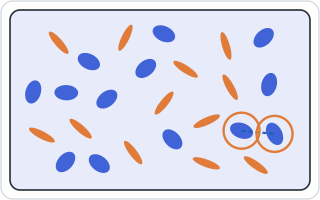

# [Particle assemblies and N-body schemes](@id man-assemblies)

!!! info "Before this page"
    [Two-inclusion interaction tensors](@ref th-interaction),
    [The cluster model](@ref th-cluster),
    [The equivalent inclusion method](@ref th-eim) and
    [The multipole expansion method](@ref th-mem), where the schemes of this
    page are derived, and [Homogenization schemes](@ref man-schemes) for the
    `RVE` an assembly is compared with throughout.

Three schemes of the package resolve the interaction between individual inclusions
instead of averaging it: [`ClusterModel`](@ref), [`EquivalentInclusion`](@ref) and
[`MultipoleExpansion`](@ref). They need to know *where* the inclusions are, so they
act on a [`ParticleAssembly`](@ref) rather than on an `RVE`.



## Building an assembly

```julia
using MeanFieldHomogenization, TensND

C_m = TensISO{3}(3 * 1.0, 2 * 0.4)      # k = 1, μ = 0.4
C_i = TensISO{3}(3 * 10.0, 2 * 6.0)

asm = ParticleAssembly(; boundary = PeriodicBox(1.0; cutoff = 3.0))
add_matrix!(asm, Dict(:C => C_m))
add_particle!(asm, :p1, (0.0, 0.0, 0.0), Ellipsoid(0.25), Dict(:C => C_i))
add_particle!(asm, :p2, (0.5, 0.5, 0.5), Ellipsoid(0.25), Dict(:C => C_i))

homogenize(asm, ClusterModel(), :C)
homogenize(asm, EquivalentInclusion(), :C)
```

!!! note "Why an assembly has a matrix and an RVE does not"
    [`add_matrix!`](@ref) exists here and nowhere else. For an [`RVE`](@ref),
    being a matrix is a *modeling* choice — the same phases are a
    matrix/inclusion composite under Mori–Tanaka and a matrix-free aggregate
    under the self-consistent scheme — so the reference medium is named on the
    scheme (see [Who is the matrix?](@ref man-who-is-the-matrix)). For an
    assembly it is *structural*: both N-body models resolve pairwise
    interactions between particles embedded in one reference medium, and
    without it there is nothing to embed them in.

Volume fractions are **derived**, never stored — `f_a = |Ω_a| / |Ω|` — so the geometry
and the fractions cannot disagree. This is the one place where an assembly differs
from an `RVE` in kind rather than in detail: on an `RVE` the inclusion *size* is
arbitrary (the Hill tensor is size-independent, so `Ellipsoid(1.0)` is idiomatic),
whereas here the size **is** the volume fraction.

## Every other scheme, on the same assembly

An assembly is strictly richer than an `RVE` — it knows *where* each inclusion is —
so forgetting the positions is always well defined. [`RVE(asm)`](@ref) does exactly
that, and it is applied automatically: **every one-site scheme of the package works
directly on an assembly**.

```julia
homogenize(asm, ClusterModel(), :C)          # reads the positions
homogenize(asm, EquivalentInclusion(), :C)   # reads the positions
homogenize(asm, MoriTanaka(), :C)            # ignores them — via RVE(asm)
homogenize(asm, SelfConsistent(), :C)
homogenize(asm, DifferentialScheme(), :C)
homogenize(asm, Voigt(), :C), homogenize(asm, Reuss(), :C)

rve = RVE(asm)                               # …the intermediate cell, to inspect
```

So "what would Mori-Tanaka say about *this* microstructure?" is one call rather than
a second, hand-built cell — and the exact degeneracy of the cluster model becomes a
statement about a single object:

```julia
homogenize(asm, ClusterModel(; cluster_radius = 0.0), :C) ≈ homogenize(asm, MoriTanaka(), :C)
```

The conversion keeps **one phase per particle**, named as the particle was. It does
not need to merge identical ones: every scheme sums over phases linearly, so `N`
identical phases of fraction `f/N` give exactly the same effective property as one
phase of fraction `f` — in Mori-Tanaka, in the self-consistent fixed point and along
a differential path alike.

Two keywords are forwarded through `homogenize` to the conversion:

| keyword | default | who reads it |
| :-- | :-- | :-- |
| `matrix_geometry` | a ball (a disk in 2D) | only the schemes that solve an auxiliary problem for the matrix like any other phase — the self-consistent family. `MoriTanaka`, `Dilute` and the bounds never look at it |
| `distribution_shape` | none | [`PonteCastanedaWillis`](@ref), which needs one; an assembly carries no such statistical descriptor |

!!! warning "The bridge is one-way"
    `RVE(asm)` discards the positions — that is the point — so its result can no
    longer feed [`ClusterModel`](@ref) or [`EquivalentInclusion`](@ref). There is
    deliberately no `ParticleAssembly(rve)`: an `RVE` has no positions to invent,
    which is the clearest statement that the assembly is the richer object rather
    than a variant of it. `Laminated` is refused on both.

!!! note "In 2D, only the N-body schemes and the bounds"
    The bridge inherits the `RVE`'s own capabilities exactly, and outside
    `Voigt` / `Reuss` the one-site family is implemented for **3D properties
    only**. A plane-strain assembly therefore answers `ClusterModel`,
    `EquivalentInclusion`, `Voigt` and `Reuss`; `MoriTanaka` and the rest raise
    the same `MethodError` they would raise on a hand-built 2D `RVE`. This is a
    limitation of the one-site kernels, not of the conversion.

Derived quantities remain available on the assembly itself:

```julia
particle_volume_fraction(asm, :p1)
inclusion_volume_fraction(asm)
matrix_volume_fraction(asm)
assembly_volume(asm)
```

[`validate_assembly`](@ref) checks that a matrix and at least one particle are present,
that the dimensions agree, that the cell is not overfilled, and that **no two particles
overlap** — the interaction kernel is undefined for overlapping regions, so this must
fail early rather than as a `DomainError` deep inside a lattice sum.

## Boundary treatments

The two schemes solve the same linear system and differ in how the far field is closed.
That difference lives in the boundary, not in the scheme.

| | measure of `Ω` | far-field term | source |
| :-- | :-- | :-- | :-- |
| [`PeriodicBox`](@ref)`(L; cutoff = R_c)` | `Lᵈ` | Hill tensor of the inclusion shape | [molinari1996](@cite) |
| [`MixedBC`](@ref)`(shape)` | volume of `shape` | Hill tensor of the SVE, ``\mathbb P_\Omega`` | [brisard2014](@cite) |

`PeriodicBox` tiles space and truncates the image sums to a **sphere** of radius `R_c`
around the receiver; the default `3L` sits inside the convergence plateau reported in
the paper, and `cutoff = 0` reduces every cluster to its own receiver. `MixedBC` needs
an *ellipsoidal* SVE (the derivation uses Eshelby's theorem on the domain itself) and
needs no periodization at all.

Each scheme keeps its own default, but either boundary works with either scheme — which
is what makes the cross-check below possible.

## Generators

```julia
# Cubic arrays. All sites of a Bravais lattice are
# equivalent, so the system collapses to one unknown.
asm = cubic_lattice(:sc, Dict(:C => C_m), Dict(:C => C_i); fraction = 0.3)
asm = cubic_lattice(:fcc, Dict(:C => C_m), Dict(:C => C_i); fraction = 0.4, cutoff = 4.0)
max_packing_fraction(:bcc)              # 0.6802 — where spheres touch

# A two-material motif: their BCC array of alternating voids and rigid spheres.
cubic_lattice(:bcc, Dict(:C => C_m), [Dict(:C => C_i), Dict(:C => C_void)]; fraction = 0.2)

# Hard-particle Metropolis microstructures, in a periodic box …
using Random
asm = random_assembly(32, Dict(:C => C_m), Dict(:C => C_i);
                      fraction = 0.3, rng = MersenneTwister(1), cycles = 20_000)

# … or inside an ellipsoidal SVE, which is the geometry of their Table 1.
asm = random_assembly(160, Dict(:C => C_m), Dict(:C => C_void);
                      radius = 1.0, dim = 2, rng = MersenneTwister(1),
                      boundary = MixedBC(Ellipsoid(20.0, 20.0)))
```

Both generators are deterministic given their inputs; always pass an explicit `rng`.

## Families

Particles sharing a **family** label are constrained to carry the same unknown. This is
how a periodic motif with symmetric particles is described without duplicating
equations, and it is what makes a lattice estimate cheap: `cubic_lattice` assigns one
family per distinct material, so a single-material SC, BCC or FCC array has exactly one
unknown whatever the number of sites.

```julia
add_particle!(asm, :a1, (0.0, 0.0, 0.0), Ellipsoid(0.1), Dict(:C => C_i); family = 1)
add_particle!(asm, :a2, (0.5, 0.0, 0.0), Ellipsoid(0.1), Dict(:C => C_i); family = 1)
family_labels(asm)          # [1]
```

## Conduction

Both kernels are written once and dispatch on the tensor order of the property, so
transport needs nothing new:

```julia
asm = cubic_lattice(:sc, Dict(:K => TensISO{3}(1.0)), Dict(:K => TensISO{3}(20.0));
                    fraction = 0.25)
homogenize(asm, ClusterModel(), :K)
```

## Multipole expansion

[`MultipoleExpansion`](@ref) expands the field around every sphere in solid
harmonics up to the degree `nmax` ([theory](@ref th-mem)). The first two schemes
keep one uniform polarization per inclusion; this one tends to the exact field
of the assembly as `nmax` grows, at the price of ``N\,n_{\max}(n_{\max}+2)``
unknowns for ``N`` spheres in conduction, three times as many in elasticity
([theory](@ref th-mem-elasticity)). The matrix is isotropic.

```@example mem_manual
using MeanFieldHomogenization, TensND, LinearAlgebra

matrix, spheres = Dict(:K => TensISO{3}(1.0)), Dict(:K => TensISO{3}(100.0))
asm = cubic_lattice(:fcc, matrix, spheres; fraction = 0.4)
k(scheme) = canonical_components(homogenize(asm, scheme, :K))[1, 1]
(mori_tanaka = k(MoriTanaka()), dipoles = k(MultipoleExpansion(; nmax = 1)),
    converged = k(MultipoleExpansion(; nmax = 9)))
```

The boundary of the assembly decides how the far field is closed:

| boundary | what the scheme computes |
| :-- | :-- |
| [`PeriodicBox`](@ref) | the conductivity or the stiffness of the periodic medium, the images being summed by Ewald's method; the `cutoff` of the box is not used |
| [`MixedBC`](@ref)`(shape)` | the finite assembly in the infinite matrix, replaced by the homogeneous inclusion of the same `shape` sending the same far field ([Maxwell](@ref th-scheme-maxwell)) |

The application [Arrays and clusters of spheres by the multipole expansion](@ref app-mem-spheres)
compares the scheme with published tables. The degree to ask for is found by raising it until the estimate settles. It grows
as the spheres come closer: a few units for a dilute assembly, more than twenty for
spheres nearly in contact with a high contrast.

### Spheres with layers and interfaces

A particle is a ball, an `Ellipsoid` of equal semi-axes with an isotropic
property, or a [`LayeredSphere`](@ref MeanFieldHomogenization.LayeredSpheres.LayeredSphere).
As in an `RVE`, a layered sphere carries its constituents in the geometry, and
the dictionary of properties is left empty. It brings its interface models with
it: here a resistance of Kapitza at the surface of each sphere of a simple cubic
array.

```@example mem_manual
function array(interface)
    asm = ParticleAssembly(; boundary = PeriodicBox(1.0))
    add_matrix!(asm, matrix)
    sphere = LayeredSphere((0.45,), (TensISO{3}(100.0),); interfaces = (interface,))
    add_particle!(asm, :p, (0.0, 0.0, 0.0), sphere, Dict{Symbol, Any}())
    return canonical_components(homogenize(asm, MultipoleExpansion(; nmax = 9), :K))[1, 1]
end
(perfect = array(PerfectInterface{Float64}()), resisting = array(KapitzaInterface(0.5)))
```

The resistance is high enough here for the spheres, a hundred times more
conducting than the matrix, to lower the conductivity of the array.

### Elasticity

The same scheme gives the stiffness of a finite or of a periodic assembly; it
needs `nmax ≥ 2`, the degree of the dipoles of elasticity. A layered sphere
brings its spring and membrane interfaces:

```@example mem_manual
C(μ, ν) = TensISO{3}(2μ * (1 + ν) / (1 - 2ν), 2μ)        # (3k, 2μ)
function pair(interface)
    asm = ParticleAssembly(; boundary = MixedBC(2.0))
    add_matrix!(asm, Dict(:C => C(1.0, 0.3)))
    sphere = LayeredSphere((0.6,), (C(50.0, 0.2),); interfaces = (interface,))
    add_particle!(asm, :a, (0.0, 0.0, 0.7), sphere, Dict{Symbol, Any}())
    add_particle!(asm, :b, (0.0, 0.0, -0.7), sphere, Dict{Symbol, Any}())
    M = mandel(homogenize(asm, MultipoleExpansion(; nmax = 4), :C), CanonicalBasis{3, Float64}())
    return (C1111 = M[1, 1], C3333 = M[3, 3])
end
(perfect = pair(PerfectInterface{Float64}()), spring = pair(SpringInterface(; sn = 0.5, st = 0.5)))
```

The pair is aligned with ``\underline{e}_3``, and the stiffness along it differs
from the transverse one: an effect of the arrangement.

A periodic array has the cubic symmetry of its lattice, with three independent
moduli where an isotropic estimate has two:

```@example mem_manual
asm_el = cubic_lattice(:bcc, Dict(:C => C(1.0, 0.3)), Dict(:C => C(10.0, 0.3)); fraction = 0.4)
M = mandel(homogenize(asm_el, MultipoleExpansion(; nmax = 6), :C), CanonicalBasis{3, Float64}())
(C1122 = M[1, 2], C1111 = M[1, 1], C1212 = M[6, 6] / 2)
```

Spheroids of axis ``\underline{e}_3``, bonded perfectly or by springs, or empty,
are taken in elasticity as well ([theory](@ref th-mem-spheroids-elasticity)):

```@example mem_manual
flat = ParticleAssembly(; boundary = PeriodicBox((2.5, 2.5, 1.0)))
add_matrix!(flat, Dict(:C => C(1.0, 0.3)))
add_particle!(flat, :p, (0.0, 0.0, 0.0), Ellipsoid(1.0, 1.0, 0.25), Dict(:C => C(10.0, 0.3)))
M = mandel(homogenize(flat, MultipoleExpansion(; nmax = 4), :C), CanonicalBasis{3, Float64}())
(C1111 = M[1, 1], C3333 = M[3, 3])
```

Ellipsoids of three different semi-axes, aligned alike, follow
([theory](@ref th-mem-ellipsoids-elasticity)); an [`InterfacedEllipsoid`](@ref)
bonds one by springs:

```@example mem_manual
springs = ParticleAssembly(; boundary = MixedBC(Ellipsoid(2.0, 1.4, 0.7)))
add_matrix!(springs, Dict(:C => C(1.0, 0.3)))
add_particle!(springs, :p, (0.0, 0.0, 0.0), InterfacedEllipsoid(1.5, 1.0, 0.5, SpringInterface(5.0, 5.0)), Dict(:C => C(100.0, 0.2)))
M = mandel(homogenize(springs, MultipoleExpansion(; nmax = 4), :C), CanonicalBasis{3, Float64}())
(C1111 = M[1, 1], C2222 = M[2, 2], C3333 = M[3, 3])
```

### Spheroids

In conduction the particles may be spheroids of revolution axis
``\underline{e}_3``, all spheroids or all spheres: an [`Ellipsoid`](@ref) with
two equal semi-axes along ``\underline{e}_1`` and ``\underline{e}_2``, or a
[`LayeredSpheroid`](@ref) with its layers and interfaces
([theory](@ref th-mem-spheroids)). A [`PeriodicBox`](@ref) may have three
different periods, so that a lattice can follow the aspect ratio of its
particles:

```@example mem_manual
oblate = ParticleAssembly(; boundary = PeriodicBox((1.0, 1.0, 1 / 3)))
add_matrix!(oblate, Dict(:K => TensISO{3}(1.0)))
add_particle!(oblate, :p, (0.0, 0.0, 0.0), Ellipsoid(0.4, 0.4, 0.4 / 3), Dict(:K => TensISO{3}(100.0)))
K = canonical_components(homogenize(oblate, MultipoleExpansion(; nmax = 5), :K))
K[1, 1], K[3, 3]
```

### Ellipsoids

Ellipsoids of three different semi-axes are taken in conduction too, all
aligned alike with the axes of the assembly ([theory](@ref th-mem-ellipsoids)).
An imperfect interface on an ellipsoid is carried by an
[`InterfacedEllipsoid`](@ref), which only this scheme takes:

```@example mem_manual
ellipsoids = ParticleAssembly(; boundary = MixedBC(Ellipsoid(2.0, 1.4, 0.7)))
add_matrix!(ellipsoids, Dict(:K => TensISO{3}(1.0)))
add_particle!(ellipsoids, :p, (0.0, 0.0, 0.0), InterfacedEllipsoid(1.5, 1.0, 0.5, KapitzaInterface(0.2)), Dict(:K => TensISO{3}(100.0)))
diag(canonical_components(homogenize(ellipsoids, MultipoleExpansion(; nmax = 3), :K)))
```

### Anisotropic constituents

In conduction the matrix may be orthotropic in the axes of the assembly and
the particles of any anisotropic conductivity, perfectly bonded, the
ellipsoids aligned with those axes ([theory](@ref th-mem-anisotropic)); a
sphere in a transversely isotropic matrix is such a case:

```@example mem_manual
aniso = ParticleAssembly(; boundary = PeriodicBox(2.5))
add_matrix!(aniso, Dict(:K => TensTI{2}(1.0, 0.5, (0.0, 0.0, 1.0))))
add_particle!(aniso, :p, (0.0, 0.0, 0.0), Ellipsoid(1.0), Dict(:K => TensISO{3}(10.0)))
diag(canonical_components(homogenize(aniso, MultipoleExpansion(; nmax = 4), :K)))
```

### Fields of the particles

The fields of this section are available in conduction, for spheres.

[`concentration_tensors`](@ref) gives the mean gradient and the mean flux of
every particle per unit macroscopic gradient, the matrix taking the rest of the
two averages, and [`multipole_coefficients`](@ref) the coefficients of the
series themselves, from which the field is rebuilt at any point of the matrix:

```@example mem_manual
ct = concentration_tensors(asm, MultipoleExpansion(; nmax = 5), :K)
canonical_components(ct.strain[:p1])[1, 1], canonical_components(ct.strain[:matrix])[1, 1]
```

```@example mem_manual
c = multipole_coefficients(asm; scheme = MultipoleExpansion(; nmax = 5))
c[:p1, 1, 0]        # the dipole along e₃, under the three unit gradients
```

## Interaction back-ends

`interaction_tensor` selects a back-end automatically; pass `method` to override, and
the option reaches the schemes too:

```julia
homogenize(asm, ClusterModel(; method = :multipole, order = 2), :C)
```

| `method` | applies to | notes |
| :-- | :-- | :-- |
| `:analytical` | ball and disk pairs, **isotropic reference** | closed form, **exact at any separation** |
| `:multipole` | any ellipsoid pair | truncated expansion, default off the isotropic ball case |
| `:quadrature` | anything | product rule on the definition; the reference solution for validation, far too slow to assemble a system |

The reference medium may be anisotropic: 3D elasticity goes through the Barnett line
integral ([`green_operator_aniso`](@ref)), conduction through a closed form in 2D and
3D. Two consequences to keep in mind there — the *analytical* kernel no longer applies
even to a ball pair (its exactness came from the isotropic Green function being
biharmonic), and the isotropic part of `𝕋` no longer vanishes, so "a cubic array keeps
the Mori-Tanaka bulk modulus" is an isotropic-matrix statement. The one remaining gap
is **plane-strain elasticity with an anisotropic reference**, which needs the Stroh
formalism and raises an `ArgumentError` naming the limitation.

!!! warning "Two sign conventions exist"
    ``\mathbb{T}^{aa} = +\mathbb{P}``, i.e. the self term **is** the Hill tensor
    [brisard2023](@cite), which is the convention this package follows.
    [molinari1996](@citet) and [berveiller1987](@citet) use the
    opposite sign, so any formula transcribed from them must be flipped. See
    [interaction tensors](@ref th-interaction).

## Local fields and bounds

```julia
τ, names = eim_polarizations(asm)        # per-particle polarization operators
A, reps  = cluster_concentrations(asm)    # per-family concentration tensors
eim_bound_type(asm)                      # :upper, :lower or :none
```

[`eim_bound_type`](@ref) reports whether the equivalent-inclusion estimate is a rigorous
bound: `:upper` when the matrix is stiffer than every inhomogeneity, `:lower` when it is
softer, `:none` for mixed contrasts.

## Cross-checking the two schemes

On a periodic assembly with the same cutoff the two are the *same* linear system and
agree to machine precision — the identity stated in [brisard2014](@citet):

```julia
asm = cubic_lattice(:sc, Dict(:C => C_m), Dict(:C => C_i); fraction = 0.25, cutoff = 3.0)
homogenize(asm, ClusterModel(), :C) ≈ homogenize(asm, EquivalentInclusion(), :C)   # true
```

Useful degeneracies to keep in mind when reading results:

* `cluster_radius = 0` ⟹ exactly [`MoriTanaka`](@ref);
* one spherical particle in a spherical `MixedBC` SVE ⟹ exactly `MoriTanaka`;
* a cubic array keeps the Mori-Tanaka **bulk** modulus exactly, at every fraction —
  only the shear response sees the arrangement.

## Sensitivities

An assembly answers the usual differentiation entry points, with two lenses no other
cell has:

```julia
derivative(asm, ClusterModel(), center_param(:p2, 1); indexer = C -> canonical_components(C)[1, 2, 1, 2])
derivative(asm, ClusterModel(), radius_param(:p1);    indexer = C -> canonical_components(C)[1, 2, 1, 2])
```

`PropertyParameter` works through the generic cell interface, so moduli need nothing
special. A `RadiusParameter` on a sphere sets every semi-axis together, so the geometry
stays spherical — and keeps its closed-form kernel — along the whole derivative.

## Multiscale

An assembly is an ordinary cell, so it plugs into the declarative multiscale seam from
both sides. The mechanism itself — `Homogenized(cell, scheme)` as a property, lazy
resolution, memoization, `nested` lenses — is described once in
[Multiscale homogenization](@ref man-multiscale); what follows is only what is specific
to an assembly.

```julia
# An assembly as the INNER cell: a composite whose matrix is itself particulate.
inner = cubic_lattice(:sc, Dict(:C => C_m), Dict(:C => C_i); fraction = 0.3)
outer = RVE()
add_phase!(outer, :M, Ellipsoid(1.0), Dict(:C => Homogenized(inner, ClusterModel())); fraction = :rest)
add_phase!(outer, :F, Ellipsoid(1.0), Dict(:C => C_f); fraction = 0.2)
homogenize(outer, MoriTanaka(), :C)

# An assembly as the OUTER cell: a particle that is a composite in its own right.
asm = ParticleAssembly(; boundary = PeriodicBox(1.0))
add_matrix!(asm, Dict(:C => C_m))
add_particle!(asm, :p1, (0.0, 0.0, 0.0), Ellipsoid(0.3),
              Dict(:C => Homogenized(sub_rve, MoriTanaka())))
homogenize(asm, ClusterModel(), :C)
```

Both give exactly the two-step result computed by hand.

!!! note "Chaining N-body schemes needs the anisotropic Green operator"
    A cluster or equivalent-inclusion estimate on a cubic array is **cubic, not
    isotropic**: its two shear constants differ. Using one as the reference medium of
    another scale therefore requires the interaction tensor in an anisotropic reference
    — which is exactly what [`green_operator_aniso`](@ref) provides. This is why the
    Barnett line integral is not an optional extra but the enabler of multiscale
    chaining. `scripts/92` walks through a three-level example.

    The isotropic approach stays the default and costs microseconds; the anisotropic one
    is a differentiated quadrature and costs milliseconds. Tune it with `green_nodes`
    (default 32) if a strongly anisotropic reference needs more.

### Which lenses an assembly answers

A `nested` lens addresses a scalar inside the inner cell exactly as it does for an
`RVE`:

```julia
lens = nested(:M, :C, property(:matrix, :C, :μ))     # an inner-scale modulus
derivative(outer, MoriTanaka(), lens; indexer = C -> canonical_components(C)[1, 2, 1, 2])
```

What is assembly-specific is the innermost lens. An assembly answers `radius_param`,
`center_param` and `property`, and has **no** `amount`: volume fractions are derived
from the geometry and the cell size, so there is nothing to vary independently, and
asking for one raises a message that names the lens to use instead. It has no
`distribution_shape` either, for the same reason — positions are explicit.

## Nano-interfaces: the equivalent particle

[dormieux2016](@citet) is a different kind of result:
it needs no new scheme. A spheroidal nanoinclusion together with its Gurtin-Murdoch
interface behaves as a single particle of stiffness
``\mathbb C^{\mathrm{eq}} = \mathbb C_I + \mathbb C^{\mathrm{int}}``, after which the classical
concentration rule applies unchanged:

```julia
κs, μs = 64.0, 51.3                      # surface moduli, stiffness × length
sph = Ellipsoid(0.01)                    # 10 nm particles
C_eq = equivalent_particle(C_i, sph, κs, μs)

rve = RVE()
add_phase!(rve, :M, Ellipsoid(1.0), Dict(:C => C_m); fraction = :rest)
add_phase!(rve, :nano, sph, Dict(:C => C_eq); fraction = 0.15)
homogenize(rve, MoriTanaka(), :C)        # the paper's extended Mori-Tanaka
```

[`surface_stiffness`](@ref) returns ``\mathbb C^{\mathrm{int}}`` for any spheroid, transversely
isotropic about the symmetry axis, with the platelet (``\omega \to 0``) and nanofiber
(``\omega \to \infty``) limits of the paper reproduced exactly, ``\omega = c/a`` being
the aspect ratio. Since it scales as
`1/size`, the stiffening it produces is a genuine size effect and vanishes for large
particles.

## Where to go next

[Multiscale models](@ref man-multiscale) describes, for every cell type, the
declarative seam used in the multiscale section above. The tutorial
[Chaining scales through an N-body scheme](@ref tut-multiscale-assemblies)
builds such a chain on an assembly, and the applications
[The cluster model on cubic arrays](@ref app-cluster-model) and
[The equivalent inclusion method, against a published table](@ref app-eim-assembly)
reproduce published numbers with the two schemes.

* [API — Interactions](@ref api-interactions) and
  [API — Particle assemblies](@ref api-assemblies) — the docstrings
