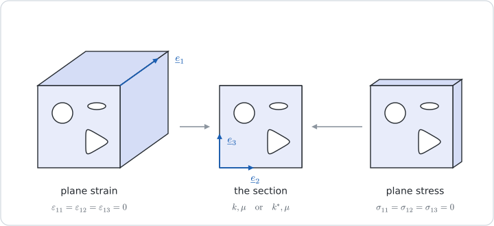

# [Plane problems](@id man-plane-problems)

!!! info "Before this page"
    [Cells and schemes](@ref man-schemes), for the cell and the schemes used
    here, [Cylindrical inclusions](@ref man-cylindrical-inclusions), whose
    sections are the inclusions of the plane, and the theory page
    [Problems of the plane](@ref th-plane-problems). The tensors of the plane
    are those of TensND: [Two dimensions, and any dimension](@extref TensND man-dimensions).

A medium invariant along an axis is studied in the plane normal to it: a
fiber composite across its fibers, a rock with parallel channels, a perforated
sheet. This page shows how such a two-dimensional medium is homogenized, in
plane strain or in plane stress. The cell holds inclusions of the plane and
tensors of the plane, isotropic, square, orthotropic or of no symmetry, and
[`homogenize`](@ref) is called as in three dimensions: the schemes are the
same, on smaller tensors.

## What a cell of space and a cell of the plane accept

The rows are the inclusions and the schemes; the columns, the cell of space
and the cell of the plane, whose matrix is isotropic in the plane or not.

| | space | plane, isotropic matrix | plane, anisotropic matrix |
| :--- | :--- | :--- | :--- |
| ellipsoid, spheroid, sphere; in the plane ellipse, disk ([`Ellipsoid`](@ref)) | yes | yes | yes |
| cylinder ([`Cylinder`](@ref)) | yes | through its section, an ellipse | through its section, an ellipse |
| crack: penny, elliptic, ribbon; in the plane the segment `RibbonCrack(b; angle)` | yes | yes, closed form | yes, computed numerically |
| springs between the faces of a crack (`K_interface`) | yes | yes | yes |
| layered sphere, spheroid, ellipsoid | yes | no | no |
| layered cylinder ([`LayeredCylinder`](@ref)), with its interfaces | yes | yes, layers isotropic in the plane | no |
| hole given by a conformal map ([`ConformalHole`](@ref)) | yes, matrix isotropic in the plane of the section | yes | the ellipse; not a map of several terms |
| torus, grid of Gaussians, mesh, network | yes | no | no |
| Voigt, Reuss, dilute, Mori–Tanaka, self-consistent, differential | yes | yes | yes |
| laminate | yes | no | no |
| interaction tensors ([`interaction_tensor`](@ref)) | yes | yes | yes |
| conduction | yes | ellipses, segments, rings, holes | ellipses, segments |
| aging viscoelasticity | yes | disks, ellipses, segments, rings | no |

Maxwell's scheme, that of Ponte Castañeda and Willis, the asymmetric
self-consistent scheme and the particle assemblies take a cell of the plane
with an isotropic matrix as well. Why holes of several terms, rings and aging
viscoelasticity ask for a matrix isotropic in the plane is said in
[What is restricted, and why](@ref man-plane-restricted).

```@example manplane
using MeanFieldHomogenization
using TensND
using Printf
nothing # hide
```

## Two states, one problem of the plane



The axis is ``\underline{e}_1`` and the plane is that of
``(\underline{e}_2,\underline{e}_3)``, with Greek indices; in a cell of the
plane these two vectors are the first and the second of its basis. In this
section the materials are isotropic in the plane: isotropic, or transversely
isotropic about the axis. Two states are met in practice.

- **Plane strain**, ``\varepsilon_{11}=\varepsilon_{12}=\varepsilon_{13}=0``:
  a body that is long along the axis. The law of the plane is

  ```math
  \sigma_{\alpha\beta}=(k-\mu)\,\varepsilon_{\gamma\gamma}\,\delta_{\alpha\beta}+2\mu\,\varepsilon_{\alpha\beta},
  \qquad k=\frac{C_{2222}+C_{2233}}{2},\quad\mu=\frac{C_{2222}-C_{2233}}{2} ,
  ```

  with ``k`` the plane-strain bulk modulus and ``\mu`` the shear modulus of
  the plane.
- **Plane stress**, ``\sigma_{11}=\sigma_{12}=\sigma_{13}=0``: a thin plate
  loaded in its plane, for the mean fields through its thickness
  ([muskhelishvili1977](@cite), section 26). The axial strain follows from
  ``\sigma_{11}=0``, and the same law holds with ``k`` replaced by

  ```math
  k^*=k-\frac{C_{1122}^2}{C_{1111}} .
  ```

For an isotropic material of Young modulus ``E`` and Poisson ratio ``\nu``,
``\mu=E/(2(1+\nu))`` in both states, ``k=\mu/(1-2\nu)`` and
``k^*=E/(2(1-\nu))``. The two states are thus one problem of the plane, with
two moduli, and the stiffness of the plane is the isotropic tensor
``2k\,\mathbb{J}+2\mu\,\mathbb{K}`` of dimension 2, a `TensISO{4,2}`. TensND
builds it from the three-dimensional stiffness:

```@example manplane
C = iso_stiffness_young_poisson(70.0, 0.25)                  # E and ν
bulk_shear(plane_strain_stiffness(C)), bulk_shear(plane_stress_stiffness(C))
```

A transversely isotropic material is isotropic in the plane normal to its
axis:

```@example manplane
Cₜ = ti_from_constants(30.0, 60.0, 0.25, 0.2, 9.0, (1.0, 0.0, 0.0); form = :engineering, role = :stiffness)
bulk_shear(plane_stress_stiffness(Cₜ))                       # E₁/(2(1 - ν₁₂)) and E₁/(2(1 + ν₁₂))
```

The same stiffness is built from its two moduli of the plane by
`iso_stiffness(Val(2), k, μ)`, never as `TensISO{2}(3k, 2μ)`: the first
coefficient of a stiffness of the plane is ``2k``.

```@example manplane
iso_stiffness(Val(2), bulk_shear(plane_strain_stiffness(C))...) ≈ plane_strain_stiffness(C)
```

With symbols the two moduli come out in closed form:

```@example manplane
import Symbolics
Symbolics.@variables E ν
Symbolics.simplify.(bulk_shear(plane_stress_stiffness(iso_stiffness_young_poisson(E, ν))))
```

The moduli of a tensor of the plane are read back with the same functions.
`young_poisson` returns the constants of the three-dimensional material that
has this stiffness in plane strain; `plane_strain_to_plane_stress` converts
them into those of the plate that has it in plane stress, which are also the
moduli of the tensor read as a material of the plane,
`convention = :intrinsic`:

```@example manplane
c = plane_stress_stiffness(C)
young_poisson(c), plane_strain_to_plane_stress(young_poisson(c)...), young_poisson(c; convention = :intrinsic)
```

!!! warning "Which Young's modulus and Poisson's ratio"
    A `TensISO{4,2}` is read by default as the plane-strain stiffness of a
    material of space (`convention = :plane_strain`): its ``E`` and ``\nu``
    are those of that material. With `convention = :intrinsic` they are the
    moduli ``E_2`` and ``\nu_2`` of a uniaxial stress in the plane, those of
    the plate for a plane-stress stiffness. The bulk modulus of the plane
    ``k`` (`bulk_modulus`, the first of `bulk_shear` and of its alias `k_mu`)
    and the shear modulus ``\mu`` do not depend on the convention; neither do
    the named coefficients `property(:phase, :C, :k)` and
    `property(:phase, :C, :μ)` of a phase, which are these ``k`` and ``\mu``
    ([Problems of the plane](@ref th-plane-problems)).

## Materials of the plane that are not isotropic

A tensor of the plane is of one of four kinds, built by TensND in a frame of
the plane `Basis(θ)`, at the angle ``\theta`` from the first axis:

| class | stiffness | conductivity |
| :--- | :--- | :--- |
| isotropic | `iso_stiffness(Val(2), k, μ)` | `TensISO{2}(k)` |
| square | `cubic_from_constants(C₁₁, C₁₂, C₄₄, Basis(θ))` | isotropic |
| orthotropic | `TensOrtho(C₁₁₁₁, C₂₂₂₂, C₁₁₂₂, C₁₂₁₂, Basis(θ))`, and `C₂₂₁₁` last without the major symmetry | `TensOrtho{2}(a₁, a₂, Basis(θ))` |
| no symmetry | `from_mandel(M)`, ``3\times3``, or `Tens(A)`, ``2\times2\times2\times2`` | `Tens(A)`, ``2\times2`` |

The plane has no transversely isotropic class
([why](@extref TensND th-dimensions)). An orthotropic tensor:

```@example manplane
c₀ = TensOrtho(40.0, 6.0, 2.5, 3.0, Basis(0.37))      # C₁₁₁₁, C₂₂₂₂, C₁₁₂₂, C₁₂₁₂ in a frame at 0.37 rad
round.(TensND.mandel(c₀); digits = 3)                # Kelvin-Mandel matrix on the axes of the cell
```

From a material of space, `plane_strain_stiffness` and `plane_stress_stiffness`
give the two tensors of a plane of symmetry: of an orthotropic material in the
plane normal to the axis `k` of its frame, here `k = 1`, the axis of the cell;
of a cubic material in a face of its cube; of a transversely isotropic one, with
`Val(:axial)`, in a plane that holds its axis, which is the first axis of the
plane. `plane_block(t, k)` and `plane_stress_block(t, k)` give them for any
tensor of space.

```@example manplane
Cₒ = TensOrtho(10.0, 8.0, 9.0, 3.0, 2.0, 4.0, 2.5, 3.0, 1.5, CanonicalBasis{3, Float64}())   # C₁₁₁₁ … C₁₂₁₂
get_data(plane_strain_stiffness(Cₒ, 1)), get_data(plane_stress_stiffness(Cₒ, 1))
```

```@example manplane
TensND.mandel(plane_stress_block(Cₒ, 1)) ≈ TensND.mandel(plane_stress_stiffness(Cₒ, 1)), get_data(plane_strain_stiffness(Cₜ, Val(:axial)))
```

## The cell of a plane medium

The phases of the cell are inclusions of the plane, and their properties
tensors of the plane:

| section | phase |
| :--- | :--- |
| disk | [`Ellipsoid`](@ref)`(r; dim = 2)` |
| ellipse of semi-axes `a` and `b`, turned by `angle` | `Ellipsoid(a, b; angle)` |
| concentric rings, a coated disk | [`LayeredCylinder`](@ref)`(radii, moduli)` |
| hole given by a conformal map | [`ConformalHole`](@ref) |
| crack, a segment of half-length `b` turned by `angle` | [`RibbonCrack`](@ref)`(b; angle)` |

A sheet with circular holes, at the porosity ``f``, in plane stress:

```@example manplane
disk = Ellipsoid(1.0; dim = 2)
function sheet(c, f; hole = disk, kw...)
    rve = RVE()
    add_phase!(rve, :matrix, disk, Dict(:C => c); fraction = :rest)
    add_phase!(rve, :holes, hole, Dict(:C => 0 * c); fraction = f, kw...)
    return rve
end
homogenize(sheet(c, 0.1), MoriTanaka(), :C)
```

The estimate is a tensor of the plane, in the state of the properties given:
here the plane-stress stiffness of the perforated sheet. For circular holes
Young's modulus of the sheet does not depend on Poisson's ratio, and the
schemes have the closed forms ``(1-f)/(1+2f)`` (Mori and Tanaka), ``1-3f``
(self-consistent) and ``(1-f)^3`` (differential):

```@example manplane
f = 0.1
plate_modulus(t) = first(plane_strain_to_plane_stress(young_poisson(t)...))
for (name, scheme, closed_form) in (("Mori-Tanaka", MoriTanaka(), (1 - f) / (1 + 2f)), ("self-consistent", SelfConsistent(), 1 - 3f), ("differential", DifferentialScheme(), (1 - f)^3))
    @printf "%-16s  E/E₀ = %.6f   closed form %.6f\n" name plate_modulus(homogenize(sheet(c, f), scheme, :C)) / 70.0 closed_form
end
```

The same cell with the plane-strain stiffness gives the moduli of the long
body:

```@example manplane
bulk_shear(homogenize(sheet(plane_strain_stiffness(C), 0.1), SelfConsistent(), :C))
```

## Sections that are not disks

A hole given by a conformal map is declared as in three dimensions
([Conformal holes](@ref man-conformal-holes)); in a cell of the plane it is
its section. The estimate is then a general tensor of the plane; a section
with an axis of symmetry of order 3, or of order 5 and more, leaves it
isotropic, and its moduli are read on its isotropic part. Triangular holes:

```@example manplane
triangle = ConformalHole(polygon_map(3, 30)...)
perforated = homogenize(sheet(c, 0.1; hole = triangle), SelfConsistent(), :C)
bulk_shear(isotropify(perforated))
```

Aligned ellipses make the sheet anisotropic in its plane, and the estimate is
a general tensor of the plane:

```@example manplane
aligned = homogenize(sheet(c, 0.1; hole = Ellipsoid(3.0, 1.0)), MoriTanaka(), :C)
round.(TensND.mandel(aligned); digits = 3)
```

Sections oriented at random in the plane are obtained with
`symmetrize = IsoSymmetrize()` on the phase, the average over the rotations
and the reflections of the plane:

```@example manplane
bulk_shear(homogenize(sheet(c, 0.1; hole = Ellipsoid(3.0, 1.0), symmetrize = IsoSymmetrize()), MoriTanaka(), :C))
```

## Coated disks

A coated fiber seen across its axis is a disk in a ring. It is declared as in
three dimensions, by its radii and by the properties of its layers, here
tensors of the plane ([Layered inclusions](@ref man-layered)); the interfaces
between the layers are given in the same way. A stiff fiber in a soft coating:

```@example manplane
fiber = plane_stress_stiffness(iso_stiffness_young_poisson(200.0, 0.3))
coating = plane_stress_stiffness(iso_stiffness_young_poisson(20.0, 0.35))
coated = LayeredCylinder((0.8, 1.0), (fiber, coating))        # radii, then the layers from the center
rve = RVE()
add_phase!(rve, :matrix, disk, Dict(:C => c); fraction = :rest)
add_phase!(rve, :fibers, coated, Dict(:C => fiber); fraction = 0.3)
bulk_shear(homogenize(rve, MoriTanaka(), :C)), bulk_shear(c)
```

## Cracks

A crack of the plane is a segment of half-length ``b``, the trace of a ribbon
crack unbounded along the normal to the plane: `RibbonCrack(b; angle)`, with
`angle` the angle of the segment with the first axis. As in three dimensions
([Cracks](@ref man-cracks)) its amount is a density, here
``\rho=N\,b^2`` for ``N`` cracks per unit area. Its opening under a unit
stress is the tensor ``\boldsymbol{B}``, proportional to the identity in an
isotropic plane:

```math
\boldsymbol{B}=\frac{\pi}{4}\,\Bigl(\frac1\mu+\frac1k\Bigr)\,\boldsymbol{1} ,
```

that is ``\pi(1-\nu^2)/E`` in plane strain and ``\pi/E`` in plane stress.

```@example manplane
crack = RibbonCrack(1.0; angle = 0.0)
canonical_components(cod_tensor(crack, c)), π / 70.0
```

The intensity factors at its tips, in opening and in sliding, are
``\underline{K}=\sqrt{\pi b}\,\boldsymbol{\Sigma}\cdot\underline{n}`` under
the remote stress ``\boldsymbol{\Sigma}``:

```@example manplane
last(sif(crack, c, Tens([0.0 0.5; 0.5 1.0]))), sqrt(π) .* (1.0, 0.5)
```

A sheet with parallel cracks, normal to the second axis, at the density
``\rho``: without interaction between the cracks its compliance across them is
``(1+2\pi\rho)/E`` and the one along them is unchanged
[kachanov1992](@cite).

```@example manplane
ρ = 0.1
function cracked(c, ρ; kw...)
    rve = RVE()
    add_phase!(rve, :matrix, disk, Dict(:C => c); fraction = :rest)
    add_phase!(rve, :cracks, crack, Dict(:C => 0 * c); density = ρ, kw...)
    return rve
end
S = canonical_components(inv(homogenize(cracked(c, ρ), MoriTanaka(), :C)))
70.0 * S[2, 2, 2, 2], 1 + 2π * ρ, 70.0 * S[1, 1, 1, 1]
```

Cracks oriented at random leave the sheet isotropic. Young's modulus is
``E/(1+\pi\rho)`` without interaction, which the scheme of Mori and Tanaka
keeps, and ``E\,\mathrm{e}^{-\pi\rho}`` by the differential scheme
[kachanov1992](@cite):

```@example manplane
at_random = cracked(c, ρ; symmetrize = IsoSymmetrize())
for (name, scheme, closed_form) in (("Mori-Tanaka", MoriTanaka(), 1 / (1 + π * ρ)), ("differential", DifferentialScheme(), exp(-π * ρ)))
    @printf "%-14s  E/E₀ = %.6f   closed form %.6f\n" name plate_modulus(homogenize(at_random, scheme, :C)) / 70.0 closed_form
end
```

## An anisotropic matrix of the plane

An ellipse and a segment accept a matrix of any anisotropy of the plane: the
Hill tensor of the ellipse is computed by residues
([Ellipses of the plane](@ref th-hill-plane)), and the opening of the segment
as that of the ribbon crack in the medium invariant along the axis. An elliptic
hole given by its map, `ConformalHole((m,))`, accepts it too, and has the
concentration tensor of the ellipse of the same semi-axes
([Conformal holes](@ref man-conformal-holes)); its potentials give besides the
stress along its edge, [`contour_stress`](@ref). Stiff
ellipses in the orthotropic matrix `c₀`:

```@example manplane
c₁ = iso_stiffness(Val(2), 50.0, 20.0)                # k and μ of the plane
function composite(c₀; inclusion = Ellipsoid(1.0, 0.4), f = 0.2)
    rve = RVE()
    add_phase!(rve, :matrix, disk, Dict(:C => c₀); fraction = :rest)
    add_phase!(rve, :inclusions, inclusion, Dict(:C => c₁); fraction = f)
    return rve
end
round.(TensND.mandel(homogenize(composite(c₀), MoriTanaka(), :C), CanonicalBasis{2, Float64}()); digits = 3)
```

A structured tensor and the general tensor of the same components are the
same material, and give the same estimate:

```@example manplane
using LinearAlgebra: norm
g₀ = Tens(canonical_components(c₀))                    # the same tensor, its class forgotten
for scheme in (MoriTanaka(), SelfConsistent())
    a = canonical_components(homogenize(composite(c₀), scheme, :C))
    b = canonical_components(homogenize(composite(g₀), scheme, :C))
    @printf "%-16s  relative difference %.1e\n" nameof(typeof(scheme)) norm(a - b) / norm(a)
end
```

The opening tensor of a segment along the first axis, which is no longer
proportional to the identity, and a sheet of parallel segments by the scheme of
Mori and Tanaka:

```@example manplane
canonical_components(cod_tensor(crack, c₀))
```

```@example manplane
S₀ = canonical_components(inv(c₀))
S = canonical_components(inv(homogenize(cracked(c₀, ρ), MoriTanaka(), :C)))
S[2, 2, 2, 2] / S₀[2, 2, 2, 2], S[1, 1, 1, 1] / S₀[1, 1, 1, 1]       # across and along the cracks
```

A coefficient of the class of a tensor is named in `property`:
`:C1111`, `:C2222`, `:C1122`, `:C1212` (and `:C2211` without the major
symmetry) for an orthotropic stiffness, `:a1`, `:a2` for an orthotropic
conductivity, `:α`, `:β`, `:γ` for a square stiffness, its coefficients on the
three projectors of the square class, and `:k`, `:μ` for an isotropic one. A
general tensor is read in a class of the plane that contains it, with
`symmetry = (:ORTHO, Basis(θ))` or `(:CUBIC, Basis(θ))`; `(:TI, …)` is refused,
the plane having no such class. The derivative of an estimate with respect to
the shear modulus ``C_{1212}`` of the matrix, given in its class and as a
general tensor:

```@example manplane
C₁₁₂₂(X) = canonical_components(X)[1, 1, 2, 2]
derivative(composite(c₀), MoriTanaka(), property(:matrix, :C, :C1212); indexer = C₁₁₂₂),
derivative(composite(g₀), MoriTanaka(), property(:matrix, :C, :C1212; symmetry = (:ORTHO, Basis(0.37))); indexer = C₁₁₂₂)
```

The interaction tensor of two disks far apart tends to the Green operator of
the matrix times the area of the source; in an anisotropic plane the operator
is computed by a quadrature over the unit circle
([The Green operator of an anisotropic plane](@ref th-plane-green)):

```@example manplane
a, d = 0.05, [3.0, 1.0]
T = TensND.get_array(interaction_tensor(Ellipsoid(a, a), Ellipsoid(a, a), d, c₀))
norm(T - π * a^2 * TensND.get_array(green_operator(c₀, d))) / norm(T)
```

## Conduction

In conduction the property of the plane is the conductivity across the axis,
a second-order tensor of dimension 2, and the two states do not differ.
Conducting disks in a matrix:

```@example manplane
rve = RVE()
add_phase!(rve, :matrix, disk, Dict(:K => TensISO{2}(1.0)); fraction = :rest)
add_phase!(rve, :disks, disk, Dict(:K => TensISO{2}(5.0)); fraction = 0.2)
homogenize(rve, MoriTanaka(), :K)
```

Conducting ellipses in an orthotropic matrix:

```@example manplane
rve = RVE()
add_phase!(rve, :matrix, disk, Dict(:K => TensOrtho{2}(3.0, 1.0, Basis(0.3))); fraction = :rest)
add_phase!(rve, :ellipses, Ellipsoid(1.0, 0.4), Dict(:K => TensISO{2}(10.0)); fraction = 0.2)
canonical_components(homogenize(rve, MoriTanaka(), :K))
```

## The same medium in three dimensions

A medium invariant along an axis is also a three-dimensional cell of aligned
cylinders ([`Cylinder`](@ref), `LayeredCylinder`, `ConformalHole`, with
three-dimensional properties), which is in plane strain in the plane of the sections. Its estimate carries,
besides the moduli of the plane, the axial modulus and the shear modulus along
the axis; its block of the plane is the estimate of the plane cell.

```@example manplane
function prisms(f)
    rve = RVE()
    add_phase!(rve, :matrix, Cylinder(1.0, 1.0), Dict(:C => C); fraction = :rest)
    add_phase!(rve, :holes, Cylinder(1.0, 1.0), Dict(:C => 0 * C); fraction = f)
    return rve
end
C₃ = canonical_components(homogenize(prisms(0.1), SelfConsistent(), :C))    # axis 1, plane (2, 3)
C₂ = canonical_components(homogenize(sheet(plane_strain_stiffness(C), 0.1), SelfConsistent(), :C))
C₃[2, 2, 2, 2] - C₂[1, 1, 1, 1], C₃[2, 2, 3, 3] - C₂[1, 1, 2, 2]
```

The plane cell is the route to take when the moduli of the plane are what is
wanted: it carries tensors of dimension 2 only, and it is the one that gives
plane stress.

## Every scheme, and what follows from the estimate

All the schemes of [Homogenization schemes](@ref man-schemes) take a cell of
the plane. Those that need the shape of the spatial distribution of the
inclusions are given a shape of the plane:

```@example manplane
stiff = plane_stress_stiffness(iso_stiffness_young_poisson(200.0, 0.3))
function reinforced(; kw...)
    rve = RVE(; kw...)
    add_phase!(rve, :matrix, disk, Dict(:C => c); fraction = :rest)
    add_phase!(rve, :fibers, disk, Dict(:C => stiff); fraction = 0.2)
    return rve
end
bulk_modulus(homogenize(reinforced(; distribution_shape = disk), PonteCastanedaWillis(), :C)),
bulk_modulus(homogenize(reinforced(), MoriTanaka(), :C))
```

Disks distributed as disks give the estimate of Mori and Tanaka, as spheres
distributed as spheres do in space. What is computed from an estimate applies
as well: the concentration tensors of the phases
([`concentration_tensors`](@ref)), the compliances of the families of cracks
([`crack_family_compliances`](@ref)), and the poroelastic coefficients
([Poromechanics](@ref manual-poromechanics)). The Biot coefficient of a porous
sheet is ``1-k/k_s`` on the bulk moduli of the plane:

```@example manplane
solid = plane_strain_stiffness(C)
drained = homogenize(sheet(solid, 0.2), MoriTanaka(), :C)
only(TensND.get_data(biot_tensor(drained, solid))), 1 - bulk_modulus(drained) / bulk_modulus(solid)
```

## A cell is of one dimension

The phases and the properties of a cell belong to the same space. A sphere in
a cell of the plane, or a tensor of the plane given to a spheroid, is refused
with a message that names the two dimensions:

```@example manplane
try
    gradient_gradient_concentration(Ellipsoid(1.0), 0 * c, c)        # a sphere, a tensor of the plane
catch err
    print(first(split(sprint(showerror, err), ". ")))
end
```

## [What is restricted, and why](@id man-plane-restricted)

**Holes given by a map of several terms and concentric rings take a matrix
isotropic in the plane**, and the rings layers isotropic in the plane. The hole
is solved with the complex potentials of Kolosov and Muskhelishvili, the rings
with radial problems that separate harmonic by harmonic: both rest on the
isotropy of the plane. An anisotropic plane needs the potentials of
Lekhnitskii, functions of one complex variable per characteristic root, and
couples the harmonics of the rings. The variable of the hole and the two of
Lekhnitskii are brought to the same circle by one map for the ellipse only: the elliptic hole is solved in
any matrix of the plane
([The elliptic hole in an anisotropic matrix](@ref th-lekhnitskii-ellipse)),
the hole of several terms and the rings are not. For these two, a general
tensor that is isotropic to a relative ``10^{-8}``, as the estimate of a scheme
can be, is accepted; a symbolic one must be given as a `TensISO`. Otherwise the
inclusion refuses the matrix:

```@example manplane
try
    gradient_gradient_concentration(triangle, 0 * c₀, c₀)
catch err
    print(first(split(sprint(showerror, err), "; ")))
end
```

An ellipse, the elliptic hole included, and a segment accept any anisotropy
of the plane. The other restrictions are these.

- **Aging viscoelasticity takes a matrix isotropic in the plane**: its Hill
  kernel is known against an isotropic reference only. The schemes it applies
  are listed in [Cells of the plane](@ref man-visco-plane).
- **The plane has no transversely isotropic class**: `TISymmetrize` and
  `symmetry = (:TI, …)` are refused in a cell of the plane.
- Laminates and conducting cracks ([`ConductiveCrack`](@ref)) are not
  written in the plane.
- The average over the rotations alone of a section without a mirror line is
  not available: `IsoSymmetrize` also averages over the reflections.
- The inclusions that are three-dimensional by nature, spheres and spheroids
  with layers, tori, the shapes solved by a grid, a mesh or a network, have no
  counterpart in the plane.

## Where to go next

- [Particle assemblies](@ref man-assemblies), the next page: cells that know
  the positions of their inclusions, disks of the plane included.
- [Problems of the plane](@ref th-plane-problems): the two states, the classes
  and the two pairs of moduli of a tensor of the plane, and the theory page of
  each problem of the plane.
- [The Green operator of an anisotropic plane](@ref th-plane-green): its
  derivation and its quadrature.
- [Cells of the plane](@ref man-visco-plane) in aging viscoelasticity: the
  operators of plane strain and of plane stress of an aging material.
- [Holes given by a conformal map](@ref th-conformal-mapping), sections 7 and
  8: the hole in a matrix isotropic in the plane, and in a plate;
  [The elliptic hole in an anisotropic matrix](@ref th-lekhnitskii-ellipse):
  the ellipse in any matrix of the plane.
- [The elliptic hole, from an isotropic to an anisotropic plate](@ref app-elliptic-hole):
  the stress along the edge of the hole in an isotropic and in a plywood plate.
- [Prismatic pores with corners](@ref app-conformal-holes): sheets with
  polygonal holes.
- TensND, for the tensors of the plane and the conversions between the two
  states: [Two dimensions, and any dimension](@extref TensND man-dimensions),
  [Tensors of the plane, of space and of any dimension](@extref TensND th-dimensions)
  and [`plane_stress_stiffness`](@extref TensND TensND.plane_stress_stiffness).
