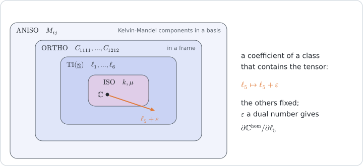

# [Sensitivities](@id man-sensitivities)

!!! info "Before this page"
    [Homogenization schemes](@ref man-schemes), where the cells and the schemes
    differentiated below are built.

The derivative of an effective property with respect to one input of a cell
(a volume fraction, a modulus, a semi-axis) is computed by forward automatic
differentiation: the input is replaced by a dual number of
[ForwardDiff.jl](https://github.com/JuliaDiff/ForwardDiff.jl), and every
function of the package carries it to the result
([Derivatives by automatic differentiation](@ref th-autodiff) gives the
principle, estimate by estimate). This page says how to designate the input,
the *parameter*, how to ask for the derivative, and how to obtain the second
moments of the local fields, which are derivatives.

## A first derivative

```@example sens
using MeanFieldHomogenization, TensND

rve = RVE()
add_phase!(rve, :M, Ellipsoid(1.0), Dict(:C => iso_stiffness(10.0, 6.0)); fraction = :rest)
add_phase!(rve, :I, Ellipsoid(1.0, 1.0, 0.3), Dict(:C => iso_stiffness(40.0, 30.0)); fraction = 0.2)
C₃₃₃₃(C) = canonical_components(C)[3, 3, 3, 3]

derivative(rve, MoriTanaka(), amount(:I); indexer = C₃₃₃₃)   # ∂C₃₃₃₃ / ∂f_I
```

`amount(:I)` is the parameter, the volume fraction of the phase `:I`;
`indexer` picks the scalar of the effective tensor to differentiate.

## [Parameters](@id man-sensitivities-lenses)

A parameter designates one number of a cell, which `get_param` reads and
`set_param` replaces in a copy of the cell:

| parameter | the number |
| :--- | :--- |
| `amount(:I)` | the volume fraction, or the crack density, of a phase |
| `property(:I, :C, sel)` | a coefficient of the property `:C` of a phase |
| `property(:I, :C, 𝔹)` | the abscissa of the property along the tensor `𝔹`, zero in the cell |
| `geometry(:I, :semi_axes, 3)` | a field of the inclusion of a phase |
| `shape_param(:semi_axes, 1)` | a field of the distribution shape |

The laminate adds `thickness` and `interface_param`
([Laminates](@ref man-laminates)), the particle assembly `radius_param` and
`center_param` ([Particle assemblies](@ref man-assemblies)), and `nested` reaches
a parameter of a cell nested in another
([Multiscale models](@ref man-multiscale)).

### The coefficient of a property

A coefficient belongs to a **symmetry class that contains the tensor**. With no
`symmetry` given, it is a coefficient of the tensor's own class:

| class | selectors | meaning |
| :--- | :--- | :--- |
| isotropic, order 4, ``\alpha\,\mathbb{J}+\beta\,\mathbb{K}`` | `:k` (≡ `:bulk`), `:μ` (≡ `:shear`), `:α`, `:β` | ``k`` and ``\mu``, with ``\alpha = d\,k`` in dimension ``d`` and ``\beta = 2\mu``; ``\alpha``, ``\beta`` themselves |
| isotropic, order 2 | `:scalar` | the conductivity |
| transversely isotropic, order 4 | `:ℓ₁` … `:ℓ₆` | the coefficients on the Walpole basis (``\ell_3 = \ell_4`` with major symmetry) |
| transversely isotropic, order 2 | `:transverse`, `:axial` | the two coefficients |
| orthotropic, order 4 | `:C1111`, `:C2222`, `:C3333`, `:C1122`, `:C1133`, `:C2233`, `:C2323`, `:C1313`, `:C1212` | the components in the frame |
| orthotropic, order 2 | `:a1`, `:a2`, `:a3` | the components in the frame |
| cubic | `:α`, `:β`, `:γ` | the coefficients on ``\mathbb{J}``, ``\mathbb{E}``, ``\mathbb{T}`` |
| any | `:Mij` (order 4), `:Mi` (order 2) | the Kelvin-Mandel component in the canonical basis |
| any | an integer `i` | the `i`-th entry of `get_data` |

In the plane, ``k = \lambda + \mu`` is the bulk modulus of the plane. A
Kelvin-Mandel component carries the factors of the Kelvin-Mandel matrix:
``M_{66} = 2\,C_{1212}``, and `:Mij` with ``i \neq j`` sets ``M_{ij}`` and
``M_{ji}`` together, so that the matrix stays symmetric.

The keyword `symmetry` names a larger class, in which the tensor is written
before its coefficient is read:

| `symmetry` | class |
| :--- | :--- |
| `(:TI, n)` | transversely isotropic about the unit vector `n` |
| `(:ORTHO, frame)`, `(:CUBIC, frame)` | orthotropic, cubic, in the frame `frame` |
| `:ANISO`, `(:ANISO, basis)` | the Kelvin-Mandel components in `basis` (canonical by default) |

A **frame** is an orthonormal basis of TensND, whose three vectors are the
axes of the class: the canonical one, `CanonicalBasis{3, Float64}()`, or a
rotated one, `RotatedBasis(θ, ϕ, ψ)`. A **basis** is any basis of TensND,
orthonormal or not, in which the components are read.

The orientation is left out when the tensor already carries it. With no
`symmetry` at all, the class and its orientation are those of the tensor: the
axis of a `TensTI`, the frame of a `TensOrtho` or of a `TensCubic`. A class
named alone takes the orientation of the tensor in the same way, `symmetry =
:TI` for a `TensTI`, `:ORTHO` for a `TensOrtho` or a `TensCubic`, `:CUBIC` for a
`TensCubic`. In every other case the orientation is not determined by the
tensor (an isotropic tensor has no axis, a transversely isotropic one fixes one
axis of a frame and not the two others), and it is to be given.



Setting a coefficient leaves the other coefficients **of its class** unchanged.
The derivative with respect to it is therefore the partial derivative in that
class, and the perturbed tensor may leave the class of the tensor given: a
derivative with respect to ``\ell_5`` of an isotropic phase, seen as
transversely isotropic about ``\underline{n}``, is the response to a
perturbation that is not isotropic.

```@example sens
n = TensND.normalize([0.0, 1.0, 1.0])
(
    k = derivative(rve, MoriTanaka(), property(:I, :C, :k); indexer = C₃₃₃₃),
    α = derivative(rve, MoriTanaka(), property(:I, :C, :α); indexer = C₃₃₃₃),
    ℓ₅ = derivative(rve, MoriTanaka(), property(:I, :C, :ℓ₅; symmetry = (:TI, n)); indexer = C₃₃₃₃),
    M₁₂ = derivative(rve, MoriTanaka(), property(:I, :C, :M12); indexer = C₃₃₃₃),
)
```

The derivative with respect to ``k`` is three times that with respect to
``\alpha = 3k``. A class that does not contain the tensor is refused, since the
derivative would be taken at another tensor; so is a selector foreign to the
class:

```@example sens
try
    get_param(rve, property(:I, :C, :ℓ₁))
catch err
    println(sprint(showerror, err))
end
```

The tutorial [One derivative, several routes](@ref tut-derivative-routes)
computes the same derivative through each class and checks them against one
another by the chain rule.

### A property along a tensor

`property(:I, :C, 𝔹)`, with a tensor in place of a selector, designates the
abscissa ``t`` of the property along `𝔹`: setting it replaces the stiffness
``\mathbb{C}`` of the phase by ``\mathbb{C} + t\,\mathbb{B}``, and its value in
the cell is zero. The derivative with respect to it is the derivative along
``\mathbb{B}``, whatever the classes of the two tensors
([Derivatives by automatic differentiation](@ref th-autodiff), section 6). The
derivative with respect to ``\mu`` is the derivative along ``2\mathbb{K}``:

```@example sens
𝕂 = TensISO{3}(0.0, 1.0)
(
    derivative(rve, MoriTanaka(), property(:I, :C, :μ); indexer = C₃₃₃₃),
    derivative(rve, MoriTanaka(), property(:I, :C, 2𝕂); indexer = C₃₃₃₃),
)
```

## Several parameters

`gradient` takes a vector of parameters and returns one derivative each;
`jacobian` returns the derivatives of every component of the effective tensor,
``81 \times N`` for a tensor of order 4:

```@example sens
ps = [amount(:I), property(:I, :C, :k), property(:M, :C, :μ)]
gradient(rve, MoriTanaka(), ps; indexer = C₃₃₃₃)
```

```@example sens
size(jacobian(rve, MoriTanaka(), ps))
```

### [A layer of a layered sphere](@id man-sensitivities-layers)

The moduli of a [`LayeredSphere`](@ref) are held by the sphere, one per layer.
`layer_param(:I, 2, name)` designates a coefficient of the second layer of the
sphere of the phase `:I`: `:k`, `:μ` (or `:scalar`) for an isotropic layer; for
a layer transversely isotropic about the radius, a component in the frame that
turns with the point, `:Crrrr`, `:Cθθθθ`, `:Cθθφφ`, `:Crrθθ`, `:Crθrθ`, a
Walpole coefficient `:ℓ₁`, `:ℓ₂`, `:ℓ₃`, `:ℓ₅`, `:ℓ₆` (five, without ``\ell_4``,
and with the factors of the Walpole basis:
[The moduli of a layer, in every notation](@ref man-layered-moduli)), or a
conductivity `:radial`, `:tangential`. With a tensor in place of the name,
`layer_param(:I, 2, 𝔹)` is the abscissa of the modulus of the layer along `𝔹`,
an isotropic tensor or a field of TensND, `radial_ti(SphericalChart(), …)`.

```@example sens
coated = RVE()
add_phase!(coated, :M, Ellipsoid(1.0), Dict(:C => iso_stiffness(10.0, 6.0)); fraction = :rest)
shell = radial_ti(SphericalChart(); n = 12.0, l = 5.0, k = 19.0, m = 11.0, p = 4.0)
add_phase!(coated, :I, LayeredSphere((0.6, 1.0), (iso_stiffness(40.0, 20.0), shell)), Dict(:C => iso_stiffness(40.0, 20.0)); fraction = 0.3)
derivative(coated, MoriTanaka(), layer_param(:I, 2, :Crrrr); indexer = C₃₃₃₃)
```

## [Second moments](@id man-sensitivities-moments)

The mean over a phase of a quadratic form of the local strain is a derivative
of the effective energy with respect to the stiffness of that phase
([Second moments of the local fields](@ref th-second-moments)).
[`second_moment`](@ref) computes it, under a macroscopic strain `E`:

```@example sens
using LinearAlgebra
E = Tens(Symmetric([1.0 0.2 0.1; 0.2 -0.5 0.3; 0.1 0.3 0.7]))
second_moment(rve, MoriTanaka(), :M, E, 𝕂)       # ⟨εᵈ:εᵈ⟩ over the matrix
```

The fifth argument is the tensor ``\mathbb{B}`` of the form
``\boldsymbol{\varepsilon}:\mathbb{B}:\boldsymbol{\varepsilon}``, of any symmetry
class. Without it, the whole tensor
``\langle\boldsymbol{\varepsilon}\otimes\boldsymbol{\varepsilon}\rangle`` is
returned, from which every form follows by a contraction:

```@example sens
M = second_moment(rve, MoriTanaka(), :M, E)
M ⊙ 𝕂
```

| call | result |
| :--- | :--- |
| `second_moment(cell, scheme, phase, E, 𝔹)` | ``\langle\boldsymbol{\varepsilon}:\mathbb{B}:\boldsymbol{\varepsilon}\rangle`` over the phase, one derivative |
| `second_moment(cell, scheme, phase, E)` | ``\langle\boldsymbol{\varepsilon}\otimes\boldsymbol{\varepsilon}\rangle``, a tensor of order 4 |
| `second_moment(cell, scheme, phase, G, 𝑩; property = :K)` | ``\langle\underline{g}\cdot\boldsymbol{B}\cdot\underline{g}\rangle``, `G` being the macroscopic gradient |
| `second_moment(cell, scheme, phase, G; property = :K)` | ``\langle\underline{g}\otimes\underline{g}\rangle``, a tensor of order 2 |

The cell is an `RVE`, a laminate or a particle assembly, in space or in the
plane; the moduli may be dual numbers or symbols. The moments of the stress
follow, ``\boldsymbol{\sigma} = \mathbb{C}_r:\boldsymbol{\varepsilon}`` in the
phase. A family of cracks has no volume and is refused.

A layer of a layered sphere is designated by the pair `(phase, layer)`, and the
tensor of the form may then turn with the point: the first element of the
Walpole basis about the radius gives the second moment of the radial strain in
the layer ([theory](@ref th-layered-sphere-radial)).

```@example sens
second_moment(coated, MoriTanaka(), (:I, 2), E, radial_ti(SphericalChart(), 1.0, 0.0, 0.0, 0.0, 0.0))   # ⟨ε_rr²⟩
```

## Any other input

What no parameter designates (a function of several inputs, an input that is not
stored in the cell) is differentiated by `sensitivity`, on a function that builds
the cell from a number:

```@example sens
function C₃₃₃₃_of_aspect(ω)
    r = RVE()
    add_phase!(r, :M, Ellipsoid(1.0), Dict(:C => iso_stiffness(10.0, 6.0)); fraction = :rest)
    add_phase!(r, :I, Ellipsoid(1.0, 1.0, ω), Dict(:C => iso_stiffness(40.0, 30.0)); fraction = 0.2)
    return C₃₃₃₃(homogenize(r, MoriTanaka(), :C))
end
sensitivity(C₃₃₃₃_of_aspect, 0.3)
```

A cell nested in another is differentiated the same way, the dual number
crossing every scale; [Multiscale models](@ref man-multiscale) does it with
`nested` parameters.

## Where to go next

[One derivative, several routes](@ref tut-derivative-routes) checks the
parameters of every symmetry class against one another;
[Derivatives and sensitivities](@ref tut-sensitivities) puts them to work;
[Quasi-brittle strength of cement paste and mortar](@ref app-strength)
differentiates a three-scale model with respect to the modulus of one family
of hydrate needles, the derivative from which [pichler2011](@citet) obtain a
strength. The manual closes with an appendix,
[Elliptic integrals — examples](@ref man-elliptic-examples), on the special
functions behind the closed-form Hill tensors.
