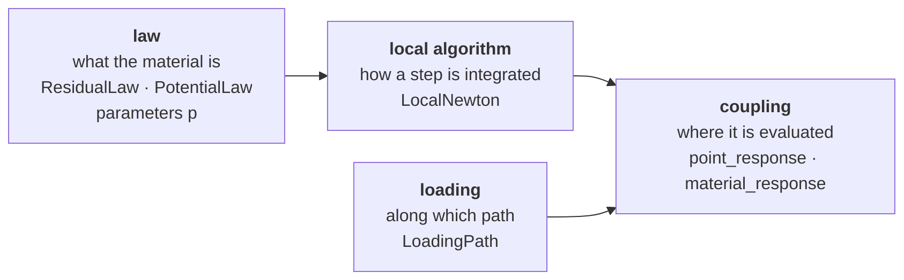

# [Material points: nonlinear laws](@id mp-index)

`MaterialPoints` is the part of MeanFieldHomogenization that deals with **one
material point**: a constitutive law that is not linear, that may remember its
history, and that may couple several fields. With it you can

- **write a law** in a few lines of mathematics, either as the equations of its
  integration over a time step or as two potentials;
- **test it** along any loading path, a tensile test, a creep test, a cycle, an
  undrained compression, before using it anywhere else;
- **plug it** into a finite-element computation, exactly where a homogenized
  material plugs in today;
- **homogenize** a composite of nonlinear phases into a law of the same kind.

The consistent tangent, the coupling blocks between fields and the derivatives
with respect to the parameters are computed for you, by automatic
differentiation: you never write a derivative by hand.

## Four pieces that do not depend on each other



| piece | the question it answers | what you write |
|:--|:--|:--|
| the **law** | what is the material? | a [`ResidualLaw`](@ref) or a [`PotentialLaw`](@ref): plain functions and a `NamedTuple` of parameters |
| the **local algorithm** | how is one step integrated? | nothing: [`LocalNewton`](@ref) is the default |
| the **loading** | along which path is the point driven? | a [`LoadingPath`](@ref), each component driven by its gradient or by its flux |
| the **coupling** | where is the law evaluated? | [`point_response`](@ref) for one point, [`material_response`](@ref) in an element loop |

Any law runs with any algorithm, along any path, in any caller. Changing one
piece never means touching another.

## A first calculation

A steel bar pulled in tension, with von Mises plasticity and linear isotropic
hardening. The law has five parameters; the path drives the axial strain
``\varepsilon_{11}`` from 0 to 0.5 % and leaves the lateral faces free.

```@example mp_first
using MeanFieldHomogenization

law = J2Plasticity(; E = 200e3, ν = 0.3, σ₀ = 250.0, H = 2e3)     # MPa
path = LoadingPath(range(0, 1; length = 51); ε11 = t -> 5e-3 * t)
r = point_response(law, path)
r[:σ11][end], r[:p][end]      # axial stress (MPa) and cumulated plastic strain
```

`r[:σ11]` is the axial stress at every time of the path, `r[:p]` the cumulated
plastic strain, an internal variable of the law. The lateral stresses
`r[:σ22]` and `r[:σ33]` are zero, as the path asked: the driver found the
lateral strains that make them vanish.

## Three kinds of laws, one tool

| kind | what changes | example shipped |
|:--|:--|:--|
| a law of the strain alone | nothing is remembered | [`LinearElasticity`](@ref), [`PowerLawElasticity`](@ref) |
| a law with **internal variables** and their evolution | the state carries the history: plastic strain, viscous strain, damage | [`J2Plasticity`](@ref), [`NortonViscoplasticity`](@ref), [`MaxwellViscoelasticity`](@ref) |
| a law of **coupled primal fields** | several gradients and their conjugate fluxes, with every coupling block of the tangent | [`BiotPoroelasticity`](@ref) (strain and pore pressure) |

The three are written the same way. A coupled law only lists its fields:
`gradients = (ε = 6, p = 1)` and `flux_names = (σ = 6, φ = 1)` for
poroelasticity; a thermo-hydro-mechanical law would add the temperature and the
entropy in the same manner.

## Reading order

| page | |
|:--|:--|
| **Theory** | |
| [Integrating a law over a step](@ref mp-theory) | the incremental problem, the consistent tangent by the implicit-function theorem, the potential route, exact derivatives |
| [Homogenizing nonlinear phases: secant methods](@ref mp-theory-secant) | the linear comparison composite, the classical and the modified secant methods, the composite as a law |
| [Uniform fields: Voigt–Taylor and Reuss–Sachs](@ref mp-theory-uniform-fields) | every phase at the macroscopic strain or at the macroscopic stress, for any phase laws |
| [Damage by the growth of microcracks](@ref mp-theory-crack-damage) | crack densities as internal variables, the driving force from the homogenized energy, Griffith's resistance, stability and viscous regularization |
| [Nonlinear poroelasticity of a cracked rock](@ref mp-theory-closing-cracks) | cracks closing under the Terzaghi effective stress, stress-dependent stiffness and Biot tensor, the rate equations |
| [The strength of a porous plastic solid](@ref mp-theory-strength) | the rigid–plastic limit of the secant method, a strength domain from a phase law, normality |
| [Strength of a frictional matrix with a non-associated flow rule](@ref mp-theory-frictional-strength) | a Drucker–Prager matrix with a dilatancy below its friction, viscous regularization, limit states around pores or rigid inclusions |
| **Manual** | |
| [Writing a law](@ref mp-writing) | the residual route, the potential route, internal variables, coupled fields |
| [The laws shipped](@ref mp-laws) | the six laws, their equations, parameters and behavior along typical paths |
| [Driving a point](@ref mp-driving) | loading paths, mixed control, reading the response |
| [Plugging a law into a computation](@ref mp-plugging) | the Gauss-point contract, the flat interface for speed, differentiating with respect to parameters |
| **Examples** | |
| [Elastoplastic bar under cycles](@ref mp-ex-plasticity) | J2 plasticity against the closed form, isotropic and kinematic hardening |
| [A damage law written from scratch](@ref mp-ex-damage) | a law of your own, with a threshold and an evolving internal variable |
| [Drained and undrained poroelasticity](@ref mp-ex-biot) | a coupled law, the same sample in two tests |
| [A composite of nonlinear phases](@ref mp-ex-composite) | two power-law phases homogenized by both secant methods, against the Voigt bound |
| [Two elastoplastic phases: uniform strain and uniform stress](@ref mp-ex-uniform-fields) | Taylor and Sachs composites of a steel and an alloy, against the elastic bounds and linear hardening |
| [Damage by the growth of microcracks](@ref mp-ex-crack-damage) | progressive and unstable crack growth in a brittle solid, a load cycle, the viscous regularization |
| [A cracked rock under confinement](@ref mp-ex-closing-cracks) | stiffening and falling Biot coefficient under confinement, the two roles of the pore pressure |
| [The strength of a porous plastic solid](@ref mp-ex-strength) | the strength domain from the phase law, against the closed-form ellipse and the derivative construction |
| [Strength of a frictional matrix with a non-associated flow rule](@ref mp-ex-frictional-strength) | porous and reinforced frictional solids, the domain and the flow rule against the closed forms |

!!! note "Small strain"
    The laws are written in infinitesimal strain. The kinematics is a trait of
    the law ([`kinematics`](@ref)), so that finite strain can be added later
    without changing the laws written today.
