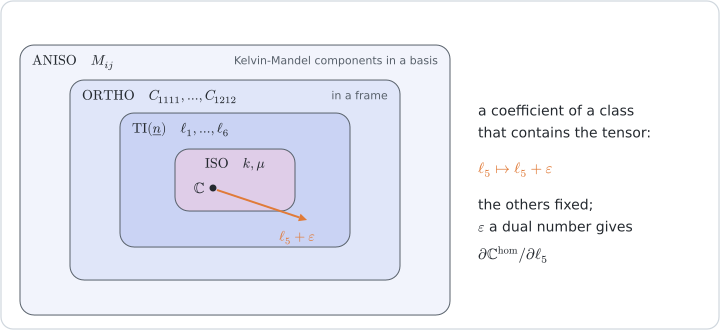

# [Derivatives by automatic differentiation](@id th-autodiff)

!!! info "Before this page"
    [Homogenization schemes](@ref th-homogenization), for the estimates
    differentiated here;
    [Self-consistent schemes](@ref th-scheme-self-consistent) and
    [Differential scheme](@ref th-differential-scheme), for the two estimates
    that are not given by a formula.

An estimate is a function of the inputs of the cell: the moduli of the phases,
their amounts, the shapes of the inclusions. Its derivatives with respect to
these inputs measure a sensitivity, drive an identification, give the tangent
operator of a nonlinear law, and, with respect to the moduli of a phase, give
the second moments of the strain in that phase
([next page](@ref th-second-moments)). The package computes them exactly, up
to rounding, by automatic differentiation: no increment to choose and no
truncation error, as a finite difference would have. This page recalls the
principle, then says how it goes through each kind of estimate and with respect
to what a derivative is taken. The syntax is in the manual page
[Sensitivities](@ref man-sensitivities).

## 1. Dual numbers

A **dual number** is a pair written ``a + b\,\epsilon``, with the rule
``\epsilon^2 = 0``. Sums and products follow:

```math
(a + b\,\epsilon) + (c + d\,\epsilon) = (a + c) + (b + d)\,\epsilon ,
\qquad
(a + b\,\epsilon)(c + d\,\epsilon) = ac + (ad + bc)\,\epsilon .
```

A polynomial ``f`` evaluated at ``a + b\,\epsilon`` therefore returns
``f(a) + f'(a)\,b\,\epsilon``, and every differentiable function is extended by
the same rule,

```math
f(a + b\,\epsilon) = f(a) + f'(a)\,b\,\epsilon ,
```

which is its expansion to the first order, exact since ``\epsilon^2 = 0``. The
rule is stable under composition: ``g\bigl(f(a + \epsilon)\bigr) =
g\bigl(f(a)\bigr) + g'\bigl(f(a)\bigr)\,f'(a)\,\epsilon``, which is the chain
rule. A program is a composition of elementary operations; run on
``a + \epsilon`` in place of ``a``, with each operation obeying the rule, it
returns its value and its derivative together
[griewankWalther2008, baydin2018](@cite). The package relies on the dual numbers
of ForwardDiff.jl [revels2016](@cite):

```@example ad
using MeanFieldHomogenization, TensND, ForwardDiff

h(x) = x^3 / (1 + x)                       # h′(x) = x² (3 + 2x) / (1 + x)²
y = h(ForwardDiff.Dual(2.0, 1.0))          # at 2 + ε
(ForwardDiff.value(y), ForwardDiff.partials(y, 1)), (8 / 3, 28 / 9)
```

With ``N`` inputs, each one carries its own ``\epsilon_i``, with
``\epsilon_i\,\epsilon_j = 0``: one evaluation returns the ``N`` partial
derivatives.

## 2. Second derivatives

A second derivative is the derivative of a derivative: the parts ``a`` and
``b`` of a dual number are themselves dual numbers of another infinitesimal
``\epsilon'``, with ``\epsilon^2 = \epsilon'^2 = 0`` and
``\epsilon\,\epsilon' \neq 0``:

```math
f(a + \epsilon + \epsilon') = f(a) + f'(a)\,(\epsilon + \epsilon')
  + f''(a)\,\epsilon\,\epsilon' .
```

Each level of nesting has its own infinitesimal, so that the two are never
mistaken for one another, and the order of derivation is the depth of the
nesting.

```@example ad
ForwardDiff.derivative(x -> ForwardDiff.derivative(h, x), 2.0), 52 / 27   # h″(x) = 2 − 2 / (1 + x)³
```

## 3. An explicit estimate

The bounds, the dilute, Mori-Tanaka, Maxwell and Ponte Castañeda-Willis
estimates, the laminate and the layered patterns are given by a chain of
formulas ([the chain, in one picture](@ref th-index)): a Hill tensor, a
concentration tensor, a contribution, an average. Dual numbers go through
every link, provided the code does not stop them:

- the number type of each intermediate result is the promotion of the types of
  **all** the inputs, so that a derivative with respect to a modulus of the
  inclusion is not lost in a tensor typed after the matrix;
- the inverse of a tensor is computed by the operations of linear algebra,
  which carry ``\mathrm{d}(\mathbb{A}^{-1}) = -\mathbb{A}^{-1}:\mathrm{d}\mathbb{A}:\mathbb{A}^{-1}``
  with them;
- a closed form with a removable limit (the sphere among the spheroids, the
  isotropic matrix among the transversely isotropic ones) is evaluated by an
  expression whose derivative is right at the limit as well
  ([Degenerate shapes](@ref th-degenerate-shapes));
- a Hill tensor obtained by a quadrature is differentiated under the integral
  sign: the points are fixed and the integrand is dual.

The bulk modulus of a Mori-Tanaka estimate of spheres has a closed form,
with ``D = 3k_0 + 4\mu_0``,

```math
k^{\mathrm{hom}} = k_0 + \frac{f\,(k_1 - k_0)\,D}{D + 3(1 - f)(k_1 - k_0)} ,
\qquad
\frac{\partial k^{\mathrm{hom}}}{\partial k_1}
  = \frac{f\,D^2}{\bigl(D + 3(1 - f)(k_1 - k_0)\bigr)^2} ,
```

against which the derivative of the estimate is compared:

```@example ad
k₀, μ₀, k₁, μ₁, f = 10.0, 6.0, 40.0, 20.0, 0.3
function spheres(k₀, μ₀, k₁, μ₁, f)
    rve = RVE()
    add_phase!(rve, :M, Ellipsoid(1.0), Dict(:C => iso_stiffness(k₀, μ₀)); fraction = :rest)
    add_phase!(rve, :I, Ellipsoid(1.0), Dict(:C => iso_stiffness(k₁, μ₁)); fraction = f)
    return rve
end
rve = spheres(k₀, μ₀, k₁, μ₁, f)
bulk(C) = get_coefficient(C, :k)

D = 3k₀ + 4μ₀
derivative(rve, MoriTanaka(), property(:I, :C, :k); indexer = bulk), f * D^2 / (D + 3(1 - f) * (k₁ - k₀))^2
```

## 4. An implicit estimate

The self-consistent estimate is not given by a formula: it is the solution
``\boldsymbol{x}`` (the coefficients of the effective tensor) of an equation
that involves the inputs ``p``,

```math
\boldsymbol{F}(\boldsymbol{x}, p) = \boldsymbol{x} - \boldsymbol{G}(\boldsymbol{x}, p) = \boldsymbol{0} ,
```

``\boldsymbol{G}`` being one step of the scheme in a reference medium of
tensor ``\boldsymbol{x}``. Differentiating the equation along the solution
gives the derivative of the solution (the implicit function theorem):

```math
\frac{\mathrm{d}\boldsymbol{x}}{\mathrm{d}p}
  = -\Bigl(\frac{\partial\boldsymbol{F}}{\partial\boldsymbol{x}}\Bigr)^{-1}\cdot
     \frac{\partial\boldsymbol{F}}{\partial p}
  = \Bigl(\mathbb{1} - \frac{\partial\boldsymbol{G}}{\partial\boldsymbol{x}}\Bigr)^{-1}\cdot
     \frac{\partial\boldsymbol{G}}{\partial p} .
```

The solvers of the package reach it in three ways.

**Fixed-point iterations.** Iterating
``\boldsymbol{x}_{n+1} = \boldsymbol{G}(\boldsymbol{x}_n, p)`` on dual numbers
``\boldsymbol{x}_n = \boldsymbol{a}_n + \boldsymbol{b}_n\,\epsilon``,
``p + \epsilon``, iterates the values and

```math
\boldsymbol{b}_{n+1} = \frac{\partial\boldsymbol{G}}{\partial\boldsymbol{x}}\cdot\boldsymbol{b}_n
  + \frac{\partial\boldsymbol{G}}{\partial p} ,
```

whose fixed point is the derivative above. The derivatives converge at the rate
of the values and one step behind them: started from the solution, the value
has converged at the first step while ``\boldsymbol{b}`` has not moved yet.
The iterations are therefore stopped on the values **and** on each derivative,
every one against its own scale.

**Newton's method.** Let ``\boldsymbol{x}^\ast`` be the solution in dual
numbers and ``\boldsymbol{x} = \boldsymbol{x}^\ast + \boldsymbol{e}`` an
iterate whose value has converged: ``\boldsymbol{e}`` has no value part, it is
a sum of terms of degree ``n \geq 1`` in the infinitesimals. Expanding
``\boldsymbol{F}`` about ``\boldsymbol{x}``,

```math
\boldsymbol{0} = \boldsymbol{F}(\boldsymbol{x}^\ast, p)
  = \boldsymbol{F}(\boldsymbol{x}, p)
  - \frac{\partial\boldsymbol{F}}{\partial\boldsymbol{x}}\cdot\boldsymbol{e} + \boldsymbol{R} ,
```

the remainder ``\boldsymbol{R}`` being of degree two in ``\boldsymbol{e}``,
hence of degree ``2n`` in the infinitesimals. The Newton step
``\boldsymbol{x}^+ = \boldsymbol{x} - (\partial\boldsymbol{F}/\partial\boldsymbol{x})^{-1}\cdot\boldsymbol{F}(\boldsymbol{x}, p)``
then leaves the error

```math
\boldsymbol{x}^+ - \boldsymbol{x}^\ast
  = \Bigl(\frac{\partial\boldsymbol{F}}{\partial\boldsymbol{x}}\Bigr)^{-1}\cdot\boldsymbol{R} ,
```

of degree ``2n``. With one infinitesimal, ``\epsilon^2 = 0``: **one** Newton
step taken after the convergence of the value gives the derivative exactly.
With dual numbers nested ``m`` times, a term of degree ``m + 1`` vanishes, and
``k`` steps give every derivative up to the order ``2^k - 1``. The step being
taken in dual numbers, its Jacobian is itself obtained by automatic
differentiation.

**A solver on values, then one correction.** The same step may use the
Jacobian of the values alone: the equation is solved on plain numbers by any
algorithm, and the dual solution is
``\boldsymbol{x}^\ast - (\partial\boldsymbol{F}/\partial\boldsymbol{x})^{-1}\cdot\boldsymbol{F}(\boldsymbol{x}^\ast, p + \epsilon)``,
which is the implicit function theorem written as one linear solve. This is
what the solvers of NonlinearSolve.jl do
([Nonlinear solvers for the self-consistent fixed point](@ref tut-nonlinear-solvers)),
and what the local integration of a material law does
([Integrating a law over a step](@ref ml-theory)).

The two built-in solvers on the same cell, with respect to the volume
fraction:

```@example ad
picard = derivative(rve, SelfConsistent(), amount(:I); indexer = bulk)
newton = derivative(rve, SelfConsistent(; algorithm = NewtonDefault()), amount(:I); indexer = bulk)
picard, newton
```

The two agree within the tolerance at which each solver stops.

## 5. An estimate defined by a differential equation

The differential scheme integrates the effective tensor along a fictitious
time ``\tau``,

```math
\frac{\mathrm{d}\boldsymbol{x}}{\mathrm{d}\tau} = \boldsymbol{\Phi}(\boldsymbol{x}, \tau, p) ,
\qquad \boldsymbol{x}(0) = \boldsymbol{x}_0(p) .
```

On dual numbers ``\boldsymbol{x} = \boldsymbol{a} + \boldsymbol{b}\,\epsilon``,
the part ``\boldsymbol{b} = \partial\boldsymbol{x}/\partial p`` obeys the
equation differentiated with respect to ``p``,

```math
\frac{\mathrm{d}\boldsymbol{b}}{\mathrm{d}\tau}
  = \frac{\partial\boldsymbol{\Phi}}{\partial\boldsymbol{x}}\cdot\boldsymbol{b}
  + \frac{\partial\boldsymbol{\Phi}}{\partial p} ,
```

integrated by the same method and on the same steps as the values, the steps
being chosen on the values. The result is the derivative of the numerical
solution, that of the numbers the scheme returns. The aging viscoelastic
estimates are differentiated in the same way through their discretization in
time ([Derivatives through the aging-viscoelastic calculation](@ref tut-alv-sensitivities)).

## 6. With respect to what

A derivative is taken with respect to one number of the cell: the amount of a
phase (a volume fraction, a crack density), a length of an inclusion or of the
distribution of the inclusions, a parameter of an interface, or a coefficient
of the tensor of a property. The last case needs a definition, since a tensor
has no coefficients until a symmetry class is named.

In a class, the tensor is a combination of fixed tensors,
``\mathbb{C}_r = \sum_a c_a\,\mathbb{B}_a``: ``3\mathbb{J}`` and ``2\mathbb{K}``
for the moduli ``k`` and ``\mu`` of an isotropic stiffness, the six elements of
the Walpole basis about an axis for a transversely isotropic one. The partial
derivative with respect to ``c_a``, the other coefficients **of that class**
being fixed, is the derivative along ``\mathbb{B}_a``:

```math
\frac{\partial\,\mathbb{C}^{\mathrm{hom}}}{\partial c_a}
  = \frac{\mathrm{d}}{\mathrm{d}t}\,
    \mathbb{C}^{\mathrm{hom}}\bigl(\mathbb{C}_r + t\,\mathbb{B}_a\bigr)\Big|_{t=0} .
```

It depends on the class through ``\mathbb{B}_a`` only, and it is linear in it:
if the same tensor is written in another class, with coefficients ``c'_b`` on
tensors ``\mathbb{B}'_b``, and ``\mathbb{B}_a = \sum_b \beta_{ab}\,\mathbb{B}'_b``,
then ``\partial/\partial c_a = \sum_b \beta_{ab}\,\partial/\partial c'_b``. The
perturbed tensor may leave the class of the tensor: an isotropic stiffness
moved along an element of the Walpole basis is no longer isotropic.



The derivative with respect to ``k`` is thus the derivative along
``3\mathbb{J}``, and a derivative along any tensor ``\mathbb{B}``, of any
class, is obtained in the same way:

```@example ad
𝕁 = TensISO{3}(1.0, 0.0)
(
    derivative(rve, MoriTanaka(), property(:I, :C, :k); indexer = bulk),
    derivative(rve, MoriTanaka(), property(:I, :C, 3𝕁); indexer = bulk),
)
```

The names of the coefficients of each class are listed in
[Sensitivities](@ref man-sensitivities-lenses), and
[One derivative, several routes](@ref tut-derivative-routes) computes one
derivative in several classes.

## 7. Symbols in place of dual numbers

Where an estimate is a closed form, its inputs may be symbols and its result an
expression, differentiated by a computer algebra system. The derivative of
section 3, with symbolic moduli:

```@example ad
using Symbolics
@variables K₀ M₀ K₁ M₁ F
kʰᵒᵐ = bulk(homogenize(spheres(K₀, M₀, K₁, M₁, F), MoriTanaka(), :C))
Dˢ = 3K₀ + 4M₀
simplify(Symbolics.derivative(kʰᵒᵐ, K₁) - F * Dˢ^2 / (Dˢ + 3(1 - F) * (K₁ - K₀))^2)
```

An iterative solver, a quadrature with a stopping test or a pivot compares
numbers, which a symbol cannot be: the self-consistent estimate and the Hill
tensor of an anisotropic matrix are differentiated by dual numbers only.

## Where to go next

The next page, [Second moments of the local fields](@ref th-second-moments),
uses the derivative with respect to the stiffness of a phase: it is the mean
of a quadratic form of the strain over that phase.

- [Sensitivities](@ref man-sensitivities): the parameters and the functions
  that differentiate.
- [Derivatives and sensitivities](@ref tut-sensitivities) and
  [One derivative, several routes](@ref tut-derivative-routes): the
  derivatives at work.
- [Nonlinear solvers for the self-consistent fixed point](@ref tut-nonlinear-solvers):
  the solvers of section 4, compared.
