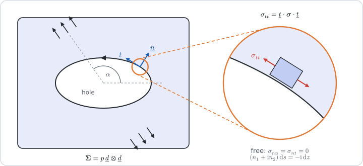
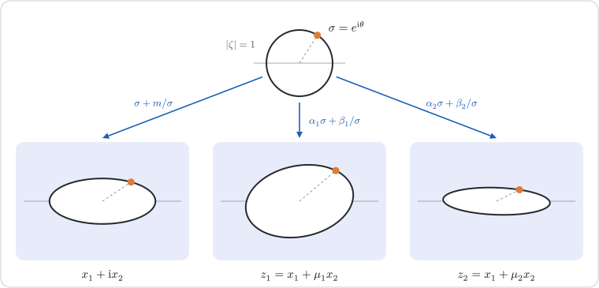

# [Complex potentials of plane elasticity](@id th-complex-potentials)

!!! info "Before this page"
    [Holomorphic functions and conformal maps](@ref th-holomorphic-functions),
    for the derivatives with respect to ``z`` and ``\bar z``, the form of
    Goursat, the identification of series on the unit circle and the conformal
    maps; [Problems of the plane](@ref th-plane-problems), for the tensors of
    the plane and the two states they stand for.

The stress of a plane problem without body force derives from a stress
function. In an isotropic medium this function is written with two holomorphic
functions of ``z=x_1+\mathrm{i}\,x_2``, the complex potentials of Kolosov and
Muskhelishvili (sections 1 to 6); in an anisotropic medium, with two
holomorphic functions of two other complex variables (sections 7 to 9). The
elliptic hole is solved in closed form in both. The isotropic part follows
[Muskhelishvili](@cite muskhelishvili1977), chapters 5, 7 and 15, the
anisotropic one [Lekhnitskii](@cite lekhnitskii1981), chapters 3 and 4; their
sections and equations are quoted where they are used, the derivations being
written in the notation of this documentation.

## 1. The stress function

The plane has the coordinates ``(x_1,x_2)``; ``\boldsymbol{\sigma}``,
``\boldsymbol{\varepsilon}`` and ``\underline{u}`` are a stress, a strain and
a displacement of the plane, and ``\partial_i`` stands for
``\partial/\partial x_i``. Without body force, equilibrium reads

```math
\partial_1\sigma_{11}+\partial_2\sigma_{12}=0,
\qquad
\partial_1\sigma_{12}+\partial_2\sigma_{22}=0 .
```

On a simply connected domain the first equation says that
``(\sigma_{11},\sigma_{12})=(\partial_2A,-\partial_1A)`` for some function
``A``, the second that ``(\sigma_{12},\sigma_{22})=(-\partial_2B,\partial_1B)``
for some ``B``; the two values of ``\sigma_{12}`` give
``\partial_1A=\partial_2B``, so that ``A=\partial_2F`` and ``B=\partial_1F``
for a function ``F``, the stress function of Airy:

```math
\sigma_{11}=\partial_{22}F,\qquad\sigma_{22}=\partial_{11}F,\qquad\sigma_{12}=-\partial_{12}F
```

([Muskhelishvili](@cite muskhelishvili1977), section 29, equation (29.2)).
The strains of a displacement,
``\varepsilon_{11}=\partial_1u_1``, ``\varepsilon_{22}=\partial_2u_2``,
``2\varepsilon_{12}=\partial_2u_1+\partial_1u_2``, satisfy the compatibility
equation

```math
\partial_{22}\varepsilon_{11}+\partial_{11}\varepsilon_{22}-2\,\partial_{12}\varepsilon_{12}=0 .
```

**Isotropic medium.** The stiffness of an isotropic medium of the plane is
``\mathbb{C}=2k\,\mathbb{J}+2\mu\,\mathbb{K}``, with ``k`` its bulk modulus of
the plane and ``\mu`` its shear modulus
([Problems of the plane](@ref th-plane-problems)). Its compliance is
``\mathbb{J}/(2k)+\mathbb{K}/(2\mu)``, that is

```math
\boldsymbol{\varepsilon}=\frac{1}{2\mu}\,\boldsymbol{\sigma}-\Bigl(\frac{1}{4\mu}-\frac{1}{4k}\Bigr)(\mathrm{tr}\,\boldsymbol{\sigma})\,\boldsymbol{1},
\qquad
\mathrm{tr}\,\boldsymbol{\sigma}=\Delta F .
```

In the compatibility equation the stress terms give
``(\partial_{2222}F+\partial_{1111}F+2\,\partial_{1122}F)/(2\mu)=\Delta\Delta F/(2\mu)``,
the trace terms ``-(1/(4\mu)-1/(4k))\,\Delta\Delta F``, and

```math
\Bigl(\frac{1}{4\mu}+\frac{1}{4k}\Bigr)\,\Delta\Delta F=0,
\qquad\text{hence}\qquad
\Delta\Delta F=0
```

(equation (29.4)). The moduli have disappeared: the stress of a plane problem
whose boundary conditions are forces does not depend on them, in plane strain
as in plane stress, the two states differing by the value of ``k`` only.

## 2. The potentials of an isotropic medium

By the form of Goursat
([Holomorphic functions](@ref th-holomorphic-functions),
section 3), ``F=\operatorname{Re}[\bar z\,\varphi(z)+\chi(z)]`` with two
holomorphic functions; let ``\psi=\chi'``. With
``2F=\bar z\,\varphi+z\,\overline{\varphi}+\chi+\overline{\chi}``,

```math
\partial_1F+\mathrm{i}\,\partial_2F=2\,\frac{\partial F}{\partial\bar z}=\varphi(z)+z\,\overline{\varphi'(z)}+\overline{\psi(z)} ,
```

and, since ``F`` is real,
``\partial F/\partial z=\tfrac12(\overline{\varphi}+\bar z\,\varphi'+\psi)``.
The operators ``4\,\partial^2/\partial z\,\partial\bar z=\partial_{11}+\partial_{22}``
and ``4\,\partial^2/\partial z^2=\partial_{11}-\partial_{22}-2\mathrm{i}\,\partial_{12}``
applied to ``F`` give the stresses (equations (31.4), (32.9) and (32.10)):

```math
\sigma_{11}+\sigma_{22}=4\operatorname{Re}\varphi'(z),
\qquad
\sigma_{22}-\sigma_{11}+2\mathrm{i}\,\sigma_{12}=2\,\bigl[\bar z\,\varphi''(z)+\psi'(z)\bigr] .
```

**Displacement.** Let ``u=u_1+\mathrm{i}\,u_2``. Its derivatives are

```math
\frac{\partial u}{\partial\bar z}=\tfrac12\,\bigl(\varepsilon_{11}-\varepsilon_{22}+2\mathrm{i}\,\varepsilon_{12}\bigr),
\qquad
\frac{\partial u}{\partial z}=\tfrac12\,\bigl(\varepsilon_{11}+\varepsilon_{22}\bigr)+\tfrac{\mathrm{i}}{2}\,\bigl(\partial_1u_2-\partial_2u_1\bigr) .
```

By the law, the deviatoric strain is the deviatoric stress divided by
``2\mu``, and ``\sigma_{11}-\sigma_{22}+2\mathrm{i}\,\sigma_{12}`` is minus the
conjugate of the second stress formula:

```math
2\mu\,\frac{\partial u}{\partial\bar z}=\tfrac12\,\bigl(\sigma_{11}-\sigma_{22}+2\mathrm{i}\,\sigma_{12}\bigr)
=-\bigl[z\,\overline{\varphi''(z)}+\overline{\psi'(z)}\bigr]
=-\frac{\partial}{\partial\bar z}\bigl[z\,\overline{\varphi'(z)}+\overline{\psi(z)}\bigr] .
```

Hence ``2\mu\,u=-z\,\overline{\varphi'}-\overline{\psi}+g(z)``, with ``g``
holomorphic. The trace gives ``g``: ``\mathrm{tr}\,\boldsymbol{\varepsilon}=\mathrm{tr}\,\boldsymbol{\sigma}/(2k)=2\operatorname{Re}\varphi'/k``,
and the real part of ``2\mu\,\partial u/\partial z=g'-\overline{\varphi'}``
is ``\mu\,\mathrm{tr}\,\boldsymbol{\varepsilon}``, so that
``\operatorname{Re}g'=(1+2\mu/k)\operatorname{Re}\varphi'``. The holomorphic
function ``g'-(1+2\mu/k)\,\varphi'`` has a zero real part: it is an imaginary
constant, and ``g`` differs from ``(1+2\mu/k)\,\varphi`` by a rigid motion,
left out. With Kolosov's constant ``\kappa``,

```math
2\mu\,(u_1+\mathrm{i}\,u_2)=\kappa\,\varphi(z)-z\,\overline{\varphi'(z)}-\overline{\psi(z)},
\qquad
\kappa=\frac{k+2\mu}{k},
\qquad
\frac{\kappa+1}{\mu}=2\,\Bigl(\frac{1}{\mu}+\frac{1}{k}\Bigr)
```

(equation (32.1)). In plane strain ``k=\lambda+\mu`` and ``\kappa=3-4\nu``; in
plane stress ``k=E/(2(1-\nu))`` and ``\kappa=(3-\nu)/(1+\nu)`` (equations
(32.2) and (32.2′)):

```@example thpotentials
import Symbolics

let
    Symbolics.@variables E ν
    λ, G = E * ν / ((1 + ν) * (1 - 2ν)), E / (2 * (1 + ν))
    κ(k) = (k + 2G) / k
    λs = 2λ * G / (λ + 2G)                        # the λ of plane stress
    Symbolics.simplify_fractions.((κ(λ + G) - (3 - 4ν), κ(λs + G) - (3 - ν) / (1 + ν)))
end
```

**Forces on an arc.** Along an arc run from ``A`` to ``B``, of element
``\mathrm{d}z=\mathrm{d}x_1+\mathrm{i}\,\mathrm{d}x_2``, the normal on the
right of the direction of travel is
``\underline{n}\,\mathrm{d}s=(\mathrm{d}x_2,-\mathrm{d}x_1)``, and the
traction ``\boldsymbol{\sigma}\cdot\underline{n}`` is the force that the
material on the side of ``\underline{n}`` exerts across the arc. With the
stress function,
``(\boldsymbol{\sigma}\cdot\underline{n})_1\,\mathrm{d}s=\partial_{22}F\,\mathrm{d}x_2+\partial_{12}F\,\mathrm{d}x_1=\mathrm{d}(\partial_2F)``
and
``(\boldsymbol{\sigma}\cdot\underline{n})_2\,\mathrm{d}s=-\mathrm{d}(\partial_1F)``,
so that the resultant is

```math
X+\mathrm{i}\,Y=\int_A^B(\boldsymbol{\sigma}\cdot\underline{n})_1+\mathrm{i}\,(\boldsymbol{\sigma}\cdot\underline{n})_2\,\mathrm{d}s
=-\mathrm{i}\,\Bigl[\varphi(z)+z\,\overline{\varphi'(z)}+\overline{\psi(z)}\Bigr]_A^B
```

(section 33, equation (33.1)). An arc is free of traction if and only if
``\partial_1F`` and ``\partial_2F`` are constant along it, that is
``\varphi+z\,\overline{\varphi'}+\overline{\psi}`` is constant. These are the
conventions of [Holes given by a conformal map](@ref th-conformal-mapping),
section 3.

## 3. What the potentials leave free, and their behavior at infinity

The stress does not change when ``\varphi`` is replaced by
``\varphi+\mathrm{i}\,Cz+\gamma`` and ``\psi`` by ``\psi+\gamma'``, with
``C`` real and ``\gamma``, ``\gamma'`` complex: ``\varphi'`` gains an
imaginary constant and ``\varphi''``, ``\psi'`` are unchanged. The
displacement changes by
``\bigl[(\kappa+1)\,\mathrm{i}\,Cz+\kappa\gamma-\overline{\gamma'}\bigr]/(2\mu)``,
a rigid motion (section 34, equations (34.4) to (34.12)).

**Outside a hole.** The domain is no longer simply connected and the potentials
may take another value after one turn around the hole. The stresses and the
displacement are single-valued, and so are ``\varphi'`` and ``\psi'``
([Muskhelishvili](@cite muskhelishvili1977), section 35): a term
``c\log z`` in ``\varphi'``, with ``c`` real for its real part to be
single-valued, would add ``2\pi\mathrm{i}\,(\kappa+1)\,c\,z`` to
``2\mu\,(u_1+\mathrm{i}\,u_2)`` after one turn. Only the terms in ``1/z``
of ``\varphi'`` and ``\psi'`` then make ``\varphi`` and ``\psi`` multi-valued
([Holomorphic functions and conformal maps](@ref th-holomorphic-functions),
section 5): ``\varphi=A\log z+\varphi_*``, ``\psi=B\log z+\psi_*``, with
``\varphi_*``, ``\psi_*`` single-valued. After one counterclockwise turn
around the hole, ``\varphi`` increases by ``2\pi\mathrm{i}A``,
``\overline{\psi}`` by ``\overline{2\pi\mathrm{i}B}=-2\pi\mathrm{i}\,\overline{B}``,
and ``z\,\overline{\varphi'}`` not at all. The displacement is single-valued:

```math
\kappa\,2\pi\mathrm{i}A+2\pi\mathrm{i}\,\overline{B}=0,
\qquad
\overline{B}=-\kappa A ,
```

and the resultant of the forces that the matrix exerts across the contour,
the normal pointing into the matrix, is
``X+\mathrm{i}\,Y=-\mathrm{i}\,(2\pi\mathrm{i}A+2\pi\mathrm{i}\kappa A)=2\pi(1+\kappa)A``.
The two potentials are single-valued if and only if no resultant force is
applied to the hole, which is the case of a free hole; with the force
``-(X+\mathrm{i}\,Y)`` applied to the matrix, this is equation (36.4) of
[Muskhelishvili](@cite muskhelishvili1977).

**At infinity.** Let the stress tend to a uniform remote stress
``\boldsymbol{\Sigma}``. The potentials of a free hole are then

```math
\varphi(z)=\Gamma\,z+\varphi_0(z),
\qquad
\psi(z)=\Gamma'\,z+\psi_0(z),
\qquad
\Gamma=\frac{\Sigma_{11}+\Sigma_{22}}{4},
\qquad
\Gamma'=\frac{\Sigma_{22}-\Sigma_{11}}{2}+\mathrm{i}\,\Sigma_{12},
```

with ``\varphi_0``, ``\psi_0`` holomorphic outside the hole and bounded at
infinity: the stress formulas give ``4\operatorname{Re}\Gamma=\Sigma_{11}+\Sigma_{22}``
and ``2\Gamma'=\Sigma_{22}-\Sigma_{11}+2\mathrm{i}\,\Sigma_{12}``, and the
imaginary part of ``\Gamma``, a rotation at infinity, is set to zero with the
constant ``C`` (equations (36.4) to (36.10)).

## 4. In the variable of a conformal map

The outside of the hole is the image of the outside of the unit disk by
``z=\omega(\zeta)``. In the variable ``\zeta`` the potentials are written with
capital letters, as in [Holes given by a conformal map](@ref th-conformal-mapping),
section 3:

```math
\Phi(\zeta)=\varphi(\omega(\zeta)),
\qquad
\Psi(\zeta)=\psi(\omega(\zeta)),
\qquad
\varphi'(z)=\frac{\Phi'(\zeta)}{\omega'(\zeta)},
\qquad
\psi'(z)=\frac{\Psi'(\zeta)}{\omega'(\zeta)} ,
```

and, differentiating once more,
``\varphi''(z)=\bigl(\Phi''\omega'-\Phi'\omega''\bigr)/\omega'^3``.

**Stress in the curvilinear frame.** In a frame turned by ``\alpha`` the trace
is unchanged and
``\sigma_{22}-\sigma_{11}+2\mathrm{i}\,\sigma_{12}`` is multiplied by
``\mathrm{e}^{2\mathrm{i}\alpha}`` (a shear ``\tau`` gives
``2\mathrm{i}\,\tau`` before and ``2\mathrm{i}\,\tau\,\mathrm{e}^{2\mathrm{i}\alpha}``
after). The frame ``(\underline{e}_\rho,\underline{e}_\theta)`` of the map has
``\mathrm{e}^{2\mathrm{i}\alpha}=\zeta^2\,\omega'(\zeta)^2/(\rho^2\,\lvert\omega'(\zeta)\rvert^2)=\zeta^2\,\omega'(\zeta)/(\rho^2\,\overline{\omega'(\zeta)})``
([Holomorphic functions](@ref th-holomorphic-functions), section 6), and
``\bar z=\overline{\omega(\zeta)}``:

```math
\sigma_{\rho\rho}+\sigma_{\theta\theta}=4\operatorname{Re}\frac{\Phi'(\zeta)}{\omega'(\zeta)},
\qquad
\sigma_{\theta\theta}-\sigma_{\rho\rho}+2\mathrm{i}\,\sigma_{\rho\theta}
=\frac{2\zeta^2}{\rho^2\,\overline{\omega'(\zeta)}}\,\Bigl[\overline{\omega(\zeta)}\,\frac{\Phi''(\zeta)\,\omega'(\zeta)-\Phi'(\zeta)\,\omega''(\zeta)}{\omega'(\zeta)^2}+\Psi'(\zeta)\Bigr] .
```

[Muskhelishvili](@cite muskhelishvili1977) writes the same formulas with the
derivatives ``\varphi'(z)`` and ``\psi'(z)`` as unknowns (section 50,
equations (50.8) to (50.10)).

**The free contour.** The contour is the image of the circle
``\zeta=\sigma=\mathrm{e}^{\mathrm{i}\theta}``. It is free when
``\varphi+z\,\overline{\varphi'}+\overline{\psi}`` is constant on it; the
constant is put in ``\psi`` (section 3). On the circle
``\bar\sigma=1/\sigma``, so that
``\overline{\omega(\sigma)}=\bar\omega(1/\sigma)``, with ``\bar\omega`` the
function of conjugate coefficients, and the conjugate of the condition
(equation (51.1)) reads

```math
\overline{\Phi(\sigma)}+F(\sigma)+\Psi(\sigma)=0,
\qquad
F(\zeta)=\bar\omega(1/\zeta)\,\frac{\Phi'(\zeta)}{\omega'(\zeta)} .
```

On the contour the normal is ``\underline{e}_\rho`` and
``\sigma_{\rho\rho}=\sigma_{\rho\theta}=0``: the only stress is the hoop stress
``\sigma_{tt}=\sigma_{\theta\theta}``, on the facet normal to the tangent
``\underline{t}=\underline{e}_\theta``,

```math
\sigma_{tt}(\theta)=4\operatorname{Re}\frac{\Phi'(\sigma)}{\omega'(\sigma)} .
```

The potential ``\Phi`` is fixed by conditions on forces, which do not
involve the moduli: neither does ``\sigma_{tt}``. It is what
[`contour_stress`](@ref)`(hole, Σ, θ)` computes, positive in tension, for a
map of any number of terms
([Holes given by a conformal map](@ref th-conformal-mapping), section 9).



## 5. The elliptic hole

The map is ``\omega(\zeta)=\zeta+m/\zeta`` with ``\lvert m\rvert<1``, real or
complex, the size ``R`` being 1; on the circle
``\overline{\omega(\sigma)}=1/\sigma+\bar m\,\sigma``, that is
``\bar\omega(1/\zeta)=1/\zeta+\bar m\,\zeta``. By section 3,

```math
\Phi(\zeta)=\Gamma\,\zeta+\sum_{k\ge1}a_k\,\zeta^{-k},
\qquad
\Psi(\zeta)=\Gamma'\,\zeta+\sum_{k\ge0}b_k\,\zeta^{-k} .
```

The three terms of the condition
``\overline{\Phi(\sigma)}+F(\sigma)+\Psi(\sigma)=0`` of section 4 are
series of ``\sigma``:

- ``\overline{\Phi(\sigma)}=\Gamma/\sigma+\sum_{k\ge1}\overline{a_k}\,\sigma^{k}``;
- ``\Phi'(\sigma)/\omega'(\sigma)=(\Gamma-\sum_kk\,a_k\,\sigma^{-k-1})(1+m\,\sigma^{-2}+m^2\sigma^{-4}+\dots)=\Gamma+O(\sigma^{-2})``,
  so that ``F(\sigma)=(1/\sigma+\bar m\,\sigma)\,\Phi'(\sigma)/\omega'(\sigma)=\bar m\,\Gamma\,\sigma+O(\sigma^{-1})``;
- ``\Psi(\sigma)=\Gamma'\sigma+\sum_{k\ge0}b_k\,\sigma^{-k}``.

The powers ``\sigma^{j}``, ``j\ge2``, give ``a_j=0``; the power ``\sigma^1``
gives ``\overline{a_1}+\bar m\,\Gamma+\Gamma'=0``. Hence

```math
\Phi(\zeta)=\Gamma\,\zeta+\frac{a_1}{\zeta},
\qquad
a_1=-\overline{\Gamma'}-\Gamma\,m .
```

The negative powers give ``\Psi``: on the circle
``\Psi(\sigma)=-\overline{\Phi(\sigma)}-F(\sigma)``,
with ``\Phi'(\sigma)/\omega'(\sigma)=(\Gamma\sigma^2-a_1)/(\sigma^2-m)``.
The right-hand side, with ``\sigma`` replaced by ``\zeta``, is a rational
function whose poles, ``0`` and ``\pm\sqrt m``, lie inside the disk; with
``\overline{a_1}+\bar m\,\Gamma=-\Gamma'`` it is

```math
\Psi(\zeta)=\Gamma'\,\zeta-\frac{\Gamma}{\zeta}-\frac{\bigl(\Gamma\,(1+\lvert m\rvert^2)-\bar m\,a_1\bigr)\,\zeta^2-a_1}{\zeta\,(\zeta^2-m)} .
```

The difference between this function and ``\Psi`` is holomorphic outside the
disk, bounded at infinity, and zero on the circle: all its coefficients vanish,
and this is ``\Psi``. For a tension ``p`` in the direction at the angle
``\alpha`` from ``\underline{e}_1``,
``\boldsymbol{\Sigma}=p\,\underline{d}\otimes\underline{d}`` with
``\underline{d}=(\cos\alpha,\sin\alpha)``, ``\Gamma=p/4`` and
``\Gamma'=-\tfrac{p}{2}\,\mathrm{e}^{-2\mathrm{i}\alpha}``, and
``\Phi(\zeta)=\tfrac{p}{4}\,\bigl(\zeta+(2\mathrm{e}^{2\mathrm{i}\alpha}-m)/\zeta\bigr)``:
this is the solution of [Muskhelishvili](@cite muskhelishvili1977),
section 82a, example 1°, equation (82.2a), whose second potential, written with a
factor ``1/m``, takes the same values:

```@example thpotentials
using MeanFieldHomogenization, TensND

tension, α, m = 1.0, 0.6, 0.4                     # a tension at the angle α; semi-axes 1.4 and 0.6
Γ, Γ′ = tension / 4, -tension / 2 * cis(-2α)
a₁ = -conj(Γ′) - Γ * m
Φ(ζ) = Γ * ζ + a₁ / ζ
dΦ(ζ) = Γ - a₁ / ζ^2
Ψ(ζ) = Γ′ * ζ - Γ / ζ - ((Γ * (1 + abs2(m)) - conj(m) * a₁) * ζ^2 - a₁) / (ζ * (ζ^2 - m))
ω(ζ) = ζ + m / ζ
dω(ζ) = 1 - m / ζ^2
φ_M(ζ) = tension / 4 * (ζ + (2cis(2α) - m) / ζ)    # Muskhelishvili, equation (82.2a)
ψ_M(ζ) = -tension / 2 * (cis(-2α) * ζ + cis(2α) / (m * ζ) - (1 + m^2) * (cis(2α) - m) / m * ζ / (ζ^2 - m))
free(σ) = conj(Φ(σ)) + (1 / σ + conj(m) * σ) * dΦ(σ) / dω(σ) + Ψ(σ)   # conj(Φ) + F + Ψ
ζ = 1.7 * cis(0.3)
abs(Φ(ζ) - φ_M(ζ)), abs(Ψ(ζ) - ψ_M(ζ)), maximum(θ -> abs(free(cis(θ))), range(0, 2π; length = 50))
```

**Hoop stress.** On the contour (section 4)
``\sigma_{tt}=4\operatorname{Re}\bigl[(\Gamma\sigma^2-a_1)/(\sigma^2-m)\bigr]``.
For the tension at the angle ``\alpha`` and a real ``m``, the numerator and the
denominator multiplied by ``\bar\sigma^2-m``, with
``\lvert\sigma^2-m\rvert^2=1-2m\cos2\theta+m^2``,

```math
\sigma_{tt}(\theta)=p\,\frac{1-m^2+2m\cos2\alpha-2\cos2(\theta-\alpha)}{1-2m\cos2\theta+m^2}
```

(section 82a, after equation (82.2a)). The ellipse has the semi-axes
``a=1+m`` along ``\underline{e}_1`` and ``b=1-m``.

- Pulled across its major axis, ``\alpha=\pi/2``, the stress at the end of the
  major axis, ``\theta=0``, is ``p\,(3+m)/(1-m)=p\,(1+2a/b)``, the factor of
  Inglis; at the end of the minor axis it is ``-p``.
- The circle, ``m=0``, has ``\sigma_{tt}=p\,(1-2\cos2(\theta-\alpha))``:
  ``3p`` across the tension, ``-p`` along it.
- When ``m\to1`` the ellipse flattens into a slit and the stress at its ends,
  ``p\,(3+m)/(1-m)``, is unbounded. The map with ``m=1`` has no area and is
  refused by [`ConformalHole`](@ref); the crack is treated as such in
  [Crack opening displacement and compliance](@ref th-cod-tensors).

```@example thpotentials
hole = ConformalHole((m,))
cα, sα = cos(α), sin(α)
Σ = tension * Tens([cα^2 cα*sα; cα*sα sα^2])
θs = range(0, π; length = 7)
hoop(θ) = tension * (1 - m^2 + 2m * cos(2α) - 2cos(2(θ - α))) / (1 - 2m * cos(2θ) + m^2)
a, b = 1 + m, 1 - m
(maximum(abs, contour_stress(hole, Σ, θs) .- hoop.(θs)),
    contour_stress(hole, Tens([0.0 0.0; 0.0 1.0]), [0.0, π / 2]), (1 + 2a / b, -1.0))
```

## 6. The mean strain of the elliptic hole

On the free contour the condition of section 4 turns the displacement into
``2\mu\,(u_1+\mathrm{i}\,u_2)=(\kappa+1)\,\Phi(\sigma)``. The contour is run
counterclockwise, the hole on the left; its normal pointing out of the hole is
``(n_1+\mathrm{i}\,n_2)\,\mathrm{d}s=-\mathrm{i}\,\mathrm{d}z``. With
``u=u_1+\mathrm{i}\,u_2`` and ``n=n_1+\mathrm{i}\,n_2``, the mean strain of the
hole,
``\boldsymbol{\varepsilon}^{c}=\frac{1}{\lvert\Omega\rvert}\oint\tfrac12(\underline{u}\otimes\underline{n}+\underline{n}\otimes\underline{u})\,\mathrm{d}s``,
has ``\lvert\Omega\rvert(\varepsilon^{c}_{11}+\varepsilon^{c}_{22})=\operatorname{Re}\oint u\,\bar n\,\mathrm{d}s``
and ``\lvert\Omega\rvert(\varepsilon^{c}_{11}-\varepsilon^{c}_{22}+2\mathrm{i}\,\varepsilon^{c}_{12})=\oint u\,n\,\mathrm{d}s``.
The two integrals are residues at ``\sigma=0``, with
``\mathrm{d}\bar\sigma=-\mathrm{d}\sigma/\sigma^2``:

```math
\oint u\,\bar n\,\mathrm{d}s=\frac{\kappa+1}{2\mu}\,\mathrm{i}\oint\Bigl(\Gamma\sigma+\frac{a_1}{\sigma}\Bigr)\bigl(1-\bar m\,\sigma^2\bigr)\,\mathrm{d}\bar\sigma
=\frac{(\kappa+1)\,\pi}{\mu}\,\bigl(\Gamma-\bar m\,a_1\bigr),
```

```math
\oint u\,n\,\mathrm{d}s=-\frac{\kappa+1}{2\mu}\,\mathrm{i}\oint\Bigl(\Gamma\sigma+\frac{a_1}{\sigma}\Bigr)\Bigl(1-\frac{m}{\sigma^2}\Bigr)\,\mathrm{d}\sigma
=\frac{(\kappa+1)\,\pi}{\mu}\,\bigl(a_1-\Gamma\,m\bigr) .
```

With ``\lvert\Omega\rvert=\pi(1-\lvert m\rvert^2)`` and ``a_1``,

```math
\varepsilon^{c}_{11}+\varepsilon^{c}_{22}=\frac{\kappa+1}{\mu\,(1-\lvert m\rvert^2)}\,\Bigl(\Gamma\,(1+\lvert m\rvert^2)+\operatorname{Re}(m\,\Gamma')\Bigr),
\qquad
\varepsilon^{c}_{11}-\varepsilon^{c}_{22}+2\mathrm{i}\,\varepsilon^{c}_{12}=-\frac{\kappa+1}{\mu\,(1-\lvert m\rvert^2)}\,\bigl(\overline{\Gamma'}+2m\,\Gamma\bigr) .
```

For a real ``m``, with ``a=1+m``, ``b=1-m`` and ``1-m^2=ab``, these are

```math
\varepsilon^{c}_{11}=\frac{\kappa+1}{8\mu}\Bigl[\Bigl(1+\frac{2b}{a}\Bigr)\Sigma_{11}-\Sigma_{22}\Bigr],
\qquad
\varepsilon^{c}_{22}=\frac{\kappa+1}{8\mu}\Bigl[\Bigl(1+\frac{2a}{b}\Bigr)\Sigma_{22}-\Sigma_{11}\Bigr],
\qquad
\varepsilon^{c}_{12}=\frac{\kappa+1}{8\mu}\,\frac{(a+b)^2}{ab}\,\Sigma_{12} .
```

The mean strain of the hole per unit remote stress is its compliance
contribution ``\mathbb{H}``, per unit area of the hole, and
``\mathbb{A}=\mathbb{H}:\mathbb{C}`` is its strain concentration tensor. The
elastic constants enter through ``(\kappa+1)/\mu=2\,(1/\mu+1/k)`` only. The
closed form and the package agree:

```@example thpotentials
k, μ = 1.9, 0.7                                   # bulk and shear moduli of the plane
κ = (k + 2μ) / k
c = iso_stiffness(Val(2), k, μ)
H = canonical_components(inverse_property_contribution(hole, 0 * c, c))
closed = (κ + 1) / (8μ) .* (1 + 2b / a, -1, 1 + 2a / b, (a + b)^2 / (2a * b))   # H₁₂₁₂ = ε₁₂/(2Σ₁₂)
maximum(abs, (H[1, 1, 1, 1], H[2, 2, 1, 1], H[2, 2, 2, 2], H[1, 2, 1, 2]) .- closed)
```

A map with more terms is solved in the same way, the identification giving a
linear system on the coefficients ``a_k``:
[Holes given by a conformal map](@ref th-conformal-mapping).

## 7. An anisotropic medium: the characteristic equation

The compliance of an anisotropic medium of the plane is written in the
engineering form

```math
\varepsilon_{11}=a_{11}\sigma_{11}+a_{12}\sigma_{22}+a_{16}\sigma_{12},
\qquad
\varepsilon_{22}=a_{12}\sigma_{11}+a_{22}\sigma_{22}+a_{26}\sigma_{12},
\qquad
2\varepsilon_{12}=a_{16}\sigma_{11}+a_{26}\sigma_{22}+a_{66}\sigma_{12} .
```

The Kelvin–Mandel matrix ``\boldsymbol{M}`` of the compliance, on
``(11,22,\sqrt2\,12)``, relates ``(\varepsilon_{11},\varepsilon_{22},\sqrt2\,\varepsilon_{12})``
to ``(\sigma_{11},\sigma_{22},\sqrt2\,\sigma_{12})``, so that

```math
a_{11}=M_{11},\quad a_{22}=M_{22},\quad a_{12}=M_{12},\quad a_{66}=2M_{33},\quad a_{16}=\sqrt2\,M_{13},\quad a_{26}=\sqrt2\,M_{23} .
```

These are the compliances of the tensor of the plane, whether it comes from
plane strain or from plane stress; [Lekhnitskii](@cite lekhnitskii1981) writes
``\beta_{ij}`` for those of plane strain and ``a_{ij}`` for those of a plate
(section 26).

**Compatibility.** The stress function of section 1 holds whatever the
medium. Substituting
``(\sigma_{11},\sigma_{22},\sigma_{12})=(\partial_{22}F,\partial_{11}F,-\partial_{12}F)``
in the law and the strains in the compatibility equation,

```math
a_{22}\,\partial_{1111}F-2a_{26}\,\partial_{1112}F+(2a_{12}+a_{66})\,\partial_{1122}F-2a_{16}\,\partial_{1222}F+a_{11}\,\partial_{2222}F=0
```

(section 26, equation (26.3), without body force). A function
``F=f(x_1+\mu\,x_2)`` has ``\partial_{1111}F=f''''``,
``\partial_{1112}F=\mu f''''``, …, ``\partial_{2222}F=\mu^4f''''``; it is a
solution if and only if ``\mu`` is a root of the characteristic equation

```math
l(\mu)=a_{11}\mu^4-2a_{16}\mu^3+(2a_{12}+a_{66})\mu^2-2a_{26}\mu+a_{22}=0
```

(section 20, equation (20.7)).

**No root is real.** The stress of ``F=f(x_1+\mu x_2)`` is
``f''\,(\mu^2,1,-\mu)``, and for this stress the energy density in the
engineering form,
``a_{11}\sigma_{11}^2+2a_{12}\sigma_{11}\sigma_{22}+a_{22}\sigma_{22}^2+2a_{16}\sigma_{11}\sigma_{12}+2a_{26}\sigma_{22}\sigma_{12}+a_{66}\sigma_{12}^2``,
is ``f''^2\,l(\mu)``. For a real ``\mu`` the stress
``(\mu^2,1,-\mu)`` is real and nonzero, and a positive definite compliance
gives ``l(\mu)>0``: the four roots are complex. The coefficients being real,
they are two pairs of conjugates; ``\mu_1`` and ``\mu_2`` denote the two of
positive imaginary part.

**The isotropic medium** has ``a_{11}=a_{22}=1/(4k)+1/(4\mu)``,
``a_{12}=1/(4k)-1/(4\mu)``, ``a_{66}=1/\mu``, ``a_{16}=a_{26}=0``, so that
``2a_{12}+a_{66}=2a_{11}`` and ``l(\mu)=a_{11}\,(\mu^2+1)^2``: the double root
``\mu_1=\mu_2=\mathrm{i}``, for which ``x_1+\mu x_2=z``. The isotropic theory
is the degenerate case of the anisotropic one.

For an orthotropic sheet turned in the plane, the roots of the companion
matrix of ``l`` and, as one largest deviation, ``l`` at a root, the energy at a
real ``\mu`` against ``l``, and the sum ``s`` and the product ``p`` of the two
roots kept (section 9) against the pair of the package:

```@example thpotentials
using LinearAlgebra

# an orthotropic sheet of Young's moduli E₁, E₂, shear modulus G and Poisson's
# ratio ν₁ (under a stress along its first axis), that axis at the angle γ from e₁
sheet(E₁, E₂, G, ν₁, γ) = TensOrtho(inv([1/E₁ -ν₁/E₁ 0; -ν₁/E₁ 1/E₂ 0; 0 0 1/(2G)]), Basis(γ))
C₀ = sheet(1.0, 0.3, 0.12, 0.25, 0.4)
M = TensND.mandel(inv(C₀), CanonicalBasis{2, Float64}())
a₁₁, a₂₂, a₁₂, a₆₆, a₁₆, a₂₆ = M[1, 1], M[2, 2], M[1, 2], 2M[3, 3], √2 * M[1, 3], √2 * M[2, 3]
l(μ) = a₁₁ * μ^4 - 2a₁₆ * μ^3 + (2a₁₂ + a₆₆) * μ^2 - 2a₂₆ * μ + a₂₂
energy(μ) = (σ = [μ^2, 1, -√2 * μ]; σ' * M * σ)   # (σ₁₁, σ₂₂, √2 σ₁₂)
companion = [0 0 0 -a₂₂/a₁₁; 1 0 0 2a₂₆/a₁₁; 0 1 0 -(2a₁₂ + a₆₆)/a₁₁; 0 0 1 2a₁₆/a₁₁]
μ₁, μ₂ = filter(μ -> imag(μ) > 0, eigvals(companion))
s, p = MeanFieldHomogenization.ConformalHoles._characteristic_pair(C₀)
round.((μ₁, μ₂); digits = 4), maximum(abs, (l(μ₁), l(0.7) - energy(0.7), s - (μ₁ + μ₂), p - μ₁ * μ₂))
```

## 8. The potentials of an anisotropic medium

The operator of the compatibility equation factors as the characteristic
polynomial does: with ``D_k=\partial_2-\mu_k\,\partial_1``,

```math
a_{22}\,\partial_{1111}-\dots+a_{11}\,\partial_{2222}=a_{11}\,D_1\,D_2\,\overline{D}_1\,\overline{D}_2,
\qquad
\overline{D}_k=\partial_2-\overline{\mu_k}\,\partial_1
```

([Lekhnitskii](@cite lekhnitskii1981) factors in the same way, in section 20,
the operator of order six of generalized plane strain). Let ``z_k=x_1+\mu_kx_2``. Since
``\operatorname{Im}\mu_k\ne0``, ``z_k`` and ``\bar z_k`` are independent
variables, and ``\partial_1=\partial/\partial z_k+\partial/\partial\bar z_k``,
``\partial_2=\mu_k\,\partial/\partial z_k+\overline{\mu_k}\,\partial/\partial\bar z_k``:
``D_k=(\overline{\mu_k}-\mu_k)\,\partial/\partial\bar z_k``. A function
annihilated by ``D_k`` is a holomorphic function of ``z_k``, and
``D_kf(z_j)=(\mu_j-\mu_k)\,f'(z_j)`` does not vanish for ``j\ne k``. Integrating
the four first-order equations one after the other, when
``\mu_1\ne\mu_2``, every real solution on a simply connected domain is

```math
F=2\operatorname{Re}\bigl[F_1(z_1)+F_2(z_2)\bigr],
\qquad
z_k=x_1+\mu_kx_2
```

(section 26, equations (26.4) and (26.5)). With Lekhnitskii's potentials
``\Phi_k=F_k'``, functions of ``z_k`` whose index distinguishes them from the
``\Phi`` of sections 4 to 6, and
``\partial_1z_k=1``, ``\partial_2z_k=\mu_k``, the derivatives of ``F`` and the
stresses are (equations (26.7) to (26.9))

```math
\partial_1F=2\operatorname{Re}\bigl[\Phi_1+\Phi_2\bigr],
\qquad
\partial_2F=2\operatorname{Re}\bigl[\mu_1\Phi_1+\mu_2\Phi_2\bigr],
```

```math
\sigma_{11}=2\operatorname{Re}\bigl[\mu_1^2\Phi_1'+\mu_2^2\Phi_2'\bigr],
\qquad
\sigma_{22}=2\operatorname{Re}\bigl[\Phi_1'+\Phi_2'\bigr],
\qquad
\sigma_{12}=-2\operatorname{Re}\bigl[\mu_1\Phi_1'+\mu_2\Phi_2'\bigr] .
```

**Displacement.** By the law,
``\partial_1u_1=\varepsilon_{11}=2\operatorname{Re}\sum_k(a_{11}\mu_k^2+a_{12}-a_{16}\mu_k)\,\Phi_k'``,
and ``\partial_1\Phi_k(z_k)=\Phi_k'``: integrating in ``x_1``,
``u_1=2\operatorname{Re}\sum_kp_k\Phi_k+f(x_2)``. Likewise
``\partial_2u_2=\varepsilon_{22}=2\operatorname{Re}\sum_k(a_{12}\mu_k^2+a_{22}-a_{26}\mu_k)\,\Phi_k'``
and ``\partial_2\Phi_k(z_k)=\mu_k\Phi_k'``: ``u_2=2\operatorname{Re}\sum_kq_k\Phi_k+g(x_1)``,
with

```math
u_1=2\operatorname{Re}\bigl[p_1\Phi_1+p_2\Phi_2\bigr],
\qquad
u_2=2\operatorname{Re}\bigl[q_1\Phi_1+q_2\Phi_2\bigr],
\qquad
p_k=a_{11}\mu_k^2+a_{12}-a_{16}\mu_k,
\qquad
q_k=a_{12}\mu_k+\frac{a_{22}}{\mu_k}-a_{26}
```

(equations (26.10) and (26.11)), ``\mu_k`` being nonzero. The two
integrations agree with the third strain: ``\partial_2u_1+\partial_1u_2``
equals ``2\operatorname{Re}\sum_k(\mu_kp_k+q_k)\,\Phi_k'+f'(x_2)+g'(x_1)``,
the law asks for ``2\operatorname{Re}\sum_k(a_{16}\mu_k^2+a_{26}-a_{66}\mu_k)\,\Phi_k'``,
and

```math
\mu_kp_k+q_k-\bigl(a_{16}\mu_k^2+a_{26}-a_{66}\mu_k\bigr)=\frac{l(\mu_k)}{\mu_k}=0 ,
```

so that ``f'(x_2)+g'(x_1)=0``: ``f'`` and ``-g'`` are one constant, a rigid
rotation, left out with the translations.

**Free contour.** The traction on an arc is ``\mathrm{d}(\partial_2F)`` and
``-\mathrm{d}(\partial_1F)`` as in section 2, which used equilibrium only: a
contour is free when ``2\operatorname{Re}[\Phi_1+\Phi_2]`` and
``2\operatorname{Re}[\mu_1\Phi_1+\mu_2\Phi_2]`` are constant on it
(equation (26.12)).

The identity above, and the four that section 9 uses, with symbols:

```@example thpotentials
identities = let
    Symbolics.@variables a₁₁ a₂₂ a₁₂ a₆₆ a₁₆ a₂₆ μ μ₁ μ₂
    l(μ) = a₁₁ * μ^4 - 2a₁₆ * μ^3 + (2a₁₂ + a₆₆) * μ^2 - 2a₂₆ * μ + a₂₂
    pₖ(μ) = a₁₁ * μ^2 + a₁₂ - a₁₆ * μ
    qₖ(μ) = a₁₂ * μ + a₂₂ / μ - a₂₆
    s, p = μ₁ + μ₂, μ₁ * μ₂
    (
        μ * pₖ(μ) + qₖ(μ) - (a₁₆ * μ^2 + a₂₆ - a₆₆ * μ) - l(μ) / μ,
        pₖ(μ₁) - pₖ(μ₂) - (μ₁ - μ₂) * (a₁₁ * s - a₁₆),
        μ₁ * pₖ(μ₂) - μ₂ * pₖ(μ₁) - (μ₁ - μ₂) * (a₁₂ - a₁₁ * p),
        qₖ(μ₁) - qₖ(μ₂) - (μ₁ - μ₂) * (a₁₂ - a₂₂ / p),
        μ₁ * qₖ(μ₂) - μ₂ * qₖ(μ₁) - (μ₁ - μ₂) * (a₂₂ * s / p - a₂₆),
    )
end
Symbolics.expand.(Symbolics.simplify_fractions.(identities))
```

## [9. The elliptic hole in an anisotropic matrix](@id th-lekhnitskii-ellipse)

### The affine images of an ellipse

The variable ``z_k=(x_1+\operatorname{Re}\mu_k\,x_2)+\mathrm{i}\,\operatorname{Im}\mu_k\,x_2``
is an affine image of the plane, which keeps the orientation since
``\operatorname{Im}\mu_k>0``. The contour of the map
``\zeta+m/\zeta`` is ``z=\sigma+m\,\bar\sigma``, that is

```math
x_1=\operatorname{Re}(\xi\,\bar\sigma),\qquad x_2=\operatorname{Re}(\eta\,\bar\sigma),
\qquad
\xi=1+m,\qquad\eta=\mathrm{i}\,(1-m),
```

``\xi=(1+\operatorname{Re}m)+\mathrm{i}\operatorname{Im}m`` and
``\eta=\operatorname{Im}m+\mathrm{i}\,(1-\operatorname{Re}m)``; for a real
``m``, ``x_1=a\cos\theta`` and ``x_2=b\sin\theta`` with ``a=1+m``,
``b=1-m``. With ``\operatorname{Re}w=(w+\bar w)/2``, the point
``z_k=x_1+\mu_kx_2`` of the contour is

```math
z_k=\alpha_k\,\sigma+\frac{\beta_k}{\sigma},
\qquad
\alpha_k=\frac{\overline{\xi}+\mu_k\,\overline{\eta}}{2},
\qquad
\beta_k=\frac{\xi+\mu_k\,\eta}{2} .
```

Each affine image of the ellipse is again an ellipse, the image of the unit
circle of a plane ``\zeta_k`` by ``z_k=\alpha_k\,\zeta_k+\beta_k/\zeta_k``,
which maps the outside of the disk on the outside of that ellipse
(``\lvert\beta_k\rvert<\lvert\alpha_k\rvert``, the orientation being kept), and
**on the contour ``\zeta_1=\zeta_2=\sigma``**: the point ``\sigma`` of the
circle is sent by the three maps on the three images of one point of the
contour ([Lekhnitskii](@cite lekhnitskii1981), section 30, equations (30.3),
(30.5), (30.6) and (30.9)). The conditions of the free contour, written at that
point, are then series of the one variable ``\sigma``.



This is special to the ellipse: for a map with ``N\ge2`` terms the point
``z_k`` of the contour holds the powers ``\overline{m_j}\,\sigma^{j}``,
``2\le j\le N``, the function of ``\sigma`` that describes the affine
contour is no longer a map of the outside of the disk, and a point of the
circle no longer gives the same point of the contour in the three planes; the
conditions cannot then be matched power by power with finite sums
([Holes given by a conformal map](@ref th-conformal-mapping), section 10). A
[`ConformalHole`](@ref) with more than one term is refused in an anisotropic
matrix of the plane.

### The potentials of the free hole

Under a remote stress ``\boldsymbol{\Sigma}``, the uniform field has
``F^0=\tfrac12(\Sigma_{11}x_2^2+\Sigma_{22}x_1^2)-\Sigma_{12}x_1x_2``, and on
the contour

```math
\partial_1F^0=\Sigma_{22}x_1-\Sigma_{12}x_2=-2\operatorname{Re}(c_1\bar\sigma),
\qquad
\partial_2F^0=\Sigma_{11}x_2-\Sigma_{12}x_1=-2\operatorname{Re}(c_2\bar\sigma),
```

```math
c_1=\frac{\Sigma_{12}\,\eta-\Sigma_{22}\,\xi}{2},
\qquad
c_2=\frac{\Sigma_{12}\,\xi-\Sigma_{11}\,\eta}{2} .
```

The perturbation is sought as ``\Phi_k=B_k/\zeta_k``, single-valued, with a
stress that vanishes at infinity. On the contour ``\zeta_k=\sigma`` and
``1/\sigma=\bar\sigma``, so that ``\partial_1F=2\operatorname{Re}[(B_1+B_2-c_1)\,\bar\sigma]``
and ``\partial_2F=2\operatorname{Re}[(\mu_1B_1+\mu_2B_2-c_2)\,\bar\sigma]``.
They are constant on the contour if and only if the coefficients of
``\bar\sigma`` vanish:

```math
B_1+B_2=c_1,
\qquad
\mu_1B_1+\mu_2B_2=c_2,
\qquad
B_1=\frac{c_2-\mu_2c_1}{\mu_1-\mu_2},
\qquad
B_2=\frac{\mu_1c_1-c_2}{\mu_1-\mu_2} .
```

A potential with more powers of ``\zeta_k`` would meet, power by power, the same
system with a zero right-hand side: the solution is unique. This is
equation (30.15) of [Lekhnitskii](@cite lekhnitskii1981), whose coefficients
``\overline{a_1}`` and ``\overline{b_1}`` are ``c_1`` and ``c_2`` for the
tension of his equations (30.21) to (30.23). The determinant of the system is
``\mu_1-\mu_2``, which vanishes for an isotropic matrix; Lekhnitskii leaves
the case of equal parameters aside, the stress function having then another
form (section 26, after equation (26.6), and section 30, after
equation (30.17)).

### Without dividing by ``\mu_1-\mu_2``

Every quantity that follows is symmetric in ``(\mu_1,\mu_2)``, hence a function
of their sum and of their product,

```math
s=\mu_1+\mu_2,
\qquad
p=\mu_1\mu_2 ,
```

and the divisions by ``\mu_1-\mu_2`` cancel exactly. The displacement added by
the hole is, on the contour, ``u_1=2\operatorname{Re}(U\bar\sigma)`` and
``u_2=2\operatorname{Re}(V\bar\sigma)``, with ``U=p_1B_1+p_2B_2`` and
``V=q_1B_1+q_2B_2``. Substituting ``B_1``, ``B_2``,

```math
(\mu_1-\mu_2)\,U=c_2\,(p_1-p_2)+c_1\,(\mu_1p_2-\mu_2p_1),
\qquad
(\mu_1-\mu_2)\,V=c_2\,(q_1-q_2)+c_1\,(\mu_1q_2-\mu_2q_1),
```

and the four differences are divisible by ``\mu_1-\mu_2`` (section 8, checked
with symbols):

```math
p_1-p_2=(\mu_1-\mu_2)(a_{11}s-a_{16}),
\qquad
\mu_1p_2-\mu_2p_1=(\mu_1-\mu_2)(a_{12}-a_{11}p),
```

```math
q_1-q_2=(\mu_1-\mu_2)\Bigl(a_{12}-\frac{a_{22}}{p}\Bigr),
\qquad
\mu_1q_2-\mu_2q_1=(\mu_1-\mu_2)\Bigl(\frac{a_{22}\,s}{p}-a_{26}\Bigr) .
```

Hence

```math
U=c_2\,(a_{11}s-a_{16})+c_1\,(a_{12}-a_{11}p),
\qquad
V=c_2\,\Bigl(a_{12}-\frac{a_{22}}{p}\Bigr)+c_1\,\Bigl(\frac{a_{22}\,s}{p}-a_{26}\Bigr) .
```

### The mean strain of the hole

The uniform field contributes its own strain to the mean strain of the hole;
the perturbation adds
``\Delta\boldsymbol{\varepsilon}=\frac{1}{\lvert\Omega\rvert}\oint\tfrac12(\underline{u}\otimes\underline{n}+\underline{n}\otimes\underline{u})\,\mathrm{d}s``,
with ``\underline{n}\,\mathrm{d}s=(\mathrm{d}x_2,-\mathrm{d}x_1)``,
``\mathrm{d}x_1/\mathrm{d}\theta=\operatorname{Im}(\xi\bar\sigma)`` and
``\mathrm{d}x_2/\mathrm{d}\theta=\operatorname{Im}(\eta\bar\sigma)``. The
integrals are those of products
``\oint\operatorname{Re}(P\bar\sigma)\operatorname{Im}(Q\bar\sigma)\,\mathrm{d}\theta=\pi\operatorname{Im}(\overline{P}Q)``,
and ``\lvert\Omega\rvert=\pi(1-\lvert m\rvert^2)``:

```math
\Delta\varepsilon_{11}=\frac{2\operatorname{Im}(\overline{U}\eta)}{1-\lvert m\rvert^2},
\qquad
\Delta\varepsilon_{22}=-\frac{2\operatorname{Im}(\overline{V}\xi)}{1-\lvert m\rvert^2},
\qquad
\Delta\varepsilon_{12}=\frac{\operatorname{Im}(\overline{V}\eta)-\operatorname{Im}(\overline{U}\xi)}{1-\lvert m\rvert^2} .
```

Linear in ``\boldsymbol{\Sigma}``, ``\Delta\boldsymbol{\varepsilon}=\Delta\mathbb{H}:\boldsymbol{\Sigma}``;
the mean strain of the hole is ``(\mathbb{C}_0^{-1}+\Delta\mathbb{H}):\boldsymbol{\Sigma}``,
and its strain concentration tensor is

```math
\mathbb{A}=\mathbb{I}+\Delta\mathbb{H}:\mathbb{C}_0 .
```

### The stress on the contour

On the contour ``\zeta_k=\sigma``, and the derivative of ``\Phi_k`` with
respect to ``z_k`` is the ratio of the derivatives with respect to
``\theta``: with ``(x_1',x_2')=(\operatorname{Im}(\xi\bar\sigma),\operatorname{Im}(\eta\bar\sigma))``,
the tangent ``\mathrm{d}(x_1,x_2)/\mathrm{d}\theta``,

```math
\Phi_k'(z_k)=\frac{-B_k\,\sigma^{-2}\,\mathrm{i}\sigma}{x_1'+\mu_kx_2'}=\frac{-\mathrm{i}\,B_k\,\bar\sigma}{x_1'+\mu_kx_2'} .
```

The product of the two denominators is
``Q=x_1'^2+s\,x_1'x_2'+p\,x_2'^2``. Over this common denominator, the
numerators of the stress formulas of section 8 combine through
``B_1+B_2=c_1``, ``\mu_1B_1+\mu_2B_2=c_2`` and
``\mu_1^2B_1+\mu_2^2B_2=s\,c_2-p\,c_1``; for instance
``B_1(x_1'+\mu_2x_2')+B_2(x_1'+\mu_1x_2')=c_1(x_1'+s\,x_2')-c_2x_2'``. With

```math
N_0=c_2x_2'-c_1(x_1'+s\,x_2'),
\qquad
N_1=-c_2x_1'-c_1p\,x_2',
\qquad
N_2=-c_2(s\,x_1'+p\,x_2')+c_1p\,x_1',
```

the stress on the contour is

```math
\sigma_{22}=\Sigma_{22}+2\operatorname{Re}\frac{\mathrm{i}\bar\sigma N_0}{Q},
\qquad
\sigma_{12}=\Sigma_{12}-2\operatorname{Re}\frac{\mathrm{i}\bar\sigma N_1}{Q},
\qquad
\sigma_{11}=\Sigma_{11}+2\operatorname{Re}\frac{\mathrm{i}\bar\sigma N_2}{Q} ,
```

and the hoop stress is ``\sigma_{tt}=\underline{t}\cdot\boldsymbol{\sigma}\cdot\underline{t}``,
``\underline{t}`` the unit tangent. It depends on the matrix through ``(s,p)``
only. With the roots of section 7, the stress computed from ``\Phi_k'`` leaves
the contour free, and its hoop component is what
[`contour_stress`](@ref)`(hole, Σ, θ, C₀)` returns, for an ellipse turned in the
plane:

```@example thpotentials
m = 0.25 - 0.15im                                 # an ellipse turned in the plane
hole = ConformalHole((m,))
Σ₁₁, Σ₂₂, Σ₁₂ = 0.8, 1.3, -0.45
ξ, η = 1 + m, im * (1 - m)
c₁, c₂ = (Σ₁₂ * η - Σ₂₂ * ξ) / 2, (Σ₁₂ * ξ - Σ₁₁ * η) / 2
B₁, B₂ = (c₂ - μ₂ * c₁) / (μ₁ - μ₂), (μ₁ * c₁ - c₂) / (μ₁ - μ₂)
function contour_point(θ)                         # stress and tangent at σ = e^{iθ}
    σ̄ = cis(-θ)
    x₁′, x₂′ = imag(ξ * σ̄), imag(η * σ̄)
    Φ₁′, Φ₂′ = -im * B₁ * σ̄ / (x₁′ + μ₁ * x₂′), -im * B₂ * σ̄ / (x₁′ + μ₂ * x₂′)
    σ₁₁ = Σ₁₁ + 2real(μ₁^2 * Φ₁′ + μ₂^2 * Φ₂′)
    σ₂₂ = Σ₂₂ + 2real(Φ₁′ + Φ₂′)
    σ₁₂ = Σ₁₂ - 2real(μ₁ * Φ₁′ + μ₂ * Φ₂′)
    return σ₁₁, σ₂₂, σ₁₂, x₁′, x₂′
end
θs = range(0, 2π; length = 9)[1:8]
traction = map(θs) do θ
    σ₁₁, σ₂₂, σ₁₂, x₁′, x₂′ = contour_point(θ)
    hypot(σ₁₁ * x₂′ - σ₁₂ * x₁′, σ₁₂ * x₂′ - σ₂₂ * x₁′)   # σ·n ds/dθ
end
hoop_roots = map(θs) do θ
    σ₁₁, σ₂₂, σ₁₂, x₁′, x₂′ = contour_point(θ)
    (σ₁₁ * x₁′^2 + 2σ₁₂ * x₁′ * x₂′ + σ₂₂ * x₂′^2) / (x₁′^2 + x₂′^2)
end
Σ = Tens([Σ₁₁ Σ₁₂; Σ₁₂ Σ₂₂])
maximum(traction), maximum(abs, hoop_roots .- contour_stress(hole, Σ, θs, C₀))
```

The symmetric ``U`` and ``V`` equal their definitions, and the mean strain of
the formulas above is that of the concentration tensor of the package, which
also agrees with the route through the Hill tensor of the ellipse turned by
``\arg(m)/2``:

```@example thpotentials
pₖ(μ) = a₁₁ * μ^2 + a₁₂ - a₁₆ * μ
qₖ(μ) = a₁₂ * μ + a₂₂ / μ - a₂₆
U = c₂ * (a₁₁ * s - a₁₆) + c₁ * (a₁₂ - a₁₁ * p)
V = c₂ * (a₁₂ - a₂₂ / p) + c₁ * (a₂₂ * s / p - a₂₆)
area = 1 - abs2(m)
Δε = [2imag(conj(U) * η) / area, -2imag(conj(V) * ξ) / area, √2 * (imag(conj(V) * η) - imag(conj(U) * ξ)) / area]
A = gradient_gradient_concentration(hole, 0 * C₀, C₀)
E = M * [Σ₁₁, Σ₂₂, √2 * Σ₁₂]                      # strain of the matrix, (11, 22, √2 12)
A_hill = gradient_gradient_concentration(Ellipsoid(1 + abs(m), 1 - abs(m); angle = angle(m) / 2), 0 * C₀, C₀)
(abs(U - pₖ(μ₁) * B₁ - pₖ(μ₂) * B₂), abs(V - qₖ(μ₁) * B₁ - qₖ(μ₂) * B₂),
    maximum(abs, TensND.mandel(A, CanonicalBasis{2, Float64}()) * E - E - Δε),
    maximum(abs, canonical_components(A) - canonical_components(A_hill)))
```

### The isotropic limit

An isotropic matrix has ``s=2\mathrm{i}`` and ``p=-1``. Then
``Q=(x_1'+\mathrm{i}\,x_2')^2``, the square of the derivative of the point
``z`` of the contour, which does not vanish: the expressions of ``U``, ``V``
and of the contour stress are regular there, while ``B_1`` and ``B_2`` are
not. They give back the solution of section 5. An orthotropic tensor whose
constants are those of an isotropic one goes through the formulas of this
section and gives the stress of the isotropic matrix; and the derivative of
the stress at the tip with respect to one of its constants is the same whether
the pair ``(s,p)`` is computed in closed form or by the Newton iteration below:

```@example thpotentials
using ForwardDiff

iso = TensOrtho(2.0, 2.0, 1.0, 0.5, Basis(0.3))   # C₁₁ = C₂₂ and C₆₆ = (C₁₁ - C₁₂)/2: isotropic
ellipse, pull = ConformalHole((0.4,)), Tens([0.0 0.0; 0.0 1.0])
tip(C) = contour_stress(ellipse, pull, 0.0, C)
structured(c) = TensOrtho(c, 2.0, 1.0, 0.5, CanonicalBasis{2, Float64}())
generic(c) = TensND.from_mandel(TensND.mandel(structured(c), CanonicalBasis{2, Float64}()))
(MeanFieldHomogenization.ConformalHoles._characteristic_pair(iso),
    maximum(abs, contour_stress(ellipse, pull, θs, iso) .- contour_stress(ellipse, pull, θs)),
    ForwardDiff.derivative(tip ∘ structured, 2.0), ForwardDiff.derivative(tip ∘ generic, 2.0))
```

### The characteristic pair

The pair ``(s,p)`` is computed from the compliances, without the roots
themselves when the matrix has a symmetry.

- **Orthotropic or square, in its own axes**, ``a_{16}=a_{26}=0`` and ``l`` is
  biquadratic: its roots ``\mu^2`` have the product ``a_{22}/a_{11}`` and the
  sum ``-(2a_{12}+a_{66})/a_{11}``. They are either two negative numbers
  ``-\beta_1^2``, ``-\beta_2^2``, and the roots kept are
  ``\mathrm{i}\beta_1``, ``\mathrm{i}\beta_2``, or a conjugate pair, and the
  roots kept are ``\mu_1`` and ``-\overline{\mu_1}``. In both cases
  ``p=-\lvert\mu_1\mu_2\rvert`` and
  ``s^2=\mu_1^2+\mu_2^2+2p``:

  ```math
  p=-\sqrt{\frac{a_{22}}{a_{11}}},
  \qquad
  s=\mathrm{i}\,\sqrt{\frac{2a_{12}+a_{66}}{a_{11}}+2\sqrt{\frac{a_{22}}{a_{11}}}} ,
  ```

  the radicand being positive since ``a_{12}>-\sqrt{a_{11}a_{22}}``.
- **Turned axes.** Let the axes of the material be turned by the angle
  ``\gamma`` from those of the problem, so that
  ``x_1'=x_1\cos\gamma+x_2\sin\gamma`` and
  ``x_2'=-x_1\sin\gamma+x_2\cos\gamma`` are the coordinates in the axes of the
  material. Then
  ``x_1'+\mu'x_2'=(\cos\gamma-\mu'\sin\gamma)\,(x_1+\mu\,x_2)`` with

  ```math
  \mu=\frac{\mu'\cos\gamma+\sin\gamma}{\cos\gamma-\mu'\sin\gamma} ,
  ```

  a real homography of determinant 1, which keeps the upper half-plane. For the
  sum and the product of the two roots, with
  ``d=\cos^2\gamma-s'\cos\gamma\sin\gamma+p'\sin^2\gamma``, the product of the
  two denominators,

  ```math
  s=\frac{s'\,(\cos^2\gamma-\sin^2\gamma)+2\cos\gamma\sin\gamma\,(1-p')}{d},
  \qquad
  p=\frac{p'\cos^2\gamma+s'\cos\gamma\sin\gamma+\sin^2\gamma}{d} .
  ```

  These closed forms accept symbols.
- **Any other anisotropy.** The quartic divided by ``a_{11}`` is
  ``(\mu^2-s\mu+p)(\mu^2-\bar s\mu+\bar p)``; identifying the coefficients,

  ```math
  \operatorname{Re}s=\frac{a_{16}}{a_{11}},
  \qquad
  \lvert s\rvert^2+2\operatorname{Re}p=\frac{2a_{12}+a_{66}}{a_{11}},
  \qquad
  \operatorname{Re}(s\,\bar p)=\frac{a_{26}}{a_{11}},
  \qquad
  \lvert p\rvert^2=\frac{a_{22}}{a_{11}} .
  ```

  The last three equations on ``(\operatorname{Im}s,\operatorname{Re}p,\operatorname{Im}p)``
  are solved by Newton's method, started from the roots of the companion
  matrix; the iteration compares values, and accepts numbers only.

The roots kept never meet their conjugates: the factors
``\mu^2-s\mu+p`` and ``\mu^2-\bar s\mu+\bar p`` have no common root, so that
their resultant, to which the Jacobian of the identification is proportional,
does not vanish. The pair ``(s,p)`` is then a smooth function of the
compliances, at isotropy as elsewhere, although the roots ``\mu_1``, ``\mu_2``
themselves meet there: derivatives by automatic differentiation go through.
The closed forms against the roots of section 7:

```@example thpotentials
E₁, E₂, G, ν₁ = 1.0, 0.3, 0.12, 0.25
pair(γ) = MeanFieldHomogenization.ConformalHoles._characteristic_pair(sheet(E₁, E₂, G, ν₁, γ))
s′, p′ = pair(0.0)
γ = 0.4
d = cos(γ)^2 - s′ * cos(γ) * sin(γ) + p′ * sin(γ)^2
turned = ((s′ * (cos(γ)^2 - sin(γ)^2) + 2cos(γ) * sin(γ) * (1 - p′)) / d, (p′ * cos(γ)^2 + s′ * cos(γ) * sin(γ) + sin(γ)^2) / d)
(abs(s′ - im * sqrt(E₁ / G - 2ν₁ + 2sqrt(E₁ / E₂))), abs(p′ + sqrt(E₁ / E₂)),
    abs(turned[1] - (μ₁ + μ₂)), abs(turned[2] - μ₁ * μ₂))
```

### Lekhnitskii's orthotropic plate

[Lekhnitskii](@cite lekhnitskii1981) (section 31) writes the plate in its axes
with Young's moduli ``E_1`` and ``E_2``, shear modulus ``G`` and Poisson's ratio
``\nu_1``, so that ``a_{11}=1/E_1``, ``a_{22}=1/E_2``,
``a_{12}=-\nu_1/E_1`` and ``a_{66}=1/G``, and uses two real parameters
(equation (31.1)), written here ``k_{\mathrm{L}}`` and ``n_{\mathrm{L}}``:

```math
k_{\mathrm{L}}=\sqrt{\frac{E_1}{E_2}}=-p,
\qquad
n_{\mathrm{L}}=\sqrt{2k_{\mathrm{L}}+\frac{E_1}{G}-2\nu_1}=-\mathrm{i}\,s .
```

For an ellipse of semi-axes ``a`` along ``\underline{e}_1`` and ``b<a``, pulled
by ``p_0`` along its minor axis, his equations (31.13) to (31.16) give the
stress at the end of the major axis, ``\theta=0``, and at the end of the minor
one, ``\theta=\pi/2``:

| axis ``E_1`` of the plate | ``\sigma_{tt}(0)/p_0`` | ``\sigma_{tt}(\pi/2)/p_0`` |
| :--- | :--- | :--- |
| along the major axis | ``1+(a/b)\,n_{\mathrm{L}}/k_{\mathrm{L}}`` | ``-k_{\mathrm{L}}`` |
| along the minor axis | ``1+(a/b)\,n_{\mathrm{L}}`` | ``-1/k_{\mathrm{L}}`` |

An isotropic plate, ``k_{\mathrm{L}}=1`` and ``n_{\mathrm{L}}=2``, gives back
``1+2a/b`` and ``-1``. The formulas of this section give the four values:

```@example thpotentials
kL, nL = sqrt(E₁ / E₂), sqrt(2sqrt(E₁ / E₂) + E₁ / G - 2ν₁)
ab = 2.0                                          # a/b
ellipse = ConformalHole(((ab - 1) / (ab + 1),))
along = contour_stress(ellipse, pull, [0.0, π / 2], sheet(E₁, E₂, G, ν₁, 0.0))
across = contour_stress(ellipse, pull, [0.0, π / 2], sheet(E₁, E₂, G, ν₁, π / 2))
along .- (1 + ab * nL / kL, -kL), across .- (1 + ab * nL, -1 / kL)
```

## Where to go next

[Holes given by a conformal map](@ref th-conformal-mapping) solves the free
hole of a map with any number of terms in an isotropic matrix, by the
identification of section 5, and adds the shear along the axis and the axial
stress of a cylindrical cavity; [Conformal holes](@ref man-conformal-holes)
gives the syntax of [`ConformalHole`](@ref) and [`contour_stress`](@ref), and
[Problems of the plane](@ref th-plane-problems) the cells of the plane in which
the holes are placed. The stress along the contour of an elliptic hole in an
isotropic and in an anisotropic plate is computed in
[The elliptic hole, from an isotropic to an anisotropic plate](@ref app-elliptic-hole).
The functions and maps used here are recalled in
[Holomorphic functions and conformal maps](@ref th-holomorphic-functions). The
theory chapter closes here; [Getting started](@ref getting-started) and the
[Manual](@ref man-index) put the whole chain to use.
