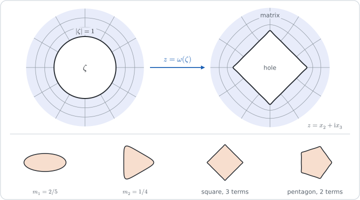

# [Holes given by a conformal map](@id th-conformal-mapping)

!!! info "Before this page"
    [Concentration and contribution tensors](@ref th-concentration), for the
    tensors computed here, and [Hill polarization tensors](@ref th-hill-tensors),
    whose cylindrical case is the elliptic section recovered below.

An infinite cylindrical cavity whose cross-section is not an ellipse has no
Hill tensor. In an isotropic matrix its response is nonetheless exact when the
outside of the section is the image of the outside of a disk by a map with a
finite number of terms: the complex potentials of plane elasticity are then
finite sums. This page derives the concentration tensors of such a cavity; the
method is that of [Muskhelishvili](@cite muskhelishvili1977), and the syntax is
given in [Conformal holes](@ref man-conformal-holes).

## 1. The cavity and its three problems

The cavity is a cylinder of axis ``\underline{e}_1``. Its section, in the plane
``(\underline{e}_2,\underline{e}_3)``, is described by the complex variable
``z=x_2+\mathrm{i}\,x_3``. The matrix is isotropic, of shear modulus ``\mu``,
Poisson ratio ``\nu`` and Young modulus ``E``; the surface of the cavity is
free. The mean strain of the cavity is defined from the displacement of its
surface, of outward normal ``\underline{n}``,

```math
\boldsymbol{\varepsilon}^{c}=\frac{1}{|\Omega|}\oint_{\partial\Omega}\tfrac12\bigl(\underline{u}\otimes\underline{n}+\underline{n}\otimes\underline{u}\bigr)\,\mathrm{d}S
=\mathbb{H}:\boldsymbol{\Sigma} ,
```

and is linear in the remote stress ``\boldsymbol{\Sigma}``: ``\mathbb{H}`` is
the compliance contribution tensor of the cavity, per unit volume, and
``\mathbb{A}=\mathbb{H}:\mathbb{C}_0`` its strain concentration tensor. No
stress acts in the cavity, so that its stress concentration vanishes. A remote
stress is the sum of three loadings, each with an exact solution:

- a stress in the plane of the section, in plane strain (sections 3 and 4);
- a shear ``\Sigma_{12}``, ``\Sigma_{13}`` along the axis, for which the
  displacement is along the axis and harmonic (section 5);
- an axial stress, which the cavity does not disturb (section 6).

## 2. The map

The outside of the section is the image of the outside of the unit disk by

```math
z=\omega(\zeta)=R\,\Bigl(\zeta+\sum_{k=1}^{N}m_k\,\zeta^{-k}\Bigr),\qquad|\zeta|\ge1 ,
```

with complex coefficients ``m_k``; the contour of the hole is the image of the
circle ``\zeta=\sigma=\mathrm{e}^{\mathrm{i}\theta}``. The length ``R`` sets the
size and is taken equal to 1 below.



**One-to-one.** For two points of the domain,

```math
\omega(\zeta_1)-\omega(\zeta_2)=(\zeta_1-\zeta_2)\,\Bigl(1-\sum_km_k\,s_k\Bigr),
\qquad
s_k=\sum_{j=1}^{k}\zeta_1^{-j}\,\zeta_2^{-(k+1-j)} ,
```

and ``|s_k|\le k``. The map is therefore one-to-one, and its derivative does
not vanish, as soon as

```math
\sum_{k=1}^{N}k\,|m_k|<1 .
```

This condition is sufficient, and it is the one the package checks. With the
equality the derivative may vanish on the circle: the contour then has cusps.

**Area.** The area of the hole is
``\tfrac12\operatorname{Im}\oint\bar z\,\mathrm{d}z``, that is

```math
|S|=\pi\,\Bigl(1-\sum_{k=1}^{N}k\,|m_k|^2\Bigr) .
```

**Examples.** ``m_1=m`` alone gives the ellipse of semi-axes ``1+m`` and
``1-m``. ``m_n=m`` alone gives a hypotrochoid, with ``n+1`` rounded corners,
which become cusps for ``m=1/n``. A regular polygon of ``n`` sides is the limit
of the map whose derivative is ``\omega'(\zeta)=(1-\zeta^{-n})^{2/n}``; its
binomial series, integrated term by term, gives the nonzero coefficients

```math
m_{jn-1}=\frac{(-1)^j}{1-jn}\binom{2/n}{j},\qquad j=1,2,\dots
```

Cut after a few terms, the map is a polygon with rounded corners.

## 3. Plane strain: the potentials

In plane strain the stress and the displacement derive from two functions
``\varphi`` and ``\psi``, holomorphic in the matrix
[muskhelishvili1977](@cite). With ``\kappa=3-4\nu``,

```math
\sigma_{22}+\sigma_{33}=4\operatorname{Re}\varphi'(z),
\qquad
2\mu\,(u_2+\mathrm{i}\,u_3)=\kappa\,\varphi(z)-z\,\overline{\varphi'(z)}-\overline{\psi(z)} ,
```

and the resultant of the forces applied to an arc of the contour, from a fixed
point to ``z``, is ``-\mathrm{i}\,\bigl(\varphi+z\,\overline{\varphi'}+\overline{\psi}\bigr)``
up to a constant. The contour of the hole is free: with the constant included
in ``\psi``,

```math
\varphi(z)+z\,\overline{\varphi'(z)}+\overline{\psi(z)}=0\quad\text{on the contour} .
```

Far from the hole the stress is uniform:

```math
\varphi\simeq\Gamma\,z,\qquad\psi\simeq\Gamma'\,z,
\qquad
\Gamma=\frac{\Sigma_{22}+\Sigma_{33}}{4},\qquad
\Gamma'=\frac{\Sigma_{33}-\Sigma_{22}}{2}+\mathrm{i}\,\Sigma_{23} .
```

In the variable ``\zeta`` the potentials are
``\Phi(\zeta)=\varphi(\omega(\zeta))`` and ``\Psi(\zeta)=\psi(\omega(\zeta))``,

```math
\Phi(\zeta)=\Gamma\,\zeta+\sum_{k\ge1}a_k\,\zeta^{-k},
\qquad
\Psi(\zeta)=\Gamma'\,\zeta+\sum_{k\ge0}b_k\,\zeta^{-k} ,
```

and ``\varphi'(z)=\Phi'(\zeta)/\omega'(\zeta)``. On the circle
``\bar\sigma=1/\sigma``, so that ``\overline{\omega(\sigma)}=\bar\omega(1/\sigma)``
with ``\bar\omega(1/\zeta)=\zeta^{-1}+\sum_k\overline{m_k}\,\zeta^{k}``. The
conjugate of the condition on the contour is then

```math
\overline{\Phi(\sigma)}+F(\sigma)+\Psi(\sigma)=0,
\qquad
F(\zeta)=\bar\omega(1/\zeta)\,\frac{\Phi'(\zeta)}{\omega'(\zeta)} .
```

``F`` is holomorphic outside the disk, where ``\omega'`` does not vanish, and
grows as ``\zeta^N`` at infinity:
``F(\zeta)=\sum_{j=0}^{N}c_j\,\zeta^{j}+F_-(\zeta)``, with ``F_-`` vanishing at
infinity. The other terms are
``\overline{\Phi(\sigma)}=\Gamma/\sigma+\sum_k\overline{a_k}\,\sigma^{k}`` and
``\Psi(\sigma)=\Gamma'\sigma+\sum_kb_k\,\sigma^{-k}``. The condition holds for
every power of ``\sigma``. The powers ``j\ge1`` give

```math
\overline{a_j}+c_j=-\Gamma'\,\delta_{j1}\quad(1\le j\le N),
\qquad a_j=0\quad(j>N,\ j\ge2) :
```

the potential ``\Phi`` is a finite sum. The other powers give the ``b_k``,
which are not needed.

**The system.** Let ``g_l`` be the coefficients of
``1/\omega'(\zeta)=\sum_{l\ge0}g_l\,\zeta^{-l}``. Since
``\omega'=1-\sum_kk\,m_k\,\zeta^{-k-1}``,

```math
g_0=1,\qquad g_l=\sum_{k=1}^{N}k\,m_k\,g_{l-k-1}\quad(l\ge1),\qquad g_l=0\ \text{for}\ l<0 .
```

The product ``\Phi'/\omega'`` is ``\sum_{s\ge0}h_s\,\zeta^{-s}`` with
``h_s=\Gamma\,g_s-\sum_ll\,a_l\,g_{s-l-1}``, and only the terms
``\overline{m_k}\,\zeta^k`` of ``\bar\omega(1/\zeta)`` raise it to a positive
power: ``c_j=\sum_{k\ge j}\overline{m_k}\,h_{k-j}``. The unknowns
``a_1,\dots,a_N`` therefore satisfy

```math
\overline{a_j}-\sum_{l=1}^{N}W_{jl}\,a_l=-\Gamma'\,\delta_{j1}-\Gamma\sum_{k=j}^{N}\overline{m_k}\,g_{k-j},
\qquad
W_{jl}=l\sum_{k=j+l+1}^{N}\overline{m_k}\,g_{k-j-l-1} ,
```

a linear system on their real and imaginary parts, of size ``2N``. For the
circle, ``N=1`` and ``m_1=0``, it reduces to ``a_1=-\overline{\Gamma'}``.

## 4. Plane strain: the mean strain of the hole

On the free contour the condition of section 3 turns the displacement into
``2\mu\,(u_2+\mathrm{i}\,u_3)=(\kappa+1)\,\varphi``. Along the contour, run
with the hole on the left, ``(n_2+\mathrm{i}\,n_3)\,\mathrm{d}s=-\mathrm{i}\,\mathrm{d}z``.
With ``u=u_2+\mathrm{i}\,u_3`` and ``n=n_2+\mathrm{i}\,n_3``, the products
``u\,\bar n`` and ``u\,n`` have for real and imaginary parts

```math
\operatorname{Re}(u\,\bar n)=u_2n_2+u_3n_3,\qquad
\operatorname{Re}(u\,n)=u_2n_2-u_3n_3,\qquad
\operatorname{Im}(u\,n)=u_2n_3+u_3n_2 ,
```

so that the mean strain of the hole follows from two integrals over the
circle, computed by residues with ``\mathrm{d}\bar\sigma=-\mathrm{d}\sigma/\sigma^2``:

```math
\oint u\,\bar n\,\mathrm{d}s=\frac{\kappa+1}{2\mu}\,\mathrm{i}\oint\Phi(\sigma)\,\overline{\omega'(\sigma)}\,\mathrm{d}\bar\sigma
=\frac{(\kappa+1)\,\pi}{\mu}\,\Bigl(\Gamma-\sum_{k=1}^{N}k\,\overline{m_k}\,a_k\Bigr),
\qquad
\oint u\,n\,\mathrm{d}s=-\frac{\kappa+1}{2\mu}\,\mathrm{i}\oint\Phi(\sigma)\,\omega'(\sigma)\,\mathrm{d}\sigma
=\frac{(\kappa+1)\,\pi}{\mu}\,\bigl(a_1-\Gamma\,m_1\bigr) .
```

Divided by the area of the hole, with ``A=1-\sum_kk\,|m_k|^2``,

```math
\varepsilon^{c}_{22}+\varepsilon^{c}_{33}=\frac{\kappa+1}{\mu\,A}\operatorname{Re}\Bigl(\Gamma-\sum_kk\,\overline{m_k}\,a_k\Bigr),
\qquad
\varepsilon^{c}_{22}-\varepsilon^{c}_{33}+2\mathrm{i}\,\varepsilon^{c}_{23}=\frac{\kappa+1}{\mu\,A}\,\bigl(a_1-\Gamma\,m_1\bigr) .
```

The elastic constants enter through the factor
``(\kappa+1)/\mu=4(1-\nu)/\mu`` only. For the circle under a tension
``\Sigma_{22}``, ``\Gamma=\Sigma_{22}/4`` and ``a_1=\Sigma_{22}/2``: the two
strains are ``3(1-\nu)\Sigma_{22}/(2\mu)`` and ``-(1-\nu)\Sigma_{22}/(2\mu)``,
the classical result.

## 5. Shear along the axis, and conduction

Under a remote shear ``\Sigma_{12}``, ``\Sigma_{13}`` the displacement is
``u_1=w(x_2,x_3)``, harmonic, with ``\partial w/\partial n=0`` on the contour.
It is the problem of the temperature around an insulating hole, under the
remote gradient ``\underline{G}`` of components ``\Sigma_{1\beta}/\mu``. A
harmonic function is the real part of a holomorphic one, ``w=\operatorname{Re}f``,
and the condition on the contour makes its imaginary part constant there. With
``g=G_2+\mathrm{i}\,G_3``, the function

```math
f(\zeta)=\bar g\,\zeta+\frac{g}{\zeta}
```

is real on the circle and behaves as ``\bar g\,z`` at infinity, whatever the
map: it is the solution. The integral of ``w\,n`` over the contour is, by
residues,

```math
\oint w\,(n_2+\mathrm{i}\,n_3)\,\mathrm{d}s=-\mathrm{i}\oint\Bigl(\bar g\,\sigma+\frac{g}{\sigma}\Bigr)\,\omega'(\sigma)\,\mathrm{d}\sigma
=2\pi\,\bigl(g-m_1\,\bar g\bigr) ,
```

and the mean gradient over the hole is ``\boldsymbol{A}^{s}\cdot\underline{G}``
with, in the plane of the section,

```math
\boldsymbol{A}^{s}=\frac{2}{1-\sum_kk\,|m_k|^2}
\begin{pmatrix}1-\operatorname{Re}m_1&-\operatorname{Im}m_1\\-\operatorname{Im}m_1&1+\operatorname{Re}m_1\end{pmatrix} .
```

Only the first coefficient of the map and the area of the hole enter. In
conduction the gradient concentration tensor of the cavity is
``\underline{e}_1\otimes\underline{e}_1+\boldsymbol{A}^{s}``, a gradient along
the axis being undisturbed; in elasticity the mean strain is
``\varepsilon^{c}_{1\alpha}=A^{s}_{\alpha\beta}\,\Sigma_{1\beta}/(2\mu)``.

## 6. Axial stress, and the whole tensor

A uniform axial stress ``\sigma_{11}`` is a solution in the matrix that leaves
the surface of the cavity free. The plane-strain state of section 3 has the
remote axial stress ``\nu\,(\Sigma_{22}+\Sigma_{33})``; adding the uniform
axial stress ``\Sigma_{11}-\nu\,(\Sigma_{22}+\Sigma_{33})`` gives the remote
stress its value, and adds to the strain of the cavity the uniform strain of
the matrix,

```math
\frac{\Sigma_{11}-\nu\,(\Sigma_{22}+\Sigma_{33})}{E}\,\bigl(\underline{e}_1\otimes\underline{e}_1-\nu\,(\underline{e}_2\otimes\underline{e}_2+\underline{e}_3\otimes\underline{e}_3)\bigr) .
```

The three contributions make up ``\mathbb{H}``, and
``\mathbb{A}=\mathbb{H}:\mathbb{C}_0``.

## 7. Checks

The ellipse is the elliptic cylinder of the package, obtained from its Hill
tensor: the two routes agree on every component.

```@example thconformal
using MeanFieldHomogenization, TensND

C₀ = iso_stiffness(1.7, 0.6)                      # bulk and shear moduli of the matrix
void = 0 * C₀
b, c = 3.0, 1.0                                   # semi-axes of the section
A_map = gradient_gradient_concentration(ConformalHole(((b - c) / (b + c),)), void, C₀)
A_hill = gradient_gradient_concentration(Cylinder(b, c), void, C₀)
maximum(abs, canonical_components(A_map) - canonical_components(A_hill))
```

For the hypotrochoid ``z=\zeta+m\,\zeta^{-n}`` the system of section 3 is
solved by hand. Under a hydrostatic stress in the plane, ``\Gamma'=0`` and
``a_n=-m\,\Gamma`` alone: the area strain of the hole per unit stress, the
compressibility of the pore, is

```math
\frac{4(1-\nu)}{\mu}\,\frac{1}{2}\,\frac{1+n\,m^2}{1-n\,m^2} ,
```

that is ``(1+n\,m^2)/(1-n\,m^2)`` times that of the circle
[ekneligodaPRSA2006](@cite).

```@example thconformal
ν, μ = (3 * 1.7 - 2 * 0.6) / (2 * (3 * 1.7 + 0.6)), 0.6
n, m = 4, 0.15
H = canonical_components(inverse_property_contribution(ConformalHole(n => m), void, C₀))
Σ = (2ν, 1.0, 1.0)                                # hydrostatic in the plane, with its axial reaction
compressibility = sum(H[i, i, j, j] * Σ[j] for i in 2:3, j in 1:3)
compressibility, 2 * (1 - ν) / μ * (1 + n * m^2) / (1 - n * m^2)
```

## 8. Scope

The solution is exact for an isotropic matrix and a map with a finite number
of terms. A corner is reached in the limit of an infinite map only: a cut map
rounds it, and the tensors converge with the number of terms
([Prismatic pores with corners](@ref app-conformal-holes)). The coefficients
are numbers, dual numbers or symbols. [`ConformalHole`](@ref) is the
inclusion; an anisotropic matrix and holes that interact are outside the
method as it is written here.
