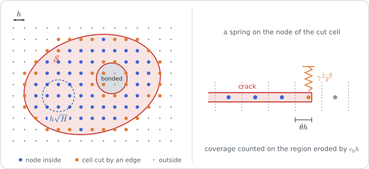

# [Planar cracks of any contour](@id th-gaussian-cracks)

!!! info "Before this page"
    [Crack opening displacement and compliance](@ref th-cod-tensors), §2–4 for
    the COD tensor ``\boldsymbol{B}``, the compliance contribution
    ``\mathbb{H}`` and the reduced kernel
    ``\hat{\boldsymbol{Q}}^{\star}_{nn}``, and §7 for the intensity factors;
    [Approximation by Gaussians](@ref th-gaussian-approximation) for the
    generating function ``\varphi``, the step ``h`` and the shape parameter
    ``H``.

The COD tensor of an elliptic crack is known in closed form because its opening
under a uniform load is an ellipsoidal cap. For another contour (a rectangle, a
ring, a crack whose faces touch on islands) the opening has to be computed. This
page solves the integral equation of a flat crack of any contour by the Gaussian
approximation, as proposed by [Kanaun](@cite kanaun2007) for an isotropic matrix
and [extended](@cite kanaun2009) to an anisotropic one. The equations are
written here with the kernel ``\hat{\boldsymbol{Q}}^{\star}_{nn}`` and the
normalizations of the [COD page](@ref th-cod-tensors), which makes them shorter;
the treatment of the edge (§4) is specific to the package.

## 1. The integral equation of a flat crack

A crack occupies the region ``\mathcal{S}`` of the plane of normal
``\underline{n}``, in an infinite matrix of stiffness ``\mathbb{C}_0`` under the
remote stress ``\boldsymbol{\Sigma}``. Its faces are free: the traction that the
opening ``[\![\underline{u}]\!]`` induces on the plane cancels
``\boldsymbol{\Sigma}\cdot\underline{n}`` on ``\mathcal{S}``. With
``\underline{x}`` a point of the plane and ``\underline{\xi}`` its Fourier
variable (also in the plane), that traction is the opening filtered by the
reduced kernel of the [COD page](@ref th-cod-green):

```math
\boxed{\;
\frac{1}{(2\pi)^{2}}\int
\hat{\boldsymbol{Q}}^{\star}_{nn}(\underline{\xi})\cdot
\widehat{[\![\underline{u}]\!]}(\underline{\xi})\;
\mathrm{e}^{i\underline{\xi}\cdot\underline{x}}\,\mathrm{d}S_{\xi}
= \boldsymbol{\Sigma}\cdot\underline{n}
\quad (\underline{x}\in\mathcal{S}),
\qquad
[\![\underline{u}]\!] = \underline{0}\ \text{ outside }\mathcal{S}.
\;}
\tag{1}
```

``\hat{\boldsymbol{Q}}^{\star}_{nn}`` is a symmetric positive definite tensor of
order 2, homogeneous of degree one. Writing
``\underline{\xi} = \xi\,\underline{e}(\theta)`` with ``\underline{e}`` a unit
vector of the plane at the polar angle ``\theta``,

```math
\hat{\boldsymbol{Q}}^{\star}_{nn}(\underline{\xi}) = \xi\;\boldsymbol{T}(\theta),
\qquad
\boldsymbol{T}(\theta) = \hat{\boldsymbol{Q}}^{\star}_{nn}(\underline{e}(\theta)),
\qquad
\boldsymbol{T}(\theta+\pi) = \boldsymbol{T}(\theta).
```

The whole anisotropy of the matrix is in the function ``\boldsymbol{T}(\theta)``.

**Isotropic matrix** of shear modulus ``\mu`` and Poisson ratio ``\nu``
([COD page](@ref th-cod-iso-derivation)):

```math
\boldsymbol{T}(\theta) = \frac{\mu}{2}\left[\boldsymbol{1}
  + \frac{\nu}{1-\nu}\,\bigl(\underline{n}\otimes\underline{n}
  + \underline{e}\otimes\underline{e}\bigr)\right].
\tag{2}
```

**Any anisotropy**: ``\boldsymbol{T}(\theta)`` is the line integral that defines
``\hat{\boldsymbol{Q}}^{\star}_{nn}``, computed numerically by the same routine
as for elliptic cracks.

**Conduction.** The jump of the potential ``[\![T]\!]`` of an insulating crack
obeys (1) with a scalar kernel. With the conductivity ``\boldsymbol{K}_0`` and
``\hat{\boldsymbol{Q}}(\underline{\xi}) = \boldsymbol{K}_0 -
\boldsymbol{K}_0\cdot\underline{\xi}\otimes\underline{\xi}\cdot\boldsymbol{K}_0
/(\underline{\xi}\cdot\boldsymbol{K}_0\cdot\underline{\xi})``, put
``\underline{\xi} = \underline{\xi}^{\star}+\zeta\,\underline{n}``,
``k_{nn} = \underline{n}\cdot\boldsymbol{K}_0\cdot\underline{n}``,
``v = \underline{n}\cdot\boldsymbol{K}_0\cdot\underline{\xi}^{\star}`` and
``q = \underline{\xi}^{\star}\cdot\boldsymbol{K}_0\cdot\underline{\xi}^{\star}``.
Then

```math
\underline{n}\cdot\hat{\boldsymbol{Q}}\cdot\underline{n}
= k_{nn} - \frac{(v+\zeta k_{nn})^{2}}{k_{nn}\zeta^{2}+2v\zeta+q}
= \frac{k_{nn}\,q - v^{2}}{k_{nn}\zeta^{2}+2v\zeta+q},
\qquad
\int_{-\infty}^{+\infty}\frac{\mathrm{d}\zeta}{k_{nn}\zeta^{2}+2v\zeta+q}
= \frac{\pi}{\sqrt{k_{nn}\,q-v^{2}}},
```

and the reduced kernel, ``1/(2\pi)`` times the integral over ``\zeta``, is

```math
\hat{Q}^{\star}_{nn}(\underline{\xi}^{\star})
= \frac{1}{2}\sqrt{(\underline{n}\cdot\boldsymbol{K}_0\cdot\underline{n})\,
  (\underline{\xi}^{\star}\cdot\boldsymbol{K}_0\cdot\underline{\xi}^{\star})
  - (\underline{n}\cdot\boldsymbol{K}_0\cdot\underline{\xi}^{\star})^{2}},
\tag{3}
```

that is ``k_0\,\xi/2`` in an isotropic matrix of conductivity ``k_0``.

## 2. The traction due to one Gaussian

The opening is expanded on the Gaussians of the nodes
``\underline{x}_m`` of a square grid of step ``h`` laid on the plane
([Approximation by Gaussians](@ref th-gaussian-approximation)):

```math
[\![\underline{u}]\!](\underline{x}) = \sum_m \underline{u}_m\,
  \varphi(\underline{x}-\underline{x}_m),
\qquad
\varphi(\underline{x}) = \frac{1}{\pi H}\exp\!\left(-\frac{|\underline{x}|^{2}}{H h^{2}}\right),
\qquad
\hat{\varphi}(\underline{\xi}) = h^{2}\exp\!\left(-\frac{H h^{2}\xi^{2}}{4}\right).
```

By (1), the traction at ``\underline{x}`` due to the Gaussian of a node is
``\boldsymbol{A}(\underline{x}-\underline{x}_m)\cdot\underline{u}_m``, with

```math
\boldsymbol{A}(\underline{x}) = \frac{1}{(2\pi)^{2}}\int
  \xi\,\boldsymbol{T}(\theta)\,\hat{\varphi}(\xi)\,
  \mathrm{e}^{i\underline{\xi}\cdot\underline{x}}\,\mathrm{d}S_{\xi}.
```

In polar coordinates, and since ``\boldsymbol{T}`` has the period ``\pi``, the
integral over ``\xi`` is that of ``\xi^{2}\hat{\varphi}(\xi)\cos(\xi t)`` with
``t = \underline{e}(\theta)\cdot\underline{x}``. It follows from
``\int_0^\infty\mathrm{e}^{-s\xi^{2}}\cos(\xi t)\,\mathrm{d}\xi =
\tfrac12\sqrt{\pi/s}\;\mathrm{e}^{-t^{2}/(4s)}`` by a derivative with respect
to ``s``:

```math
\int_0^\infty \xi^{2}\,\mathrm{e}^{-s\xi^{2}}\cos(\xi t)\,\mathrm{d}\xi
= \frac{\sqrt{\pi}}{4\,s^{3/2}}\left(1-\frac{t^{2}}{2s}\right)\mathrm{e}^{-t^{2}/(4s)},
\qquad s = \frac{H h^{2}}{4}.
```

With ``\underline{x} = \rho\,h\,\underline{e}(\vartheta)``, so that
``t = \rho h\cos(\theta-\vartheta)``, a single angular integral remains:

```math
\boldsymbol{A}(\underline{x}) = \frac{1}{h}\;\frac{1}{2\pi^{3/2}H^{3/2}}
\int_0^{2\pi}\boldsymbol{T}(\theta)\,
\Bigl(1-\frac{2\rho^{2}\cos^{2}(\theta-\vartheta)}{H}\Bigr)\,
\exp\!\Bigl(-\frac{\rho^{2}\cos^{2}(\theta-\vartheta)}{H}\Bigr)\,\mathrm{d}\theta.
\tag{4}
```

``\boldsymbol{T}`` being periodic of period ``\pi``, it is a Fourier series in
``2\theta``,
``\boldsymbol{T}(\theta) = \sum_{k\ge0}\bigl[\boldsymbol{T}^{c}_{k}\cos 2k\theta +
\boldsymbol{T}^{s}_{k}\sin 2k\theta\bigr]``, and each harmonic of (4)
integrates in closed form. With ``z = \rho^{2}/H`` and the modified Bessel
functions ``I_k`` taken at ``z/2``,
``\int_0^{2\pi}\cos 2k\phi\;\mathrm{e}^{-z\cos^{2}\phi}\,\mathrm{d}\phi =
2\pi(-1)^{k}\,\mathrm{e}^{-z/2}I_k``, and a derivative with respect to ``z``
gives the same integral weighted by ``\cos^{2}\phi``. Hence

```math
\boxed{\;
\boldsymbol{A}(\underline{x}) = \frac{1}{h}\sum_{k\ge0}
\bigl[\boldsymbol{T}^{c}_{k}\cos 2k\vartheta
     + \boldsymbol{T}^{s}_{k}\sin 2k\vartheta\bigr]\,Z_k(\rho),
\qquad
Z_k(\rho) = \frac{(-1)^{k}\,\mathrm{e}^{-z/2}}{\sqrt{\pi}\,H^{3/2}}
\Bigl[(1-z)\,I_k + \frac{z}{2}\,(I_{k-1}+I_{k+1})\Bigr].
\;}
\tag{5}
```

The isotropic kernel (2) has two harmonics, ``k = 0`` and ``k = 1``; an
anisotropic one has a series that converges fast, cut where its terms fall
below ``10^{-12}`` of the mean. Far from the node,
``Z_0\simeq-1/(2\pi\rho^{3})``: the traction of a point dislocation loop of
moment ``h^{2}\underline{u}_m``.

```@example gausscrack
using MeanFieldHomogenization
using Plots

G = MeanFieldHomogenization.GaussianApproximation
ρ = range(0, 6; length = 300)
plt = plot(; xlabel = "ρ = |x| / h", ylabel = "Z_k(ρ)", legend = :topright)
for k in 0:2
    plot!(plt, ρ, [G.harmonic_profile(k, r^2, 2.0) for r in ρ]; lw = 2, label = "k = $k")
end
plot!(plt, ρ[100:end], [-1 / (2π * r^3) for r in ρ[100:end]]; ls = :dash, color = :black,
    label = "-1 / (2π ρ³)")
plt
```

## 3. The system

The equation (1) is written at the nodes that the crack contains (collocation),
with ``\underline{u}_m = \underline{0}`` at the others:

```math
\sum_{m'\in\mathcal{S}}\boldsymbol{A}(\underline{x}_m-\underline{x}_{m'})\cdot\underline{u}_{m'}
= \boldsymbol{\Sigma}\cdot\underline{n}
\qquad (\underline{x}_m\in\mathcal{S}).
\tag{6}
```

The contour enters through the list of the nodes inside it, and nowhere else.



The matrix is symmetric positive definite, as the kernel is; it depends on
``m-m'`` only, so its product by a vector is a discrete convolution, evaluated
by fast Fourier transform on arrays padded with zeros to twice the size of the
grid (the sum over the nodes is then exact, without periodic images). The system
is solved by the conjugate gradient, for the three unit loads
``\boldsymbol{\Sigma}\cdot\underline{n}`` at once.

## 4. Where the edge is

Keeping or dropping a node moves the edge of the discrete crack by a whole step,
and the Gaussians of the last nodes kept spread the opening beyond them. Left
alone, the two effects give the COD tensor an error of first order in ``h``,
large for a narrow crack. The package removes it in three steps.

**A spring on the nodes of the edge.** Let ``\theta_m\in[0,1]`` be the fraction
of the cell of node ``m`` that the crack covers. A node whose cell is cut is
kept, and held by a spring proportional to the term of the matrix on its
diagonal:

```math
\sum_{m'}\boldsymbol{A}(\underline{x}_m-\underline{x}_{m'})\cdot\underline{u}_{m'}
+ \gamma\,\frac{1-\theta_m}{\theta_m}\,\boldsymbol{A}(\underline{0})\cdot\underline{u}_m
= \boldsymbol{\Sigma}\cdot\underline{n}.
\tag{7}
```

The spring vanishes for a cell inside the crack and is rigid for a cell outside.
The coefficient ``\gamma`` is calibrated on the local problem of any smooth
edge: a straight edge along the grid, that is a line crack ``|x|<a`` in one
dimension, whose exact opening ``\sqrt{a^{2}-x^{2}}`` under a unit load (for
the kernel ``|\xi|``) has the integral ``\pi a^{2}/2``. The half-length that
the discrete solution represents is read from that integral. For the right
``\gamma``, it follows ``a`` continuously as the edge is swept across a cell,
instead of jumping by a step.

**A constant offset.** The discrete edge then lies a constant distance
``c_0\,h`` beyond the edge of the region. The fractions ``\theta_m`` are
therefore computed on the region eroded by ``c_0 h``.

Both constants depend on ``H`` only, and [`edge_rule`](@ref) returns them:

```@example gausscrack
γ, c₀ = edge_rule(2.0)
```

**Two grids.** What remains is of first order with a small coefficient (the
calibration is exact for an edge along the grid, approximate for an oblique
one). The mean openings are computed on the grids of ``n`` and ``n/2`` nodes
and extrapolated linearly to ``h = 0``.

The three steps on a disk and on a ring of radii ``1`` and ``1/2``, against the
closed form of the penny-shaped crack and the Galerkin solution of the
[annular crack](@ref th-rice-contributions):

```@example gausscrack
using TensND, LinearAlgebra

C₀ = iso_stiffness_E_nu(10.0, 0.3)
relative_error(B, Bref) = norm(get_array(B) - get_array(Bref)) / norm(get_array(Bref))
cases = (
    ("disk", Disk(1.0), cod_tensor(PennyCrack(1.0), C₀)),
    ("ring", Annulus(1.0, 0.5), cod_tensor(AnnularCrack(1.0, 0.5), C₀; method = :opening)),
)
ns = (16, 24, 32, 48)
plt = plot(; xscale = :log10, yscale = :log10, xlabel = "nodes across the crack, n",
    ylabel = "relative error on B", legend = :bottomleft)
for (name, region, Bref) in cases, (label, extrapolate) in (("one grid", false), ("two grids", true))
    errors = [relative_error(cod_tensor(PlanarCrack(region; n, size = 1.0, extrapolate), C₀), Bref) for n in ns]
    plot!(plt, collect(ns), errors; marker = :circle, label = "$name, $label")
end
plt
```

## 5. From the opening to ``\boldsymbol{B}``, ``\mathbb{H}`` and ``\boldsymbol{R}``

The integral of the opening is the sum of its coefficients times the integral
``h^{2}`` of a Gaussian. A crack of any contour is normalized as a penny-shaped
crack is by its radius, with a reference length ``\ell`` (by default the radius
``\sqrt{S/\pi}`` of the disk of the same area ``S``):

```math
\pi\,\ell^{3}\,\boldsymbol{B}\cdot\boldsymbol{\Sigma}\cdot\underline{n}
= \int_{\mathcal{S}}[\![\underline{u}]\!]\,\mathrm{d}S
\simeq h^{2}\sum_m\underline{u}_m,
\qquad
\mathbb{H} = \frac{3}{4}\,\underline{n}\stackrel{s}{\otimes}\boldsymbol{B}
  \stackrel{s}{\otimes}\underline{n},
\qquad
\Delta\mathbb{S} = \frac{4\pi}{3}\,\varepsilon\,\mathbb{H},
\quad \varepsilon = N\ell^{3},
```

so that a disk of radius ``\ell`` has the ``\boldsymbol{B}`` of the
[penny-shaped crack](@ref th-cod-tensors), and every relation of the
[COD page](@ref th-cod-compliance) holds unchanged. ``\ell`` is a convention:
``\ell^{3}\boldsymbol{B}``, hence the contribution of ``N`` cracks per unit
volume, does not depend on it. In conduction the same solve with the scalar
kernel (3) gives the thermal COD ``b`` and the resistivity contribution
``\boldsymbol{R} = \tfrac34\,b\,\underline{n}\otimes\underline{n}``
([Thermal cracks](@ref th-thermal-cracks)).

**Compliance and resistance.** In an isotropic matrix the normal component of
(2) is ``\mu\,\xi/(2(1-\nu))`` and the kernel (3) is ``k_0\,\xi/2``: the normal
opening per unit normal traction and the potential jump per unit normal flux
solve the same equation up to a constant, at every point and for every contour,

```math
\frac{B_{nn}}{b} = \frac{k_0\,(1-\nu)}{\mu},
```

which is the connection of [Kachanov and Argatov](@cite kachanov2023) between
the compliance and the resistance of a flat crack. It holds with contacts
between the faces (§6) and not in an anisotropic matrix, where the two kernels
have different angular dependences.

## 6. Contacts and interface stiffness

**Contacts.** Faces that touch on islands and are bonded there have no opening
on the islands: the region ``\mathcal{S}`` of (1) is the contour without the
islands, a region with holes, and nothing else changes
[markov2025](@cite). The edge rule of §4 applies to the edges of the islands as
to the outer edge.

**Interface stiffness.** Faces linked by springs of stiffness
``\boldsymbol{K}`` (traction ``\boldsymbol{K}\cdot[\![\underline{u}]\!]``
between the faces) carry part of the load: the right-hand side of (1) becomes
``\boldsymbol{\Sigma}\cdot\underline{n}-\boldsymbol{K}\cdot[\![\underline{u}]\!]``,
that is a block ``\boldsymbol{K}`` added on every node of (6). The opening is no
longer an ellipsoidal cap, even for an ellipse: the closed form
``\boldsymbol{B}\cdot(\boldsymbol{1}+b\,\boldsymbol{K}\cdot\boldsymbol{B})^{-1}``
used for elliptic cracks assumes it is, and is exact only in the limits
``\boldsymbol{K}\to\boldsymbol{0}`` and ``\boldsymbol{K}\to\infty``.

```@example gausscrack
crack = PlanarCrack(Disk(1.0); n = 32)
stiffness = 10.0 .^ range(-1, 2; length = 7)
Bnn(B) = get_array(B)[3, 3]
exact = [Bnn(cod_tensor(crack, C₀; K_interface = TensISO{3}(K))) for K in stiffness]
cap = [Bnn(cod_tensor(PennyCrack(1.0), C₀; K_interface = TensISO{3}(K))) for K in stiffness]
plot(stiffness, [exact cap]; xscale = :log10, marker = :circle, xlabel = "interface stiffness K",
    ylabel = "B_nn", label = ["integral equation" "ellipsoidal-cap closed form"])
```

## 7. Intensity factors

At a regular point of the front, of outward normal ``\underline{\nu}`` in the
plane, the opening at the distance ``s`` inside the crack and the stress
intensity factor are those of the [COD page](@ref th-cod-tensors), §7:

```math
[\![\underline{u}]\!] \simeq 4\sqrt{\frac{2}{\pi}}\;\underline{N}\,\sqrt{s},
\qquad
\underline{K} = \pi\,\bigl(\boldsymbol{B}^{\mathcal{R}}(\underline{\nu},\underline{n})\bigr)^{-1}
  \cdot\underline{N}.
```

The second relation involves the ribbon crack tangent to the front and the
matrix only: it is local [kanaun1981, kunin1983, kanaunlevin2009](@cite), and
holds for any contour and any anisotropy. [`sif_from_dif`](@ref) applies it. For
a [`PlanarCrack`](@ref), ``\underline{N}`` is fitted on the computed opening
along the inward normal, between 3 and 10 steps from the front, by
``\sqrt{s+s_0}\,\bigl(\underline{N}'+\underline{M}\,(s+s_0)\bigr)``, where
``s_0`` absorbs what remains of the position of the discrete edge. Against the
exact elliptic crack, in isotropic and transversely isotropic matrices and in
conduction, the three modes are within 1 to 2 % with 64 nodes across the crack.
The relation does not hold at a corner of the contour.

## 8. Derivatives

The system (6) reads ``\boldsymbol{\mathsf{A}}(p)\,\boldsymbol{\mathsf{u}} =
\boldsymbol{\mathsf{t}}`` with ``p`` a property of the matrix. Its derivative,
``\boldsymbol{\mathsf{A}}\,\partial_p\boldsymbol{\mathsf{u}} =
\partial_p\boldsymbol{\mathsf{t}}-(\partial_p\boldsymbol{\mathsf{A}})\,\boldsymbol{\mathsf{u}}``,
is one more solve with the same matrix. `ForwardDiff` duals carried by
``\mathbb{C}_0`` are propagated that way, nested ones included, and the
derivatives are exact for the discrete system. A derivative with respect to the
contour is refused: the list of nodes is not a continuous function of it.

## Where to go next

- [Planar cracks of any contour](@ref man-planar-cracks), in the manual: the
  ways to describe a contour, and the functions.
- [Contributions from intensity factors](@ref th-rice-contributions): another
  description of a non-elliptic crack, when its intensity factors are known.

## References

```@bibliography
Pages = ["gaussian_cracks.md"]
Canonical = false
```
