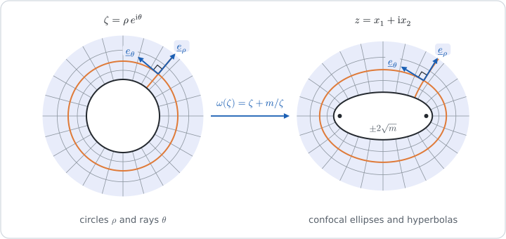

# [Holomorphic functions and conformal maps](@id th-holomorphic-functions)

!!! info "Before this page"
    Only the calculus of functions of two real variables. The page supports
    [Complex potentials of plane elasticity](@ref th-complex-potentials) and
    [Holes given by a conformal map](@ref th-conformal-mapping).

A point of the plane, of coordinates ``(x_1,x_2)``, is the complex number
``z=x_1+\mathrm{i}\,x_2``, of conjugate ``\bar z=x_1-\mathrm{i}\,x_2``. The
plane problems of elasticity are solved with the functions of ``z`` that have a
derivative in the complex sense and with the maps they define. This appendix
gives the part of their theory that those solutions use, with a proof when it
is short and the reference otherwise.

## 1. Derivatives with respect to ``z`` and ``\bar z``

A function ``f(x_1,x_2)`` with complex values is differentiated along the two
operators

```math
\frac{\partial}{\partial z}=\frac12\Bigl(\frac{\partial}{\partial x_1}-\mathrm{i}\,\frac{\partial}{\partial x_2}\Bigr),
\qquad
\frac{\partial}{\partial\bar z}=\frac12\Bigl(\frac{\partial}{\partial x_1}+\mathrm{i}\,\frac{\partial}{\partial x_2}\Bigr) .
```

They act as if ``z`` and ``\bar z`` were independent variables:
``\partial z/\partial z=\partial\bar z/\partial\bar z=1`` and
``\partial\bar z/\partial z=\partial z/\partial\bar z=0``; the rules of the
product and of the chain hold; the conjugation exchanges them,
``\overline{\partial f/\partial z}=\partial\bar f/\partial\bar z``. Their
product is a quarter of the Laplacian:

```math
4\,\frac{\partial^2}{\partial z\,\partial\bar z}
=\Bigl(\frac{\partial}{\partial x_1}-\mathrm{i}\,\frac{\partial}{\partial x_2}\Bigr)\Bigl(\frac{\partial}{\partial x_1}+\mathrm{i}\,\frac{\partial}{\partial x_2}\Bigr)
=\frac{\partial^2}{\partial x_1^2}+\frac{\partial^2}{\partial x_2^2}=\Delta .
```

For an increment ``h=h_1+\mathrm{i}\,h_2``, with ``h_1=(h+\bar h)/2`` and
``h_2=(h-\bar h)/(2\mathrm{i})``,

```math
f(z+h)-f(z)=\frac{\partial f}{\partial x_1}\,h_1+\frac{\partial f}{\partial x_2}\,h_2+o(\lvert h\rvert)
=\frac{\partial f}{\partial z}\,h+\frac{\partial f}{\partial\bar z}\,\bar h+o(\lvert h\rvert) .
```

**Holomorphic functions.** The ratio ``(f(z+h)-f(z))/h`` has a limit that does
not depend on the direction of ``h`` if and only if the coefficient of
``\bar h`` vanishes. A function is holomorphic in a domain when, at every
point of it,

```math
\frac{\partial f}{\partial\bar z}=0 ,
\qquad\text{and then}\qquad
f'(z)=\frac{\partial f}{\partial z}=\frac{\partial f}{\partial x_1}=-\mathrm{i}\,\frac{\partial f}{\partial x_2} .
```

With ``f=P+\mathrm{i}\,Q``, the real and imaginary parts of
``\partial f/\partial\bar z=0`` are the Cauchy–Riemann equations

```math
\frac{\partial P}{\partial x_1}=\frac{\partial Q}{\partial x_2},
\qquad
\frac{\partial P}{\partial x_2}=-\frac{\partial Q}{\partial x_1} .
```

Polynomials of ``z``, the exponential, ``1/z`` away from the origin and their
sums, products and compositions are holomorphic; ``\bar z`` is not. The
conjugate of a holomorphic function, ``\overline{f(z)}``, is a function of
``\bar z`` alone:
``\partial\overline{f(z)}/\partial z=\overline{\partial f/\partial\bar z}=0``
and ``\partial\overline{f(z)}/\partial\bar z=\overline{f'(z)}``.

The Jacobian matrix of ``(x_1,x_2)\mapsto(P,Q)`` for
``f(z)=\mathrm{e}^{z}+1/z`` satisfies the two equations, its first column is
``f'``, and the Laplacian of ``P`` vanishes:

```@example thholo
using ForwardDiff

h(z) = exp(z) + 1 / z                             # holomorphic away from the origin
X(x) = (w = h(complex(x[1], x[2])); [real(w), imag(w)])
x = [0.7, -0.4]
J = ForwardDiff.jacobian(X, x)                    # ∂(P, Q)/∂(x₁, x₂)
HP = ForwardDiff.hessian(x -> X(x)[1], x)
z₀ = complex(x[1], x[2])
(J[1, 1] - J[2, 2], J[1, 2] + J[2, 1], complex(J[1, 1], J[2, 1]) - (exp(z₀) - 1 / z₀^2), HP[1, 1] + HP[2, 2])
```

## 2. Harmonic functions

The real and the imaginary parts of a holomorphic function are harmonic:
``\Delta f=4\,\partial(\partial f/\partial\bar z)/\partial z=0``, and the
Laplacian is a real operator, so that ``\Delta P=\Delta Q=0``. The two are
called conjugate: each determines the other, up to a constant, through the
Cauchy–Riemann equations.

**Conversely**, on a simply connected domain, every real harmonic function
``P`` is the real part of a holomorphic function. The function
``g=2\,\partial P/\partial z`` is holomorphic, since
``\partial g/\partial\bar z=\Delta P/2=0``. On a simply connected domain a
holomorphic function has a primitive ``f``, ``f'=g`` (Cauchy's theorem). Then
``\partial(P-\operatorname{Re}f)/\partial z=g/2-f'/2=0``; the function
``P-\operatorname{Re}f`` is real, so that its derivative with respect to
``\bar z``, the conjugate of the former, vanishes too: it is a constant, which
is added to ``f``. On a domain with a hole the primitive may take another value
after one turn around it (section 5).

## 3. Biharmonic functions

The stress function of plane elasticity satisfies ``\Delta\Delta F=0``
([Complex potentials of plane elasticity](@ref th-complex-potentials)). On a
simply connected domain, every real biharmonic function is

```math
F=\operatorname{Re}\bigl[\bar z\,\varphi(z)+\chi(z)\bigr] ,
```

with ``\varphi`` and ``\chi`` holomorphic: the form of Goursat
([Muskhelishvili](@cite muskhelishvili1977), section 31, equation (31.2)). It
follows from ``\Delta\Delta F=16\,\partial^4F/\partial z^2\partial\bar z^2=0``
by integrating twice.

- Let ``G=\partial^2F/\partial z\,\partial\bar z=\Delta F/4``, real. It is
  harmonic, so that ``2\,\partial G/\partial z`` is holomorphic (section 2);
  let ``\varphi`` be a function whose second derivative is
  ``2\,\partial G/\partial z``. Then ``G-\operatorname{Re}\varphi'`` is real and
  its derivative with respect to ``z`` vanishes: it is a constant, added to
  ``\varphi'`` by a term proportional to ``z`` in ``\varphi``. Thus
  ``\Delta F=4\operatorname{Re}\varphi'(z)``.
- The function ``\operatorname{Re}(\bar z\,\varphi)=\tfrac12(\bar z\,\varphi+z\,\bar\varphi)``
  has ``\partial^2/\partial z\,\partial\bar z=\tfrac12(\varphi'+\overline{\varphi'})=\operatorname{Re}\varphi'``.
  The difference ``F-\operatorname{Re}(\bar z\,\varphi)`` is therefore
  harmonic, the real part of a holomorphic ``\chi`` (section 2).

Conversely every such ``F`` is biharmonic, since ``\Delta F=4\operatorname{Re}\varphi'``
is harmonic. The check, with symbols, on ``z^3`` for the Cauchy–Riemann
equations and on ``\varphi=z^2``, ``\chi=z^4`` for the form of Goursat:

```@example thholo
import Symbolics

Symbolics.@variables x₁ x₂
z = x₁ + im * x₂
D₁, D₂ = Symbolics.Differential(x₁), Symbolics.Differential(x₂)
∂(D, F) = Symbolics.expand_derivatives(D(F))
Δ(F) = ∂(D₁, ∂(D₁, F)) + ∂(D₂, ∂(D₂, F))
cube = z * z * z
P, Q = real(cube), imag(cube)
Symbolics.simplify.((∂(D₁, P) - ∂(D₂, Q), ∂(D₂, P) + ∂(D₁, Q), Δ(P)); expand = true)
```

```@example thholo
φ, χ = z * z, z * z * z * z
F = real(conj(z) * φ + χ)
Symbolics.simplify.((Δ(Δ(F)), Δ(F) - 4real(2z)); expand = true)   # ΔΔF and ΔF - 4 Re φ′
```

## 4. Series, and their coefficients on the unit circle

The domains of this documentation are the outside of a hole, mapped on the
outside of the unit disk (section 6). A function ``f`` holomorphic for
``\lvert\zeta\rvert>1`` is the sum of its Laurent series

```math
f(\zeta)=\sum_{k=-\infty}^{+\infty}c_k\,\zeta^{k},
\qquad
c_k=\frac{1}{2\pi\mathrm{i}}\oint_{\lvert\zeta\rvert=r}f(\zeta)\,\zeta^{-k-1}\,\mathrm{d}\zeta\quad(r>1) .
```

If ``f`` is bounded by ``M`` at infinity, ``\lvert c_k\rvert\le M\,r^{-k}``
for every large ``r``: the coefficients of the positive powers vanish, and
``f=\sum_{k\ge0}c_k\,\zeta^{-k}``, with ``c_0=f(\infty)``. If ``f`` grows as
``\Gamma\,\zeta`` at most, one positive power remains, ``c_1=\Gamma``.

**Identification on the circle.** On the unit circle
``\zeta=\sigma=\mathrm{e}^{\mathrm{i}\theta}``, so that ``\bar\sigma=1/\sigma``
and the conjugate of a series is again a series of powers of ``\sigma``:

```math
\overline{f(\sigma)}=\sum_{k}\overline{c_k}\,\sigma^{-k} .
```

Since ``\frac{1}{2\pi}\int_0^{2\pi}\sigma^{k}\,\bar\sigma^{j}\,\mathrm{d}\theta=\delta_{kj}``,
a series ``\sum_kd_k\,\sigma^k`` that vanishes for every ``\theta`` has all
its coefficients zero. A boundary condition on the contour of a hole mixes a
function and the conjugate of another; written on the circle, it becomes a
relation between series of ``\sigma`` and is solved power by power. When the
map of the hole has a finite number of terms, the sums are finite
([Holes given by a conformal map](@ref th-conformal-mapping), section 3, and
the elliptic hole of [Complex potentials of plane elasticity](@ref th-complex-potentials)).

**Cauchy's formula.** The general tool for the same task is the Cauchy
integral. For ``f`` holomorphic for ``\lvert\zeta\rvert>1``, continuous up to
the circle and bounded at infinity, the circle being run counterclockwise
([Muskhelishvili](@cite muskhelishvili1977), section 70, equations (70.1′) and
(70.2′)),

```math
\frac{1}{2\pi\mathrm{i}}\oint\frac{f(\sigma)}{\sigma-\zeta}\,\mathrm{d}\sigma
=\begin{cases}
-f(\zeta)+f(\infty), & \lvert\zeta\rvert>1,\\
f(\infty), & \lvert\zeta\rvert<1 .
\end{cases}
```

The integral, computed by the trapezoidal rule on the circle, for a function
with a pole inside the disk:

```@example thholo
g(ζ) = 2 + 1 / (ζ - 0.4im) + 0.3 / ζ^2            # holomorphic outside the circle, g(∞) = 2
n = 64
σs = cis.(2π * (0:(n - 1)) / n)
cauchy(ζ) = sum(g(σ) * σ / (σ - ζ) for σ in σs) / n   # dσ = i σ dθ
ζₒ, ζᵢ = 1.6 * cis(0.4), 0.5 * cis(-1.0)
abs(cauchy(ζₒ) - (2 - g(ζₒ))), abs(cauchy(ζᵢ) - 2)
```

## 5. The logarithm, and potentials that are not single-valued

The function ``\log z=\ln\lvert z\rvert+\mathrm{i}\arg z`` is holomorphic in
the plane without the origin, of derivative ``1/z``, but it is not
single-valued: after one counterclockwise turn around the origin its value has
increased by ``2\pi\mathrm{i}``. Outside a hole, let ``f'`` be holomorphic and
single-valued, of Laurent coefficients ``d_k``. Integrating term by term,

```math
f(\zeta)=d_{-1}\log\zeta+\sum_{k\ne-1}\frac{d_k}{k+1}\,\zeta^{k+1}+\text{const},
```

and ``f`` is single-valued if and only if ``d_{-1}=0``, that is
``\oint f'\,\mathrm{d}\zeta=0``. The potentials of plane elasticity outside a
hole have such a term, proportional to the resultant of the forces applied to
the hole, and it vanishes for a free hole
([Complex potentials of plane elasticity](@ref th-complex-potentials),
section 3).

## 6. Conformal maps

Let ``z=\omega(\zeta)`` be holomorphic and one-to-one on a domain, with
``\omega'\ne0``. Near a point, ``\mathrm{d}z=\omega'(\zeta)\,\mathrm{d}\zeta``:
every small segment is turned by ``\arg\omega'(\zeta)`` and stretched by
``\lvert\omega'(\zeta)\rvert``, the same for all directions. Two curves keep the
angle at which they cross, and a small figure keeps its shape: the map is
conformal ([Muskhelishvili](@cite muskhelishvili1977), section 47).

The outside of a hole is the image of the outside of the unit disk by

```math
z=\omega(\zeta)=R\,\Bigl(\zeta+\sum_{k=1}^{N}m_k\,\zeta^{-k}\Bigr),\qquad\lvert\zeta\rvert\ge1 ,
```

which keeps the point at infinity at infinity; the condition that makes it
one-to-one, and the shapes it gives, are in
[Holes given by a conformal map](@ref th-conformal-mapping), section 2.

**Curvilinear coordinates.** With ``\zeta=\rho\,\mathrm{e}^{\mathrm{i}\theta}``,
the images of the circles ``\rho=\text{const}`` and of the rays
``\theta=\text{const}`` cover the outside of the hole, the contour being
``\rho=1`` ([Muskhelishvili](@cite muskhelishvili1977), section 49,
equation (49.1)). Their tangents are

```math
\frac{\partial z}{\partial\rho}=\mathrm{e}^{\mathrm{i}\theta}\,\omega'(\zeta)=\frac{\zeta\,\omega'(\zeta)}{\rho},
\qquad
\frac{\partial z}{\partial\theta}=\mathrm{i}\,\zeta\,\omega'(\zeta)=\mathrm{i}\,\rho\,\frac{\partial z}{\partial\rho} :
```

the two families cross at right angles, and the ratio of the lengths is
``\rho``. The unit vector ``\underline{e}_\rho`` of increasing ``\rho`` is the
complex number ``\mathrm{e}^{\mathrm{i}\alpha}`` and ``\underline{e}_\theta``
is ``\mathrm{i}\,\mathrm{e}^{\mathrm{i}\alpha}``, with

```math
\mathrm{e}^{\mathrm{i}\alpha}=\frac{\zeta\,\omega'(\zeta)}{\rho\,\lvert\omega'(\zeta)\rvert} ,
```

so that a vector of components ``(A_1,A_2)`` has, in the frame
``(\underline{e}_\rho,\underline{e}_\theta)``, the components
``A_\rho+\mathrm{i}\,A_\theta=\mathrm{e}^{-\mathrm{i}\alpha}(A_1+\mathrm{i}\,A_2)``
(Muskhelishvili's equations (49.3) and (49.4)). The contour, ``\rho=1``, has
``\underline{e}_\theta`` for tangent and ``\underline{e}_\rho`` for normal,
pointing away from the hole.

**The ellipse.** The map ``\omega(\zeta)=R\,(\zeta+m/\zeta)`` with
``0\le m<1`` gives

```math
x_1=R\,\Bigl(\rho+\frac{m}{\rho}\Bigr)\cos\theta,
\qquad
x_2=R\,\Bigl(\rho-\frac{m}{\rho}\Bigr)\sin\theta
```

(Muskhelishvili's section 48, equations (48.16) to (48.18)). The circle ``\rho`` becomes the
ellipse of semi-axes ``R(\rho\pm m/\rho)``, whose foci, at
``\pm2R\sqrt m``, do not depend on ``\rho``; eliminating ``\rho``, the ray
``\theta`` becomes the branch of the hyperbola

```math
\frac{x_1^2}{4mR^2\cos^2\theta}-\frac{x_2^2}{4mR^2\sin^2\theta}=1
```

of the same foci. The contour is the ellipse of semi-axes ``R(1+m)`` along
``\underline{e}_1`` and ``R(1-m)`` along ``\underline{e}_2``. A complex
coefficient ``m=\lvert m\rvert\,\mathrm{e}^{2\mathrm{i}\beta}`` turns it by
``\beta``, since
``\zeta+m/\zeta=\mathrm{e}^{\mathrm{i}\beta}(\zeta'+\lvert m\rvert/\zeta')`` with
``\zeta'=\mathrm{e}^{-\mathrm{i}\beta}\zeta``. For ``m=1`` the ellipse
flattens into the segment ``[-2R,2R]``, at whose ends ``\omega'`` vanishes.



The tangents of the image grid at a point, computed by automatic
differentiation of ``(\rho,\theta)\mapsto(x_1,x_2)``, are orthogonal, in the
ratio ``\rho``, and the first one is along ``\mathrm{e}^{\mathrm{i}\alpha}``;
the images of a ray lie on the hyperbola:

```@example thholo
m = 0.35
ω(ζ) = ζ + m / ζ
dω(ζ) = 1 - m / ζ^2
Z(q) = (w = ω(q[1] * cis(q[2])); [real(w), imag(w)])   # (ρ, θ) ↦ (x₁, x₂)
ρ, θ = 1.4, 0.6
J = ForwardDiff.jacobian(Z, [ρ, θ])
∂ρ, ∂θ = J[:, 1], J[:, 2]
ζ = ρ * cis(θ)
eα = ζ * dω(ζ) / (ρ * abs(dω(ζ)))
(sum(∂ρ .* ∂θ), hypot(∂θ...) / hypot(∂ρ...) - ρ, abs(complex(∂ρ...) / hypot(∂ρ...) - eα))
```

```@example thholo
[real(w)^2 / (4m * cos(θ)^2) - imag(w)^2 / (4m * sin(θ)^2) for w in ω.((1.0, 1.5, 2.5) .* cis(θ))]
```

## Where to go next

[Complex potentials of plane elasticity](@ref th-complex-potentials) writes
every solution of plane elasticity with two holomorphic functions, solves the
elliptic hole with the identification of section 4, and extends the method to
an anisotropic matrix. [Holes given by a conformal map](@ref th-conformal-mapping)
applies it to a map of any number of terms, and
[Conformal holes](@ref man-conformal-holes) gives the syntax; the cells of the
plane in which these holes are placed are described in
[Problems of the plane](@ref th-plane-problems).
