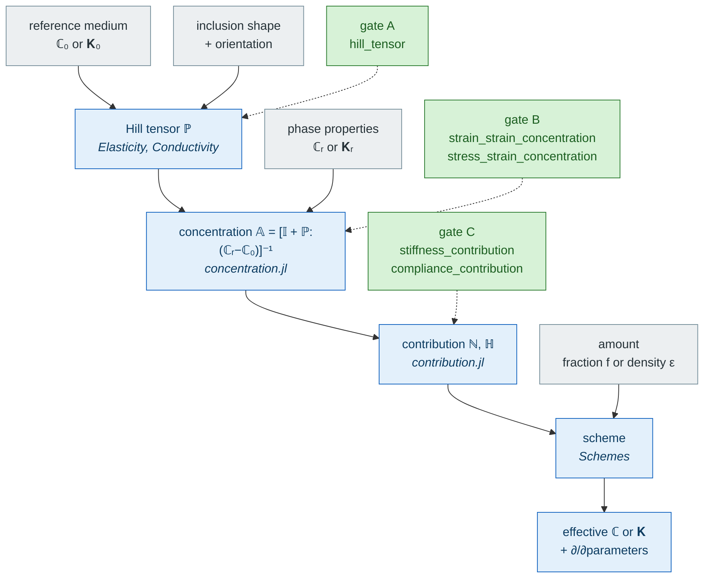

# [Theory — reading path](@id th-index)

`MeanFieldHomogenization` computes effective properties of heterogeneous materials by
mean-field homogenization. This section states the theory it implements, in the
order in which it is built. Every page follows the
[Conventions](@ref th-notation) and the [Nomenclature](@ref nomenclature), and
every formula is either cited or derived on the page.

The order below is the dependency chain, and it is worth reading in that order.
It starts with the problems of a single heterogeneity in an infinite medium: the
Eshelby problem and the tensors it produces, the interaction of two inclusions,
the crack as the flat limit of an ellipsoid, and the layered patterns that
generalize the Eshelby problem. The homogenization schemes come next, one family
per page, and turn those solutions into effective properties. The chain is then
extended to another physics, conduction, and to another time dependence,
viscoelasticity.

!!! tip "The symbols"
    Every symbol of these pages is in the [Nomenclature](@ref nomenclature),
    with its meaning and its unit. Hovering an equation shows the symbols it
    holds, with their meaning on the page.

## Foundations: the chain, in one paragraph

An **inclusion** embedded in an infinite reference medium responds to a remote
load in a way entirely captured by one object, the **Hill polarization tensor**
``\mathbb{P}`` — this is [Eshelby's result](@ref th-eshelby-problem), and
``\mathbb{P}`` depends only on the inclusion *shape* and the reference *moduli*
([Hill polarization tensors](@ref th-hill-tensors)). From ``\mathbb{P}`` follows the
**concentration tensor**, which says how much of the remote load each phase
actually sees, and hence each phase's **contribution** to the effective
stiffness ([Concentration](@ref th-concentration)).

## The chain, in one picture

Everything the package does is one pipeline, read top to bottom. The **gray**
boxes are what you supply — each entering at the stage that needs it — the
**blue** ones what the package computes, and the **green** ones on the right
the three places where you can plug in your own physics without touching the
library.

**The three green gates are the extension mechanism.** A morphology
`MeanFieldHomogenization` knows nothing about becomes a first-class citizen of *every*
scheme by answering one of them — implement the lowest you can reach and the
package derives the rest algebraically. Four routes already use them:

| Route | Gate | Where the answer comes from |
| :--- | :---: | :--- |
| ellipsoids, cylinders, cracks | A | closed forms, quadrature or residues |
| [composite spheres and spheroids](@ref MeanFieldHomogenization.LayeredSpheres) | B | the Hervé–Zaoui recurrences — a layered pattern has no Hill tensor |
| [finite elements](@ref man-fe-inclusions) | B / COD | a `Ferrite` or `Gridap` solve of the Eshelby problem |
| [neural surrogates](@ref man-neural-inclusions) | A / B | a trained network, differentiable in the morphology |
| [your own](@ref man-custom-inclusions) | A, B or C | a formula, a solver, a table — anything callable |

Cracks and flat objects follow the same chain with ``\mathbb H`` in place of
``\mathbb N`` and a density in place of a volume fraction; transport is the same
picture at tensor order 2, and aging viscoelasticity the same picture with
Volterra products in place of tensor products. The contract is written up in
[Adding a new inclusion](@ref dev-adding-inclusion).

## The Eshelby problem

| Page | What it adds |
| :--- | :----------- |
| [The Eshelby inclusion problem](@ref th-eshelby-problem) | the uniform strain inside an ellipsoid, and the three tensors ``\mathbb{P}``, ``\mathbb{S}^{\mathrm{E}}``, ``\mathbb{Q}`` |
| [Hill polarization tensors](@ref th-hill-tensors) | the closed forms of ``\mathbb{P}``, shape by shape and symmetry class by symmetry class |
| [Concentration and contribution tensors](@ref th-concentration) | the response of an inhomogeneity to a remote load, and its contribution to the effective stiffness |
| [Two-inclusion interaction tensors](@ref th-interaction) | the field one inclusion induces in another, through the Green operator — the ingredient of the N-body schemes |

## Cracks and degenerate shapes

A crack is a degenerate ellipsoid rather than a composite pattern: it keeps the
Eshelby framework and loses its volume, which is what forces a different
descriptor.

| Page | What it adds |
| :--- | :----------- |
| [Crack opening displacement](@ref th-cod-tensors) | the flat-inclusion limit: a crack has no volume, so it is described by ``\boldsymbol{B}`` and ``\mathbb{H}`` instead of a volume fraction |
| [Thermal cracks](@ref th-thermal-cracks) | the same limit for scalar transport |
| [Degenerate shapes](@ref th-degenerate-shapes) | the closed forms of the Hill, Eshelby and crack opening tensors at the shapes where they reach ``0/0`` limits: sphere, disc, needle |

## The generalized Eshelby problem: morphological patterns

A composite pattern has **no Hill tensor** — the strain inside it is not
uniform, so Eshelby's result does not apply as such. What does exist, and is all
any scheme needs, is its average concentration tensor, obtained by solving the
*generalized* Eshelby problem for that pattern. Any morphology admitting that
treatment belongs in this group; two are implemented.

| Page | Pattern |
| :--- | :------ |
| [Layered sphere](@ref th-layered-sphere) | a *composite* inclusion: no Hill tensor exists, the response is assembled by a radial recurrence |
| [Layered spheroid](@ref th-layered-spheroid) | the same for confocal spheroids, where imperfect interfaces couple harmonic degrees |
| [The elastic confocal spheroid](@ref th-spheroid-elasticity) | the axisymmetric elastic problem on the same chart |

## Homogenization schemes

Assembling the solutions of the previous chapters under an assumption about
what surrounds each inclusion gives a **homogenization scheme**. The overview
states what every scheme estimates and gathers them in one table; each family
then has its page, with its figure, its assumption and its equations.

| Page | What it adds |
| :--- | :----------- |
| [Homogenization schemes](@ref th-homogenization) | the framework common to all schemes, the identities between contribution tensors, how a crack family enters, and the table of schemes |
| [Voigt and Reuss bounds](@ref th-scheme-bounds) | a uniform strain or a uniform stress, and the energy principles that make them bounds |
| [Dilute estimates](@ref th-scheme-dilute) | each inclusion alone in the matrix, under the remote strain or the remote stress |
| [Mori–Tanaka](@ref th-scheme-mori-tanaka) | each inclusion under the mean strain of the matrix |
| [Maxwell](@ref th-scheme-maxwell) | a domain holding the inclusions, filled with the effective medium, disturbs the matrix far away as they do |
| [Ponte Castañeda–Willis](@ref th-scheme-pcw) | the Hashin–Shtrikman energy principle with the two-point statistics of the inclusions, one distribution ellipsoid per pair of phases |
| [Self-consistent schemes](@ref th-scheme-self-consistent) | each phase in the effective medium, with or without a distinguished matrix |
| [Differential scheme](@ref th-differential-scheme) | incorporation as an ODE in a fictitious time, and what a crack — which has no volume to replace — does to it |
| [Laminate](@ref th-laminate) | a periodic stack solved exactly: no inclusion at all, the interface algebra replaces the Hill tensor |
| [The cluster model](@ref th-cluster) | the mean strain of every inclusion, resolved inside a cluster [molinari1996](@cite) |
| [The equivalent inclusion method](@ref th-eim) | the same physics as a variational Galerkin problem, with rigorous bounds [brisard2014](@cite) |

The last two drop the one-site assumption: instead of averaging the interaction
between inclusions, they resolve it pair by pair, and therefore need to know
*where* the inclusions are.

## Extension to conductivity

| Page | What it adds |
| :--- | :----------- |
| [Extension to conductivity](@ref th-conductivity) | the order-4 ↔ order-2 dictionary stated once — Hooke against Fourier, Fick, Darcy and Ohm — what transposes untouched, and the two things that genuinely differ |

## Extension to viscoelasticity

Two distinct extensions, and the distinction matters: for a **non-aging**
material a transform maps the problem onto an elastic one, so nothing new has to
be solved; for an **aging** one no such map exists, and it is the Eshelby
problem itself that must be generalized.

| Page | What it adds |
| :--- | :----------- |
| [The Laplace-Carson route](@ref th-laplace-carson) | the correspondence principle: a non-aging problem solved as an elastic one, transform by transform |
| [Aging linear Volterra behavior](@ref th-viscoelasticity) | moduli and conductivities become Volterra operators; the algebra of the chain is unchanged, the order of its factors is not free, and every scheme is restated in that algebra |

## Appendices

| Page | Role |
| :--- | :--- |
| [The finite Eshelby cell](@ref th-corrected-cell) | a numerical device supporting the finite-element inclusions: the inclusion is solved on a *finite* cell and the truncation bias removed by its own dipole far field. Written in the language of [concentration](@ref th-concentration) and [crack opening displacement](@ref th-cod-tensors), so it is read after both |
| [Elliptic integrals](@ref th-elliptic-integrals) | the special functions the closed forms need |

## Where the two physics meet

The Eshelby framework applies verbatim to elasticity (order-4 tensors) and to
scalar transport — heat conduction, diffusion, electric conduction, Darcy flow
(order-2 tensors). The documentation treats them in parallel rather than in
separate sections, because with the convention
``\boldsymbol{\sigma} \equiv -\underline{q}`` fixed in
[Elasticity and transport: one set of formulas](@ref th-notation-sigma-q) the
algebra is not merely analogous but *identical, symbol for symbol*:

| | Elasticity | Transport |
| :--- | :--- | :--- |
| property | stiffness ``\mathbb{C}`` | conductivity ``\boldsymbol{K}`` |
| Hill tensor | ``\mathbb{P}(\boldsymbol{A},\mathbb{C})`` (order 4) | ``\boldsymbol{P}(\boldsymbol{A},\boldsymbol{K})`` (order 2) |
| Eshelby tensor | ``\mathbb{S}^{\mathrm{E}} = \mathbb{P}:\mathbb{C}`` | ``\boldsymbol{S}^{\mathrm{E}} = \boldsymbol{P}\cdot\boldsymbol{K}`` |
| crack descriptor | COD tensor ``\boldsymbol{B}``, compliance ``\mathbb{H}`` | COD scalar ``b``, resistivity ``\boldsymbol{R}`` |

One asymmetry is worth knowing in advance: for an **arbitrarily anisotropic**
matrix the order-2 Hill tensor has a *closed form* (via a square-root
transformation), whereas the order-4 one requires numerical cubature. This is
why the conductivity paths in `MeanFieldHomogenization` are analytical far more often than
the elastic ones.

## Relation to the Echoes manual

`MeanFieldHomogenization` is a pure-Julia reimplementation of the Eshelby/Hill machinery of
the [Echoes manual](https://jfbarthelemy.github.io/echoes/), and the
Hill-tensor pages follow its appendix closely — same expressions, same
conventions, same bibliography. Two families of difference are flagged
explicitly wherever they occur:

- **extensions**: infinite cylinders and 2-D plane strain as first-class
  inclusion types, an analytical transversely isotropic path, automatic
  differentiation and symbolic number types throughout;
- **conventions that genuinely differ**: the crack opening displacement tensor
  ``\boldsymbol{B}`` and the compliance ``\mathbb{H}`` are the notable case.
  `MeanFieldHomogenization` computes ``\boldsymbol{B}`` first and derives ``\mathbb{H}``
  from it, where Echoes computes ``\mathbb{H}`` directly and never forms
  ``\boldsymbol{B}``. The competing normalizations are named and compared in
  [Crack opening displacement](@ref th-cod-tensors).
