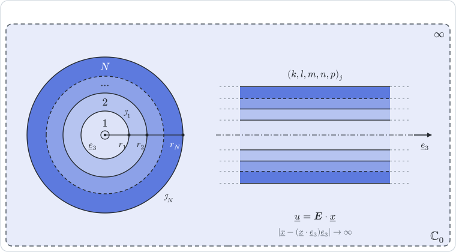

# [Layered cylinder](@id th-layered-cylinder)

!!! info "Before this page"
    [Layered spheres and cylinders: the radial problem](@ref th-radial-problems),
    which states the problem solved here and the two strategies that solve it,
    [Layered sphere](@ref th-layered-sphere), whose plan is followed section by
    section, and [Concentration and contribution tensors](@ref th-concentration),
    which defines the tensors a pattern without a Hill tensor supplies to the
    [Homogenization schemes](@ref th-homogenization).

[`LayeredCylinder`](@ref) is an infinite fiber of circular section made of `n`
coaxial layers, in an infinite matrix, under a remote uniform strain or
temperature gradient. It is the cylindrical counterpart of the layered sphere,
with one difference in the constituents: each layer, and the matrix, may be
**transversely isotropic about the fiber axis**. This is what a
unidirectional composite needs, since its effective medium is itself
transversely isotropic; a self-consistent or a differential scheme on aligned
fibers therefore stays within the model. A layer may also be transversely
isotropic about the radial direction of the section, or graded.

The solution of the coated fiber goes back to the composite-cylinder model of
[hashinRosen1964](@citet) and, for the transverse shear, to the three-phase
model of [christensenLo1979](@citet); [herve1995](@citet) gave it for any
number of coatings by transfer matrices, [hashin1979](@citet) treated
anisotropic constituents. Every relation of this page is derived with symbolic
computations: the modes and the transfer relations on
[Layered cylinder: modes and transfer relations, symbolically](@ref tut-layered-cylinder-symbolic),
the systems of the first order on
[Layered cylinder: the systems of the first order, symbolically](@ref tut-layered-cylinder-first-order-symbolic).

## 1. Geometry and constituents

The radii are ascending, ``0 = r_0 < r_1 < \cdots < r_N``; layer ``k`` lies
between ``r_{k-1}`` and ``r_k`` (layer 1 is the core) and the matrix occupies
``r > r_N``. The axis is ``\underline{e}_3`` by default and may be any direction
``\underline n`` (`axis`); this page writes it ``\underline{e}_3``, which loses
nothing, since a fiber of axis ``\underline n`` is the same problem written in a
frame whose third vector is ``\underline n`` (section 10 for the aging case).



A layer is given by its modulus:

| Layer | Stiffness | Conductivity |
| :--- | :--- | :--- |
| isotropic | ``3\kappa\,\mathbb{J} + 2\mu\,\mathbb{K}`` (`TensISO{4,3}`) | ``k_T\,\boldsymbol{1}`` (`TensISO{2,3}`) |
| transversely isotropic about the axis | five moduli, `ti_from_constants(…, axis; form)` | ``k_T`` across the axis, ``k_A`` along it (`TensTI{2}`) |
| transversely isotropic about ``\underline{e}_r`` | five moduli, `radial_ti(CylindricalChart(), …)` | ``k_r`` along the radius, ``k_\theta`` across it |
| graded | a function ``r \mapsto`` an isotropic or a radial one | the same |

A stiffness that is transversely isotropic about ``\underline{e}_3`` has five
constants, written here with Hill's moduli [hill1964](@cite):

```math
k = \tfrac12(C_{1111} + C_{1122}),\quad l = C_{1133},\quad
m = \tfrac12(C_{1111} - C_{1122}),\quad n = C_{3333},\quad p = C_{2323},
```

``k`` being the plane-strain bulk modulus, ``m`` and ``p`` the transverse and
axial shear moduli. An isotropic layer ``(\kappa, \mu)`` has
``k = \kappa + \mu/3``, ``l = \kappa - 2\mu/3``, ``n = \kappa + 4\mu/3`` and
``m = p = \mu``. The five constants may be given in any of the notations of a
transversely isotropic material (Hill's moduli, the components, the
engineering constants, Hoenig's parameters), which
[Layered inclusions](@ref man-layered-moduli) lists.

```@example layered_cylinder
using MeanFieldHomogenization, TensND, LinearAlgebra
ez = (0.0, 0.0, 1.0)
fiber = ti_from_constants(30.0, 12.0, 9.0, 150.0, 14.0, ez; form = :hill)     # k, l, m, n, p
coating = iso_stiffness(4.0, 1.5)                                            # κ, μ
C₀ = ti_from_constants(5.0, 1.0, 2.0, 9.0, 3.0, ez; form = :hill)
cyl = LayeredCylinder((0.6, 1.0), (fiber, coating))
```

## 2. Layers isotropic or transversely isotropic about the axis

### 2.1 Four radial problems and their modes

A remote strain ``\boldsymbol{E}`` has, about the axis, an axial part
``\varepsilon = E_{33}``, an in-plane equibiaxial part
``e = \tfrac12(E_{11} + E_{22})``, an in-plane shear and an antiplane shear.
Each one drives a displacement of fixed angular shape, and the problem reduces
to radial functions. In each layer these are combinations of a few **modes**;
the **state** gathers the quantities that an interface transmits.

| Problem | Displacement | Modes | State |
| :--- | :--- | :--- | :--- |
| Axisymmetric | ``u_r = A r + B/r``, ``u_z = \varepsilon z`` | ``r,\ r^{-1}`` | ``(u_r, \sigma_{rr})`` |
| Transverse shear | ``u_r = U\cos 2\theta``, ``u_\theta = V\sin 2\theta`` | ``r,\ r^{3},\ r^{-3},\ r^{-1}`` | ``(U, V, \sigma_{rr}, \sigma_{r\theta})`` |
| Antiplane shear | ``u_z = (A r + B/r)\cos\theta`` | ``r,\ r^{-1}`` | ``(u_z, \sigma_{rz})`` |
| Transverse conduction | ``T = (A r + B/r)\cos\theta`` | ``r,\ r^{-1}`` | ``(T, -q_r)`` |

The stresses of the states are

```math
\begin{aligned}
\text{axisymmetric:}\quad & \sigma_{rr} = 2k\,A - 2m\,\frac{B}{r^2} + l\,\varepsilon,\\
\text{antiplane:}\quad & \sigma_{rz} = p\,\Big(A - \frac{B}{r^2}\Big),
\qquad\text{conduction:}\quad -q_r = k_T\,\Big(A - \frac{B}{r^2}\Big).
\end{aligned}
```

The axial strain enters the radial stress through ``l\,\varepsilon``: the axial
and the in-plane loadings are coupled, and the fiber answers an axial strain by
an in-plane one.

For the transverse shear, with ``\chi = m/k`` and the amplitudes
``(a, b, c, d)`` of the four modes,

```math
\begin{aligned}
U &= a\,r + (\chi - 1)\,b\,r^3 + \frac{c}{r^3} + (1 + \chi)\,\frac{d}{r},
&\sigma_{rr} &= m\,\Big(2a - \frac{6c}{r^4} - \frac{4d}{r^2}\Big),\\
V &= -a\,r + (\chi + 2)\,b\,r^3 + \frac{c}{r^3} - \chi\,\frac{d}{r},
&\sigma_{r\theta} &= m\,\Big(-2a + 6b\,r^2 - \frac{6c}{r^4} - \frac{2d}{r^2}\Big).
\end{aligned}
```

Only ``k`` and ``m`` enter. The mode ``a`` is the uniform strain; the modes
``c`` and ``d`` are singular on the axis and absent from the core, the modes
``b`` (and ``B`` above) grow at infinity and are absent from the matrix.

Along the axis the temperature gradient is uniform, the same in every layer.

### 2.2 Chaining the layers

In a layer, the amplitudes give the state at any radius, and a state gives the
amplitudes back. The recurrence starts in the core, where only the regular
modes exist, with a unit amplitude; at each radius it reads the state, applies
the jump of the interface, and extracts the amplitudes of the next layer. In
the matrix, the remote loading fixes the amplitude of the growing mode, which
normalizes the whole sequence. This is the transfer-matrix method of
[herve1995](@citet), written on states: the first strategy of
[the radial problem](@ref th-radial-problems), section 3.

Two problems need a second sequence. The axisymmetric one is solved for
``e`` and for ``\varepsilon`` separately. The transverse shear has two regular
modes in the core, ``a`` and ``b``; two sequences are run and combined so that
the matrix carries ``(a, b) = (1, 0)``.

### 2.3 The systems of the first order

The same four problems are systems ``r\,\mathrm{d}Y/\mathrm{d}r = \boldsymbol{M}\,Y``
on the states of section 2.1 whose stresses are multiplied by ``r``. Each
matrix holds the constitutive law, solved for the radial derivatives of the
displacement, and the equilibrium.

**Antiplane shear, conduction across the axis.** With
``u_z = \varphi(r)\cos\theta``, ``\sigma_{rz} = p\,\varphi'\cos\theta`` and
``\sigma_{\theta z} = -p\,(\varphi/r)\sin\theta``, the axial equilibrium reads
``(r\,p\,\varphi')' = p\,\varphi/r``. On ``Y = (\varphi,\; r\,\sigma_{rz})``,

```math
\boldsymbol{M} = \begin{pmatrix} 0 & \dfrac{1}{p} \\[2mm] p & 0 \end{pmatrix} ,
\qquad s = \pm 1 ,
```

and the same matrix with ``k_T`` in place of ``p`` on ``Y = (\hat T,\; -r\,\hat q_r)``.

**In-plane dilatation and axial strain.** With
``\sigma_{rr} = (k+m)\,u_r' + (k-m)\,u_r/r + l\,\varepsilon`` and the radial
equilibrium ``(r\,\sigma_{rr})' = \sigma_{\theta\theta}``, on
``Y = (u_r,\; r\,\sigma_{rr})`` and with ``\eta = (k-m)/(k+m)``,

```math
r\,\frac{\mathrm{d}Y}{\mathrm{d}r} = \begin{pmatrix} -\eta & \dfrac{1}{k+m} \\[2mm] \dfrac{4km}{k+m} & \eta \end{pmatrix} Y
+ \varepsilon\,r\,\frac{l}{k+m} \begin{pmatrix} -1 \\[1mm] 2m \end{pmatrix} ,
\qquad s = \pm 1 .
```

The axial strain is a second member. Since ``g = \varepsilon\,r`` obeys
``r\,g' = g``, it is appended to the state, and the system is homogeneous
again on ``(u_r,\; r\,\sigma_{rr},\; \varepsilon r)``.

**In-plane shear.** On ``Y = (U,\; V,\; r\,\sigma_{rr},\; r\,\sigma_{r\theta})``,
the stresses being the radial functions of ``\sigma_{rr}`` on ``\cos 2\theta``
and of ``\sigma_{r\theta}`` on ``\sin 2\theta``, and with ``c = 4km/(k+m)``,

```math
\boldsymbol{M} = \begin{pmatrix}
 -\eta & -2\eta & \dfrac{1}{k+m} & 0 \\[2mm]
 2 & 1 & 0 & \dfrac{1}{m} \\[2mm]
 c & 2c & \eta & -2 \\[1mm]
 2c & 4c & 2\eta & -1
\end{pmatrix} ,
\qquad s = \pm 1,\ \pm 3 .
```

The eigenvalues of each matrix are the exponents of the modes of section 2.1,
and its eigenvectors their states: the power
``\xi^{\boldsymbol{M}}``, ``\xi = r_{\mathrm{out}}/r_{\mathrm{in}}``, crosses a
layer as the amplitudes of section 2.2 do. Here for the in-plane shear of the
fiber, with ``\boldsymbol{D}(r) = \operatorname{diag}(1, 1, r, r)`` between the
two states:

```@example layered_cylinder
using StaticArrays
const LC = MeanFieldHomogenization.LayeredCylinders
const RS = MeanFieldHomogenization.Core
(; k, m) = hill_moduli(fiber)
η, c = (k - m) / (k + m), 4k * m / (k + m)
M = @SMatrix [-η -2η 1/(k + m) 0; 2 1 0 1/m; c 2c η -2; 2c 4c 2η -1]
eigvals(Matrix(M))
```

```@example layered_cylinder
r_in, r_out = 0.6, 1.0
state = (1.0, -0.4, 2.0, 0.7)                       # (U, V, σ_rr, σ_rθ) at r_in
by_modes = LC._shear_cross(r_in, r_out, hill_moduli(fiber), state)[2]
by_power = RS.radial_power(M, r_out / r_in) * SVector(state[1], state[2], r_in * state[3], r_in * state[4])
collect(by_modes) ≈ [by_power[1], by_power[2], by_power[3] / r_out, by_power[4] / r_out]
```

The package crosses a layer of this section by its modes. No derivative of a
modulus enters the matrices above, which therefore hold at each radius of a
layer whose moduli vary; for an isotropic layer they are those of section 3,
to which it belongs as well.

### 2.4 Conduction, and impermeable layers

The transverse problem is that of the antiplane shear, with ``k_T`` in place of
``p``. A layer of zero conductivity is admissible at any rank. No flux crosses
it: the layers it encloses are shielded and carry no transverse gradient, and
its own field, the limit of a vanishing conductivity, vanishes on its inner
face, ``T = A\,(r - r_{k-1}^2/r)\cos\theta``. Two adjacent impermeable layers
leave the inner one undefined and are refused.

```@example layered_cylinder
K(t, a) = TensTI{2}(t, a, ez)                   # (transverse, axial)
pipe = LayeredCylinder((0.4, 0.7, 1.0), (K(5.0, 7.0), K(0.0, 0.0), K(1.0, 2.0)))
[TensND.get_data(gradient_gradient_concentration(pipe, K(2.0, 3.0); layer = j)) for j in 1:3]
```

## [3. Layers transversely isotropic about the radius](@id th-layered-cylinder-radial)

A layer may be transversely isotropic about the radial direction
``\underline{e}_r`` of the section instead of the axis: a wound sheet, a
coating deposited on a fiber, the rings of a trunk. Its plane of isotropy
``(\underline{e}_\theta, \underline{e}_z)`` then turns around the axis. Such a
layer is crossed by the systems of the first order of its loading modes, given
here; with moduli that depend on ``r`` they are those of a graded layer. They
are derived symbolically in
[the companion tutorial](@ref tut-layered-cylinder-radial-symbolic).

### 3.1 The moduli of a layer

In the frame ``(\underline{e}_r, \underline{e}_\theta, \underline{e}_z)`` of the
cylindrical chart, whose first vector is the radial one, Hill's moduli about
the radius are

```math
\begin{gathered}
n = C_{rrrr}, \qquad l = C_{rr\theta\theta} = C_{rrzz}, \qquad p = C_{r\theta r\theta} = C_{rzrz} , \\
k = \tfrac12\,(C_{\theta\theta\theta\theta} + C_{\theta\theta zz}), \qquad
m = \tfrac12\,(C_{\theta\theta\theta\theta} - C_{\theta\theta zz}) = C_{\theta z\theta z} ,
\end{gathered}
```

with ``C_{zzzz} = C_{\theta\theta\theta\theta}``. An isotropic layer
``(\kappa, \mu)`` has ``n = \kappa + \tfrac43\mu``, ``l = \kappa - \tfrac23\mu``,
``k = \kappa + \tfrac13\mu`` and ``m = p = \mu``. The conductivity is
``k_r\,\underline{e}_r\otimes\underline{e}_r + k_\theta\,(\boldsymbol{1} - \underline{e}_r\otimes\underline{e}_r)``.
The chart is that of the cylinder, whatever the direction of its axis in space.

```@example layered_cylinder
chart = CylindricalChart()
wound = radial_ti(chart, 19.0, 5.0, 11.0, 12.0, 4.0; form = :hill)      # k, l, m, n, p about the radius
tensor_at(wound, [0.0, 1.0, 0.0])        # at a point of the axis e₂: the stiff plane is (e₁, e₃)
```

### 3.2 Antiplane shear, and conduction across the axis

With ``u_z = \varphi(r)\cos\theta``, the stresses are
``\sigma_{rz} = p\,\varphi'\cos\theta`` and
``\sigma_{\theta z} = -m\,(\varphi/r)\sin\theta``, and the axial equilibrium
reads ``(r\,p\,\varphi')' = m\,\varphi/r``. On the state
``Y = (\varphi,\; r\,p\,\varphi')``,

```math
\boldsymbol{M} = \begin{pmatrix} 0 & \dfrac{1}{p} \\[2mm] m & 0 \end{pmatrix} ,
\qquad s = \pm\sqrt{m/p} .
```

Conduction across the axis is the same problem, ``T = \hat T(r)\cos\theta`` and
``Y = (\hat T,\; r\,k_r\,\hat T')``, with ``k_r`` in place of ``p`` and ``k_\theta``
in place of ``m``. A homogeneous cylinder, whose regular mode is
``r^{\sqrt{k_\theta/k_r}}``, presents to the matrix the impedance
``k_r\sqrt{k_\theta/k_r}``: it disturbs nothing in a medium of conductivity
``\sqrt{k_r k_\theta}``.

```@example layered_cylinder
k_θ, kᵣ = 5.0, 2.0
rod = LayeredCylinder((1.0,), (radial_ti(chart, k_θ, kᵣ),))
TensND.get_data(property_contribution(rod, TensISO{3}(sqrt(kᵣ * k_θ))))     # across the axis, along it
```

Along the axis the gradient is uniform and the flux is that of the tangential
conductivity: the second coefficient is ``k_\theta - \sqrt{k_r k_\theta}``.

### 3.3 In-plane dilatation and axial strain

With ``\underline{u} = u_r(r)\,\underline{e}_r + \varepsilon z\,\underline{e}_z``,

```math
\begin{aligned}
\sigma_{rr} &= n\,u_r' + l\,\frac{u_r}{r} + l\,\varepsilon , \\
\sigma_{\theta\theta} &= l\,u_r' + (k + m)\,\frac{u_r}{r} + (k - m)\,\varepsilon , \\
\sigma_{zz} &= l\,u_r' + (k - m)\,\frac{u_r}{r} + (k + m)\,\varepsilon ,
\end{aligned}
```

and the radial equilibrium is ``(r\,\sigma_{rr})' = \sigma_{\theta\theta}``. On
``Y = (u_r,\; r\,\sigma_{rr})``, with ``c = k + m - l^2/n``,

```math
r\,\frac{\mathrm{d}Y}{\mathrm{d}r} = \begin{pmatrix} -\dfrac{l}{n} & \dfrac{1}{n} \\[2mm] c & \dfrac{l}{n} \end{pmatrix} Y
+ \varepsilon\,r \begin{pmatrix} -\dfrac{l}{n} \\[2mm] c - 2m \end{pmatrix} ,
\qquad s = \pm\sqrt{\frac{k + m}{n}} .
```

The axial strain is a second member, which vanishes when ``l = 0`` and
``k = m`` only. Since ``g = \varepsilon\,r`` obeys ``r\,g' = g``, it is appended
to the state and the system is homogeneous again, of constant matrix in a
uniform layer.

The mean axial stress is not a traction on the lateral surface. Over a layer
``a < r < b``,

```math
\int_a^b r\,\sigma_{zz}\,\mathrm{d}r = l\,\bigl[r\,u_r\bigr]_a^b + (k - m - l)\int_a^b u_r\,\mathrm{d}r + (k + m)\,\varepsilon\,\frac{b^2 - a^2}{2} ,
```

which needs the integral of ``u_r`` across the layer. The quantity
``J = \tfrac{1}{r}\int_a^r u_r\,\mathrm{d}r`` obeys ``r\,J' = u_r - J``: it is
appended as well, and the state ``(u_r,\; r\,\sigma_{rr},\; \varepsilon r,\; J)``
of a uniform layer is carried by the power of a ``4\times4`` matrix. In a graded
layer the integral of ``r\,\sigma_{zz}`` itself is carried along the
integration.

A homogeneous cylinder under an in-plane dilatation has the regular mode
``r^{s_+}`` and the impedance ``r\sigma_{rr}/u_r = n\,s_+ + l``, that of an
isotropic disc of plane-strain bulk modulus
``\tfrac12\bigl(\sqrt{n\,(k + m)} + l\bigr)``.

### 3.4 In-plane shear

With ``\underline{u} = U(r)\cos 2\theta\,\underline{e}_r + V(r)\sin 2\theta\,\underline{e}_\theta``,
the strains are ``\varepsilon_{rr} = U'\cos 2\theta``,
``\varepsilon_{\theta\theta} = (U + 2V)/r\,\cos 2\theta`` and
``2\varepsilon_{r\theta} = (V' - V/r - 2U/r)\sin 2\theta``. The stresses
``\sigma_{rr} = n\,\varepsilon_{rr} + l\,\varepsilon_{\theta\theta}`` and
``\sigma_{r\theta} = 2p\,\varepsilon_{r\theta}``, solved for ``U'`` and ``V'``,
give the first two rows; the two equations of equilibrium in the plane, with
``\sigma_{\theta\theta} = c\,(U + 2V)/r + (l/n)\,\sigma_{rr}``, give the last
two. On ``Y = (U,\; V,\; r\,\sigma_{rr},\; r\,\sigma_{r\theta})``, the stresses
being the radial functions of ``\sigma_{rr}`` on ``\cos 2\theta`` and of
``\sigma_{r\theta}`` on ``\sin 2\theta``,

```math
\boldsymbol{M} = \begin{pmatrix}
 -\dfrac{l}{n} & -\dfrac{2l}{n} & \dfrac{1}{n} & 0 \\[2mm]
 2 & 1 & 0 & \dfrac{1}{p} \\[2mm]
 c & 2c & \dfrac{l}{n} & -2 \\[2mm]
 2c & 4c & \dfrac{2l}{n} & -1
\end{pmatrix} .
```

Its eigenvalues are ``\pm1`` and ``\pm3`` for an isotropic layer, the modes of
section 2.1; the axial moduli do not
enter, ``k`` and ``m`` appearing through ``c`` alone.

```@example layered_cylinder
exponents(c) = eigvals(Matrix(LC._shear_system(LC._hill_moduli(c, ez))))
(isotropic = exponents(radial_ti(chart, iso_stiffness(4.0, 3.0))), wound = exponents(wound))
```

### 3.5 Chaining

The modes are solved as [the radial problem](@ref th-radial-problems) says: the
regular states on the axis, the layers crossed one after the other, the
interfaces of section 4 between them,
and a matrix that is transversely isotropic about the axis. A cylinder may mix
layers of both kinds, and graded ones:

```@example layered_cylinder
coated = LayeredCylinder((0.6, 1.0), (fiber, wound); interfaces = (SpringInterface(20.0, 12.5), PerfectInterface()))
property_contribution(coated, C₀)
```

```@example layered_cylinder
stiffening(r) = radial_ti(chart; n = 12.0 + 3r, l = 5.0, k = 19.0 - 2r, m = 11.0, p = 4.0 + r)
property_contribution(LayeredCylinder((0.6, 1.0), (fiber, stiffening)), C₀)
```

## [4. Interfaces](@id th-layered-cylinder-interfaces)

A perfect interface transmits the state unchanged. The imperfect ones come in
pairs, as for the sphere: one lets the field jump, the other its flux.

| | Field jumps | Flux jumps |
| :--- | :--- | :--- |
| Elasticity | [`SpringInterface`](@ref) | [`MembraneInterface`](@ref) |
| Conduction | [`KapitzaInterface`](@ref) | [`SurfaceConductiveInterface`](@ref) |

A spring of normal and tangential compliances ``s_n = 1/k_n``, ``s_t = 1/k_t``
opens in proportion to the traction [hashin1990](@cite):

```math
[\![u_r]\!] = s_n\,\sigma_{rr},\qquad
[\![u_\theta]\!] = s_t\,\sigma_{r\theta},\qquad
[\![u_z]\!] = s_t\,\sigma_{rz}.
```

A membrane carries the surface stress
``\boldsymbol\sigma^{\mathrm s} = \lambda^{\mathrm s}(\operatorname{tr}\boldsymbol\varepsilon^{\mathrm s})\boldsymbol 1^{\mathrm s} + 2\mu^{\mathrm s}\boldsymbol\varepsilon^{\mathrm s}``
of the strain in its tangent plane [chenDvorakYu2007](@cite), and its
equilibrium, ``[\![\boldsymbol\sigma]\!]\cdot\underline{e}_r = -\operatorname{div}^{\mathrm s}\boldsymbol\sigma^{\mathrm s}``,
gives at the radius ``R``, with ``\kappa^{\mathrm s} = \lambda^{\mathrm s} + \mu^{\mathrm s}``:

```math
\begin{aligned}
\text{axisymmetric:}\quad & [\![\sigma_{rr}]\!] = \frac{1}{R}\Big((\kappa^{\mathrm s} + \mu^{\mathrm s})\,\frac{u_r}{R} + (\kappa^{\mathrm s} - \mu^{\mathrm s})\,\varepsilon\Big),\\
\text{transverse shear:}\quad & [\![\sigma_{rr}]\!] = (\kappa^{\mathrm s} + \mu^{\mathrm s})\,\frac{U + 2V}{R^2},\qquad
[\![\sigma_{r\theta}]\!] = 2\,[\![\sigma_{rr}]\!],\\
\text{antiplane:}\quad & [\![\sigma_{rz}]\!] = \mu^{\mathrm s}\,\frac{u_z}{R^2}.
\end{aligned}
```

In conduction, a Kapitza resistance ``\rho`` gives ``[\![T]\!] = -\rho\,q_r`` and
a conducting surface ``k^{\mathrm s}`` gives ``[\![q_r]\!] = -k^{\mathrm s}\,T/R^2``.

Each of these is the limit of a thin layer of thickness ``h``, as shown in
elasticity by [benvenisteMiloh2001](@citet): a spring is a soft layer with
``s_n = h/(k + m)`` and ``s_t = h/m = h/p``, a membrane a stiff isotropic one
with ``\mu^{\mathrm s} = h\mu`` and ``\lambda^{\mathrm s} = 2h\lambda\mu/(\lambda + 2\mu)``;
in conduction, a Kapitza resistance is a layer of conductivity ``h/\rho`` and
a conducting surface one of conductivity ``k^{\mathrm s}/h``. The test suite
checks each of the four interfaces against its thin layer, computed with
perfect interfaces.

These jumps act on the states of section 2.1. On the state ``Y`` of a system
of the first order, whose stresses are multiplied by ``r``, a compliance is
divided by the radius of the interface and a surface stiffness multiplied by
it.

## 5. Averages

Over a disc of radius ``r`` of the section, the average strain is a contour
integral of the displacement, and the average of an equilibrated stress a
contour integral of the traction:

```math
\langle\boldsymbol\varepsilon\rangle = \frac{1}{\pi r^2}\oint \underline{u}\otimes^{\mathrm s}\underline{n}\,\mathrm{d}s,
\qquad
\langle\boldsymbol\sigma\rangle = \frac{1}{\pi r^2}\oint \underline{x}\otimes^{\mathrm s}(\boldsymbol\sigma\cdot\underline{n})\,\mathrm{d}s .
```

They are therefore read on the state:

| Problem | Average strain (gradient) | Average stress (flux) |
| :--- | :--- | :--- |
| Axisymmetric | ``e = u_r/r`` | ``\tfrac12(\sigma_{11} + \sigma_{22}) = \sigma_{rr}`` |
| Transverse shear | ``(U - V)/(2r)`` | ``(\sigma_{rr} - \sigma_{r\theta})/2`` |
| Antiplane, conduction | ``u_z/r``, ``T/r`` | ``\sigma_{rz}``, ``-q_r`` |

A layer is the difference of two discs. Read on the outer side of an
interface, an average includes what the interface carries — the opening of a
spring, which is a strain without stress, or the surface stress of a
membrane — and on its inner side it does not. The keywords `external` and
`internal` choose the side, with the meaning they have for the sphere
([Averages and interface jumps](@ref th-layered-sphere-jumps)).

The axial stress is not given by a traction on the lateral surface. It is
summed over the layers, ``\sigma_{zz} = 2l\,A + n\,\varepsilon`` in each, plus
the axial line force ``\sigma^{\mathrm s}_{zz}`` of each membrane; likewise a
conducting surface adds ``2k^{\mathrm s}r_k/r_N^2`` to the axial flux.

The strain concentration ``\mathbb{A}`` and the average stress ``\mathbb{B}``
per unit remote strain are transversely isotropic about the axis. They are
not symmetric: ``\mathbb A`` maps an axial strain to an in-plane one and not the
reverse. The contribution ``\mathbb N = \mathbb B - \mathbb C_0:\mathbb A`` is
symmetric when the cylinder carries all of the perturbation, its outer
interface included (`external = true`, what the schemes use).

```@example layered_cylinder
A = gradient_gradient_concentration(cyl, C₀, C₀)      # ⟨ε⟩ = A : E
B = flux_gradient_concentration(cyl, C₀, C₀)          # ⟨σ⟩ = B : E
N = property_contribution(cyl, C₀)
N ≈ B - C₀ ⊡ A
```

With layers transversely isotropic about the radius, or graded, the averages
are read on the states in the same way, the axial stress by the integral of
section 3.3. With isotropic
layers written as radial ones, the tensors of the isotropic cylinder are
recovered to rounding, which is the first check of the implementation:

```@example layered_cylinder
C₁, C₂ = iso_stiffness(40.0, 20.0), iso_stiffness(4.0, 3.0)
axial = LayeredCylinder((0.6, 1.0), (C₁, C₂))
radial = LayeredCylinder((0.6, 1.0), (C₁, radial_ti(chart, C₂)))
norm(property_contribution(axial, C₀) - property_contribution(radial, C₀)) / norm(property_contribution(axial, C₀))
```

## 6. The composite-cylinder model recovered

A fiber coated by a matrix, read from outside, answers three of the four
loadings as a homogeneous fiber, whatever the medium around it: its moduli
``k``, ``l``, ``n`` and ``p`` are those of the composite-cylinder model
[hashinRosen1964](@cite), and satisfy Hill's universal relations
[hill1964](@cite). Its effective stiffness is ``\mathbb B:\mathbb A^{-1}``:

```@example layered_cylinder
c = 0.36                                        # fiber fraction
k_f, p_f = 30.0, 14.0
k_m, m_m, p_m = 4.0 + 1.5 / 3, 1.5, 1.5           # coating: k = κ + μ/3, m = p = μ
C_eq = B ⊡ inv(A)
C₁₁₁₁, C₁₁₂₂, _, _, C₂₃₂₃ = ti_constants(best_fit_ti(C_eq, ez))
k_HR = k_m + c / (1 / (k_f - k_m) + (1 - c) / (k_m + m_m))
p_HR = p_m * (p_f * (1 + c) + p_m * (1 - c)) / (p_f * (1 - c) + p_m * (1 + c))
((C₁₁₁₁ + C₁₁₂₂) / 2, k_HR), (C₂₃₂₃, p_HR)
```

Under transverse shear this equivalence does not hold: the answer of the
coated fiber depends on the surrounding medium, and the model only bounds the
modulus ``m``. Taking the surrounding medium as the unknown effective one is
the three-phase model [christensenLo1979](@cite), a fixed point of the
schemes rather than a property of the pattern.

The cylinder is also the limit of elongated inclusions of the package, which
share none of its code: a homogeneous prolate ellipsoid tends to the one-layer
cylinder, and a confocal layered spheroid of growing focal distance to the
layered cylinder. An imperfect interface carries a length (``\rho``,
``k^{\mathrm s}``, ``1/k_n``), so that a section answers according to its own
radius: the spheroid then tends to the average of the cylinders of its
sections, not to the cylinder of its largest radius. Both limits are checked
by the test suite and drawn in
[Coated fibers: the layered cylinder at work](@ref tut-layered-cylinder).

## 7. Pointwise fields

In the cylindrical frame of a point the local strain depends on the radius
only: with ``D = \tfrac12(E_{rr} - E_{\theta\theta})``,

```math
\begin{aligned}
\varepsilon_{rr} &= \Big(A_e - \frac{B_e}{r^2}\Big)e + \Big(A_\varepsilon - \frac{B_\varepsilon}{r^2}\Big)\varepsilon + U'\,D,
& \varepsilon_{r\theta} &= \tfrac12\Big(\frac{2U}{r} - V' + \frac{V}{r}\Big)E_{r\theta},\\
\varepsilon_{\theta\theta} &= \Big(A_e + \frac{B_e}{r^2}\Big)e + \Big(A_\varepsilon + \frac{B_\varepsilon}{r^2}\Big)\varepsilon + \frac{U + 2V}{r}\,D,
& \varepsilon_{rz} &= \varphi'\,E_{rz},\quad \varepsilon_{\theta z} = \frac{\varphi}{r}\,E_{\theta z},
\end{aligned}
```

``(A_e, B_e)`` and ``(A_\varepsilon, B_\varepsilon)`` being the axisymmetric
amplitudes under ``e`` and ``\varepsilon``, and ``\varphi = A r + B/r`` the
antiplane function. [`LayeredCylinderFields`](@ref) caches the amplitudes;
[`local_gradient`](@ref), [`local_flux`](@ref) and
[`local_displacement`](@ref) evaluate the fields at a point given as a vector
or by its cylindrical coordinates, in a layer or in the matrix, and `side`
chooses the limit on an interface.

```@example layered_cylinder
bonded = LayeredCylinder((0.6, 1.0), (fiber, coating); interfaces = (SpringInterface(20.0, 12.5), PerfectInterface()))
fields = LayeredCylinderFields(bonded, C₀)
E = Tens([0.0 0.0 0.0; 0.0 0.0 0.0; 0.0 0.0 1.0])     # axial strain
jump = local_displacement(fields, 0.6, 0.0, 0.0, E; side = :outer) -
    local_displacement(fields, 0.6, 0.0, 0.0, E; side = :inner)
```

The radial opening of the spring under an axial strain is the Poisson effect
of the fiber against its coating.

## 8. The parameters of a layer, and second moments

A coefficient of a layer is designated as for the sphere
([Layered sphere](@ref th-layered-sphere), section 7), by its name in the
frame of the cylindrical chart:

```@example layered_cylinder
rve = RVE()
add_phase!(rve, :M, Ellipsoid(1.0), Dict(:C => C₀); fraction = :rest)
add_phase!(rve, :I, LayeredCylinder((0.6, 1.0), (C₁, wound)), Dict(:C => C₁); fraction = 0.3)
axial_modulus(C) = canonical_components(C)[3, 3, 3, 3]
[name => derivative(rve, MoriTanaka(), layer_param(:I, 2, name); indexer = axial_modulus) for name in (:Crrrr, :Cθθθθ, :Cθθzz, :Crrθθ, :Crθrθ)]
```

and the mean of ``\varepsilon_{rr}^2`` over a layer is the
[second moment](@ref th-second-moments) along the first element of the Walpole
basis about the radius:

```@example layered_cylinder
E = Tens(Symmetric([1.0 0.2 0.1; 0.2 -0.5 0.3; 0.1 0.3 0.7]))
second_moment(rve, Dilute(), (:I, 2), E, radial_ti(chart, 1.0, 0.0, 0.0, 0.0, 0.0))
```

## 9. In the schemes

A layered cylinder has no Hill tensor: it enters every scheme by its
tensors ``\mathbb A``, ``\mathbb B`` and ``\mathbb N``, evaluated in the reference of
the scheme. That reference must be isotropic or transversely isotropic about
the fiber axis. In a self-consistent or a differential scheme it is the
running estimate, which aligned fibers keep in that class; a matrix phase is
then given the shape of a one-layer cylinder.

```@example layered_cylinder
rve = RVE()
add_phase!(rve, :matrix, LayeredCylinder((1.0,), (coating,)), Dict(:C => coating); fraction = :rest)
add_phase!(rve, :fiber, cyl, Dict(:C => fiber); fraction = 0.4)
C_sc = homogenize(rve, SelfConsistent(), :C)
ti_constants(best_fit_ti(C_sc, ez))             # (C₁₁₁₁, C₁₁₂₂, C₁₁₃₃, C₃₃₃₃, C₂₃₂₃)
```

With an orientation distribution on the phase (`symmetrize = :iso`), the
tensors are averaged over the orientations, as for any inclusion.

## 10. Aging viscoelasticity

In aging linear viscoelasticity each modulus is a Volterra operator and each
amplitude a history ([Aging viscoelasticity (ALV)](@ref man-viscoelasticity)).
The relations of sections 2.1, 2.2, 4 and 5 hold with the products read in the order the
mechanics gives them: a modulus acts on the left of the strain it multiplies,
a division by a modulus is a left division, and a normalization by the remote
amplitude acts on the right. In particular ``\chi`` is ``k^{-1}\circ m``; the
other order does not satisfy equilibrium
([the symbolic page](@ref tut-layered-cylinder-symbolic) shows both). The
package writes the radial problems once, for numbers and for operators, so
the aging cylinder is the elastic one evaluated on Volterra matrices:
[`gradient_gradient_concentration_alv`](@ref) and
[`property_contribution_alv`](@ref) take a `LayeredCylinder` whose layers are
elastic tensors or `ViscoLaw`s, with the interfaces of section 4, which do
not age.

The axis ``\underline n`` of the cylinder is any direction. A layer or a reference
transversely isotropic about ``\underline n`` is written in the frame of the
cylinder, ``(\underline t_1, \underline t_2, \underline n)``, where it is
transversely isotropic about the third vector: its Volterra operator keeps the
same blocks in the basis adapted to its class (two ``n\times n`` scalars and a
``2\times 2`` array of them), only the axis of the class changes. The radial
problems, and the schemes of a cell of such cylinders, are solved in that
frame; the result, read back in the class about ``\underline n``, is the operator
in the canonical frame. A frame does not depend on time, so neither move alters
the order of the Volterra products.

The reference of the Hill kernels of the aging schemes is isotropic. A
layered cylinder needs no Hill kernel, so a cell made only of coaxial layered
cylinders is solved by the self-consistent, asymmetric self-consistent and
differential schemes with a running estimate transversely isotropic about
their common axis; among other shapes, a cylinder phase takes an isotropic
orientation average.

## 11. Scope

- **Symmetry.** A layer is isotropic, transversely isotropic about the axis of
  the cylinder or about its radial direction; any other class is refused.
- **Matrix.** The reference medium is isotropic or transversely isotropic about
  the axis.
- **Numbers.** Real, complex and dual numbers, nested; symbols as well with
  layers isotropic or transversely isotropic about the axis.
- **A graded layer** is, at each radius, isotropic or transversely isotropic
  about the radial direction.
- **Not available with radial or graded layers:** the pointwise fields and
  aging viscoelasticity.

## Where to go next

- [Layered cylinder: modes and transfer relations, symbolically](@ref tut-layered-cylinder-symbolic),
  [Layered cylinder: the systems of the first order, symbolically](@ref tut-layered-cylinder-first-order-symbolic)
  and [Layered cylinder: layers transversely isotropic about the radius, symbolically](@ref tut-layered-cylinder-radial-symbolic):
  the derivations of sections 2 to 4, and a power-law layer in closed form.
- [Coated fibers: the layered cylinder at work](@ref tut-layered-cylinder): one
  coated fiber, its fields, the aligned composite and its creep.
- [Graded isotropic layers with interfaces at given radii](@ref tut-graded-layers-interfaces):
  a coating whose moduli vary with the radius.
- The next page, [Layered spheroid](@ref th-layered-spheroid): the pattern of
  confocal spheroidal layers.
- [Layered inclusions](@ref man-layered): the syntax shared by the layered
  patterns.
- [Cylindrical inclusions](@ref man-cylindrical-inclusions): the homogeneous
  cylinder, of any section, through its Hill tensor.
- [API — LayeredCylinder](@ref api-layered-cylinder).
