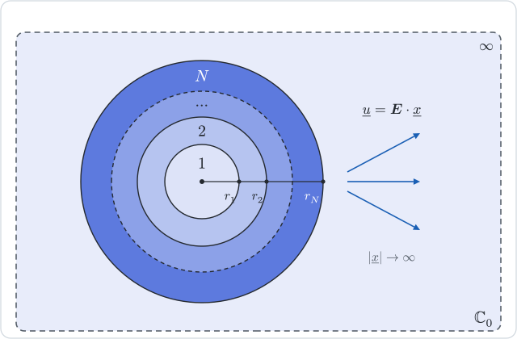

# [Layered sphere](@id th-layered-sphere)

!!! info "Before this page"
    [Layered spheres and cylinders: the radial problem](@ref th-radial-problems),
    which states the problem solved here and the two strategies that solve it,
    and [Concentration and contribution tensors](@ref th-concentration), whose
    strain concentration tensor is what a pattern without a Hill tensor
    supplies to the [Homogenization schemes](@ref th-homogenization).

[`LayeredSphere`](@ref) is a spherical composite inclusion made of `n`
concentric layers, in an infinite isotropic matrix, under a remote uniform
strain or temperature gradient. Its layers are isotropic or transversely
isotropic about the radial direction, uniform or graded, and its interfaces
perfect or imperfect. This page gives, for each of its three loading modes,
the radial modes and the transfer matrix of a layer (the recurrences of
[herve1993](@citet), which generalize the three-phase model of
[christensenLo1979](@citet)) and the matrix of its system of the first order;
then the interfaces [herveLuanco2014](@cite), the averages the schemes use and
the pointwise fields. The imperfect interfaces come in pairs, one per physics
and per quantity that jumps:

| | Field jumps | Flux jumps |
| :--- | :--- | :--- |
| Elasticity | `SpringInterface(kn, kt)` | `MembraneInterface(κs, μs)`, surface elasticity [dormieux2016](@cite) |
| Conduction | `KapitzaInterface(ρ)` | `SurfaceConductiveInterface(ks)` [barthelemyBignonnetIJES2020](@cite) |

Every matrix of this page is derived with symbolic computations: the modes and
the transfer matrices on
[Layered sphere: modes and transfer matrices, symbolically](@ref tut-layered-sphere-symbolic),
where the order of the products is fixed for moduli that are aging operators,
and the systems of the first order on
[Layered sphere: the systems of the first order, symbolically](@ref tut-layered-sphere-first-order-symbolic).

## 1. Geometry and constituents

Radii are stored in ascending order from the center,

```math
r_0 = 0\text{ (implicit)} < r_1 < r_2 < \cdots < r_N,
```

with **layer ``k`` occupying** ``r_{k-1} \le r < r_k``.  Layer 1 is the
core, layer ``N`` is the outermost shell, and the composite sphere is
embedded in an infinite matrix for ``r > r_N``.



That is the whole problem solved below: a concentric pattern in
an unbounded reference medium ``\mathbb C_0``, loaded by a remote uniform
strain. Because the strain is **not** uniform inside such a pattern, it has no
Hill tensor at all; what it does have is a volume-averaged concentration
tensor, and that is what every scheme consumes.

The three-phase model of [christensenLo1979](@citet) is one
*use* of this solution rather than a variant of it — take ``N = 2`` and let the
reference medium be the unknown effective one, and the fixed point is their
result. That is a property of the scheme, not of the pattern, so it lives with
the schemes.

An interactive view of the layered geometry is in
[The inclusion zoo](@ref man-inclusion-gallery).

The interface conditions at each radius ``r_k`` are given by a tuple of
interfaces, perfect by default (section 4). A layer is given by its modulus:

| Layer | Stiffness | Conductivity |
| :--- | :--- | :--- |
| isotropic | ``3\kappa\,\mathbb{J} + 2\mu\,\mathbb{K}`` (`TensISO{4,3}`) | ``k_r\,\boldsymbol{1}`` (`TensISO{2,3}`) |
| transversely isotropic about ``\underline{e}_r`` | five moduli, `radial_ti(SphericalChart(), …)` | ``k_r\,\underline{e}_r\otimes\underline{e}_r + k_\theta\,(\boldsymbol{1} - \underline{e}_r\otimes\underline{e}_r)`` |
| graded | a function ``r \mapsto`` one of the above | the same |

The second kind is a field of TensND whose symmetry axis turns with the point,
as in a coating deposited layer by layer or in an oolite. In the local frame
``(\underline{e}_r, \underline{e}_\theta, \underline{e}_\varphi)`` its
stiffness has the components ``C_{rrrr}``,
``C_{\theta\theta\theta\theta}``, ``C_{\theta\theta\varphi\varphi}``,
``C_{rr\theta\theta}`` and ``C_{r\theta r\theta}``, and Hill's moduli about the
radius are used below:

```math
\begin{gathered}
k = \tfrac12\,(C_{\theta\theta\theta\theta} + C_{\theta\theta\varphi\varphi}), \qquad
l = C_{rr\theta\theta}, \qquad
m = \tfrac12\,(C_{\theta\theta\theta\theta} - C_{\theta\theta\varphi\varphi}) , \\
n = C_{rrrr}, \qquad p = C_{r\theta r\theta} .
\end{gathered}
```

They may be given in any of the notations of a transversely isotropic
material, the radial direction being the axis: Hill's moduli, the components,
the engineering constants or Hoenig's parameters
([Layered inclusions](@ref man-layered-moduli)). An isotropic layer
``(\kappa, \mu)`` is the case

```math
k = \kappa + \tfrac13\mu, \qquad l = \kappa - \tfrac23\mu, \qquad
m = p = \mu, \qquad n = \kappa + \tfrac43\mu ,
```

and ``k_\theta = k_r`` in conduction.

```@example layered_sphere
using MeanFieldHomogenization, TensND, LinearAlgebra
core = iso_stiffness(30.0, 12.0)                                          # κ, μ
shell = radial_ti(SphericalChart(), 19.0, 5.0, 11.0, 12.0, 4.0; form = :hill)   # k, l, m, n, p about the radius
hill_moduli(core), hill_moduli(shell)
```

## 2. Isotropic layers

A remote strain is the sum of a spherical part and a deviatoric one, which
load the sphere independently; conduction is a third loading mode. For each
one, this section gives the radial modes of a uniform isotropic layer
``(\kappa, \mu)`` and its transfer matrix, then the matrix
``\boldsymbol{M}`` of its system of the first order, of which the transfer
matrix is the power. ``\xi = r_{\mathrm{out}}/r_{\mathrm{in}}`` is the ratio of
the radii of the layer and

```math
\omega = \frac{3\kappa}{3\kappa + 4\mu} \in [0, 1] ,
```

which tends to one for an incompressible layer.

### 2.1 Spherical part

Under a remote spherical strain the displacement is radial,
``\underline{u} = u_r(r)\,\underline{e}_r``, and equilibrium is an Euler
equation, ``r^2 u_r'' + 2r\,u_r' - 2u_r = 0``, of solutions

```math
u_r = A\,r + \frac{B}{r^2} ,
\qquad
\sigma_{rr} = 3\kappa\,A - 4\mu\,\frac{B}{r^3} :
```

a uniform strain and a mode that decays. The quantities that a perfect
interface transmits are ``u_r`` and ``\sigma_{rr}``; eliminating ``(A, B)``
between the two radii of a layer gives the transfer of the state
``(u_r, \sigma_{rr})``,

```math
\begin{pmatrix} u_r \\ \sigma_{rr} \end{pmatrix}_{r_{\mathrm{out}}}
= \boldsymbol{T}\,\begin{pmatrix} u_r \\ \sigma_{rr} \end{pmatrix}_{r_{\mathrm{in}}} ,
\qquad
\boldsymbol{T} =
\begin{pmatrix}
(1-\omega)\,\xi + \omega\,\xi^{-2}
& \dfrac{r_{\mathrm{in}}\,(1-\omega)\,(\xi - \xi^{-2})}{4\mu} \\[3mm]
\dfrac{4\mu\,\omega\,(\xi - \xi^{-2})}{r_{\mathrm{out}}}
& \omega + (1-\omega)\,\xi^{-3}
\end{pmatrix} .
```

Every entry stays finite as ``\kappa \to \infty``, hence for a Poisson ratio
of ``1/2``: this is why the state is carried rather than the amplitudes. In the
core only the regular mode exists. It is entered by its pressure
``P_1 = 3\kappa_1 A_1``, so that

```math
u_r(r_1^-) = \frac{r_1}{3\kappa_1}\,P_1 \xrightarrow{\kappa_1 \to \infty} 0,\qquad
\sigma_{rr}(r_1^-) = P_1 ,
```

and the bulk concentration of a layer, ``\alpha_k = A_k/A_\infty``, vanishes
smoothly for an incompressible core.

**As a system of the first order.** The constitutive law
``\sigma_{rr} = (\kappa + \tfrac43\mu)\,u_r' + 2\,(\kappa - \tfrac23\mu)\,u_r/r``,
solved for ``r\,u_r'``, and the equilibrium
``(r^2\sigma_{rr})' = r\,(\sigma_{\theta\theta} + \sigma_{\varphi\varphi})``
are, on the state ``Y = (u_r,\; r\,\sigma_{rr})``,

```math
r\,\frac{\mathrm{d}Y}{\mathrm{d}r} = \boldsymbol{M}\,Y ,
\qquad
\boldsymbol{M} = \begin{pmatrix} 1 - 3\omega & \dfrac{3\,(1-\omega)}{4\mu} \\[3mm] 12\mu\,\omega & 3\omega - 2 \end{pmatrix} .
```

Its trace is ``-1`` and its determinant ``-2``: its eigenvalues are ``1`` and
``-2``, the exponents of the two modes, and its eigenvectors
``(1, 3\kappa)`` and ``(1, -4\mu)`` their states at ``r = 1``. The layer is
crossed by

```math
\xi^{\boldsymbol{M}} =
\begin{pmatrix}
(1-\omega)\,\xi + \omega\,\xi^{-2} & \dfrac{(1-\omega)\,(\xi - \xi^{-2})}{4\mu} \\[3mm]
4\mu\,\omega\,(\xi - \xi^{-2}) & \omega\,\xi + (1-\omega)\,\xi^{-2}
\end{pmatrix}
= \boldsymbol{D}(r_{\mathrm{out}})\,\boldsymbol{T}\,\boldsymbol{D}(r_{\mathrm{in}})^{-1} ,
\qquad \boldsymbol{D}(r) = \begin{pmatrix} 1 & 0 \\ 0 & r \end{pmatrix} ,
```

the transfer matrix above, on the state whose traction is multiplied by ``r``.

```@example layered_sphere
const LS = MeanFieldHomogenization.LayeredSpheres
const RS = MeanFieldHomogenization.Core
κ, μ, r_in, r_out = 30.0, 12.0, 0.8, 1.0
ω, ξ = 3κ / (3κ + 4μ), r_out / r_in
M = LS._bulk_system(hill_moduli(core))
M ≈ [1-3ω 3*(1 - ω)/(4μ); 12μ*ω 3ω-2], eigvals(Matrix(M))
```

```@example layered_sphere
D(r) = Diagonal([1.0, r])
RS.radial_power(M, ξ) ≈ D(r_out) * LS._bulk_layer_transfer(r_out, r_in, κ, μ) / D(r_in)
```

### 2.2 Deviatoric part

Under a remote pure-deviatoric strain, the displacement field in an
isotropic layer has the axisymmetric form
``u_r = U(r)\,P_2(\cos\theta)``, ``u_\theta = W(r)\,\mathrm dP_2(\cos\theta)/\mathrm d\theta``, and the
four linearly-independent Navier solutions at ``\ell = 2`` are parametrized
by the power-law exponents ``s \in \{1, 3, -4, -2\}`` with material-
dependent ``U/W`` ratios derived directly from the Navier characteristic
equation (using ``x = \kappa/\mu``):

| Mode | Radial dependence | ``(U, W)``                                  |
| :--: | :---------------- | :------------------------------------------ |
|  1   | ``r``             | ``(2r, r)`` — uniform deviatoric strain      |
|  2   | ``r^3``           | ``(6(3x-2)\,r^3,\ (15x+11)\,r^3)``           |
|  3   | ``r^{-4}``        | ``(3/r^4,\ -1/r^4)``                         |
|  4   | ``r^{-2}``        | ``(3(x+1)/r^2,\ 1/r^2)``                     |

The corresponding traction amplitudes are obtained from Hooke's law
``\sigma_{ij} = \lambda\,\delta_{ij}\,\varepsilon_{kk} + 2\mu\,\varepsilon_{ij}``:

```math
\begin{aligned}
\sigma_{rr}\text{ amp} &= (\lambda+2\mu)\,U' + \frac{2\lambda}{r}(U - 3W),\\[2pt]
\sigma_{r\theta}\text{ amp} &= \mu\bigl(W' + (U-W)/r\bigr).
\end{aligned}
```

The state ``(U, W, \sigma_{rr}, \sigma_{r\theta})`` combines
displacement and physical traction amplitudes; this form is continuous
across every perfect interface and rational in ``(\kappa, \mu, r)``, so the
recurrence is **type-generic** (supports `Float64`, `BigFloat`,
`ForwardDiff.Dual`, `SymPyPythonCall.Sym`, `Symbolics.Num`) and remains regular
in the incompressibility limit ``\kappa \to \infty``.

With ``\boldsymbol{\Phi}(r)`` the matrix whose columns are the states of the
four modes, the transfer matrix of a layer is
``\boldsymbol{T} = \boldsymbol{\Phi}(r_{\mathrm{out}})\,\boldsymbol{\Phi}(r_{\mathrm{in}})^{-1}``,
the inverse being written in closed form.

In the core the two regular modes are kept (``a_1 = 1, b_1 = 0``
and ``a_1 = 0, b_1 = 1``; the two singular amplitudes ``c_1 = d_1 = 0``
are forced by regularity at the origin).  Propagating both probes and
solving a 2×2 linear system for the matrix-side far-field
``(a_\infty, b_\infty) = (1, 0)`` yields the per-layer amplitudes.

The layer concentration is **not** the mode-1 amplitude alone.  Mode 2 has
an ``r^3`` displacement profile, so it integrates to a non-zero deviatoric
strain over a shell of finite thickness, whereas modes 3 and 4 average to
zero pointwise:

```math
\beta_k = a_k + b_k\,\frac{21}{5}\,\frac{3\kappa_k + \mu_k}{\mu_k}\,
      \frac{r_k^5 - r_{k-1}^5}{r_k^3 - r_{k-1}^3}.
```

Dropping the mode-2 term is invisible on degenerate configurations
(vanishing core, core ≡ shell, single layer) and wrong by 1–50 % on a
genuine multi-layer stack.

For ``N = 1`` the recurrence reduces to the classical Eshelby single-
sphere result; for ``N \ge 2`` it reproduces the core-shell effective shear
modulus of [christensenLo1979](@citet) and passes the Eshelby consistency tests
(``N = 2`` with core ≡ shell ↔ single-layer of radius ``r_N``, etc.).

**As a system of the first order.** On the state
``Y = (U,\; W,\; r\,\sigma_{rr},\; r\,\sigma_{r\theta})``, the two relations
above, solved for ``r\,U'`` and ``r\,W'``, and the two equations of equilibrium
give

```math
\boldsymbol{M} = \begin{pmatrix}
 1 - 3\omega & 9\omega - 3 & \dfrac{3\,(1-\omega)}{4\mu} & 0 \\[3mm]
 -1 & 1 & 0 & \dfrac{1}{\mu} \\[3mm]
 12\mu\,\omega & -36\mu\,\omega & 3\omega - 2 & 6 \\[2mm]
 -6\mu\,\omega & 18\mu\,\omega + 4\mu & \dfrac{1 - 3\omega}{2} & -2
\end{pmatrix} ,
```

whose eigenvalues are ``1``, ``3``, ``-4`` and ``-2``: the exponents of the
table, the eigenvectors holding the shapes ``(U, W)`` of the modes and their
tractions. The power ``\xi^{\boldsymbol{M}}`` is the transfer matrix
``\boldsymbol{T}`` on the state whose tractions are multiplied by ``r``, with
``\boldsymbol{D}(r) = \operatorname{diag}(1, 1, r, r)``:

```@example layered_sphere
M₄ = LS._shear_system(hill_moduli(core))
M₄ ≈ [1-3ω 9ω-3 3*(1 - ω)/(4μ) 0; -1 1 0 1/μ; 12μ*ω -36μ*ω 3ω-2 6; -6μ*ω 18μ*ω+4μ (1 - 3ω)/2 -2], eigvals(Matrix(M₄))
```

```@example layered_sphere
D₄(r) = Diagonal([1.0, 1.0, r, r])
RS.radial_power(M₄, ξ) ≈ D₄(r_out) * LS._shear_layer_transfer(r_out, r_in, κ, μ) / D₄(r_in)
```

### 2.3 Conduction

Under a remote uniform temperature gradient the temperature is
``T = \hat T(r)\,(\underline{n}\cdot\underline{e})``, ``\underline{n}`` being the
radial unit vector and ``\underline{e}`` the direction of the gradient, with
``\hat T = A\,r + B/r^2``. The state ``(\hat T, \hat q_n)``,
``\hat q_n = -k_r\,\hat T'`` being the amplitude of the outward flux and
``k_r`` the conductivity of the layer, is carried by the transfer matrix
``\boldsymbol{T} = \boldsymbol{\Phi}(r_{\mathrm{out}})\,\boldsymbol{\Phi}(r_{\mathrm{in}})^{-1}`` of
the modes,

```math
\boldsymbol{\Phi}(r) = \begin{pmatrix} r & r^{-2} \\ -k_r & 2k_r\,r^{-3} \end{pmatrix} .
```

The gradient concentration of a layer, ``\alpha_k = A_k/A_\infty``, reduces for
one sphere of conductivity ``k_1`` in a matrix ``k_0`` to the classical
``3k_0/(2k_0 + k_1)``.

**As a system of the first order.** With ``\hat q_n = -k_r\,\hat T'`` and the
balance ``(r^2\hat q_n)' + 2k_r\,\hat T = 0``, on
``Y = (\hat T,\; r\,\hat q_n)``,

```math
\boldsymbol{M} = \begin{pmatrix} 0 & -\dfrac{1}{k_r} \\[2mm] -2k_r & -1 \end{pmatrix} ,
```

of eigenvalues ``1`` and ``-2``; it is the example of
[the radial problem](@ref th-radial-problems), sections 2 to 5.

### 2.4 Numbers, symbols and incompressible layers

The transfer matrices are small matrices of rational functions of the moduli
and of the radii: they are exercised with `Float64`, `BigFloat`,
`ForwardDiff.Dual`, `SymPyPythonCall.Sym` and `Symbolics.Num`. With symbols,

```julia
using SymPyPythonCall; @syms κ₀ μ₀ κ₁ μ₁
s = LayeredSphere((Sym(1),), (TensISO{3}(3κ₁, 2μ₁),))
simplify(MeanFieldHomogenization.LayeredSpheres._bulk_concentration(s, κ₀, μ₀)[1])
# → (3κ₀ + 4μ₀) / (3κ₁ + 4μ₀)
```

and the derivative with respect to any modulus or radius is obtained
by wrapping the computation in `ForwardDiff.derivative` /
`ForwardDiff.gradient`. A sphere whose layers are all isotropic and uniform is
solved by these transfer matrices; the systems above are those the package
crosses as soon as one layer is of another kind (section 3 and
[the radial problem](@ref th-radial-problems), section 5).

## [3. Layers transversely isotropic about the radius](@id th-layered-sphere-radial)

The layers need not be isotropic for the sphere to keep its symmetry: it is
enough that the material be, at each point, transversely isotropic about
``\underline{e}_r``. The loading modes and the angular shapes of section 2 are
kept; what changes is the radial modes, still powers of ``r``, with exponents
that depend on the moduli. They were given for the sphere by
[kushch2021](@citet) and [kushchMogilevskaya2022](@citet), in a setting
[norrisShuvalov2012](@citet) describe for every degree of harmonics, and are
derived again, symbolically, in
[the companion tutorial](@ref tut-layered-sphere-radial-symbolic). With moduli
that depend on ``r``, the matrices of section 3.4 are those of a graded layer.

### 3.1 Spherical part

The displacement is radial, ``\underline{u} = f(r)\,\underline{e}_r``, and
equilibrium is an Euler equation,

```math
n\,r^2 f'' + 2n\,r f' - 2\,(2k - l)\,f = 0 ,
```

of solutions ``r^s`` with

```math
n\,s(s + 1) = 2\,(2k - l) ,
\qquad
s = -\tfrac12 \pm t , \quad t^2 = \tfrac14 + \frac{2\,(2k - l)}{n} .
```

A positive definite stiffness has ``n k > l^2``, hence
``t^2 \geq (\tfrac12 - 2\sqrt{k/n})^2``: the two exponents are real, one of each
sign. The isotropic layer has ``s = 1`` and ``s = -2`` (section 2.1). The mode ``r^s`` carries
the state

```math
u_r = r^s , \qquad \sigma_{rr} = (n\,s + 2l)\,r^{s-1} .
```

### 3.2 Deviatoric part

With the angular shapes of section 2.2,
``\underline{u} = U(r)\,P_2\,\underline{e}_r + W(r)\,P_2'\,\underline{e}_\theta``,
and ``U = a\,r^s``, ``W = b\,r^s``, the two equilibrium equations read

```math
\begin{aligned}
\bigl[n\,s(s+1) - 4k + 2l - 6p\bigr]\,a + \bigl[12k - 6l\,(s+1) - 6p\,(s-1)\bigr]\,b &= 0 , \\
\bigl[2k + (l + p)\,s + 2p\bigr]\,a + \bigl[p\,s(s+1) - 2p - 6k - 4m\bigr]\,b &= 0 .
\end{aligned}
```

Their determinant is a polynomial of degree two in ``t^2``, ``t = s + \tfrac12``,

```math
n p\,t^4 - B\,t^2 + C = 0 ,
```

```math
\begin{aligned}
B &= 6kn + 4kp - 6l^2 - 14lp + 4mn + \tfrac52\,np , \\
C &= 16km + \tfrac32\,kn + 9kp - \tfrac32\,l^2 - 8lm + \tfrac92\,lp + mn + 24mp + \tfrac{9}{16}\,np ,
\end{aligned}
```

whose roots are ``t = \pm\tfrac32, \pm\tfrac72`` for an isotropic layer: the
exponents ``1, 3, -2, -4`` of [christensenLo1979](@citet). Each exponent gives a
mode of shape ``(a, b)`` in the kernel of the system, and of state

```math
\begin{gathered}
U = a\,r^s , \qquad W = b\,r^s , \\
\sigma_{rr} = \bigl[(n\,s + 2l)\,a - 6l\,b\bigr]\,r^{s-1} , \qquad
\sigma_{r\theta} = p\,\bigl[a + (s - 1)\,b\bigr]\,r^{s-1} ,
\end{gathered}
```

``\sigma_{rr}`` and ``\sigma_{r\theta}`` being the radial functions of the
traction, on ``P_2`` and ``P_2'``.

The two values of ``t^2`` are not always real. When ``B^2 < 4npC``, which
positive definite moduli allow, the exponents are complex,
``s = -\tfrac12 \pm (\alpha \pm i\beta)``, and the modes oscillate as
``r^{-1/2 \pm \alpha}\cos(\beta\ln r)``. The layers are crossed without the
exponents (section 3.4), so that this case needs no particular treatment.

```@example layered_sphere
oscillating = radial_ti(SphericalChart(); n = 0.768, l = 0.622, k = 1.2855, m = 1.2335, p = 3.6)
exponents(c) = eigvals(Matrix(LS._shear_system(hill_moduli(c))))     # of the system of section 3.4
(isotropic = exponents(radial_ti(SphericalChart(), iso_stiffness(4.0, 3.0))), shell = exponents(shell), oscillating = exponents(oscillating))
```

### 3.3 Conduction

Under a remote uniform gradient the temperature is ``T = \hat T(r)\cos\theta``,
and ``\hat T = r^s`` with

```math
k_r\,s(s + 1) = 2k_\theta , \qquad s = -\tfrac12 \pm \sqrt{\tfrac14 + \frac{2k_\theta}{k_r}} ,
```

of state ``(\hat T, \hat q) = (r^s, -k_r\,s\,r^{s-1})``, ``\hat q`` being the
outward flux. A homogeneous sphere, whose regular mode has the exponent
``s_+``, disturbs nothing in a medium of conductivity ``k_r\,s_+``
[schulgasser1983](@cite), [milton2002](@cite):

```@example layered_sphere
kᵣ, k_θ = 2.0, 5.0
s₊ = -1 / 2 + sqrt(1 / 4 + 2k_θ / kᵣ)
ball = LayeredSphere((1.0,), (radial_ti(SphericalChart(), k_θ, kᵣ),))
property_contribution(ball, TensISO{3}(kᵣ * s₊))
```

### 3.4 The systems

On the state ``Y`` of a mode (the radial functions of the displacement and
``r`` times those of the traction, the temperature and ``r`` times the outward
flux), the equations of sections 3.1 to 3.3 are the system
``r\,\mathrm{d}Y/\mathrm{d}r = \boldsymbol{M}\,Y`` of
[the radial problem](@ref th-radial-problems). For the spherical part,
``Y = (u_r,\; r\,\sigma_{rr})``, and for conduction,
``Y = (\hat T,\; r\,\hat q)``:

```math
\boldsymbol{M} = \begin{pmatrix} -\dfrac{2l}{n} & \dfrac{1}{n} \\[2mm] 4k - \dfrac{4l^2}{n} & \dfrac{2l}{n} - 1 \end{pmatrix} ,
\qquad
\boldsymbol{M} = \begin{pmatrix} 0 & -\dfrac{1}{k_r} \\[2mm] -2k_\theta & -1 \end{pmatrix} .
```

For the deviatoric part,
``Y = (U,\; W,\; r\,\sigma_{rr},\; r\,\sigma_{r\theta})`` and, with
``c = k - l^2/n``,

```math
\boldsymbol{M} = \begin{pmatrix}
 -\dfrac{2l}{n} & \dfrac{6l}{n} & \dfrac{1}{n} & 0 \\[2mm]
 -1 & 1 & 0 & \dfrac{1}{p} \\[2mm]
 4c & -12c & \dfrac{2l}{n} - 1 & 6 \\[2mm]
 -2c & 6c + 4m & -\dfrac{l}{n} & -2
\end{pmatrix} .
```

The exponents of sections 3.1 to 3.3 are the eigenvalues of these matrices,
symmetric about ``-\tfrac12``. The layers are crossed by the power of
``\boldsymbol{M}``, the regular states at the center are those of the projector
on the exponents above ``-\tfrac12``, and the interfaces are those of
section 4. In the matrix, which is
isotropic, the amplitude of the uniform strain is read and set to one. With
the moduli of an isotropic layer these matrices are those of section 2.

## [4. Interfaces](@id th-layered-sphere-interfaces)

An interface at the radius ``r_k`` multiplies the state by its jump matrix
``\boldsymbol{J}``: the state on its outer side, at ``r_k^+``, is
``\boldsymbol{J}`` times the state on its inner side, at ``r_k^-``. The
matrices below act on the state ``(u_r, \sigma_{rr})`` of the spherical part
and on ``(\hat T, \hat q_n)`` in conduction. A jump is
always the outer value minus the inner one, ``[\![x]\!] = x(r_k^+) - x(r_k^-)``. A spring interface is
parametrized by its normal and tangential stiffnesses ``k_n``, ``k_t``, whose
inverses ``s_n = 1/k_n``, ``s_t = 1/k_t`` are the compliances, a membrane by its
surface bulk and shear moduli ``\kappa^{\mathrm s}``, ``\mu^{\mathrm s}``, a
Kapitza interface by its thermal resistance ``\rho`` and a surface-conductive one
by its surface conductance ``k^{\mathrm s}``.

```math
\begin{aligned}
\text{Perfect:} &\quad \boldsymbol{J} = \boldsymbol{1},\\
\text{Spring:} &\quad \boldsymbol{J} = \begin{pmatrix}1 & s_n \\ 0 & 1\end{pmatrix}
\quad\text{(the spherical part uses } s_n\text{ only)},\\
\text{Membrane:} &\quad \boldsymbol{J} = \begin{pmatrix}1 & 0 \\ 4\kappa^{\mathrm s}/r^{2} & 1\end{pmatrix}
\quad\text{(the spherical part uses } \kappa^{\mathrm s}\text{ only)},\\
\text{Kapitza:} &\quad \boldsymbol{J} = \begin{pmatrix}1 & -\rho \\ 0 & 1\end{pmatrix},\\
\text{Surface-conductive:} &\quad \boldsymbol{J} = \begin{pmatrix}1 & 0 \\ -\ell(\ell{+}1)k^{\mathrm s}/r^{2} & 1\end{pmatrix}
\quad\text{(harmonic degree } \ell\text{; } \ell = 1 \text{ for a uniform gradient)}.
\end{aligned}
```

`SpringInterface` and `KapitzaInterface` encode a **primal
discontinuity** (displacement / temperature jump), while
`MembraneInterface` and `SurfaceConductiveInterface` encode a **dual
discontinuity** (traction / flux jump).  All limit to
`PerfectInterface` when their compliance goes to zero.

The minus sign of the Kapitza matrix is that of the dictionary
``\boldsymbol\sigma \equiv -\underline q`` of [Conventions](@ref th-notation-sigma-q). The Kapitza law is
the exact analog of the spring law ``[\![u_r]\!] = s_n\,\sigma_{rr}``, namely
``[\![T]\!] = \rho\,\sigma_n``, and the state carries the physical outward normal flux
``\hat q_n``, with ``\underline q = -k_r\,\underline{\operatorname{grad}}\,T``: hence ``[\![T]\!] = -\rho\,q_n``. Heat crossing the
resistance outward leaves the inner side hotter than the outer one. With ``+\rho``
the interface would be a negative resistance, raising the conductance of the
sphere it is meant to lower.

For the deviatoric part, on ``(U, W, \sigma_{rr}, \sigma_{r\theta})``:

- **Perfect**: identity.
- **Spring**: ``[\![U]\!] = s_n\,\sigma_{rr} = \sigma_{rr}/k_n``,
  ``[\![W]\!] = s_t\,\sigma_{r\theta} = \sigma_{r\theta}/k_t``, the traction being
  continuous.
- **Membrane**: a surface-elastic shell of moduli ``(\kappa^{\mathrm s}, \mu^{\mathrm s})``
  generates a jump in the tractions driven by the surface-stress divergence.

These matrices act on the state without the factor ``r``. On the state ``Y``
of a system of the first order the same interface has the matrix
``\boldsymbol{D}(r_k)\,\boldsymbol{J}\,\boldsymbol{D}(r_k)^{-1}``: a spring adds
``s_n/r_k`` times ``r\,\sigma_{rr}`` to the displacement, a membrane
``4\kappa^{\mathrm s}/r_k`` times ``u_r`` to ``r\,\sigma_{rr}``. A layer of any
kind may have any interface on its outer radius.

## [5. Averages and interface jumps](@id th-layered-sphere-jumps)

### 5.1 Averages over the material

Three volume-average flavors are provided:

- [`layer_gradient_average`](@ref)`(sphere, C₀, ε∞, k)` — mean strain in
  layer ``k`` (bulk + deviatoric parts).
- [`sphere_gradient_average`](@ref)`(sphere, C₀, ε∞)` — mean strain in
  the whole composite.
- [`cumulative_strain_average`](@ref)`(sphere, C₀, ε∞, r)` — mean
  strain inside the ball of radius ``r``.

All three cover the deviatoric part for any ``N \ge 1`` via the deviatoric
modes of section 2.2. They average the field over the **material** of the layers,
which is what a local criterion needs. A spring interface adds strain that
belongs to no layer, and the concentration tensor of the whole sphere has to
count it.

### 5.2 The strain carried by a displacement jump

Over a ball ``B`` of radius ``R``, the divergence theorem applied layer by layer
gives

```math
\frac{1}{|B|}\int_B \boldsymbol\varepsilon\,\mathrm dV
= \frac{1}{|B|}\oint_{\partial B^-}\underline u\otimes^{\mathrm s}\underline n\,\mathrm dS
- \frac{1}{|B|}\sum_{r_k < R}\oint_{S_k}[\![\underline u]\!]\otimes^{\mathrm s}\underline n\,\mathrm dS,
```

with ``S_k`` the interface of radius ``r_k``, ``\underline n`` its outward normal and
``[\![\underline u]\!] = \underline u^+ - \underline u^-``. The left-hand side is the average over the
material, ``\sum_k f_k\,\langle\boldsymbol\varepsilon\rangle_k``. The strain of the ball seen from outside is the
first term on the right, read on the outer side of ``\partial B``: it carries the
opening of every interface. The two coincide only when no interface opens.

The strain average rule ``\boldsymbol E = \sum_i f_i\,\langle\boldsymbol\varepsilon\rangle_i`` requires each opening to
be assigned to some phase. The concentration tensor of a composite sphere
assigns to the sphere the openings of its inner interfaces, and of its outer
one by default. This is also the convention of Echoes, of
[`LayeredSpheroid`](@ref MeanFieldHomogenization.LayeredSpheroids.LayeredSpheroid)
and of the laminates.

On each harmonic the surface integral reduces to an amplitude. For the
spherical part, ``\underline u = u_r(r)\,\underline n`` and
``\oint u_r\,\underline n\otimes\underline n\,\mathrm dS = \tfrac{4\pi}{3}r^2u_r\,\boldsymbol 1``. For the deviatoric part, with
``u_r = U P_2(\cos\theta)``, ``u_\theta = W\,\mathrm dP_2/\mathrm d\theta`` and the remote strain of
mode 1, ``\boldsymbol\varepsilon^{\infty} = 2\underline e_3\otimes\underline e_3 - \underline e_1\otimes\underline e_1 - \underline e_2\otimes\underline e_2``,

```math
\oint u_3\,n_3\,\mathrm dS
= r^2\!\int\!\big(U P_2\cos^2\theta + 3W\cos^2\theta\sin^2\theta\big)\,\mathrm d\Omega
= \frac{8\pi r^2}{15}\,(U + 3W),
```

since both angular integrals equal ``8\pi/15``. Dividing by ``|B| = 4\pi R^3/3`` and
by ``\varepsilon^{\infty}_{33} = 2`` gives the weight of the ``\mathbb K`` part. Mode 1,
``(U, W) = (2r, r)``, then averages to 1 on its own ball, and modes 3 and 4 to
zero on any shell, as section 2.2 requires. The interface of radius ``r_k`` therefore
adds to the concentration of a ball of radius ``R``

```math
\Delta\alpha_k = \frac{r_k^2}{R^3}\,[\![u_r]\!]_k,
\qquad
\Delta\beta_k = \frac{r_k^2}{5R^3}\,\big([\![U]\!]_k + 3[\![W]\!]_k\big),
\qquad
\Delta\alpha^{\mathrm{cond}}_k = \frac{r_k^2}{R^3}\,[\![\hat T]\!]_k,
```

per unit remote amplitude, on ``\mathbb J``, on ``\mathbb K`` and in conduction. The
jumps are those of section 4: ``[\![u_r]\!] = s_n\,\sigma_{rr}`` in the spherical harmonic,
``[\![U]\!] = s_n\,\sigma_{rr}`` and ``[\![W]\!] = s_t\,\sigma_{r\theta}`` between amplitudes in the deviatoric
one, and ``[\![\hat T]\!] = -\rho\,\hat q_n``. The traction and the flux are continuous across a primal
interface, so the average stress and the average flux are unchanged. A
jump is strain without stress, and it lowers the contribution tensor by
``\mathbb C_0:\Delta\mathbb A``.

A single grain of bulk modulus ``\kappa_{\mathrm g}`` bonded by a normal spring ``k_n`` gives
a check in closed form. Under a hydrostatic stress ``p\,\boldsymbol 1``, the grain strains by
``\varepsilon = p/3\kappa_{\mathrm g}`` in every direction and the interface opens by ``p/k_n``. The sphere seen from
outside therefore strains by ``\varepsilon + p/(k_n R)``, which is the response of a
homogeneous grain of modulus

```math
\kappa^{\mathrm{eq}} = \frac{\kappa_{\mathrm g}}{1 + 3\kappa_{\mathrm g}/(k_n R)}.
```

Its dilute concentration ``(3\kappa_0 + 4\mu_0)/(3\kappa^{\mathrm{eq}} + 4\mu_0)`` is what the
interface term restores. In conduction, the same reasoning gives
``k^{\mathrm{eq}} = k_1/(1 + \rho k_1/R)`` for a grain of conductivity ``k_1`` behind a
Kapitza resistance.

### 5.3 Which interfaces an average counts

| Call | Inner interfaces | Outer interface ``r_N`` | Echoes |
|:--|:--|:--|:--|
| `gradient_gradient_concentration(sphere, C₀, C₀)` | counted | counted | `eE` |
| `gradient_gradient_concentration(sphere, C₀, C₀; external = false)` | counted | not counted | `sphere_eE(n-1, external=False)` |
| `gradient_gradient_concentration(sphere, C₀; layer = k)` | — | — | `layer_eE(k-1, external=False)` |
| `gradient_gradient_concentration(sphere, C₀; layer = k, external = true)` | — | ``r_k`` counted | `layer_eE(k-1)` |
| `gradient_gradient_concentration(sphere, C₀; layer = k, internal = true)` | ``r_{k-1}`` counted | — | `layer_eE(k-1, internal=True)` |
| `layer_gradient_average`, `sphere_gradient_average` | — | — | |

`external` and `internal` keep the meaning they have in Echoes; only the
default of the per-layer form differs, the material average. With
`external = true` on every layer, the shells partition the sphere:
``\sum_k f_k\,\mathbb A_k = \mathbb A_\Omega``. The same keyword moves the surface stress
of an outer membrane out of [`flux_gradient_concentration`](@ref), so that
``\mathbb N = \mathbb A_{\sigma\varepsilon} - \mathbb C_0:\mathbb A_\Omega`` holds for either value. Conduction
follows the same rules through [`gradient_gradient_concentration`](@ref) and
[`flux_gradient_concentration`](@ref). The schemes use the defaults.

These tensors reproduce Echoes to ten digits, with spring interfaces inside
and outside the sphere, under Mori–Tanaka and the self-consistent scheme, and
with Kapitza interfaces in conduction. In conduction they also match the
spherical limit of the confocal spheroid, computed independently.

### 5.4 Averages read on the states

With the amplitudes of an isotropic layer the averages above are closed forms
(the ``21/5`` of section 2.2). A layer crossed by its system of the first order
has no amplitudes: its means are read on the states at its boundaries.
amplitudes of the layers. The mean strain of a ball of radius ``R`` and its mean
stress are integrals over its surface, of unit normal ``\underline{n}``,

```math
\langle\boldsymbol{\varepsilon}\rangle = \frac{1}{V}\oint \underline{u}\stackrel{s}{\otimes}\underline{n}\,\mathrm{d}S ,
\qquad
\langle\boldsymbol{\sigma}\rangle = \frac{1}{V}\oint R\,(\boldsymbol{\sigma}\cdot\underline{n})\stackrel{s}{\otimes}\underline{n}\,\mathrm{d}S ,
```

the second one because the stress is in equilibrium. On the states of the two
parts they are, per unit remote strain and on ``\mathbb{J}`` and ``\mathbb{K}``,

| | spherical part | deviatoric part |
| :--- | :--- | :--- |
| mean strain of the ball | ``u_r/R`` | ``(U + 3W)/(5R)`` |
| mean stress of the ball | ``\sigma_{rr}`` | ``(\sigma_{rr} + 3\sigma_{r\theta})/5`` |

A layer is the difference of two balls. These expressions hold for any law of
the layers; with isotropic ones they return the tensors of the isotropic
sphere, which is the first check of the implementation:

```@example layered_sphere
C₀, C₁, C₂ = iso_stiffness(10.0, 6.0), iso_stiffness(40.0, 20.0), iso_stiffness(4.0, 3.0)
isotropic = LayeredSphere((0.6, 1.0), (C₁, C₂))
as_radial = LayeredSphere((0.6, 1.0), (C₁, radial_ti(SphericalChart(), C₂)))
TensND.get_data(property_contribution(isotropic, C₀, C₀)), TensND.get_data(property_contribution(as_radial, C₀, C₀))
```

The mean stress of a layer is not the product of a stiffness by its mean
strain, since the stiffness turns with the point: it is
`flux_gradient_concentration(sphere, C₀; layer)`.

## [6. Pointwise fields](@id th-layered-sphere-pointwise)

The amplitudes of the isotropic layers (section 2) already carry everything needed to evaluate the field
**at a point**, in any layer and in the matrix; only the reconstruction was
missing.  Write ``\underline n = \underline x/r``,
``\boldsymbol p = \underline n\otimes\underline n``,
``\boldsymbol q = \boldsymbol 1 - \boldsymbol p``.

**Spherical part.** ``\underline u = f(r)\,\underline n`` with
``f = \tilde A r + \tilde B/r^2``, hence
``\boldsymbol\varepsilon = f'\,\boldsymbol p + (f/r)\,\boldsymbol q``.

**Deviatoric part.** The general — non-axisymmetric — ``\ell = 2`` solution is

```math
\underline u = g(r)\,(\boldsymbol\varepsilon^{\infty\mathrm d}\cdot\underline n)
             + h(r)\,(\underline n\cdot\boldsymbol\varepsilon^{\infty\mathrm d}\cdot\underline n)\,\underline n,
```

which is the ``u_r = U P_2``, ``u_\theta = W\,\mathrm dP_2/\mathrm d\theta`` convention
above through ``U = 2(g+h)``, ``W = g``.  Differentiating with
``\partial n_i/\partial x_j = (\delta_{ij} - n_i n_j)/r`` gives, with
``s = \underline n\cdot\boldsymbol\varepsilon^{\infty\mathrm d}\cdot\underline n``,

```math
\boldsymbol\varepsilon = \frac{g}{r}\,\boldsymbol\varepsilon^{\infty\mathrm d}
 + G_2\,(\boldsymbol\varepsilon^{\infty\mathrm d}\cdot\underline n\otimes\underline n)^{\mathrm s}
 + G_3\,s\,\boldsymbol p + G_4\,s\,\boldsymbol 1,
\qquad
\begin{aligned}
G_2 &= g' - g/r + 2h/r,\\
G_3 &= h' - 3h/r,\\
G_4 &= h/r.
\end{aligned}
```

Every generator is transversely isotropic about ``\underline n`` — the
configuration is rotation-invariant about the center — so the pointwise
concentration tensor ``\mathbb A(\underline x)``, defined by
``\boldsymbol\varepsilon(\underline x) = \mathbb A(\underline x):\boldsymbol\varepsilon^\infty``,
is a `TensTI{4,T,6}`: six Walpole coefficients and an axis, with **no major
symmetry**.

Averaging ``\mathbb A(\underline x)`` over directions and over a shell returns exactly
the ``(\alpha_k, \beta_k)`` of sections 2 and 5 — mode 1 contributes ``a_k``, modes 3 and 4
contribute nothing pointwise, and mode 2 contributes
``7 b_k r^2 (3\kappa_k+\mu_k)/\mu_k``, whose shell average is the ``21/5`` factor.
[`shell_concentration`](@ref) exposes that identity from the same cached
amplitudes, so the pointwise and averaged approaches cannot drift apart.

The transport problem is the ``Y_1`` analog: ``T = f(r)\,(\underline
n\cdot\underline{\operatorname{grad}}\,T^\infty)`` and
``\underline{\operatorname{grad}}\,T = [\,f'\,\boldsymbol p + (f/r)\,\boldsymbol q\,]\cdot\underline{\operatorname{grad}}\,T^\infty``,
a second-order transversely isotropic tensor.

Everything is validated pointwise against the C++ reference (Echoes'
`conc_eE`, `conc_eS`, `conc_sE`, `conc_sS`) to ``10^{-14}``, perfect, spring and
Gurtin–Murdoch membrane interfaces alike.

See the worked example with figures:
[n-layer sphere: pointwise fields](@ref tut-layered-sphere-local-fields).

## 7. The parameters of a layer and second moments

The moduli of the layers belong to the sphere. A coefficient of one layer is
designated by `layer_param(phase, layer, name)`, the name being a component in
the frame that turns with the point. The derivative with respect to
``C_{rrrr}`` of the second layer is taken at fixed
``C_{\theta\theta\theta\theta}``, ``C_{\theta\theta\varphi\varphi}``,
``C_{rr\theta\theta}`` and ``C_{r\theta r\theta}``:

```@example layered_sphere
rve = RVE()
add_phase!(rve, :M, Ellipsoid(1.0), Dict(:C => C₀); fraction = :rest)
add_phase!(rve, :I, LayeredSphere((0.6, 1.0), (C₁, shell)), Dict(:C => C₁); fraction = 0.3)
shear(C) = k_mu(C)[2]
[name => derivative(rve, MoriTanaka(), layer_param(:I, 2, name); indexer = shear) for name in (:Crrrr, :Cθθθθ, :Cθθφφ, :Crrθθ, :Crθrθ)]
```

By [Kreher's theorem](@ref th-second-moments), the derivative of the effective
energy when the stiffness of a layer moves along a tensor field
``\mathbb{B}(\underline{x})`` is the mean over the layer of
``\boldsymbol{\varepsilon}:\mathbb{B}(\underline{x}):\boldsymbol{\varepsilon}``.
With a field that turns with the point, the moments of the components of the
strain in the local frame follow, which no uniform tensor gives: the direction
``\underline{e}_r\otimes\underline{e}_r\otimes\underline{e}_r\otimes\underline{e}_r``,
the first element of the Walpole basis about the radius, gives
``\langle\varepsilon_{rr}^2\rangle``. The layer need not be anisotropic for
that: an isotropic layer is moved along a radial field.

```@example layered_sphere
iso_rve = RVE()
add_phase!(iso_rve, :M, Ellipsoid(1.0), Dict(:C => C₀); fraction = :rest)
add_phase!(iso_rve, :I, isotropic, Dict(:C => C₁); fraction = 0.3)
E = Tens(Symmetric([1.0 0.2 0.1; 0.2 -0.5 0.3; 0.1 0.3 0.7]))
𝕎₁ = radial_ti(SphericalChart(), 1.0, 0.0, 0.0, 0.0, 0.0)
second_moment(iso_rve, Dilute(), (:I, 2), E, 𝕎₁)          # ⟨ε_rr²⟩ in the shell
```

In the dilute scheme the local field is that of one sphere in the matrix, which
[`LayeredSphereFields`](@ref) gives at every point of an isotropic sphere. The
mean of ``\varepsilon_{rr}^2`` over the shell, by a quadrature of that field,
is the same number:

```@example layered_sphere
using QuadGK
fields = LayeredSphereFields(isotropic, C₀)
function εrr²(r, c, φ)
    x = r .* [sqrt(1 - c^2) * cos(φ), sqrt(1 - c^2) * sin(φ), c]
    ε = local_gradient_gradient_concentration(fields, x) ⊡ E
    n = Tens(x / r)
    return (n ⋅ ε ⋅ n)^2
end
xs, ws = gauss(10)
shell_mean = sum(
    wr * wc * 0.2 * (0.8 + 0.2xr)^2 * εrr²(0.8 + 0.2xr, c, 2π * (j - 0.5) / 16) * 2π / 16
        for (xr, wr) in zip(xs, ws), (c, wc) in zip(xs, ws), j in 1:16
) / (4π / 3 * (1 - 0.6^3))
```

This identity, for the five directions of the Walpole basis and in each layer,
is the second check of the implementation: it compares the derivative of the
solution with radial layers, taken at isotropic ones, with the field of the
isotropic sphere, computed by other formulas.

## 8. In the schemes

A layered sphere has no Hill tensor: it enters every scheme by its tensors
``\mathbb A``, ``\mathbb B`` and ``\mathbb N``
([Concentration and contribution tensors](@ref th-concentration)), evaluated in
the reference medium of the scheme. The radial problem needs that reference
to be isotropic. A cell of isotropic phases keeps it so in every scheme,
including the self-consistent and differential ones, whose reference is the
running estimate: the matrix can stay an ordinary sphere, and the property
declared on the layered phase is not used, the layers carrying their own
moduli. Below, coated grains at 40 %:

```@example layered_sphere
coating, matrix = iso_stiffness(6.0, 3.0), iso_stiffness(9.0, 4.0)
grain = LayeredSphere((0.8, 1.0), (core, coating);
                      interfaces = (SpringInterface(20.0, 10.0), PerfectInterface()))
rve = RVE()
add_phase!(rve, :matrix, Ellipsoid(1.0, 1.0, 1.0), Dict(:C => matrix); fraction = :rest)
add_phase!(rve, :grain, grain, Dict(:C => core); fraction = 0.4)
k_mu(homogenize(rve, MoriTanaka(), :C)), k_mu(homogenize(rve, SelfConsistent(), :C))
```

The coated fiber of [Layered cylinder](@ref th-layered-cylinder) differs on one
point: its tensors are transversely isotropic about its axis, so a
self-consistent estimate of aligned fibers leaves the isotropic class and the
matrix must then be a one-layer cylinder.

## 9. Aging viscoelasticity

In aging linear viscoelasticity each modulus is a Volterra operator and each
amplitude a history ([Aging viscoelasticity (ALV)](@ref man-viscoelasticity)).
The transfer matrices of section 2 and the jumps of section 4 hold with the products in the order fixed on
[the symbolic page](@ref tut-layered-sphere-symbolic): a modulus acts on the
left of the strain it multiplies, a division by a modulus is a left division.
The averages of section 5 and the pointwise fields of section 6 have their aging
counterparts ([Inside a layered inclusion](@ref man-visco-layered-inside)), and
a layered sphere enters every aging scheme, its reference being isotropic as
in elasticity:

```@example layered_sphere
times = [0.0, 0.5, 1.0, 2.0]
aging(C, τ) = ViscoLaw((t, t′) -> t < t′ ? 0.0 * C : (1 + t′) / (1 + t′ + (t - t′) / τ) * C, :relaxation)
rve_alv = RVE()
add_phase!(rve_alv, :matrix, Ellipsoid(1.0, 1.0, 1.0), Dict(:C => aging(matrix, 2.0)); fraction = :rest)
add_phase!(rve_alv, :grain, LayeredSphere((0.8, 1.0), (core, aging(coating, 0.5))),
           Dict(:C => core); fraction = 0.4)
homogenize_alv(rve_alv, MoriTanaka(), :C; times)
```

## 10. Scope

- **Symmetry.** The layers are isotropic or transversely isotropic about the
  radius. A layer of fixed axes breaks the symmetry of the sphere and is
  refused.
- **Matrix.** The reference medium is isotropic.
- **Numbers.** With isotropic uniform layers: real, complex and dual numbers,
  nested, and symbols. With radial or graded layers: real and complex numbers
  (the complex moduli of a viscoelastic material at a frequency) and dual
  numbers, nested, in elasticity; symbols as well in conduction. Oscillating
  modes and equal exponents need no particular treatment.
- **Not available with radial or graded layers:** the pointwise fields, the
  response to a harmonic of any degree (multipole expansion), and aging
  viscoelasticity.

## Where to go next

The next page, [Layered cylinder](@ref th-layered-cylinder), solves the same
problem for a coated fiber, by the same two strategies; its layers may be
transversely isotropic about its axis as well.
[Layered spheroid](@ref th-layered-spheroid) solves the problem for confocal
spheroidal layers, in conduction and in elasticity; there an imperfect
interface couples the harmonic degrees that a sphere keeps apart.

- [Layered sphere: modes and transfer matrices, symbolically](@ref tut-layered-sphere-symbolic),
  [Layered sphere: the systems of the first order, symbolically](@ref tut-layered-sphere-first-order-symbolic)
  and [Layered sphere: layers transversely isotropic about the radius, symbolically](@ref tut-layered-sphere-radial-symbolic):
  the derivations of sections 2 to 4.
- [n-layer sphere: volume-averaged concentration tensors](@ref tut-layered-sphere):
  the per-layer concentration tensors of section 5 on a random multilayer;
  [n-layer sphere: pointwise fields](@ref tut-layered-sphere-local-fields).
- [Graded isotropic layers with interfaces at given radii](@ref tut-graded-layers-interfaces):
  moduli that vary with the radius.
- [Layered inclusions](@ref man-layered): the syntax.
