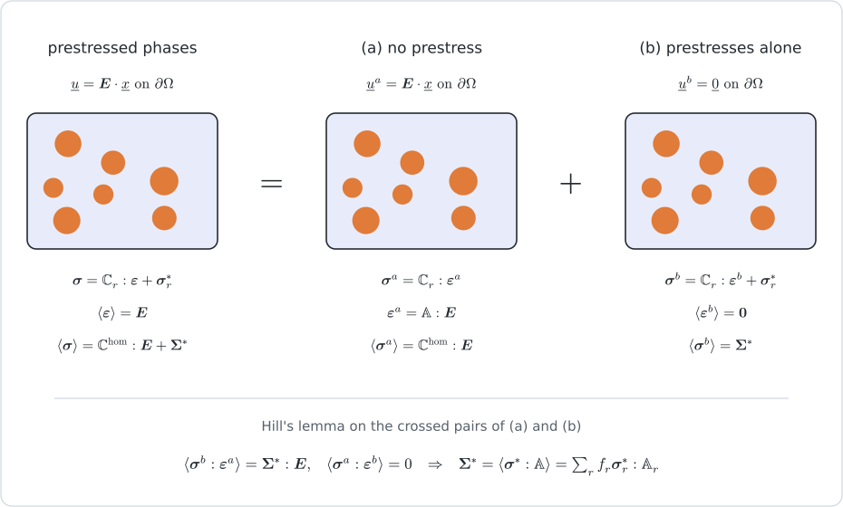
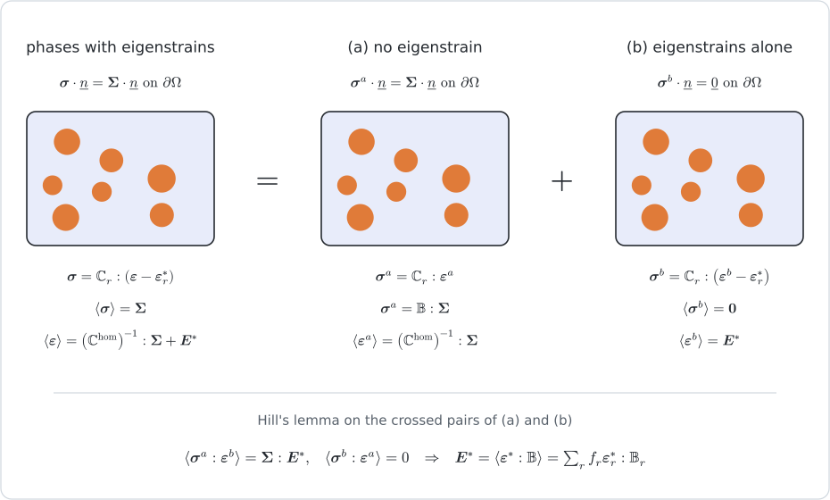

# [Levin's theorem: free strains and prestresses](@id th-levin)

!!! info "Before this page"
    [Homogenization schemes](@ref th-homogenization), where the strain and
    stress concentration tensors of an estimate are defined, and any of the
    scheme pages of this chapter, each of which ends with the concentration
    tensors of its estimate.

The schemes of this chapter estimate the response of a composite to a
macroscopic strain alone. The phases of a real material often carry, in
addition, a strain that owes nothing to the stress — a thermal dilation, a
hydric or chemical swelling — or a stress that owes nothing to the strain, such
as the pressure of a fluid filling the pores. The macroscopic law then acquires
an additional term, and the result known as Levin's theorem states that this
term follows from the concentration tensors already computed, without any new
problem to solve. Its consequences for thermal expansion were drawn by
[rosen1970](@citet) for two anisotropic phases, the relations between the
eigenstrains of the phases and their concentration tensors are developed for
multiphase media by [dvorak1992](@citet), and the theorem is the basis of the
micromechanics of saturated porous media [dormieux2006microporo](@cite).

## 1. Setting

Each phase ``r`` of the representative volume element obeys a linear elastic
law with a uniform eigenstrain ``\boldsymbol\varepsilon^\ast_r``, or equivalently
a uniform prestress ``\boldsymbol\sigma^\ast_r``,

```math
\boldsymbol\sigma = \mathbb C_r:(\boldsymbol\varepsilon - \boldsymbol\varepsilon^\ast_r)
  = \mathbb C_r:\boldsymbol\varepsilon + \boldsymbol\sigma^\ast_r ,
\qquad
\boldsymbol\sigma^\ast_r = -\,\mathbb C_r:\boldsymbol\varepsilon^\ast_r ,
```

the stiffness ``\mathbb C_r`` having the major symmetry. The second form remains
meaningful for a phase without stiffness, such as a pore filled with a fluid at
pressure ``p``, where ``\mathbb C_r = 0`` and ``\boldsymbol\sigma^\ast_r = -p\,\boldsymbol 1``.
The local problem being linear in the pair
``(\boldsymbol E, \boldsymbol\sigma^\ast)``, the macroscopic law is affine,

```math
\boldsymbol\Sigma = \mathbb C^{\mathrm{hom}}:\boldsymbol E + \boldsymbol\Sigma^\ast
  = \mathbb C^{\mathrm{hom}}:(\boldsymbol E - \boldsymbol E^\ast) ,
\qquad
\boldsymbol\Sigma^\ast = -\,\mathbb C^{\mathrm{hom}}:\boldsymbol E^\ast ,
```

which defines the macroscopic prestress ``\boldsymbol\Sigma^\ast``, the stress
under a vanishing macroscopic strain, and the macroscopic free strain
``\boldsymbol E^\ast``, the strain under a vanishing macroscopic stress. The
concentration tensors are those of the problem without eigenstrain: the fields
``\mathbb A(\underline x)`` and ``\mathbb B(\underline x)`` give the local strain
``\boldsymbol\varepsilon(\underline x) = \mathbb A(\underline x):\boldsymbol E`` under a
macroscopic strain and the local stress
``\boldsymbol\sigma(\underline x) = \mathbb B(\underline x):\boldsymbol\Sigma`` under a
macroscopic stress, and their averages over phase ``r`` are
``\mathbb A_r = \langle\mathbb A\rangle_r`` and ``\mathbb B_r = \langle\mathbb B\rangle_r``. The
fields ``\boldsymbol\sigma^\ast(\underline x)`` and ``\boldsymbol\varepsilon^\ast(\underline x)``
equal ``\boldsymbol\sigma^\ast_r`` and ``\boldsymbol\varepsilon^\ast_r`` in phase ``r``.

## 2. Statement

The macroscopic prestress and free strain are

```math
\boldsymbol\Sigma^\ast = \langle\boldsymbol\sigma^\ast:\mathbb A\rangle
  = \sum_r f_r\,\boldsymbol\sigma^\ast_r:\mathbb A_r ,
\qquad
\boldsymbol E^\ast = \langle\boldsymbol\varepsilon^\ast:\mathbb B\rangle
  = \sum_r f_r\,\boldsymbol\varepsilon^\ast_r:\mathbb B_r ,
```

the averages holding whatever the fields ``\boldsymbol\sigma^\ast`` and
``\boldsymbol\varepsilon^\ast``, and the sums being their value for fields uniform in
each phase. The second-order tensor contracts the first pair of indices of the
fourth-order one, ``(\boldsymbol\sigma^\ast:\mathbb A)_{kl} = \sigma^\ast_{ij}\,A_{ijkl}``.
The concentration tensors have the minor symmetries but not the major one, so
the order of the factors matters.

## 3. Proof



The local laws being linear, the problem with prestresses under a macroscopic
strain ``\boldsymbol E`` is the sum of two problems posed on the same volume
element under uniform strain boundary conditions (figure above). In problem (a)
there is no prestress and the macroscopic strain is ``\boldsymbol E``, so that
``\boldsymbol\varepsilon^a = \mathbb A:\boldsymbol E`` and
``\boldsymbol\sigma^a = \mathbb C:\boldsymbol\varepsilon^a``. In problem (b) the phases
carry their prestresses and the macroscopic strain vanishes, so that
``\langle\boldsymbol\varepsilon^b\rangle = \boldsymbol 0`` and
``\langle\boldsymbol\sigma^b\rangle = \boldsymbol\Sigma^\ast``. Each stress field is in
equilibrium and each strain field is compatible, so that Hill's lemma
[hill1963](@cite) applies to the two crossed pairs:

```math
\langle\boldsymbol\sigma^b:\boldsymbol\varepsilon^a\rangle
  = \langle\boldsymbol\sigma^b\rangle:\langle\boldsymbol\varepsilon^a\rangle
  = \boldsymbol\Sigma^\ast:\boldsymbol E ,
\qquad
\langle\boldsymbol\sigma^a:\boldsymbol\varepsilon^b\rangle
  = \langle\boldsymbol\sigma^a\rangle:\langle\boldsymbol\varepsilon^b\rangle = 0 .
```

Pointwise, the major symmetry of the local stiffness yields
``\boldsymbol\sigma^b:\boldsymbol\varepsilon^a
= \boldsymbol\varepsilon^b:\mathbb C:\boldsymbol\varepsilon^a + \boldsymbol\sigma^\ast:\boldsymbol\varepsilon^a
= \boldsymbol\sigma^a:\boldsymbol\varepsilon^b + \boldsymbol\sigma^\ast:\boldsymbol\varepsilon^a``,
whose average is

```math
\boldsymbol\Sigma^\ast:\boldsymbol E
  = \langle\boldsymbol\sigma^\ast:\boldsymbol\varepsilon^a\rangle
  = \langle\boldsymbol\sigma^\ast:\mathbb A\rangle:\boldsymbol E
```

for every ``\boldsymbol E``, so that
``\boldsymbol\Sigma^\ast = \langle\boldsymbol\sigma^\ast:\mathbb A\rangle``. Only the
symmetry of the local stiffness was used, so that this holds for a phase
without stiffness as well. For a prestress uniform in each phase, the average
splits over the phases,
``\langle\boldsymbol\sigma^\ast:\mathbb A\rangle = \sum_r f_r\,\boldsymbol\sigma^\ast_r:\langle\mathbb A\rangle_r = \sum_r f_r\,\boldsymbol\sigma^\ast_r:\mathbb A_r``,
which is the first statement.



The second statement follows from the dual decomposition, under uniform stress
boundary conditions (figure above), when every phase has a stiffness and hence
a compliance ``\mathbb C^{-1}``. In problem (a) there is no eigenstrain and the
macroscopic stress is ``\boldsymbol\Sigma``, so that
``\boldsymbol\sigma^a = \mathbb B:\boldsymbol\Sigma`` and
``\boldsymbol\varepsilon^a = \mathbb C^{-1}:\boldsymbol\sigma^a``. In problem (b) the phases
carry their eigenstrains and the macroscopic stress vanishes, so that
``\langle\boldsymbol\sigma^b\rangle = \boldsymbol 0`` and
``\langle\boldsymbol\varepsilon^b\rangle = \boldsymbol E^\ast``. Hill's lemma now gives

```math
\langle\boldsymbol\sigma^a:\boldsymbol\varepsilon^b\rangle
  = \langle\boldsymbol\sigma^a\rangle:\langle\boldsymbol\varepsilon^b\rangle
  = \boldsymbol\Sigma:\boldsymbol E^\ast ,
\qquad
\langle\boldsymbol\sigma^b:\boldsymbol\varepsilon^a\rangle
  = \langle\boldsymbol\sigma^b\rangle:\langle\boldsymbol\varepsilon^a\rangle = 0 ,
```

and, the compliance having the major symmetry too, pointwise
``\boldsymbol\varepsilon^b = \mathbb C^{-1}:\boldsymbol\sigma^b + \boldsymbol\varepsilon^\ast`` yields
``\boldsymbol\sigma^a:\boldsymbol\varepsilon^b
= \boldsymbol\sigma^b:\boldsymbol\varepsilon^a + \boldsymbol\sigma^a:\boldsymbol\varepsilon^\ast``,
whose average is

```math
\boldsymbol\Sigma:\boldsymbol E^\ast
  = \langle\boldsymbol\sigma^a:\boldsymbol\varepsilon^\ast\rangle
  = \boldsymbol\Sigma:\langle\boldsymbol\varepsilon^\ast:\mathbb B\rangle
```

for every ``\boldsymbol\Sigma``, so that
``\boldsymbol E^\ast = \langle\boldsymbol\varepsilon^\ast:\mathbb B\rangle``. For an
eigenstrain uniform in each phase,
``\langle\boldsymbol\varepsilon^\ast:\mathbb B\rangle = \sum_r f_r\,\boldsymbol\varepsilon^\ast_r:\mathbb B_r``,
which is the second statement.

The two statements agree. The volume element being representative, a
macroscopic strain ``\boldsymbol E`` and the macroscopic stress
``\mathbb C^{\mathrm{hom}}:\boldsymbol E`` produce the same fields, so that
``\mathbb C:\mathbb A:\boldsymbol E = \mathbb B:\mathbb C^{\mathrm{hom}}:\boldsymbol E`` at every
point, and ``\mathbb C:\mathbb A = \mathbb B:\mathbb C^{\mathrm{hom}}``. Substituting
``\boldsymbol\sigma^\ast = -\,\mathbb C:\boldsymbol\varepsilon^\ast`` in the first,

```math
\boldsymbol\Sigma^\ast
  = -\,\langle\boldsymbol\varepsilon^\ast:\mathbb C:\mathbb A\rangle
  = -\,\langle\boldsymbol\varepsilon^\ast:\mathbb B\rangle:\mathbb C^{\mathrm{hom}}
  = -\,\mathbb C^{\mathrm{hom}}:\boldsymbol E^\ast ,
```

the last equality using the major symmetry of ``\mathbb C^{\mathrm{hom}}``: it is the
relation between the macroscopic prestress and the free strain of the setting.

## 4. With an estimate

A scheme provides estimates of ``\mathbb A_r`` and ``\mathbb B_r`` rather than
the exact phase averages, and the theorem applied to them yields the estimate of
``\boldsymbol\Sigma^\ast`` and ``\boldsymbol E^\ast`` consistent with the scheme.
The two forms of §2 remain equivalent as long as the estimate of
``\mathbb C^{\mathrm{hom}}`` keeps the major symmetry, on which the proof of the
second one rests. A Mori–Tanaka estimate with inclusions of different shapes or
orientations can lose it, and the two forms then give two different estimates;
the package evaluates each one as stated, from ``\mathbb A_r`` for the prestress
and from ``\mathbb B_r`` for the free strain.

### Two phases

With two phases the averages
``f_1\,\mathbb B_1 + f_2\,\mathbb B_2 = \mathbb I`` and
``f_1\,\mathbb S_1:\mathbb B_1 + f_2\,\mathbb S_2:\mathbb B_2 = \mathbb S^{\mathrm{hom}}``
determine both stress concentration tensors, provided ``\mathbb S_2 - \mathbb S_1``
is invertible:
``f_2\,\mathbb B_2 = (\mathbb S_2 - \mathbb S_1)^{-1}:(\mathbb S^{\mathrm{hom}} - \mathbb S_1)``
and ``f_1\,\mathbb B_1 = \mathbb I - f_2\,\mathbb B_2``. The free strain therefore
depends on the effective compliance alone,

```math
\boldsymbol E^\ast = \boldsymbol\varepsilon^\ast_1
  + (\boldsymbol\varepsilon^\ast_2 - \boldsymbol\varepsilon^\ast_1):(\mathbb S_2 - \mathbb S_1)^{-1}:(\mathbb S^{\mathrm{hom}} - \mathbb S_1) .
```

The derivation uses nothing but the two averages, which every estimate of the
package satisfies: whatever the scheme, its estimate of the free strain of a
two-phase material is this function of its estimate of
``\mathbb S^{\mathrm{hom}}``. For two isotropic phases of bulk moduli ``k_1``,
``k_2`` and thermal expansion coefficients ``\alpha_1``, ``\alpha_2``, under a
temperature rise ``\Delta T``, the eigenstrains are
``\boldsymbol\varepsilon^\ast_r = \alpha_r\,\Delta T\,\boldsymbol 1``. Since
``\boldsymbol 1:\mathbb K = \boldsymbol 0`` for the deviatoric projector and
``\boldsymbol 1:(\mathbb S_2 - \mathbb S_1)^{-1} = 3\,\boldsymbol 1/(1/k_2 - 1/k_1)``,
the thermal expansion tensor ``\boldsymbol\alpha^{\mathrm{hom}} = \boldsymbol E^\ast/\Delta T`` is

```math
\boldsymbol\alpha^{\mathrm{hom}} = \alpha_1\,\boldsymbol 1
  + \frac{\alpha_2 - \alpha_1}{1/k_2 - 1/k_1}
    \Big(3\,\boldsymbol 1:\mathbb S^{\mathrm{hom}} - \frac{1}{k_1}\,\boldsymbol 1\Big) ,
```

which reduces to
``\alpha^{\mathrm{hom}} = \alpha_1 + (\alpha_2 - \alpha_1)\,(1/k^{\mathrm{hom}} - 1/k_1)/(1/k_2 - 1/k_1)``
when the effective compliance is isotropic, ``\boldsymbol 1:\mathbb S^{\mathrm{hom}} = \boldsymbol 1/(3k^{\mathrm{hom}})``.

## 5. Saturated pores and cracks: the Biot tensor

A fluid at pressure ``p`` filling the pores loads them with the prestress
``-p\,\boldsymbol 1``, and the macroscopic law takes the drained form
``\boldsymbol\Sigma = \mathbb C^{\mathrm{hom}}:\boldsymbol E - p\,\boldsymbol B`` of
[Poromechanics](@ref manual-poromechanics), with the Biot tensor
``\boldsymbol B`` defined by ``\boldsymbol\Sigma^\ast = -p\,\boldsymbol B``. A crack
family filled by the same fluid contributes as well. Its volume fraction vanishes
while the strain carried by its openings remains finite, so that the product
``f_c\,\mathbb A_c`` tends to ``\varepsilon_c\,\mathbb A_c``, the crack density
times the concentration tensor per unit density defined in
[Homogenization schemes](@ref th-homogenization). Only the traction
``-p\,\underline n`` on its faces enters the contraction, since the opening is a
displacement jump across them. The first statement of §2 thus gives

```math
\boldsymbol B = \sum_{\mathrm{pores}} f_p\,\boldsymbol 1:\mathbb A_p
  + \sum_{\mathrm{cracks}} \varepsilon_c\,\boldsymbol 1:\mathbb A_c .
```

When the solid is a single homogeneous phase ``s``, the two averages provide a
shortcut: neither pores nor cracks carry stress, so that
``f_s\,\mathbb C_s:\mathbb A_s = \mathbb C^{\mathrm{hom}}``, and the strain average then gives
``\sum_{\mathrm{pores}} f_p\,\mathbb A_p + \sum_{\mathrm{cracks}} \varepsilon_c\,\mathbb A_c
= \mathbb I - \mathbb S_s:\mathbb C^{\mathrm{hom}}``, whence the classical
``\boldsymbol B = \boldsymbol 1:(\mathbb I - \mathbb S_s:\mathbb C^{\mathrm{hom}})``
evaluated by [`biot_tensor`](@ref). With several solid phases the shortcut is
lost, and the theorem in the form above is the general route.

## 6. Conduction

The proof uses neither the order of the tensors nor the physics, only the
symmetry of the local law and Hill's lemma, both of which hold in conduction
with the dictionary of [Extension to conductivity](@ref th-conductivity): the
gradient for the strain, the opposite of the flux for the stress, vectors for the
second-order tensors. A phase conducting no flux under the gradient
``\underline g^\ast_r``, its eigengradient,

```math
\underline q = -\,\boldsymbol K_r\cdot(\nabla T - \underline g^\ast_r)
  = -\,\boldsymbol K_r\cdot\nabla T + \underline q^\ast_r ,
\qquad
\underline q^\ast_r = \boldsymbol K_r\cdot\underline g^\ast_r ,
```

gives the composite the law
``\underline Q = -\,\boldsymbol K^{\mathrm{hom}}\cdot(\underline G - \underline G^\ast)
= -\,\boldsymbol K^{\mathrm{hom}}\cdot\underline G + \underline Q^\ast``, with

```math
\underline G^\ast = \sum_r f_r\,\underline g^\ast_r\cdot\boldsymbol A^q_r ,
\qquad
\underline Q^\ast = \sum_r f_r\,\underline q^\ast_r\cdot\boldsymbol A_r ,
```

where ``\boldsymbol A_r`` maps the macroscopic gradient onto the mean gradient of the
phase and ``\boldsymbol A^q_r`` the macroscopic flux onto its mean flux. For two
phases the free gradient again depends on the effective tensor alone,
``\underline G^\ast = \underline g^\ast_1 + (\underline g^\ast_2 - \underline g^\ast_1)\cdot(\boldsymbol K_2^{-1} - \boldsymbol K_1^{-1})^{-1}\cdot\big((\boldsymbol K^{\mathrm{hom}})^{-1} - \boldsymbol K_1^{-1}\big)``.
Such terms arise when a transport law carries, besides the gradient, a driving
force that is uniform in each phase.

## 7. In the package

[`concentration_tensors`](@ref) returns the concentration tensors of every phase
under a scheme, and the theorem is applied by [`levin_preflux`](@ref) and
[`levin_free_gradient`](@ref), which take the prestress or the eigenstrain of each
loaded phase:

```julia
ct = concentration_tensors(rve, MoriTanaka(:M), :C)
𝟏 = TensISO{3}(1.0)
α_hom = levin_free_gradient(ct, Dict(:M => α_M * 𝟏, :I => α_I * 𝟏))
B = -levin_preflux(ct, Dict(:P => -𝟏, :cracks => -𝟏))
```

A crack family is accepted as a prestressed phase, with its density as weight,
and refused as an eigenstrained one, since it holds no material. The same two
functions serve conduction: they take vectors and the concentration tensors of
a conduction estimate. In elasticity they also answer to
[`levin_free_strain`](@ref) and [`levin_prestress`](@ref), which refuse a
conduction estimate:

```julia
ct_K = concentration_tensors(rve, MoriTanaka(:M), :K)
G = levin_free_gradient(ct_K, Dict(:M => g_M, :I => g_I))   # g_M = Tens([0.0, 0.0, 1.0]), …
```

## Where to go next

The tutorial [Thermal expansion and Biot tensor](@ref tut-levin) applies the
theorem to a two-phase composite and to a porous solid, numerically and in
closed form. The next chapter keeps every scheme and changes the physics:
[Extension to conductivity](@ref th-conductivity) states the dictionary through
which the order-2 transport problem reuses the whole chain.
