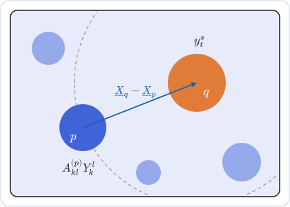

# [The multipole expansion method](@id th-mem)

!!! info "Before this page"
    [Extension to conductivity](@ref th-conductivity) for the transport problem
    and its notation, [Maxwell](@ref th-scheme-maxwell) for the closure used on
    a finite assembly, [Layered sphere](@ref th-layered-sphere) for the transfer
    matrices of a sphere with layers and imperfect interfaces, and
    [Layered spheroid](@ref th-layered-spheroid), whose notation for the
    harmonics is kept here.

[The cluster model](@ref th-cluster) and
[the equivalent inclusion method](@ref th-eim) describe each inclusion by one
uniform polarization. The multipole expansion method of
[kushch2013](@citet) keeps the whole field instead: around each inclusion the
field is a series of harmonics, the series of one inclusion is rewritten about
the center of the others, and the coefficients solve a linear system. Truncated
at the degree ``n_{\max}``, the solution tends to the exact field of the
assembly as ``n_{\max}`` grows. The scheme is
[`MultipoleExpansion`](@ref), on a [`ParticleAssembly`](@ref) of spheres in an
isotropic matrix.



This page treats conduction, and
[the next one](@ref th-mem-elasticity) elasticity. The temperature ``T`` is
harmonic in each phase and the flux is
``\underline{q} = -k\,\underline{\operatorname{grad}}\,T``, with ``k_0`` the
conductivity of the matrix. The assembly holds ``N`` spheres of centers
``\underline{X}_I`` and radii ``R_I``, ``1 \le I \le N``, and is submitted to
the remote gradient ``\underline{H}``.

## 1. Solid harmonics

Let ``(r, \theta, \varphi)`` be the spherical coordinates of
``\underline{x}`` about ``\underline{e}_3``, and ``P_n^m`` the associated
Legendre function of the first kind, of degree ``n`` and order ``m``, as in
[barthelemyBignonnetIJES2020](@citet): ``P_1^1(p) = -\sqrt{1-p^2}`` for
``|p| \le 1``. The surface harmonic of degree ``n \ge 0`` and order
``0 \le m \le n`` is taken as

```math
\chi_n^m(\theta, \varphi) = (-1)^m\,P_n^m(\cos\theta)\,\mathrm{e}^{\mathrm{i}m\varphi} ,
```

so that ``\chi_1^1 = \sin\theta\,\mathrm{e}^{\mathrm{i}\varphi}``. Two families
of harmonic functions follow, one regular at the origin and one decaying at
infinity, with the normalization of [kushch2013](@citet):

```math
y_n^m(\underline{x}) = \frac{r^n}{(n+m)!}\,\chi_n^m , \qquad
Y_n^m(\underline{x}) = \frac{(n-m)!}{r^{n+1}}\,\chi_n^m .
```

The negative orders are defined by
``y_n^{-m} = (-1)^m\,\overline{y_n^m}`` and
``Y_n^{-m} = (-1)^m\,\overline{Y_n^m}``. The first functions are
``y_0^0 = 1``, ``y_1^0 = x_3``, ``y_1^1 = (x_1 + \mathrm{i}x_2)/2`` and
``Y_0^0 = 1/r``, ``Y_1^0 = x_3/r^3``, ``Y_1^1 = (x_1 + \mathrm{i}x_2)/r^3``:
a uniform gradient is a combination of the ``y_1^m`` and the field of a dipole
a combination of the ``Y_1^m``.

[`regular_solid_harmonics`](@extref TensND TensND.regular_solid_harmonics) and [`irregular_solid_harmonics`](@extref TensND TensND.irregular_solid_harmonics) return the table
of one family at a point:

```@example mem
using MeanFieldHomogenization, TensND, LinearAlgebra
x = [0.3, -0.7, 0.45]
y = regular_solid_harmonics(x, 2)
Y = irregular_solid_harmonics(x, 2)
y[1, 0], y[1, 1], Y[1, 0] * norm(x)^3
```

## 2. Response of a sphere to one harmonic

Around a sphere centered at the origin, the temperature in the matrix is a sum
over the degrees and the orders of terms

```math
a_n^m\,y_n^m + b_n^m\,Y_n^m ,
```

the first being the field the sphere receives and the second the field it
sends back; as in [barthelemyBignonnetIJES2020](@citet), ``a`` is the
coefficient of the regular function and ``b`` that of the singular one. The
sphere is isotropic, so the harmonics do not mix, and the ratio of the two
radial functions ``(n-m)!\,b_n^m\,r^{-(n+1)}`` and ``a_n^m\,r^n/(n+m)!``
depends on the degree alone. This defines the response ``\zeta_n`` of the
sphere to the degree ``n``:

```math
(n-m)!\,(n+m)!\;b_n^m = \zeta_n\,a_n^m .
```

For a homogeneous sphere of radius ``R`` and conductivity ``k_1`` behind a
perfect interface, the continuity of ``T`` and of the normal flux at ``r = R``
gives

```math
\zeta_n = -\,\frac{n\,(k_1 - k_0)}{n\,k_1 + (n+1)\,k_0}\,R^{2n+1} .
```

For a sphere with layers and interfaces, the state
``(\hat T, \hat q_n)`` of the harmonic is carried from the center to the outer
radius by the transfer matrices of the [layered sphere](@ref th-layered-sphere),
written with the radial functions ``r^n`` and ``r^{-(n+1)}`` in place of ``r``
and ``r^{-2}``; the interface models act as for the uniform gradient, the
surface conductance ``k^{\mathrm{s}}`` entering through the surface Laplacian
of ``\chi_n^m``, ``\Delta_S\,\chi_n^m = -n(n+1)\,\chi_n^m/r^2``. A Kapitza
resistance ``\rho`` at the surface of a homogeneous sphere thus replaces
``k_1`` by ``k_1/(1 + n\,\rho\,k_1/R)``, and a surface conductance by
``k_1 + (n+1)\,k^{\mathrm{s}}/R``: the apparent conductivity of the sphere
depends on the degree. [`harmonic_response`](@ref) returns ``\zeta_n``:

```@example mem
K₀, K₁ = TensISO{3}(1.0), TensISO{3}(10.0)
plain = LayeredSphere((0.5,), (K₁,))
resisting = LayeredSphere((0.5,), (K₁,); interfaces = (KapitzaInterface(0.2),))
[harmonic_response(plain, K₀, n) for n in 1:3], [harmonic_response(resisting, K₀, n) for n in 1:3]
```

## 3. From one center to another

A decaying harmonic centered at a point is, away from that point, a regular
field. About a second center, at ``\underline{R}`` from the first, it expands
on the regular harmonics [kushch2013](@cite):

```math
Y_{n'}^{m'}(\underline{r} + \underline{R}) =
  \sum_{n \ge 0}\,\sum_{|m| \le n} (-1)^{n+m}\,Y_{n'+n}^{m'-m}(\underline{R})\;y_n^m(\underline{r}) ,
\qquad \|\underline{r}\| < \|\underline{R}\| ,
```

a harmonic whose order exceeds its degree being zero. The normalization of the
two families is the one for which the coefficients are decaying harmonics of
the vector joining the centers, without any other factor. The series converges
inside the ball that reaches the first center:

```@example mem
R, r = [1.1, -0.6, 0.9], [0.15, 0.2, -0.1]
YR, yr = irregular_solid_harmonics(R, 22), regular_solid_harmonics(r, 20)
series = sum((-1)^(n + m) * YR[2 + n, 1 - m] * yr[n, m] for n in 0:20 for m in -n:n)
series ≈ irregular_solid_harmonics(R + r, 2)[2, 1]
```

## 4. The linear system

In the matrix the temperature is the remote field and one series of decaying
harmonics per sphere,

```math
T(\underline{x}) = \underline{H}\cdot\underline{x}
  + \sum_{J=1}^{N}\,\sum_{n' \ge 1}\,\sum_{|m'| \le n'} b_{J,n'}^{m'}\,Y_{n'}^{m'}(\underline{x} - \underline{X}_J) ,
```

the degree 0 being absent because no sphere is a source of heat. About the
center of sphere ``I``, the remote field and the series of the other spheres
are regular: by the formula of the previous section, with
``\underline{R} = \underline{X}_I - \underline{X}_J``, the coefficient
received on ``y_n^m(\underline{x} - \underline{X}_I)`` is

```math
a_{I,n}^m = h_n^m + \sum_{J \ne I}\,\sum_{n',m'} (-1)^{n+m}\,
  Y_{n'+n}^{m'-m}(\underline{X}_I - \underline{X}_J)\,b_{J,n'}^{m'} ,
```

with ``h_n^m`` the coefficients of ``\underline{H}\cdot\underline{x}``, which
has the degree 1 only:

```math
\underline{H}\cdot\underline{x} = \sum_{|m| \le 1} h_1^m\,y_1^m , \qquad
h_1^0 = H_3 , \quad h_1^1 = H_1 - \mathrm{i}H_2 , \quad h_1^{-1} = -(H_1 + \mathrm{i}H_2) .
```

The sphere answers by its response ``\zeta_{I,n}``:

```math
(n-m)!\,(n+m)!\;b_{I,n}^m = \zeta_{I,n}\,a_{I,n}^m , \qquad 1 \le n \le n_{\max} .
```

These two relations are ``N\,n_{\max}(n_{\max}+2)`` equations for as many
coefficients ``a_{I,n}^m``. The interaction enters by the decaying harmonics of
the vectors joining the centers, which decrease as
``\|\underline{X}_I - \underline{X}_J\|^{-(n'+n+1)}``: the closer two spheres,
the higher the degree needed. With ``n_{\max} = 1`` the spheres exchange
dipoles only.

The coefficients are scaled before the system is solved,
``a_{I,n}^m\,R_I^n/\sqrt{(n-m)!\,(n+m)!}``, which keeps the entries of the
system of order one at every degree [kushch2013](@cite).

## 5. Effective conductivity

Let ``V`` be a volume that holds the spheres. In the matrix
``\underline{q} + k_0\,\underline{\operatorname{grad}}\,T = \underline{0}``, so
that the average of this vector over ``V`` reduces to the spheres, where both
terms are turned into integrals over the surface ``S_I`` of each sphere, taken
on the side of the matrix (``\underline{n}`` is the outward normal and the flux
is divergence-free):

```math
\langle\underline{q}\rangle + k_0\,\langle\underline{\operatorname{grad}}\,T\rangle
 = \frac{1}{V}\sum_I \oint_{S_I}\big[(\underline{x} - \underline{X}_I)\,(\underline{q}\cdot\underline{n})
   + k_0\,T\,\underline{n}\big]\,\mathrm{d}S .
```

Defined in this way, the two averages hold whatever the interface between a
sphere and the matrix. In each integral the field of the matrix is the regular
field received by the sphere plus its own series. The regular part contributes
nothing, for it is a solution of the conduction problem of the homogeneous
matrix inside ``S_I``. In the series, the surface harmonics of degree other
than 1 are orthogonal to the components of ``\underline{n}``, and the degree 1
is the field of a dipole: with
``\underline{r} = \underline{x} - \underline{X}_I``,

```math
\sum_{|m| \le 1} b_{I,1}^m\,Y_1^m(\underline{r}) = \frac{\underline{d}_I\cdot\underline{r}}{r^3} ,
\qquad \underline{d}_I = \big(b_{I,1}^{1} - b_{I,1}^{-1},\ \mathrm{i}\,(b_{I,1}^{1} + b_{I,1}^{-1}),\ b_{I,1}^{0}\big) .
```

On the sphere ``r = R_I`` it gives
``T = \underline{d}_I\cdot\underline{n}/R_I^2`` and
``\underline{q}\cdot\underline{n} = 2k_0\,\underline{d}_I\cdot\underline{n}/R_I^3``,
and with ``\oint \underline{n}\otimes\underline{n}\,\mathrm{d}S = (4\pi R_I^2/3)\,\boldsymbol{1}``
the integral is ``4\pi k_0\,\underline{d}_I``. Hence

```math
\langle\underline{q}\rangle = -k_0\,\langle\underline{\operatorname{grad}}\,T\rangle
  + \frac{4\pi k_0}{V}\sum_I \underline{d}_I .
```

The degree 1 received by sphere ``I`` is a uniform gradient
``\underline{H}_I``, of components ``a_{I,1}^0 = H_{I,3}`` and
``a_{I,1}^1 = H_{I,1} - \mathrm{i}H_{I,2}``, and the relation between
``b_{I,1}^m`` and ``a_{I,1}^m`` reads
``\underline{d}_I = \zeta_{I,1}\,\underline{H}_I``. The system being linear,
``\underline{H}_I = \boldsymbol{A}_I\cdot\underline{H}``, with
``\boldsymbol{A}_I`` obtained from the three unit remote gradients, and the
spheres contribute to the flux, per unit volume, by

```math
\boldsymbol{\Sigma} = -\,\frac{4\pi k_0}{V}\sum_I \zeta_{I,1}\,\boldsymbol{A}_I ,
\qquad \langle\underline{q}\rangle = -k_0\,\langle\underline{\operatorname{grad}}\,T\rangle
  - \boldsymbol{\Sigma}\cdot\underline{H} .
```

For one sphere, ``\boldsymbol{A}_1 = \boldsymbol{1}`` and
``\boldsymbol{\Sigma}`` is the volume fraction times the
[contribution tensor](@ref th-conductivity) of the sphere.

The same regular field gives the averages over each sphere. The harmonics of
degree other than 1 have a zero mean gradient over a ball, so the mean gradient
and the mean flux of sphere ``I`` are those of the sphere alone under the
uniform gradient ``\underline{H}_I`` it receives:
[`concentration_tensors`](@ref) returns them, layers and interfaces included.

What remains is to relate ``\underline{H}`` to the average gradient, which
depends on what surrounds the assembly.

**Finite assembly.** Under [`MixedBC`](@ref), the spheres lie in a domain
``\Omega`` of volume ``V``, itself in the infinite matrix. Following
[Maxwell](@ref th-scheme-maxwell), the domain filled with the effective medium
must send far away the same dipole as the spheres it replaces: with
``\boldsymbol{P}_\Omega`` the Hill tensor of the shape of ``\Omega`` in the
matrix,

```math
\boldsymbol{K}^{\mathrm{hom}} = \boldsymbol{K}_0
  + \boldsymbol{\Sigma}\cdot\big(\boldsymbol{1} - \boldsymbol{P}_\Omega\cdot\boldsymbol{\Sigma}\big)^{-1} ,
\qquad \boldsymbol{K}_0 = k_0\,\boldsymbol{1} ,
```

the formula of the Maxwell scheme, in which the contributions of the inclusions
now account for their interactions [kushch2013](@cite).

**Periodic assembly.** Under a [`PeriodicBox`](@ref) the temperature is
``\underline{H}\cdot\underline{x}`` plus a periodic field, so that
``\langle\underline{\operatorname{grad}}\,T\rangle = \underline{H}`` and

```math
\boldsymbol{K}^{\mathrm{hom}} = \boldsymbol{K}_0 + \boldsymbol{\Sigma} ,
```

without any closure: the estimate is the exact conductivity of the periodic
medium, up to the truncation.

## 6. Periodic arrays

In a periodic assembly each sphere stands for the lattice of its images, and
the decaying harmonics of the system are replaced by their sums over the
lattice. The sum of the harmonics of degree 2, which decrease as ``r^{-3}``,
converges conditionally, a difficulty met by [rayleigh1892](@citet) and settled
by [mcphedran1978](@citet) for the simple cubic array. It is avoided here by
starting from a function that is periodic by construction: the potential ``S``
of a unit source repeated on the lattice of periods ``(L_1, L_2, L_3)``, at the
points ``\underline{x}_i``, and neutralized by a uniform background
[hasimoto1959](@cite),

```math
\Delta S = -4\pi\Big[\sum_{i}\delta(\underline{x} - \underline{x}_i) - \frac{1}{V}\Big] ,
\qquad V = L_1 L_2 L_3 .
```

A decaying harmonic is a derivative of ``1/r``,
``Y_n^m = \mathcal{D}_n^m(1/r)`` with ``\mathcal{D}_n^m`` a harmonic polynomial
of the three partial derivatives, and its periodic counterpart is the same
derivative of ``S``, ``Y_n^{*m} = \mathcal{D}_n^m S``, returned by
[`lattice_solid_harmonics`](@extref TensND TensND.lattice_solid_harmonics). ``S`` is computed by the splitting of
[ewald1921](@citet) into a sum over the lattice and a sum over the reciprocal
lattice, both converging as a Gaussian; the derivative passes through each of
them term by term, at any degree.

The background has one consequence. Near a lattice point, ``S - 1/r`` is
regular but not harmonic: its Laplacian is ``4\pi/V``, so its expansion holds
the term ``2\pi r^2/(3V)`` next to the harmonic ones. A periodic dipole of
moment ``\underline{d}`` therefore sends to every sphere, on top of the
harmonics given by the formula of section 3 with ``Y^{*}`` in place of ``Y``,
the uniform gradient

```math
-\,\frac{4\pi}{3V}\,\underline{d} ,
```

the same in the three directions and whatever the lattice. This term is what
the dipoles alone need to recover a classical result: on a cubic array the
harmonics of degree 2 of the lattice vanish by symmetry, and with
``n_{\max} = 1`` the system reduces, for one sphere of radius ``R``,
conductivity ``k_1`` and response
``\zeta_1 = -\beta R^3``, ``\beta = (k_1 - k_0)/(k_1 + 2k_0)``, to
``\underline{d} = \zeta_1\big(\underline{H} - 4\pi\,\underline{d}/(3V)\big)``,
that is, with ``f = 4\pi R^3/(3V)`` the volume fraction,

```math
\frac{k^{\mathrm{hom}}}{k_0} = \frac{1 + 2f\beta}{1 - f\beta} ,
```

the estimate of Maxwell and of [Mori–Tanaka](@ref th-scheme-mori-tanaka):

```@example mem
matrix, spheres = Dict(:K => TensISO{3}(1.0)), Dict(:K => TensISO{3}(10.0))
asm = cubic_lattice(:sc, matrix, spheres; fraction = 0.3)
k(scheme) = canonical_components(homogenize(asm, scheme, :K))[1, 1]
k(MultipoleExpansion(; nmax = 1)), k(MoriTanaka())
```

## 7. Convergence with the degree

The higher harmonics carry what the arrangement adds to that estimate. On the
simple cubic array of fraction 0.3 and contrast 10, the value tabulated by
[kushch2014](@citet) is 1.888:

```@example mem
[(nmax, round(k(MultipoleExpansion(; nmax)); digits = 5)) for nmax in (1, 3, 5, 9)]
```

The degree needed grows with the fraction and with the contrast, the spheres
being closer and their interaction stronger: for perfectly conducting spheres
at the fraction 0.5, where the gap between neighbors is 1.5 % of the period,
``n_{\max} = 9`` still misses the converged value 5.891 by more than 1 %. The
manual page [Particle assemblies and N-body schemes](@ref man-assemblies) gives
the syntax of the scheme and of the assemblies it acts on, and the application
[Arrays and clusters of spheres by the multipole expansion](@ref app-mem-spheres)
follows these convergences against the published tables.
