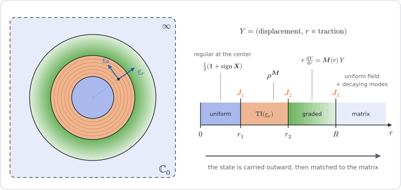

# [Layered spheres and cylinders: the radial problem](@id th-radial-problems)

!!! info "Before this page"
    [The Eshelby inclusion problem](@ref th-eshelby-problem), whose uniformity
    result a layered pattern loses, and
    [Concentration and contribution tensors](@ref th-concentration), which
    defines the tensors such a pattern supplies to the
    [Homogenization schemes](@ref th-homogenization).

A sphere or a cylinder made of concentric layers keeps its symmetry as long as
its moduli depend on the radius ``r`` alone, in the frame that turns with the
point. Under a remote uniform loading, its problem then reduces to a few
functions of ``r``. This page states that radial problem for
[`LayeredSphere`](@ref) and [`LayeredCylinder`](@ref) together, and the two
strategies that solve it:

- **radial modes and transfer matrices** (section 3): in a uniform layer the
  radial functions are powers of ``r``, whose amplitudes are carried from one
  layer to the next. It is the method of [herve1993](@citet) for the sphere
  and of [herve1995](@citet) for the cylinder;
- **a system of the first order** (section 4): the equations are written on
  the state that an interface transmits, and a layer is crossed by the power of
  a matrix, or by a numerical integration when its moduli vary.

Section 5 shows that they give the same transfer across a uniform layer, and
which layers each one reaches:

| Layer | Moduli | Crossed by |
| :--- | :--- | :--- |
| uniform, isotropic (cylinder: or transversely isotropic about the axis) | constant | the transfer matrix of its modes, or the power of a matrix |
| uniform, transversely isotropic about ``\underline{e}_r`` | constant components in the local frame | the power of a matrix |
| power law, [`PowerLawLayer`](@ref) | those of a reference, times ``(r/r_{\mathrm{ref}})^\beta`` | the power of a matrix |
| graded, [`GradedLayer`](@ref) | any function of ``r`` | a numerical integration |

The modes and the matrices of each loading mode are on the two pages that
follow, [Layered sphere](@ref th-layered-sphere) and
[Layered cylinder](@ref th-layered-cylinder).



## 1. Loading modes and radial functions

In a sphere the moduli are given in the frame
``(\underline{e}_\theta, \underline{e}_\varphi, \underline{e}_r)`` of the
spherical chart, in a cylinder in the frame
``(\underline{e}_r, \underline{e}_\theta, \underline{e}_z)`` of the cylindrical
one; the radial vector is the third of the first frame and the first of the
second, and a field built by `radial_ti` knows which it is. A material that is
isotropic, or transversely isotropic about ``\underline{e}_r``, with
coefficients that depend on ``r`` alone, is unchanged by the rotations that
leave the inclusion unchanged; so is, in a cylinder, a material transversely
isotropic about the axis ``\underline{e}_z``.

A uniform remote strain ``\boldsymbol{E}`` (a remote gradient
``\underline{G}`` in conduction) then splits into **loading modes**, each of
which drives a field of fixed angular shape. Only radial functions remain
unknown:

| Inclusion | Loading mode | Field | Size of the state |
| :--- | :--- | :--- | :---: |
| sphere | spherical part of ``\boldsymbol{E}`` | ``\underline{u} = u_r(r)\,\underline{e}_r`` | 2 |
| sphere | deviatoric part of ``\boldsymbol{E}`` | ``\underline{u} = U(r)\,P_2\,\underline{e}_r + W(r)\,P_2'\,\underline{e}_\theta`` | 4 |
| sphere | ``\underline{G}`` | ``T = \hat T(r)\cos\theta`` | 2 |
| cylinder | in-plane dilatation and axial strain | ``\underline{u} = u_r(r)\,\underline{e}_r + \varepsilon z\,\underline{e}_z`` | 2 |
| cylinder | in-plane shear | ``\underline{u} = U(r)\cos 2\theta\,\underline{e}_r + V(r)\sin 2\theta\,\underline{e}_\theta`` | 4 |
| cylinder | antiplane shear | ``\underline{u} = u_z(r)\cos\theta\,\underline{e}_z`` | 2 |
| cylinder | ``\underline{G}`` across the axis | ``T = \hat T(r)\cos\theta`` | 2 |
| cylinder | ``\underline{G}`` along the axis | ``T = G z`` | none |

``P_2`` is the Legendre polynomial of ``\cos\theta`` and ``P_2'`` its derivative
with respect to ``\theta``. The modes do not interact: each one is solved
alone, and the tensors of the inclusion are assembled from their answers.

## 2. The state and its equation

The **state** of a mode at the radius ``r`` gathers what a perfect interface
transmits: the radial functions of the displacement, and those of the traction
on the surface of radius ``r``. The traction is multiplied by ``r``,

```math
Y(r) = \bigl(\text{displacement functions},\; r \times \text{traction functions}\bigr) ,
```

and, in conduction, ``Y = (\hat T,\; r \times \text{normal flux})``. The
state is continuous where the moduli jump, which neither the derivative of the
displacement nor the amplitudes of a modal solution are. Its size ``N`` is
twice the number of radial functions of the displacement.

Take the simplest case, conduction in a sphere, with a radial conductivity
``k_r(r)`` and a tangential one ``k_\theta(r)``. With
``T = \hat T(r)\cos\theta``, the flux
``\underline{q} = -\boldsymbol{k}\cdot\underline{\operatorname{grad}}\,T`` has the
components

```math
q_r = \hat q(r)\cos\theta , \quad \hat q = -k_r\,\hat T' ,
\qquad
q_\theta = \frac{k_\theta\,\hat T}{r}\,\sin\theta ,
```

and its divergence vanishes when ``(r^2\hat q)' + 2k_\theta\,\hat T = 0``. The first
relation is the constitutive law along the radius, the second one the balance.
Written on ``Y = (\hat T,\; r\hat q)``, they are

```math
r\,\frac{\mathrm{d}Y}{\mathrm{d}r} = \boldsymbol{M}(r)\,Y ,
\qquad
\boldsymbol{M} = \begin{pmatrix} 0 & -\dfrac{1}{k_r} \\[2mm] -2k_\theta & -1 \end{pmatrix} .
```

Every mode of the table has this form. The first rows of ``\boldsymbol{M}`` are
the constitutive law solved for the radial derivatives of the displacement, the
last rows the equilibrium; ``\boldsymbol{M}`` holds the moduli at the radius
``r`` and no derivative of them. The factor ``r`` in front of the tractions is
what makes ``\boldsymbol{M}`` free of ``r`` when the moduli are. The matrices
of every mode are built from the field equations, with symbols, in
[Layered sphere: the systems of the first order, symbolically](@ref tut-layered-sphere-first-order-symbolic)
and in its [counterpart for the cylinder](@ref tut-layered-cylinder-first-order-symbolic).

## 3. First strategy: radial modes and transfer matrices

In a layer of uniform moduli the equations of a mode are of Euler's type: each
term has as many powers of ``r`` as derivatives. Their solutions are powers
``r^s``, and a mode of state size ``N`` has ``N`` of them, the **radial modes**
of the layer. For the conducting sphere, ``\hat T = r^s`` gives
``k_r\,s(s+1) = 2k_\theta``, that is ``s = 1`` and ``s = -2`` when
``k_\theta = k_r``: the uniform gradient ``\hat T = r`` and the dipole
``\hat T = r^{-2}``.

The state of the layer is a combination of those of its modes,

```math
Y(r) = \boldsymbol{\Phi}(r)\,\underline{a} ,
```

``\underline{a}`` holding the ``N`` amplitudes and the columns of
``\boldsymbol{\Phi}(r)`` the states of the modes at the radius ``r``; for the
isotropic conducting sphere,

```math
\boldsymbol{\Phi}(r) = \begin{pmatrix} r & r^{-2} \\ -k_r\,r & 2k_r\,r^{-2} \end{pmatrix} .
```

Eliminating the amplitudes between the two radii of the layer gives its
**transfer matrix**,

```math
Y(r_{\mathrm{out}}) = \boldsymbol{T}\,Y(r_{\mathrm{in}}) ,
\qquad
\boldsymbol{T} = \boldsymbol{\Phi}(r_{\mathrm{out}})\,\boldsymbol{\Phi}(r_{\mathrm{in}})^{-1} .
```

[herve1993](@citet) carry the amplitudes rather than the state: at the radius
``r_k`` between the layers ``k`` and ``k+1``, the continuity of the state reads
``\boldsymbol{\Phi}_{k+1}(r_k)\,\underline{a}_{k+1} = \boldsymbol{\Phi}_k(r_k)\,\underline{a}_k``,
and the amplitudes of the whole inclusion follow from those of the core by the
product of the matrices
``\boldsymbol{\Phi}_{k+1}(r_k)^{-1}\boldsymbol{\Phi}_k(r_k)``. Both chains are
the same products, cut at the amplitudes or at the states. The package cuts at
the states, on which an imperfect interface acts (section 9), and which stay
finite when a layer is incompressible.

The amplitudes are worth keeping: they give the field at every point of the
layer, and its mean in closed form. This strategy is that of the isotropic
layers of the sphere, of the layers of the cylinder that are isotropic or
transversely isotropic about its axis, and of every layer in aging
viscoelasticity, where the moduli are operators that do not commute and the
order of each product is fixed mode by mode.

## 4. Second strategy: a system of the first order and the power of a matrix

In a layer of uniform moduli ``\boldsymbol{M}`` is constant. With
``\tau = \ln r`` the equation is ``\mathrm{d}Y/\mathrm{d}\tau = \boldsymbol{M}\,Y``,
of solution ``Y(\tau) = \exp\bigl(\boldsymbol{M}(\tau - \tau_0)\bigr)\,Y(\tau_0)``: the state
is carried from the inner radius of the layer to its outer one by

```math
Y(r_{\mathrm{out}}) = \xi^{\boldsymbol{M}}\,Y(r_{\mathrm{in}}) ,
\qquad
\xi = \frac{r_{\mathrm{out}}}{r_{\mathrm{in}}} ,
\qquad
\xi^{\boldsymbol{M}} = \exp(\boldsymbol{M}\ln\xi) .
```

No mode was looked for. For the isotropic conducting sphere:

```@example radial_problems
using MeanFieldHomogenization, TensND, LinearAlgebra, StaticArrays
const RS = MeanFieldHomogenization.Core
const LS = MeanFieldHomogenization.LayeredSpheres

kᵣ = 3.0
M = LS._cond_system(radial_ti(SphericalChart(), kᵣ, kᵣ))     # k_\theta = k_r
```

```@example radial_problems
ξ = 2.0
Y_in = SVector(1.0, -3.0)                    # T̂ = r at r = 1: r q̂ = -k_r r
RS.radial_power(M, ξ) * Y_in, SVector(ξ, -3ξ)
```

Let ``N`` be the size of the state and
``\boldsymbol{X} = \boldsymbol{M} - \tfrac{1}{N}(\operatorname{tr}\boldsymbol{M})\,\boldsymbol{1}``.
The eigenvalues of ``\boldsymbol{X}`` come in opposite pairs: those of
``\boldsymbol{M}`` are symmetric about ``-\tfrac12`` in a sphere and about ``0``
in a cylinder. At size two, ``\boldsymbol{X}^2 = t^2\,\boldsymbol{1}`` with
``t^2 = -\det\boldsymbol{X}``, and the series of the exponential sums to

```math
\xi^{\boldsymbol{M}} = \xi^{\operatorname{tr}\boldsymbol{M}/2}\,\Bigl[\cosh(t\ln\xi)\,\boldsymbol{1} + \frac{\sinh(t\ln\xi)}{t}\,\boldsymbol{X}\Bigr] ,
```

which holds for symbols as well. At size four the exponential of the
``4\times4`` matrix is computed.

## 5. The two strategies compared

A solution ``Y = r^s\,\underline{y}`` of
``r\,\mathrm{d}Y/\mathrm{d}r = \boldsymbol{M}\,Y`` has
``\boldsymbol{M}\,\underline{y} = s\,\underline{y}``: **the exponents of the
radial modes are the eigenvalues of ``\boldsymbol{M}``, and the states of the
modes its eigenvectors**. With ``\boldsymbol{V}`` the matrix of the
eigenvectors and ``\boldsymbol{\Lambda}`` the diagonal one of the exponents,
when ``\boldsymbol{M}`` has ``N`` independent eigenvectors,

```math
\boldsymbol{\Phi}(r) = \boldsymbol{V}\,r^{\boldsymbol{\Lambda}} ,
\qquad
\boldsymbol{T} = \boldsymbol{\Phi}(r_{\mathrm{out}})\,\boldsymbol{\Phi}(r_{\mathrm{in}})^{-1}
= \boldsymbol{V}\,\xi^{\boldsymbol{\Lambda}}\,\boldsymbol{V}^{-1} = \xi^{\boldsymbol{M}} :
```

the transfer matrix of the modes is the power of the matrix of the system,
written on its eigenvectors. For the conducting sphere:

```@example radial_problems
eigvals(Matrix(M))                                   # the exponents 1 and -2
```

```@example radial_problems
Φ(r) = [r r^-2; -kᵣ*r 2kᵣ*r^-2]                      # the states of the modes r and r⁻²
r_in, r_out = 1.0, 2.0
Φ(r_out) / Φ(r_in), RS.radial_power(M, r_out / r_in)
```

The pages of the sphere and of the cylinder state the first strategy on
``(\text{displacement},\;\text{traction})``, without the factor ``r``, as the
package carries it. With ``\boldsymbol{D}(r)`` the diagonal matrix of
ones on the displacements and of ``r`` on the tractions, its transfer matrix is
``\boldsymbol{D}(r_{\mathrm{out}})^{-1}\,\xi^{\boldsymbol{M}}\,\boldsymbol{D}(r_{\mathrm{in}})``,
which the test suite checks for every loading mode of the sphere and of the
cylinder.

What differs is what each strategy needs and gives:

| | Radial modes and transfer matrices | System of the first order |
| :--- | :--- | :--- |
| needs | the exponents and the shapes of the modes, case by case | the matrix ``\boldsymbol{M}``, read on the equations |
| equal or complex exponents | a modal solution changes form (``r^s\ln r``, oscillating modes) | one case: the power does not use the exponents |
| moduli that vary in the layer | no modes in general | the same system, integrated |
| closed forms | at any size, with symbols | at size two; at size four through the eigenvectors |
| amplitudes of the layer | known: pointwise fields, harmonics of any degree | not known: the means are read on the states (section 10) |
| moduli that do not commute (aging viscoelasticity) | each product in its order | not available |

The package therefore solves by its modes a sphere whose layers are all
isotropic and uniform, and the layers of a cylinder that are isotropic or
transversely isotropic about its axis. A layer transversely isotropic about
the radius, a power-law or a graded one is crossed by the second strategy; in
a sphere that holds one such layer, every layer is. An isotropic layer written
as a radial one gives the same tensors to rounding
([sphere](@ref th-layered-sphere-radial), [cylinder](@ref th-layered-cylinder-radial)).

## 6. A layer that follows a power of the radius

Let the moduli of a layer be those of a reference, uniform, times
``(r/r_{\mathrm{ref}})^\beta``. A matrix ``\boldsymbol{M}`` has the blocks

```math
\boldsymbol{M}(r) = \begin{pmatrix} \boldsymbol{M}_{11} & \varrho^{-\beta}\,\boldsymbol{M}_{12} \\ \varrho^{\beta}\,\boldsymbol{M}_{21} & \boldsymbol{M}_{22} \end{pmatrix} ,
\qquad \varrho = \frac{r}{r_{\mathrm{ref}}} ,
```

``\boldsymbol{M}_{ij}`` being the blocks of the reference: ratios of moduli stay,
a compliance is divided by ``\varrho^\beta`` and a stiffness multiplied by it.
The tractions of the state, divided by ``\varrho^\beta``, give a state
``\tilde Y`` that obeys a system of constant matrix,

```math
r\,\frac{\mathrm{d}\tilde Y}{\mathrm{d}r} = \tilde{\boldsymbol{M}}\,\tilde Y ,
\qquad
\tilde{\boldsymbol{M}} = \begin{pmatrix} \boldsymbol{M}_{11} & \boldsymbol{M}_{12} \\ \boldsymbol{M}_{21} & \boldsymbol{M}_{22} - \beta\,\boldsymbol{1} \end{pmatrix} ,
```

so that the layer is crossed by ``\xi^{\tilde{\boldsymbol{M}}}``, exactly. In
conduction the exponents are the roots of ``s(s + 1 + \beta) = 2k_\theta/k_r``, the
classical result for a shell graded as a power.

```@example radial_problems
k_c, k_s, β, R, k₀ = 8.0, 0.4, 2.5, 1.6, TensISO{3}(1.3)       # core, shell, exponent, outer radius, matrix
exact = LayeredSphere((1.0, R), (TensISO{3}(k_c), PowerLawLayer(TensISO{3}(k_s), β)))
property_contribution(exact, k₀)
```

## 7. A graded layer: numerical integration

For any other profile the system
``r\,\mathrm{d}Y/\mathrm{d}r = \boldsymbol{M}(r)\,Y`` is integrated across the
layer, in the variable
``\ln(r/r_{\mathrm{in}})/\ln(r_{\mathrm{out}}/r_{\mathrm{in}})`` from 0 to
1, by an explicit Runge-Kutta method with step control. A function given as the
modulus of a layer is such a profile:

```@example radial_problems
integrated = LayeredSphere((1.0, R), (TensISO{3}(k_c), r -> TensISO{3}(k_s * r^β)))
property_contribution(integrated, k₀)
```

The two answers agree to the tolerance of the integration (`reltol`, `abstol`
of [`GradedLayer`](@ref)). The integration carries real, complex and dual
numbers alike: the complex moduli of a viscoelastic material at a frequency,
and the derivatives with respect to a parameter of the profile or to a radius.
An elastic zone with interfaces at given radii is solved in
[Graded isotropic layers with interfaces at given radii](@ref tut-graded-layers-interfaces).

```@example radial_problems
using ForwardDiff
contribution(β) = TensND.get_data(property_contribution(LayeredSphere((1.0, R), (TensISO{3}(k_c), r -> TensISO{3}(k_s * r^β))), k₀))[1]
closed(β) = TensND.get_data(property_contribution(LayeredSphere((1.0, R), (TensISO{3}(k_c), PowerLawLayer(TensISO{3}(k_s), β))), k₀))[1]
ForwardDiff.derivative(contribution, β), ForwardDiff.derivative(closed, β)
```

Uniform layers that follow the profile, as [`graded_layers`](@ref) cuts them,
tend to the same answer as the square of their thickness:

```@example radial_problems
using Plots
profile(r) = TensISO{3}(k_s * r^β)
value(sphere) = TensND.get_data(property_contribution(sphere, k₀))[1]
ns = [2, 4, 8, 16, 32, 64, 128]
errors = map(ns) do n
    radii, moduli = graded_layers(profile, 1.0, R, n)
    abs(value(LayeredSphere((1.0, radii...), (TensISO{3}(k_c), moduli...))) / value(exact) - 1)
end
plot(ns, errors; xscale = :log10, yscale = :log10, marker = :circle, label = "n uniform layers",
    xlabel = "number of layers n", ylabel = "relative difference with the exact layer")
plot!(ns, errors[1] .* (ns[1] ./ ns) .^ 2; linestyle = :dash, label = "n⁻²")
hline!([abs(value(integrated) / value(exact) - 1)]; linestyle = :dot, label = "integrated layer")
```

## 8. The center

At the center the solutions that stay bounded are kept. With the modes of a
uniform core, the amplitudes of those that are singular at ``r = 0`` are set to
zero. With its system, the regular solutions
are the modes whose exponent has a real part above that of the pairs,
``\tfrac{1}{N}\operatorname{tr}\boldsymbol{M}``: the eigenvectors of
``\boldsymbol{X}`` of eigenvalues of positive real part. Their span is the
range of the projector

```math
\boldsymbol{P} = \tfrac12\,\bigl(\boldsymbol{1} + \operatorname{sign}\boldsymbol{X}\bigr) ,
```

``\operatorname{sign}\boldsymbol{X}`` being the matrix that has the
eigenvectors of ``\boldsymbol{X}`` and the signs of the real parts of its
eigenvalues. At size two it is ``\boldsymbol{X}/t``; at size four it is the
limit of Newton's iteration
``\boldsymbol{X} \leftarrow \tfrac12\,(\boldsymbol{X} + \boldsymbol{X}^{-1})``.
A mode has one regular solution at size two and two at size four; independent
columns of ``\boldsymbol{P}`` are their states at the radius of the core.

In a **graded core** the moduli vary down to the center, where the profile must
have a value. Carrying two regular solutions from a small radius does not work:
both turn toward the one of largest exponent and the pair loses its second
direction. Their span is carried instead, by its **impedance**
``\boldsymbol{Z}``, the matrix that gives the tractions of a regular state from
its displacements, ``Y = (\underline{d},\; \boldsymbol{Z}\,\underline{d})``.
Inserted in the system, with the blocks of ``\boldsymbol{M}``,

```math
r\,\frac{\mathrm{d}\boldsymbol{Z}}{\mathrm{d}r} = \boldsymbol{M}_{21} + \boldsymbol{M}_{22}\,\boldsymbol{Z} - \boldsymbol{Z}\,\boldsymbol{M}_{11} - \boldsymbol{Z}\,\boldsymbol{M}_{12}\,\boldsymbol{Z} ,
```

a Riccati equation, integrated from the impedance of the uniform medium found at
the center. The regular solutions being the growing ones, their impedance is
the solution this equation is attracted to when ``r`` increases, and the
integration is stable.

## 9. Interfaces, the matrix, and the amplitude

The regular states of the core are carried outward: across a layer by sections
3 to 7, across an interface by its jump matrix ``\boldsymbol{J}``, which acts
on the state, ``Y(r_k^+) = \boldsymbol{J}\,Y(r_k^-)``
([sphere](@ref th-layered-sphere-interfaces), [cylinder](@ref th-layered-cylinder-interfaces)).
A perfect interface has ``\boldsymbol{J} = \boldsymbol{1}``. A spring or a
Kapitza resistance adds to the displacement a multiple of the traction, a
membrane or a conducting surface adds to the traction a multiple of the
displacement:

```math
\boldsymbol{J} = \begin{pmatrix} \boldsymbol{1} & \boldsymbol{S} \\ \boldsymbol{0} & \boldsymbol{1} \end{pmatrix}
\quad\text{(the field jumps)} ,
\qquad
\boldsymbol{J} = \begin{pmatrix} \boldsymbol{1} & \boldsymbol{0} \\ \boldsymbol{K} & \boldsymbol{1} \end{pmatrix}
\quad\text{(the flux jumps)} .
```

A layer of any kind may have any of them on its outer radius, and the chain is
the same for the two strategies.

At the outer radius ``R`` the states found are those of the inclusion up to
``n`` amplitudes, ``n`` being half the size of the state. The matrix is
uniform, its solutions are its radial modes, and only those that decay,
plus the uniform field of the loading, are present: ``n`` more amplitudes. The
continuity of the state at ``R``, across the last interface, is a linear system
of ``2n`` equations, which fixes all of them per unit remote loading.

A loading that acts inside the layers as well enters the system as a second
member. The axial strain ``\varepsilon`` of a cylinder is the only one; it is
appended to the state, as [the page of the cylinder](@ref th-layered-cylinder-radial)
shows, so that the system keeps its form; with the modes, it adds a uniform
term to the radial stress of each layer.

## 10. Averages

The schemes need the mean strain and the mean stress of each layer per unit
remote strain. With the modes of a layer they follow from its amplitudes; with
its system no amplitude is known, and they are read on the states. Over a ball or a disc ``\Omega`` of radius ``r``, of outward normal
``\underline{n}``,

```math
\langle\boldsymbol{\varepsilon}\rangle = \frac{1}{|\Omega|}\oint_{\partial\Omega} \underline{u}\stackrel{s}{\otimes}\underline{n}\,\mathrm{d}S ,
\qquad
\langle\boldsymbol{\sigma}\rangle = \frac{1}{|\Omega|}\oint_{\partial\Omega} \underline{x}\stackrel{s}{\otimes}(\boldsymbol{\sigma}\cdot\underline{n})\,\mathrm{d}S ,
```

the second one because the stress is in equilibrium. Both are linear in the
state at ``r``, and a layer is the difference of two balls or two discs. The
mean stress of a layer is not the product of a stiffness by its mean strain,
since the stiffness varies in the layer: it is read on the tractions.

The mean of the moduli over a layer, which the bounds and some schemes ask for,
is taken over the directions at each radius and, for a graded layer, by a
quadrature along the radius:

```@example radial_problems
LS.layer_property_average(integrated, k₀)        # volume-weighted mean of the conductivity
```

## 11. Scope

- **Matrix.** The reference medium is isotropic for the sphere, transversely
  isotropic about the axis for the cylinder.
- **Numbers.** Real, complex and dual numbers, nested, for every kind of layer.
  Symbols with the modes of the first strategy, at any size; with the systems,
  for uniform layers in conduction: the sign of a ``4\times4`` matrix and the
  step control of an integration compare values, which symbols do not have.
- **A power-law layer** cannot be the core, where its moduli vanish or are
  infinite. In a cylinder it is integrated as a graded layer.
- **Not available** with layers crossed by the second strategy: the pointwise
  fields, the multipole expansion, and aging viscoelasticity.

## Where to go next

- The next page, [Layered sphere](@ref th-layered-sphere), gives the modes and
  the matrices of the three loading modes of the sphere, its interfaces, its
  averages and its pointwise fields; [Layered cylinder](@ref th-layered-cylinder)
  does the same for the coated fiber.
- [Layered sphere: the systems of the first order, symbolically](@ref tut-layered-sphere-first-order-symbolic)
  and [Layered cylinder: the systems of the first order, symbolically](@ref tut-layered-cylinder-first-order-symbolic):
  the matrices built from the field equations, and the transfer matrices of the
  modes found again.
- [Layered cylinder: layers transversely isotropic about the radius, symbolically](@ref tut-layered-cylinder-radial-symbolic):
  a power-law layer integrated in closed form.
- [Graded isotropic layers with interfaces at given radii](@ref tut-graded-layers-interfaces):
  moduli that vary with the radius, integrated numerically.
- [Layered inclusions](@ref man-layered): the syntax.
- [A graded interphase around a spherical particle](@ref app-graded-interphase):
  the zone of [lutzIJSS2005](@citet) around an aggregate.
