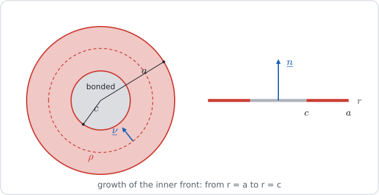
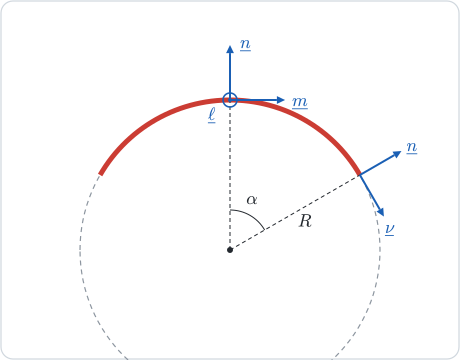

# [Contributions from intensity factors](@id th-rice-contributions)

!!! info "Before this page"
    [Crack opening displacement and compliance](@ref th-cod-tensors) §3, for
    ``\mathbb{H} = k\,\underline{n}\stackrel{s}{\otimes}\boldsymbol{B}\stackrel{s}{\otimes}\underline{n}``
    and the density of a crack family, and §7, for the intensity factors
    ``\underline{K}``, ``\underline{N}`` and the energy release rate.

The closed forms of ``\boldsymbol{B}`` cover the ellipse and the ribbon. Many
other cracks have known intensity factors: a crack bonded on part of its
surface, a crack grown from a pore, a curved crack. This page turns intensity
factors into a compliance contribution ``\mathbb{H}`` and a resistivity
contribution ``\boldsymbol{R}``, by integrating the energy released while the
crack grows [rice1975, kachanov2012](@cite). It then computes the
intensity factors of the annular crack, which the literature gives only in the
opening mode.

## [1. The energy released by a growing crack](@id th-rice-formula)

A volume ``V`` of a linear elastic solid of compliance ``\mathbb{S}_0`` carries a
uniform remote stress ``\boldsymbol{\Sigma}``. A crack grows in it from a nucleus,
along a path indexed by ``\lambda\in[\lambda_0,\lambda_1]``: at stage ``\lambda``
its front is the curve ``L(\lambda)``, of outer normal ``\underline{\nu}`` in the
plane tangent to the crack, and the front advances along ``\underline{\nu}`` by
``v_\nu\,\mathrm{d}\lambda``. The overall compliance of ``V`` is
``\mathbb{S}(\lambda)``, with ``\mathbb{S}(\lambda_0) = \mathbb{S}_0``.

At fixed ``\boldsymbol{\Sigma}``, the complementary energy of ``V`` is
``\tfrac12 V\,\boldsymbol{\Sigma}:\mathbb{S}(\lambda):\boldsymbol{\Sigma}``, and its
increase is the energy released at the front, the energy release rate ``G``
integrated over the area the front sweeps:

```math
\frac{1}{2}\,V\,\boldsymbol{\Sigma}:\frac{\mathrm{d}\mathbb{S}}{\mathrm{d}\lambda}:\boldsymbol{\Sigma}
= \int_{L(\lambda)} G\,v_\nu\,\mathrm{d}l .
```

Integrated from the nucleus to the current crack, with
``\Delta\mathbb{S} = \mathbb{S}(\lambda_1) - \mathbb{S}_0``:

```math
\frac{1}{2}\,V\,\boldsymbol{\Sigma}:\Delta\mathbb{S}:\boldsymbol{\Sigma}
= \int_{\lambda_0}^{\lambda_1}\!\int_{L(\lambda)} G\,v_\nu\,\mathrm{d}l\,\mathrm{d}\lambda .
\tag{1}
```

The energy release rate is a quadratic form in the stress intensity factor
vector ``\underline{K}`` ([§7 of the COD page](@ref th-cod-tensors)),

```math
G = \frac{1}{\pi}\,\underline{K}\cdot\boldsymbol{B}^{\mathcal{R}}(\underline{\nu},\underline{n})\cdot\underline{K},
```

``\boldsymbol{B}^{\mathcal{R}}(\underline{\nu},\underline{n})`` being the COD
tensor of the ribbon tangent to the front, of normal ``\underline{n}`` and width
direction ``\underline{\nu}``, for any anisotropy of the matrix. ``\underline{K}``
is linear in the remote stress: ``\underline{K} = \mathcal{K}:\boldsymbol{\Sigma}``,
with ``\mathcal{K}`` a third-order influence tensor, symmetric in its last two
indices. Both sides of (1) are then quadratic forms in the symmetric
``\boldsymbol{\Sigma}``, and the fourth-order tensors with major and minor
symmetries that represent them coincide:

```math
\boxed{\;
V\,\Delta\mathbb{S} = \frac{2}{\pi}\int_{\lambda_0}^{\lambda_1}\!\int_{L(\lambda)}
\mathcal{K}^{\!T}\cdot\boldsymbol{B}^{\mathcal{R}}\cdot\mathcal{K}\;v_\nu\,\mathrm{d}l\,\mathrm{d}\lambda
\;}
\tag{2}
```

where ``\mathcal{K}^{\!T}\cdot\boldsymbol{B}^{\mathcal{R}}\cdot\mathcal{K}`` is the
fourth-order tensor such that
``\boldsymbol{\Sigma}:(\mathcal{K}^{\!T}\cdot\boldsymbol{B}^{\mathcal{R}}\cdot\mathcal{K}):\boldsymbol{\Sigma}
= (\mathcal{K}:\boldsymbol{\Sigma})\cdot\boldsymbol{B}^{\mathcal{R}}\cdot(\mathcal{K}:\boldsymbol{\Sigma})``.
For ``N`` identical, non-interacting cracks per unit volume, of density
``\varepsilon = N\ell^{d}`` built on a length ``\ell`` (``d = 3`` for a crack
bounded in its plane, ``d = 2`` for a crack unbounded along one direction), the
dilute correction ``\Delta\mathbb{S} = f\,\varepsilon\,\mathbb{H}`` of the
[COD page](@ref th-cod-dilute) gives the contribution

```math
\mathbb{H} = \frac{2}{\pi f \ell^{d}}\int_{\lambda_0}^{\lambda_1}\!\int_{L(\lambda)}
\mathcal{K}^{\!T}\cdot\boldsymbol{B}^{\mathcal{R}}\cdot\mathcal{K}\;v_\nu\,\mathrm{d}l\,\mathrm{d}\lambda ,
\tag{3}
```

``f`` being the factor of [`crack_density_factor`](@ref) (``4\pi/3`` or ``\pi``).
Two consequences follow. The result does not depend on the growth path, since
the left side of (1) does not; and it is less sensitive to the details of the
shape than the intensity factors themselves, which it integrates.

## [2. Flat cracks: back to the COD tensor](@id th-rice-flat)

On a flat crack of normal ``\underline{n}``, the problem is that of the faces
loaded by ``-\boldsymbol{\Sigma}\cdot\underline{n}`` in an unloaded solid, so the
intensity factors depend on ``\boldsymbol{\Sigma}\cdot\underline{n}`` only:
``\underline{K} = \boldsymbol{M}\cdot(\boldsymbol{\Sigma}\cdot\underline{n})``.
Then

```math
(\mathcal{K}:\boldsymbol{\Sigma})\cdot\boldsymbol{B}^{\mathcal{R}}\cdot(\mathcal{K}:\boldsymbol{\Sigma})
= (\boldsymbol{\Sigma}\cdot\underline{n})\cdot\boldsymbol{M}^{\!T}\cdot\boldsymbol{B}^{\mathcal{R}}\cdot\boldsymbol{M}\cdot(\boldsymbol{\Sigma}\cdot\underline{n})
= \boldsymbol{\Sigma}:\bigl(\underline{n}\stackrel{s}{\otimes}(\boldsymbol{M}^{\!T}\cdot\boldsymbol{B}^{\mathcal{R}}\cdot\boldsymbol{M})\stackrel{s}{\otimes}\underline{n}\bigr):\boldsymbol{\Sigma},
```

and (3) takes the form ``\mathbb{H} = k\,\underline{n}\stackrel{s}{\otimes}\boldsymbol{B}\stackrel{s}{\otimes}\underline{n}``
of the COD page, with

```math
\boxed{\;
\boldsymbol{B} = \frac{2}{\pi f k \ell^{d}}\int_{\lambda_0}^{\lambda_1}\!\int_{L(\lambda)}
\boldsymbol{M}^{\!T}\cdot\boldsymbol{B}^{\mathcal{R}}\cdot\boldsymbol{M}\;v_\nu\,\mathrm{d}l\,\mathrm{d}\lambda
\;}
\tag{4}
```

(``k = 3/4``, ``f = 4\pi/3`` for a crack normalized as a penny). This is
[`rice_cod_tensor`](@ref): the user gives the front point by point, the matrix
enters only through ``\boldsymbol{B}^{\mathcal{R}}``.

A penny-shaped crack grown from its center checks (4). At radius ``\rho`` the
front has ``\underline{\nu} = \underline{e}_r``,
``\underline{\tau} = \underline{e}_\theta``, ``v_\nu = 1`` and, in an isotropic
matrix of Young modulus ``E`` and Poisson ratio ``\nu``
[kassir1966](@cite),

```math
\boldsymbol{M} = 2\sqrt{\frac{\rho}{\pi}}\left(\underline{n}\otimes\underline{n}
+ \frac{2}{2-\nu}\,\underline{e}_r\otimes\underline{e}_r
+ \frac{2(1-\nu)}{2-\nu}\,\underline{e}_\theta\otimes\underline{e}_\theta\right),
\qquad
\boldsymbol{B}^{\mathcal{R}} = \frac{\pi}{E^{*}}\bigl(\underline{n}\otimes\underline{n}
+ \underline{e}_r\otimes\underline{e}_r\bigr) + \frac{\pi}{2\mu}\,\underline{e}_\theta\otimes\underline{e}_\theta ,
```

with ``E^{*} = E/(1-\nu^2)`` and ``\mu = E/(2(1+\nu))``. Along the circle
``\underline{n}\cdot\boldsymbol{M}^{\!T}\cdot\boldsymbol{B}^{\mathcal{R}}\cdot\boldsymbol{M}\cdot\underline{n} = 4\rho/E^{*}``,
and (4) gives ``B_{nn} = \frac{2}{\pi^{2} a^{3}}\int_0^{a}\frac{4\rho}{E^{*}}\,2\pi\rho\,\mathrm{d}\rho = \frac{16}{3\pi E^{*}}``,
the closed form of the COD page. The same with the sliding modes, by
[`RiceCrack`](@ref):

```@example rice
using MeanFieldHomogenization, TensND, Printf
E, ν = 1.0, 0.25
C₀ = iso_stiffness_E_nu(E, ν)
grown = RiceCrack(1.0;
    K_I   = (ρ, ν) -> 2sqrt(ρ / π),
    K_II  = (ρ, ν) -> 4sqrt(ρ / π) / (2 - ν),
    K_III = (ρ, ν) -> 4(1 - ν) * sqrt(ρ / π) / (2 - ν))
B_rice = TensND.canonical_components(cod_tensor(grown, C₀))
B_ref = TensND.canonical_components(cod_tensor(PennyCrack(1.0), C₀))
@printf "B_nn: %.12f (Rice)  %.12f (closed form)\n" B_rice[3, 3] B_ref[3, 3]
@printf "B_tt: %.12f (Rice)  %.12f (closed form)\n" B_rice[1, 1] B_ref[1, 1]
```

## [3. Conduction](@id th-rice-conduction)

In steady conduction (conventions of [Notation](@ref th-notation-sigma-q),
``\boldsymbol{\sigma}^{\infty}\equiv -\underline{q}^{\infty}``), an insulating
crack carries at its front the flux intensity factor ``K_T`` and the temperature
jump ``[\![T]\!]\sim 8\sqrt{-r/(2\pi)}\,N_T``. The energy release rate is
``G = K_T\,N_T = b^{\mathcal{R}}K_T^{2}/\pi``, with
``b^{\mathcal{R}} = \pi/(2k_0)`` the thermal COD scalar of a ribbon in an
isotropic conductor ``\boldsymbol{K}_0 = k_0\,\boldsymbol{1}``
([Thermal cracks](@ref th-thermal-cracks)). The argument of §1 holds word for
word, with the resistivity ``\boldsymbol{R}`` in place of ``\mathbb{S}`` and
``K_T = \underline{k}\cdot\boldsymbol{\sigma}^{\infty}``:

```math
\boldsymbol{R} = \frac{2}{\pi f \ell^{d}}\int\!\!\int b^{\mathcal{R}}\,\underline{k}\otimes\underline{k}\;v_\nu\,\mathrm{d}l\,\mathrm{d}\lambda ,
\qquad
b = \frac{2}{\pi f k \ell^{d}}\int\!\!\int b^{\mathcal{R}}\,m^{2}\;v_\nu\,\mathrm{d}l\,\mathrm{d}\lambda
\quad\text{(flat crack, } K_T = m\,\underline{n}\cdot\boldsymbol{\sigma}^{\infty}\text{)} .
```

### [A flat crack has the same factor in both problems](@id th-rice-mode-I-conduction)

For a flat crack in an isotropic matrix, the flux intensity factor per unit
normal flux equals the stress intensity factor per unit normal stress:
``m = \underline{n}\cdot\boldsymbol{M}\cdot\underline{n}``. The two problems are
written on the plane of the crack, with ``\hat{f}(\underline{\xi})`` the
two-dimensional Fourier transform of ``f``.

*Opening.* The opening ``w`` (jump of ``\underline{u}\cdot\underline{n}``) is
symmetric: each half-space receives the normal displacement ``\pm w/2`` with no
shear traction on the plane. The normal displacement of the surface of a
half-space under a point force ``P``, normal to it, is
``P/(\pi E^{*}r)`` [love1927](@cite), whose transform is
``2P/(E^{*}|\underline{\xi}|)``; the traction ``p`` normal to the plane and the
opening are therefore related by ``\hat{p} = \tfrac{E^{*}}{4}|\underline{\xi}|\,\hat{w}``.

*Conduction.* The jump ``[\![T]\!]`` is symmetric as well: each half-space
receives ``\pm[\![T]\!]/2``. A point source ``Q`` on the surface of a half-space
raises its temperature by ``Q/(2\pi k_0 r)``, of transform
``Q/(k_0|\underline{\xi}|)``; the flux ``q`` across the plane and the jump are
related by ``\hat{q} = \tfrac{k_0}{2}|\underline{\xi}|\,\widehat{[\![T]\!]}``.

On the crack, the opening answers ``\sigma_{nn} = \underline{n}\cdot\boldsymbol{\Sigma}\cdot\underline{n}``
and the jump answers ``q_n``, outside it both vanish. The same operator, scaled
by ``E^{*}/4`` or ``k_0/2``, therefore gives
``[\![T]\!]/q_n = (E^{*}/2k_0)\,w/\sigma_{nn}`` at every point. At the front this
reads ``N_T/q_n = (E^{*}/2k_0)\,N_n/\sigma_{nn}``, and with
``K_I = \pi N_n/B^{\mathcal{R}}_{nn} = E^{*}N_n`` and
``K_T = \pi N_T/b^{\mathcal{R}} = 2k_0N_T``:

```math
\frac{K_T}{q_n} = \frac{K_I}{\sigma_{nn}} ,
\qquad
b = \frac{E^{*}}{2k_0}\,B_{nn} .
```

## [4. The annular crack](@id th-rice-annular)

The annular crack is a penny of radius ``a`` whose faces are bonded on the
central disc of radius ``c``: it occupies ``c < r < a``. Its opening factors
were tabulated by [smetanin1968](@citet), with an accuracy of 1 % at the outer
front and 2 % at the inner one; [kachanov2012](@citet) integrate them by (1)
for ``H_{nnnn}``. The sliding modes, which give the rest of ``\mathbb{H}``, are
computed here by a Galerkin method on the equation of the crack.



### The equation of the crack in weak form

Let ``\underline{b}`` be the jump of displacement across the crack and
``\underline{t}[\underline{b}]`` the traction it induces on the plane of the
crack in an unloaded isotropic solid. The faces are free, so
``\underline{t}[\underline{b}] = -\boldsymbol{\Sigma}\cdot\underline{n}`` on the
crack. The opening ``w`` obeys §3:
``\hat{t}_n = -\tfrac{E^{*}}{4}|\underline{\xi}|\,\hat{w}``. The sliding
``\underline{b}_t`` (in the plane) is antisymmetric: each half-space receives
``\pm\underline{b}_t/2`` with no normal traction. A tangential point force
``\underline{P}`` on a half-space moves its surface by
``\frac{1}{2\pi\mu r}\bigl((1-\nu)\boldsymbol{1} + \nu\,\underline{e}_r\otimes\underline{e}_r\bigr)\cdot\underline{P}``
in the plane [love1927](@cite), of transform
``\frac{1}{\mu|\underline{\xi}|}\bigl(\boldsymbol{1} - \nu\,\underline{\xi}\otimes\underline{\xi}/|\underline{\xi}|^{2}\bigr)\cdot\underline{P}``
(``\boldsymbol{1}`` the identity of the plane). Inverted, and with
``\underline{b}_t = 2\underline{u}_t``:

```math
\widehat{\underline{t}}_t = -\frac{\mu}{2}\left(|\underline{\xi}|\,\boldsymbol{1}
+ \frac{\nu}{1-\nu}\,\frac{\underline{\xi}\otimes\underline{\xi}}{|\underline{\xi}|}\right)\cdot\widehat{\underline{b}}_t .
```

Contracted with a test jump ``\underline{b}'_t`` that vanishes on the front,
transformed back by Parseval's identity, with
``\underline{\xi}\cdot\widehat{\underline{b}} = -\mathrm{i}\,\widehat{\operatorname{div}_S\underline{b}}``,
``\underline{\xi}\wedge\widehat{\underline{b}} = -\mathrm{i}\,\widehat{\operatorname{curl}_S\underline{b}}``
and ``1/|\underline{\xi}|`` the transform of ``1/(2\pi r)``, the equation of the
crack becomes, for every such ``\underline{b}'_t``,

```math
\frac{\mu}{4\pi}\int_{\mathcal{C}}\!\int_{\mathcal{C}}
\frac{\frac{1}{1-\nu}\operatorname{div}_S\underline{b}'_t(\underline{x})\,\operatorname{div}_S\underline{b}_t(\underline{y})
+ \operatorname{curl}_S\underline{b}'_t(\underline{x})\,\operatorname{curl}_S\underline{b}_t(\underline{y})}
{|\underline{x}-\underline{y}|}\,\mathrm{d}S_x\,\mathrm{d}S_y
= \int_{\mathcal{C}}\underline{b}'_t\cdot\boldsymbol{\Sigma}\cdot\underline{n}\,\mathrm{d}S ,
```

``\operatorname{curl}_S\underline{b} = \underline{n}\cdot\underline{\operatorname{curl}}\,\underline{b}``
being the scalar curl in the plane, and likewise
``\frac{E^{*}}{8\pi}\int\!\!\int\underline{\operatorname{grad}}_S\,w'\cdot\underline{\operatorname{grad}}_S\,w\,/|\underline{x}-\underline{y}|
= \int w'\,\sigma_{nn}``. The kernel ``1/|\underline{x}-\underline{y}|`` is only
weakly singular, which is what makes this form fit a numerical solution.

### Reduction to the radius

A uniform normal traction gives an axisymmetric opening ``w(r)``. A uniform
tangential traction ``\tau\,\underline{e}_x`` gives
``\underline{b}_t = p(r)\cos\theta\,\underline{e}_r - q(r)\sin\theta\,\underline{e}_\theta``,
of ``\operatorname{div}_S\underline{b}_t = D(r)\cos\theta`` and
``\operatorname{curl}_S\underline{b}_t = C(r)\sin\theta`` with
``D = (rp)'/r - q/r`` and ``C = p/r - (rq)'/r``. The integrals over the angles
leave the kernel

```math
Q_1(r,s) = \int_0^{2\pi}\frac{\cos\varphi\,\mathrm{d}\varphi}{\sqrt{r^{2}+s^{2}-2rs\cos\varphi}}
= \frac{4\bigl[(2-k^{2})K(k) - 2E(k)\bigr]}{k^{2}(r+s)},
\qquad k^{2} = \frac{4rs}{(r+s)^{2}},
```

``K`` and ``E`` the complete elliptic integrals, and the two equations

```math
\frac{E^{*}}{4}\int\!\!\int w'_{\mathrm{t}}(r)\,w'(s)\,r\,s\,Q_1\,\mathrm{d}r\,\mathrm{d}s = 2\pi\,\sigma_{nn}\int w_{\mathrm{t}}\,r\,\mathrm{d}r ,
\qquad
\frac{\mu}{4}\int\!\!\int\Bigl(\frac{D_{\mathrm{t}}D}{1-\nu} + C_{\mathrm{t}}C\Bigr)r\,s\,Q_1\,\mathrm{d}r\,\mathrm{d}s = \pi\,\tau\int(p_{\mathrm{t}}+q_{\mathrm{t}})\,r\,\mathrm{d}r ,
```

the subscript ``\mathrm{t}`` marking the test functions. Along the
arithmetic–geometric mean started at ``(1, k', k)``, ``k' = |r-s|/(r+s)``, the
numerator is ``2K\sum_{n\ge1}2^{n-1}c_n^{2}`` with ``c_1 = \min(r,s)/(r+s)``: a
sum of positive terms, accurate at ``s\to r``.

### Discretization and intensity factors

With ``r = m + h\,t``, ``m = (a+c)/2``, ``h = (a-c)/2``, each unknown is sought
as ``h\sqrt{1-t^{2}}\sum_{n<N}c_n U_n(t)``, ``U_n`` the Chebyshev polynomials of
the second kind: the square root at both fronts is built in. The Galerkin
system is assembled on the ``\theta`` of ``t = \cos\theta``, where the
derivatives of the unknowns are the Chebyshev polynomials ``T_{n+1}``. Near the
outer front, at distance ``d``, a jump reads
``\sqrt{2hd}\sum c_n(n+1) = 8\sqrt{d/(2\pi)}\,N``, which gives the displacement
intensity factor ``N`` and, through ``\underline{K} = \pi(\boldsymbol{B}^{\mathcal{R}})^{-1}\cdot\underline{N}``,

```math
K_I = E^{*}N_n,\qquad K_{II} = E^{*}N_\nu,\qquad K_{III} = 2\mu\,N_\tau ,
\qquad N = \frac{\sqrt{\pi h}}{4}\sum_{n<N}c_n\,(\pm1)^{n}(n+1)
```

(``+`` at the outer front, ``-`` at the inner one). The error decreases as
``\exp(-0.8\,N\sqrt{c/a})``; ``N`` is chosen accordingly, from 24 to 160.

```@example rice
crack = AnnularCrack(1.0, 0.5)
Σ = TensND.Tens([0 0 0.3; 0 0 0; 0.3 0 1.0], crack_basis(crack))
for front in (:outer, :inner)
    _, (KI, KII, KIII) = sif(crack, C₀, Σ; front)
    @printf "%-5s front  K_I = %.6f  K_II = %+.6f  K_III = %+.6f\n" front KI KII KIII
end
```

### The contribution

``\boldsymbol{B}`` follows from (4) as the inner front grows from ``r = a`` (a
circle of zero width) to ``r = c``, the matrices ``\boldsymbol{M}`` being those
of the penny with the factors of the annulus. Grown instead from the outer
front, or read from the mean jumps of the final crack
(``\pi a^{3}B_{nn}\,\sigma_{nn} = \int w\,\mathrm{d}S``), it is the same tensor:

```@example rice
B1 = TensND.canonical_components(cod_tensor(crack, C₀))                     # Rice, inner front
B2 = TensND.canonical_components(cod_tensor(crack, C₀; method = :opening))  # mean jumps
@printf "B_nn = %.10f / %.10f   B_tt = %.10f / %.10f\n" B1[3, 3] B2[3, 3] B1[1, 1] B2[1, 1]
```

In conduction, ``b = E^{*}B_{nn}/(2k_0)`` by §3.

## [5. The circular arc crack](@id th-rice-arc)

A crack along the arc of circle of radius ``R`` and half-angle ``\alpha``,
unbounded along the axis ``\underline{\ell}`` of the circle, is not flat and has
no COD tensor: (3) applies with the whole influence tensor ``\mathcal{K}``. In
the frame ``(\underline{\ell},\underline{m},\underline{n})`` of
[`CircularArcCrack`](@ref) the arc is
``R(\sin\theta\,\underline{m} + \cos\theta\,\underline{n})``,
``|\theta|\le\alpha``.



At the tip ``\theta = \alpha`` the in-plane factors are
[sih1962, cotterell1980](@cite), as written in [kachanov2018; eq. (1.9.27)](@cite)

```math
\begin{aligned}
K_I &= \sqrt{\pi R\sin\alpha}\left[\Bigl(\tfrac{\Sigma_{mm}+\Sigma_{nn}}{2} - \tfrac{\Sigma_{nn}-\Sigma_{mm}}{2}\sin^{2}\tfrac{\alpha}{2}\cos^{2}\tfrac{\alpha}{2}\Bigr)\frac{\cos\frac{\alpha}{2}}{1+\sin^{2}\frac{\alpha}{2}}
+ \tfrac{\Sigma_{nn}-\Sigma_{mm}}{2}\cos\tfrac{3\alpha}{2} - \Sigma_{mn}\Bigl(\sin\tfrac{3\alpha}{2}+\sin^{3}\tfrac{\alpha}{2}\Bigr)\right],\\
K_{II} &= \sqrt{\pi R\sin\alpha}\left[\Bigl(\tfrac{\Sigma_{mm}+\Sigma_{nn}}{2} - \tfrac{\Sigma_{nn}-\Sigma_{mm}}{2}\sin^{2}\tfrac{\alpha}{2}\cos^{2}\tfrac{\alpha}{2}\Bigr)\frac{\sin\frac{\alpha}{2}}{1+\sin^{2}\frac{\alpha}{2}}
+ \tfrac{\Sigma_{nn}-\Sigma_{mm}}{2}\sin\tfrac{3\alpha}{2} + \Sigma_{mn}\Bigl(\cos\tfrac{3\alpha}{2}+\cos\tfrac{\alpha}{2}\sin^{2}\tfrac{\alpha}{2}\Bigr)\right],
\end{aligned}
```

the other tip following by the mirror ``\underline{m}\to-\underline{m}``. The
anti-plane factor is that of the conduction problem with ``k_0\to\mu``
[kachanov2018; eq. (1.10.9)](@cite):
``K_{III} = \sqrt{\pi R\sin\alpha}\,\bigl(\Sigma_{\ell n}\cos\frac{\alpha}{2} + \Sigma_{\ell m}\sin\frac{\alpha}{2}\bigr)``.
Both tips advance by ``R\,\mathrm{d}\alpha``, and (2) integrates in closed form
[kachanov2018; eqs. (1.9.28) and (1.10.12)](@cite). Per unit length of the axis,
with ``\gamma = \cos\alpha`` and ``P = \pi R^{2}(1-\gamma)/E^{*}``:

```math
\begin{aligned}
V\Delta S_{mmmm} &= P\Bigl(\tfrac14 - \gamma - \tfrac{\gamma^{2}}{4} + \tfrac{2}{3-\gamma}\Bigr), &
V\Delta S_{nnnn} &= P\Bigl(-\tfrac{15}{4} - \gamma - \tfrac{\gamma^{2}}{4} + \tfrac{18}{3-\gamma}\Bigr),\\
V\Delta S_{mmnn} &= P\Bigl(\tfrac74 + \gamma + \tfrac{\gamma^{2}}{4} - \tfrac{6}{3-\gamma}\Bigr), &
V\Delta S_{mnmn} &= P\,\tfrac{5-\gamma^{2}}{4},\\
V\Delta S_{\ell m\ell m} &= \frac{\pi R^{2}(1-\gamma)^{2}}{8\mu}, &
V\Delta S_{\ell n\ell n} &= \frac{\pi R^{2}(1-\gamma)(3+\gamma)}{8\mu},
\end{aligned}
```

and ``V\Delta R_{mm} = \pi R^{2}(1-\gamma)^{2}/(2k_0)``,
``V\Delta R_{nn} = \pi R^{2}(1-\gamma)(3+\gamma)/(2k_0)``. The arc is normalized as
a ribbon of half-width ``R\alpha``: ``\varepsilon = N(R\alpha)^{2}`` and
``\mathbb{H} = V\Delta\mathbb{S}/(\pi(R\alpha)^{2})``. At ``\alpha\to0`` it is
the ribbon; at ``\alpha = \pi`` the cut core carries neither in-plane nor
anti-plane stress, and the in-plane and anti-plane components are those of a
cylindrical hole.

```@example rice
arc = CircularArcCrack(1.0, 2π / 3)
H_closed = TensND.canonical_components(inverse_property_contribution(arc, C₀))
H_rice = TensND.canonical_components(inverse_property_contribution(arc, C₀; method = :rice))
@printf "H_nnnn = %.10f (closed form)  %.10f (Rice, numerical)\n" H_closed[3, 3, 3, 3] H_rice[3, 3, 3, 3]
```

## [6. The Saturn ring](@id th-rice-saturn)

A spherical pore of radius ``a`` with an annular crack of length ``c`` in its
equatorial plane opens under a normal stress with
``K_I = \sigma\,F(\lambda)\sqrt{\pi c}``, ``\lambda = c/a``, the factor ``F``
fitted by [fett1994](@citet) [kachanov2018; eqs. (4.4.16) and (4.4.17)](@cite). The
ring is grown from the surface of the pore, its front at radius ``\rho`` from
``a`` to ``a + c``, and by (4), in an isotropic matrix,

```math
V H_{nnnn}^{\mathrm{ring}} = \frac{4\pi}{E^{*}}\int_a^{a+c}\rho\,F^{2}\Bigl(\frac{\rho-a}{a}\Bigr)\,\pi(\rho-a)\,\mathrm{d}\rho ,
```

to which the pore adds its own contribution. Only the opening mode of this
configuration is published, so only ``H_{nnnn}`` follows:
[`saturn_ring_compliance`](@ref).

```@example rice
S = saturn_ring_compliance(1.0, 1.5, C₀)
@printf "pore %.6f  ring %.6f  total %.6f  penny of radius a + c: %.6f\n" S.pore S.ring S.total 16 * 2.5^3 * (1 - ν^2) / (3E)
```

The tutorial [Cracks from their intensity factors](@ref tut-rice-cracks) plots
these contributions against the geometry.

## Where to go next

The next page, [Interacting cracks](@ref th-interacting-cracks), lets several
cracks of a plane load each other. [Degenerate shapes and extreme aspect ratios](@ref th-degenerate-shapes)
closes the chapter with the shapes at which the closed forms of the ellipsoid
and of the crack reach removable limits. A contour for which neither the
opening nor the intensity factors are published is treated by the integral
equation of [Planar cracks of any contour](@ref th-gaussian-cracks).
