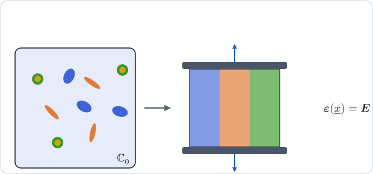
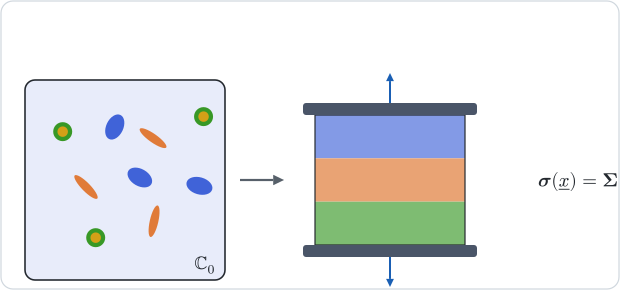

# [Voigt and Reuss bounds](@id th-scheme-bounds)

!!! info "Before this page"
    [Homogenization schemes](@ref th-homogenization), where the concentration
    tensors ``\mathbb A_r`` and the average relations they satisfy are set out.

The two bounds use no shape, no reference medium and no Eshelby problem: they
assume a uniform field throughout the RVE, the strain for one and the stress for
the other. That crude assumption is what makes them rigorous, since a uniform
field is admissible in the corresponding energy principle
[hill1952](@cite).

## [1. Voigt: a uniform strain](@id th-scheme-voigt)



Every phase is assumed to undergo the macroscopic strain, ``\mathbb A_r = \mathbb I``,
which is exact for bars loaded in parallel. The average relation of
[§2 of the overview](@ref th-homogenization) then gives the arithmetic mean

```math
\mathbb C^{\mathrm V} = \sum_r f_r\,\mathbb C_r .
```

Its bound property follows from the principle of minimum potential energy. Under
the affine boundary condition ``\underline u = \boldsymbol E\cdot\underline x``,
the effective energy is the minimum of
``\langle\boldsymbol\varepsilon:\mathbb C:\boldsymbol\varepsilon\rangle/2`` over
the kinematically admissible fields, and the uniform field
``\boldsymbol\varepsilon = \boldsymbol E`` is one of them:

```math
\boldsymbol E:\mathbb C^{\mathrm{hom}}:\boldsymbol E
  \le \big\langle\boldsymbol E:\mathbb C:\boldsymbol E\big\rangle
  = \boldsymbol E:\mathbb C^{\mathrm V}:\boldsymbol E
\qquad\forall\,\boldsymbol E .
```

## [2. Reuss: a uniform stress](@id th-scheme-reuss)



Every phase is assumed to carry the macroscopic stress, which is exact for layers
loaded in series. The compliances then average,

```math
\mathbb C^{\mathrm R} = \Big(\sum_r f_r\,\mathbb S_r\Big)^{-1} ,
```

and the principle of minimum complementary energy, applied to the statically
admissible field ``\boldsymbol\sigma = \boldsymbol\Sigma``, gives the dual
inequality
``\boldsymbol\Sigma:\mathbb S^{\mathrm{hom}}:\boldsymbol\Sigma
\le \boldsymbol\Sigma:\mathbb S^{\mathrm R}:\boldsymbol\Sigma``. Together,

```math
\mathbb C^{\mathrm R} \le \mathbb C^{\mathrm{hom}} \le \mathbb C^{\mathrm V}
```

in the sense of quadratic forms, whatever the microstructure. A phase without
stiffness, a void, makes ``\mathbb C^{\mathrm R}`` vanish: the lower bound is
then uninformative, which is the price of using no geometry at all.

## 3. Cracks, conduction, laminates

A crack family has no volume, so it enters neither mean: both bounds ignore
cracks, which is why [`Voigt`](@ref) and [`Reuss`](@ref) refuse an RVE holding
cracks alone. In conduction the same arguments give
``\boldsymbol K^{\mathrm V} = \sum_r f_r\,\boldsymbol K_r`` and
``\boldsymbol K^{\mathrm R} = \big(\sum_r f_r\,\boldsymbol K_r^{-1}\big)^{-1}``.

A laminate attains both, each on its own block: across the layers, the inverse
of the acoustic tensor ``\underline n\cdot\mathbb C^{\mathrm{hom}}\cdot\underline n``
is the Reuss mean of the layers' inverses, and in their plane, the Schur
complement of ``\mathbb C^{\mathrm{hom}}`` is the Voigt mean of the layers'
complements ([Laminate](@ref th-laminate), §6).

## 4. Concentration tensors

The two assumptions are statements on the concentration tensors themselves, in
the sense of [the overview](@ref th-estimate-concentration). Under Voigt every
phase undergoes the macroscopic strain, so that ``\mathbb A_r = \mathbb I`` and
``\mathbb A_{\sigma\varepsilon,r} = \mathbb C_r``; under Reuss every phase carries
the macroscopic stress, ``\mathbb B_r = \mathbb I``, so that
``\mathbb A_{\sigma\varepsilon,r} = \mathbb C^{\mathrm R}`` and
``\mathbb A_r = \mathbb S_r:\mathbb C^{\mathrm R}``. The two averages then return
``\mathbb C^{\mathrm V}`` and ``\mathbb C^{\mathrm R}``. Neither bound singles out a
matrix, so that a contribution must be given an explicit reference, and crack
families are absent, as they are from the bounds.

## Where to go next

The bounds know nothing of shapes. The next page,
[Dilute estimates](@ref th-scheme-dilute), introduces the Eshelby problem into
the estimate, with each inclusion alone in the matrix, under either the remote
strain or the remote stress. The bounds are computed on a first RVE in the
tutorial [Bounds and classical schemes](@ref tut-bounds-and-schemes).
