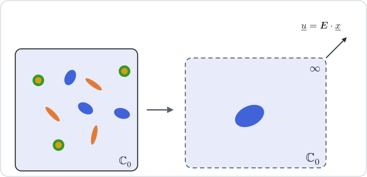
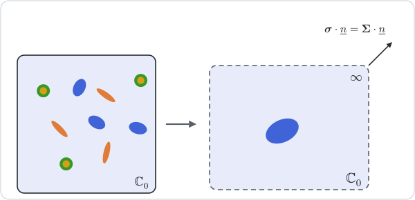

# [Dilute estimates](@id th-scheme-dilute)

!!! info "Before this page"
    [Homogenization schemes](@ref th-homogenization), for the contribution
    tensors ``\mathbb N_i`` and ``\mathbb H_i``, the identity that links them
    and the limits through which a crack family enters, and
    [Voigt and Reuss bounds](@ref th-scheme-bounds), the dual pair this page
    mirrors with an Eshelby problem in place of a uniform field.

The dilute estimates are the first to use the inclusion shapes. Each inclusion
is placed alone in an infinite matrix, as if the others were absent, and loaded
at infinity by the macroscopic field. Like the bounds, they come as a dual pair:
the remote field is either the macroscopic strain or the macroscopic stress.

## [1. Dilute: the remote strain](@id th-scheme-dilute-strain)



Taking ``\boldsymbol E^0 = \boldsymbol E`` in the matrix gives
``\mathbb A_i = \mathbb A_i^{\mathrm{dil}}`` for every inclusion phase, and the
average relation reduces to the sum of the contributions:

```math
\mathbb C^{\mathrm{dil}} = \mathbb C_0 + \sum_i f_i\,\mathbb N_i
  - \sum_c \kappa_c\,\varepsilon_c\,\mathbb C_0:\mathbb H_c:\mathbb C_0
  = \mathbb C_0 + \mathbb N_\Sigma .
```

The assumption is consistent to first order only. With
``\boldsymbol E^0 = \boldsymbol E`` the matrix keeps the macroscopic strain, and
the strain average ``f_0\,\boldsymbol E + \sum_i f_i\,\mathbb A_i^{\mathrm{dil}}:\boldsymbol E``
differs from ``\boldsymbol E`` at order ``f``. The estimate is therefore exact as
``f \to 0`` and nothing more: it is linear in the fractions and in the crack
densities, and for soft phases it loses positive definiteness at a finite
amount. Spherical voids in an isotropic matrix, whose contribution has the
spherical part ``-\,3k_0\,(3k_0+4\mu_0)/(4\mu_0)\,\mathbb J``, bring the bulk
modulus to zero at ``f = 4\mu_0/(3k_0+4\mu_0)``.

## [2. DiluteDual: the remote stress](@id th-scheme-dilute-stress)



Prescribing the macroscopic stress at infinity instead adds the compliance
contributions,

```math
\mathbb S^{\mathrm{dild}} = \mathbb S_0 + \sum_i f_i\,\mathbb H_i
  + \sum_c \kappa_c\,\varepsilon_c\,\mathbb H_c
  = \mathbb S_0 + \mathbb H_\Sigma .
```

For cracks alone this is the non-interaction approximation of
[kachanov2018](@citet): each crack opens under the remote stress as if it were
alone, and the openings add up. It is the natural form for cracks, whose
compliance contribution ``\mathbb H_c`` stays finite while the stiffness one is
the limit of a diverging quantity. The package evaluates ``\mathbb H_i`` through
``-\,\mathbb S_0:\mathbb N_i:\mathbb S_0`` rather than through its definition,
so that a void keeps the finite contribution it should.

## 3. The two estimates side by side

Since ``\mathbb H_\Sigma = -\,\mathbb S_0:\mathbb N_\Sigma:\mathbb S_0``, the
two estimates agree to first order. Writing
``\mathbb Y = \mathbb S_0^{1/2}:\mathbb N_\Sigma:\mathbb S_0^{1/2}``,

```math
\mathbb C^{\mathrm{dil}} = \mathbb C_0^{1/2}:(\mathbb I + \mathbb Y):\mathbb C_0^{1/2} ,
\qquad
\mathbb C^{\mathrm{dild}} = \mathbb C_0^{1/2}:(\mathbb I - \mathbb Y)^{-1}:\mathbb C_0^{1/2} ,
```

and their difference is
``\mathbb C_0^{1/2}:\mathbb Y:(\mathbb I - \mathbb Y)^{-1}:\mathbb Y:\mathbb C_0^{1/2}``,
which is positive semi-definite as long as ``\mathbb C^{\mathrm{dild}}`` itself
is positive definite. The dilute estimate is thus always the softer of the two,
whether the inclusions are stiffer or softer than the matrix. For spherical
voids or rigid spheres in an isotropic matrix, the closed forms show that the
Mori–Tanaka bulk modulus of the next page lies between the two.

## 4. Concentration tensors

Both estimates follow the construction of
[the overview](@ref th-estimate-concentration), with the matrix as reference
medium. Under [`Dilute`](@ref) the remote field is the macroscopic strain,
``\mathbb E = \mathbb I``, and each inclusion keeps its dilute tensor,
``\mathbb A_i = \mathbb A_i^{\mathrm{dil}}``. The matrix takes the rest of the
average,

```math
f_0\,\mathbb A_0 = \mathbb I - \sum_i f_i\,\mathbb A_i^{\mathrm{dil}}
  - \sum_c \kappa_c\,\varepsilon_c\,\mathbb H_c:\mathbb C_0 ,
```

so that ``\mathbb A_0`` departs from ``\mathbb I`` at first order in the
amounts, which is the inconsistency of §1 seen from the matrix. Under
[`DiluteDual`](@ref) the remote field is the strain of the matrix under the
macroscopic stress, ``\mathbb S_0:\boldsymbol\Sigma = \mathbb S_0:\mathbb C^{\mathrm{dild}}:\boldsymbol E``,
hence ``\mathbb E = \mathbb S_0:\mathbb C^{\mathrm{dild}}`` and
``\mathbb A_i = \mathbb A_i^{\mathrm{dil}}:\mathbb S_0:\mathbb C^{\mathrm{dild}}``,
the matrix again taking the rest. Its compliance contributions are then
``\mathbb H_i^{\mathrm{est}} = \mathbb H_i``: each inclusion of the dual estimate
contributes to the compliance exactly as it does alone, which is the
non-interaction approximation once more.

## Where to go next

Both estimates ignore what surrounds an inclusion. The next page,
[Mori–Tanaka](@ref th-scheme-mori-tanaka), keeps each inclusion in the matrix
but loads it by the mean strain of the matrix, which restores the strain average
at every fraction. The crack case is followed on a growing density in the
tutorial [Cracks and crack density](@ref tut-cracks).
