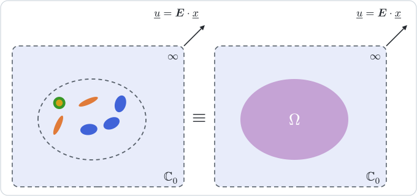

# [Maxwell](@id th-scheme-maxwell)

!!! info "Before this page"
    [Mori–Tanaka](@ref th-scheme-mori-tanaka), whose second form is compared
    with the estimate below, the
    [sign of the Green operator](@ref th-notation-green-sign) fixed in the
    Conventions, and [Concentration](@ref th-concentration) for the contribution
    tensors.

Mori–Tanaka describes what surrounds an inclusion by the mean strain of the
matrix alone. The Maxwell scheme keeps the matrix as reference medium and adds a
second shape: that of a domain which holds the inclusions and which, filled with
the effective medium, must disturb the matrix far away as the inclusions do. The
argument rests on nothing but the far field of an inhomogeneity, which this page
derives from the Green operator of the matrix (§1) before building the estimate
on it (§2) and reading the concentration tensors off the construction (§3).

The notation is the intrinsic one of [barthelemyIJES2019](@citet), who
transpose the scheme to aging viscoelasticity. It is written here in
elasticity, with the conventions of this documentation: ``\mathbb S`` is a
compliance, and the Green operator ``\mathbb G^0`` of the matrix maps a
polarization onto minus the strain it induces.

## 1. The field of one inhomogeneity, seen from afar

An inhomogeneity occupies a bounded domain ``\mathcal E`` of any shape, with a
stiffness ``\mathbb C_{\mathcal E}`` that need not be uniform, and is embedded in
the infinite matrix ``\mathbb C_0`` loaded at infinity by the strain
``\boldsymbol E``. Its polarization
``\boldsymbol\tau = (\mathbb C_{\mathcal E} - \mathbb C_0):\boldsymbol\varepsilon``
vanishes outside ``\mathcal E``, and the Lippmann–Schwinger equation gives the
strain everywhere:

```math
\boldsymbol\varepsilon(\underline x) = \boldsymbol E
  - \int_{\mathcal E} \mathbb G^0(\underline x - \underline y):\boldsymbol\tau(\underline y)\,
    \mathrm dV_{\underline y} .
```

At a point ``\underline x`` far from ``\mathcal E`` compared with its size, the
kernel varies little across the domain, and
``\mathbb G^0(\underline x - \underline y)`` may be replaced by
``\mathbb G^0(\underline x)``, the origin being taken inside ``\mathcal E``. The
leading term of the disturbance is then

```math
\boldsymbol\varepsilon(\underline x) - \boldsymbol E \simeq
  -\,|\mathcal E|\,\mathbb G^0(\underline x):\langle\boldsymbol\tau\rangle_{\mathcal E}
  = -\,|\mathcal E|\,\mathbb G^0(\underline x):\mathbb N_{\mathcal E}:\boldsymbol E ,
```

because the mean polarization of the inhomogeneity is, by definition of its
stiffness contribution, ``\langle\boldsymbol\tau\rangle_{\mathcal E}
= \langle\boldsymbol\sigma\rangle_{\mathcal E} - \mathbb C_0:\langle\boldsymbol\varepsilon\rangle_{\mathcal E}
= \mathbb N_{\mathcal E}:\boldsymbol E``. Since the matrix carries
``\boldsymbol\sigma - \boldsymbol\Sigma = \mathbb C_0:(\boldsymbol\varepsilon - \boldsymbol E)``
and ``\mathbb N_{\mathcal E} = -\,\mathbb C_0:\mathbb H_{\mathcal E}:\mathbb C_0``,
the same term reads, in stress,

```math
\boldsymbol\sigma(\underline x) - \boldsymbol\Sigma \simeq
  |\mathcal E|\,\mathbb C_0:\mathbb G^0(\underline x):\mathbb C_0:\mathbb H_{\mathcal E}:\boldsymbol\Sigma .
```

At leading order, the far field thus depends on the inhomogeneity through a
single product, ``|\mathcal E|\,\mathbb N_{\mathcal E}`` or equivalently
``|\mathcal E|\,\mathbb H_{\mathcal E}``: its shape, its moduli and its inner
structure enter nowhere else [sevostianovIJSS2011](@cite). For an ellipsoid of
uniform stiffness and Hill tensor ``\mathbb P_{\mathcal E}``,
``\mathbb N_{\mathcal E} = \big[(\mathbb C_{\mathcal E} - \mathbb C_0)^{-1} + \mathbb P_{\mathcal E}\big]^{-1}``.

## 2. A cluster and its effective twin

Since the far field retains a single product per inhomogeneity, a set of
inhomogeneities and a homogeneous domain can disturb the matrix in the same way.
The scheme requires precisely that.



Cut out of the composite an ellipsoidal domain ``\Omega`` holding many
inhomogeneities ``\mathcal E_a``, centered at ``\underline x_a``, and embed it in
the infinite matrix under the remote strain ``\boldsymbol E^0``. Far from
``\Omega`` its disturbance can be described in two ways.

1. As the sum of the far fields of the inhomogeneities, each computed as if it
   were alone in the matrix. For ``|\underline x|`` large compared with the size
   of ``\Omega``, ``\mathbb G^0(\underline x - \underline x_a) \simeq \mathbb G^0(\underline x)``
   for every ``a``, and
   ``\boldsymbol\varepsilon - \boldsymbol E^0 \simeq
   -\,\mathbb G^0(\underline x):\big(\sum_a |\mathcal E_a|\,\mathbb N_a\big):\boldsymbol E^0``.
2. As the far field of ``\Omega`` filled with the effective medium, an
   inhomogeneity in its own right:
   ``\boldsymbol\varepsilon - \boldsymbol E^0 \simeq
   -\,|\Omega|\,\mathbb G^0(\underline x):\mathbb N_\Omega(\mathbb C^{\mathrm{hom}}):\boldsymbol E^0``.

The scheme equates the two. With ``f_i`` the volume fraction of phase ``i`` in
``\Omega``, it reads

```math
\mathbb N_\Omega(\mathbb C^{\mathrm{MX}}) = \sum_i f_i\,\mathbb N_i = \mathbb N_\Sigma ,
```

and, ``\Omega`` being an ellipsoid of Hill tensor ``\mathbb P_\Omega`` filled with
a uniform medium, the contribution on the left is
``\big[(\mathbb C^{\mathrm{MX}} - \mathbb C_0)^{-1} + \mathbb P_\Omega\big]^{-1}``.
Solving for the effective stiffness [sevostianovIJES2013](@cite):

```math
\mathbb C^{\mathrm{MX}} = \mathbb C_0 + \big(\mathbb N_\Sigma^{-1} - \mathbb P_\Omega\big)^{-1}
  = \mathbb C_0 + \mathbb N_\Sigma:\big(\mathbb I - \mathbb P_\Omega:\mathbb N_\Sigma\big)^{-1} .
```

The second form needs no inverse of ``\mathbb N_\Sigma``, which is singular for a
single family of parallel cracks, and it is the one the package evaluates. A crack
family enters through ``\mathbb N_\Sigma`` only, as
``\kappa_c\,\varepsilon_c\,\mathbb N_c``. Equating the far fields in stress
instead gives
``\mathbb S^{\mathrm{MX}} = \mathbb S_0 + \big(\mathbb H_\Sigma^{-1} - \mathbb Q_\Omega\big)^{-1}``,
with ``\mathbb Q_\Omega = \mathbb C_0 - \mathbb C_0:\mathbb P_\Omega:\mathbb C_0``:
the same estimate, since ``\mathbb H = -\,\mathbb S_0:\mathbb N:\mathbb S_0``
holds for ``\Omega`` as for each inhomogeneity.

The approximation lies in the first description, where every inhomogeneity is
loaded by the remote strain as if the others were absent, and in matching the
leading term of the far field only. The estimate is nevertheless not the dilute
one: the response of ``\Omega`` as a whole, through ``\mathbb P_\Omega``, accounts
for the interactions collectively. Expanded in the fractions,

```math
\mathbb C^{\mathrm{MX}} = \mathbb C_0 + \mathbb N_\Sigma
  + \mathbb N_\Sigma:\mathbb P_\Omega:\mathbb N_\Sigma + O(f^3) :
```

the inclusion shapes act at first order, the shape of ``\Omega`` at second order
only, and the estimate is major-symmetric whatever the shapes.

Two consequences follow from the derivation. First, each inhomogeneity enters
through its contribution tensor alone, so that any morphology that supplies one
(a crack, a layered sphere, a finite-element inclusion) may be mixed with
ellipsoids [sevostianovIJES2013](@cite); only ``\Omega`` has to be an ellipsoid.
Second, ``\Omega`` describes the distribution, not the inclusions. A sphere
suits an isotropic distribution of orientations and positions, the common shape
suits identical aligned inclusions, and the general anisotropic case is a
question of its own [sevostianovMOM2014](@cite). The package therefore takes
``\Omega`` from the RVE, where it must be declared.

## 3. Concentration tensors

The concentration tensors are not where the derivation starts, but the
construction gives them. In the first description each inclusion is loaded by
the remote strain, ``\langle\boldsymbol\varepsilon\rangle_i
= \mathbb A_i^{\mathrm{dil}}:\boldsymbol E^0``. In the second, the effective
medium filling ``\Omega`` undergoes the uniform strain
``\boldsymbol\varepsilon_\Omega``, related to the remote one by the Eshelby
solution,

```math
\boldsymbol E^0 = \big[\mathbb I + \mathbb P_\Omega:(\mathbb C^{\mathrm{MX}} - \mathbb C_0)\big]:\boldsymbol\varepsilon_\Omega
  = \big(\mathbb I - \mathbb P_\Omega:\mathbb N_\Sigma\big)^{-1}:\boldsymbol\varepsilon_\Omega ,
```

the second equality following from the expression of ``\mathbb C^{\mathrm{MX}}``.
Reading ``\boldsymbol\varepsilon_\Omega`` as the macroscopic strain
``\boldsymbol E`` of the composite held in ``\Omega``,

```math
\mathbb A_i^{\mathrm{MX}} = \mathbb A_i^{\mathrm{dil}}:\big(\mathbb I - \mathbb P_\Omega:\mathbb N_\Sigma\big)^{-1} ,
\qquad
f_0\,\mathbb A_0^{\mathrm{MX}} = \mathbb I - \sum_i f_i\,\mathbb A_i^{\mathrm{MX}} ,
```

the second relation giving the matrix its share of the average. These tensors
are consistent with the estimate:
``\mathbb C_0 + \sum_i f_i\,(\mathbb C_i - \mathbb C_0):\mathbb A_i^{\mathrm{MX}}
= \mathbb C_0 + \mathbb N_\Sigma:(\mathbb I - \mathbb P_\Omega:\mathbb N_\Sigma)^{-1}``.
Every inclusion is loaded by the same field, that of the cluster at infinity.
These are also the concentration tensors that the stationarity condition of the
[Ponte Castañeda–Willis](@ref th-scheme-pcw) estimate yields for a single
distribution ellipsoid shaped like ``\Omega``. In the terms of
[the overview](@ref th-estimate-concentration), the remote field is
``\mathbb E = (\mathbb I - \mathbb P_\Omega:\mathbb N_\Sigma)^{-1}``, crack
families entering ``\mathbb N_\Sigma`` through their limits and carrying the
strain ``\kappa_c\,\mathbb H_c:\mathbb C_0:\mathbb E`` per unit density.

## 4. Relation to the other estimates

The estimate shares its reference medium with the dilute and Mori–Tanaka
estimates, and its structure with the latter. The second form of the [Mori–Tanaka estimate](@ref th-scheme-mori-tanaka) and the
Maxwell estimate differ by a single term,

```math
\mathbb C^{\mathrm{MT}} = \mathbb C_0 + \mathbb N_\Sigma:\Big(\mathbb I - \sum_j f_j\,\mathbb P_j:\mathbb N_j\Big)^{-1} ,
\qquad
\mathbb C^{\mathrm{MX}} = \mathbb C_0 + \mathbb N_\Sigma:\Big(\mathbb I - \mathbb P_\Omega:\sum_j f_j\,\mathbb N_j\Big)^{-1} ,
```

and they coincide when every inclusion phase has the Hill tensor of ``\Omega``,
whatever the moduli. A spherical domain therefore reproduces Mori–Tanaka for
spherical inclusions only, and departs from it as soon as the inclusions are
spheroids. Both concentration tensors then also coincide: the field of the
cluster at infinity is the mean strain of the matrix.

The [Ponte Castañeda–Willis estimate](@ref th-scheme-pcw) of the next page starts
from entirely different premises, an energy principle and the two-point
statistics of the inclusions, and yet returns the same tensor when a single
ellipsoid describes the distribution of every pair of phases and ``\Omega`` has
its shape. That page shows the coincidence; nothing in either derivation
announces it.

## 5. In practice

The domain ``\Omega`` is a property of the microstructure, declared on the RVE
and without default; the manual explains why
([Distribution shape](@ref man-distribution-shape)). The estimate is a closed
form with no iteration, so that it accepts dual numbers and symbolic moduli like
the dilute estimates, and conduction follows with
``(\boldsymbol K, \boldsymbol P, \boldsymbol N)`` in place of
``(\mathbb C, \mathbb P, \mathbb N)``. In aging viscoelasticity the estimate
keeps its second form, with Volterra products and the Hill kernel of ``\Omega``
[barthelemyIJES2019](@cite); see
[Aging linear Volterra behavior](@ref th-viscoelasticity).

## Where to go next

The next page, [Ponte Castañeda–Willis](@ref th-scheme-pcw), describes the
distribution of the inclusions statistically rather than by a cluster, and
derives its estimate from the Hashin–Shtrikman energy principle.
