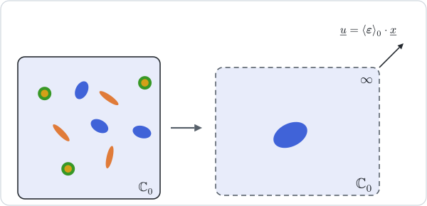

# [Mori–Tanaka](@id th-scheme-mori-tanaka)

!!! info "Before this page"
    [Dilute estimates](@ref th-scheme-dilute), whose auxiliary problem is kept
    here with a different remote field, and
    [Homogenization schemes](@ref th-homogenization) for the identity
    ``\mathbb A_i^{\mathrm{dil}} = \mathbb I - \mathbb P_i:\mathbb N_i``.

The dilute estimate violates the strain average because each inclusion is loaded
by the macroscopic strain while the matrix around it is not. The scheme of
[mori1973](@citet), in the form given by [benveniste1987](@citet), repairs this
with one change: each inclusion is still alone in the matrix, but the strain it
sees at infinity is the mean strain of the matrix,
``\boldsymbol E^0 = \langle\boldsymbol\varepsilon\rangle_0``.



## 1. The estimate

The dilute solution then gives
``\langle\boldsymbol\varepsilon\rangle_i = \mathbb A_i^{\mathrm{dil}}:\langle\boldsymbol\varepsilon\rangle_0``,
and the strain average fixes the mean matrix strain:

```math
\boldsymbol E = f_0\,\langle\boldsymbol\varepsilon\rangle_0
  + \sum_i f_i\,\langle\boldsymbol\varepsilon\rangle_i
  = \Big(f_0\,\mathbb I + \sum_j f_j\,\mathbb A_j^{\mathrm{dil}}\Big):\langle\boldsymbol\varepsilon\rangle_0 .
```

The concentration tensors and the estimate follow,

```math
\mathbb A_i^{\mathrm{MT}} = \mathbb A_i^{\mathrm{dil}}:\Big(f_0\,\mathbb I + \sum_j f_j\,\mathbb A_j^{\mathrm{dil}}\Big)^{-1} ,
\qquad
\mathbb C^{\mathrm{MT}} = \mathbb C_0
  + \mathbb N_\Sigma:\Big(f_0\,\mathbb I + \sum_j f_j\,\mathbb A_j^{\mathrm{dil}}\Big)^{-1} .
```

The inverse stands on the right of ``\mathbb N_\Sigma``: it maps the macroscopic
strain to the mean strain of the matrix, on which the contributions act. With
``\mathbb A_j^{\mathrm{dil}} = \mathbb I - \mathbb P_j:\mathbb N_j`` and
``f_0 + \sum_j f_j = 1``, the bracket is
``\mathbb I - \sum_j f_j\,\mathbb P_j:\mathbb N_j``, so that

```math
\mathbb C^{\mathrm{MT}} = \mathbb C_0
  + \mathbb N_\Sigma:\Big(\mathbb I - \sum_j f_j\,\mathbb P_j:\mathbb N_j\Big)^{-1} .
```

This second form is the one to keep in mind for the next page: it differs from
the Maxwell estimate only in the tensor that multiplies each contribution in the
bracket.

## 2. Cracks

A crack family adds the two limits of
[§2 of the overview](@ref th-homogenization): ``\kappa_c\,\varepsilon_c\,\mathbb H_c:\mathbb C_0``
to the bracket and ``-\,\kappa_c\,\varepsilon_c\,\mathbb C_0:\mathbb H_c:\mathbb C_0`` to
``\mathbb N_\Sigma``. With cracks alone, writing
``\mathbb X = \sum_c \kappa_c\,\varepsilon_c\,\mathbb H_c``,

```math
\mathbb C^{\mathrm{MT}} = \mathbb C_0 - \mathbb C_0:\mathbb X:\mathbb C_0:(\mathbb I + \mathbb X:\mathbb C_0)^{-1}
  = \mathbb C_0:(\mathbb I + \mathbb X:\mathbb C_0)^{-1} ,
\qquad
\mathbb S^{\mathrm{MT}} = \mathbb S_0 + \mathbb X ,
```

which is the non-interaction approximation of the
[dual dilute estimate](@ref th-scheme-dilute-stress): for cracks, Mori–Tanaka and
[`DiluteDual`](@ref) coincide. The crack term in the bracket is not optional: an
additive crack term alone would make the stiffness vanish at a moderate density.

## 3. Properties

For a two-phase isotropic composite with spherical inclusions and well-ordered
phases, the estimate coincides with a bound of [hashin1963](@citet): the upper
bound when the matrix is the stiffer phase, the lower one when it is the softer.

With several inclusion shapes the estimate is not, in general, major-symmetric.
[ponte1995](@citet) trace this to the morphology the scheme implicitly assumes,
which the next page makes explicit. The package returns the estimate as
computed: an asymmetric Mori–Tanaka tensor is the scheme's answer, not a
numerical artifact.

The scheme reads one phase as the matrix, and the estimate depends on that
choice ([Who is the matrix?](@ref man-who-is-the-matrix)). In conduction it is
the same formula with ``(\boldsymbol K, \boldsymbol P, \boldsymbol N)`` in place
of ``(\mathbb C, \mathbb P, \mathbb N)``.

## Where to go next

Mori–Tanaka describes what surrounds an inclusion only through the mean strain
of the matrix. The next page,
[Maxwell and Ponte Castañeda–Willis](@ref th-scheme-maxwell-pcw), adds a second
shape that describes how the inclusions are distributed, derives both schemes
from the Green operator, and recovers Mori–Tanaka as a particular choice of that
shape. The estimate is computed and compared with the bounds in the tutorial
[Bounds and classical schemes](@ref tut-bounds-and-schemes).
