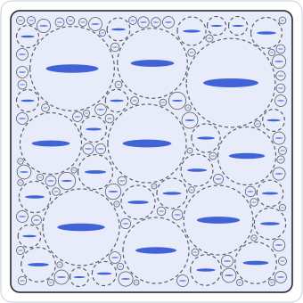

# [Ponte Castañeda–Willis](@id th-scheme-pcw)

!!! info "Before this page"
    [Voigt and Reuss bounds](@ref th-scheme-bounds), whose energy principles
    are refined here, [Two-inclusion interaction tensors](@ref th-interaction)
    for the Green operator ``\mathbb G^0``, its sign and the tensor
    ``\mathbb T^{ab}`` through which one inclusion acts on another, and
    [Mori–Tanaka](@ref th-scheme-mori-tanaka), recovered below as a particular
    case.

Mori–Tanaka and Maxwell start from the solution of an inclusion problem and
assemble it. The estimate of [ponte1995](@citet) starts elsewhere: from the
energy of the composite, bounded by a variational principle, and from a
statistical description of how the inclusions are distributed. The statistics
enter through one ellipsoid per pair of phases, which describes how the centers
of the inclusions of one phase are distributed around an inclusion of the other.

The derivation below is carried out for a matrix holding any number ``n`` of
inclusion phases, with these ellipsoids unrestricted. It builds the energy
principle (§1), restricts it to a polarization uniform in each phase (§2),
evaluates the statistical terms (§3) and solves the stationarity system (§4).
The case of a single ellipsoid (§5), Mori–Tanaka (§6), the concentration
tensors (§7) and the cracks (§8) follow, and §9 gathers the assumptions. The
premises have nothing in common with those of the
[Maxwell scheme](@ref th-scheme-maxwell), with which the estimate nevertheless
coincides in one case.

## 1. An energy principle with a comparison medium

The effective stiffness is defined by the effective energy, the minimum of the
mean strain energy over the strain fields ``\boldsymbol\varepsilon`` compatible
with the affine displacement ``\boldsymbol E\cdot\underline x`` on the boundary,

```math
W^{\mathrm{hom}}(\boldsymbol E) = \tfrac12\,\boldsymbol E:\mathbb C^{\mathrm{hom}}:\boldsymbol E
  = \min_{\boldsymbol\varepsilon}\,\big\langle w(\underline x, \boldsymbol\varepsilon)\big\rangle ,
\qquad
w(\underline x, \boldsymbol\varepsilon) = \tfrac12\,\boldsymbol\varepsilon:\mathbb C(\underline x):\boldsymbol\varepsilon .
```

The principle of [hashin1962](@citet) compares the composite with a homogeneous
medium of stiffness ``\mathbb C_0`` and energy
``w_0(\boldsymbol\varepsilon) = \frac12\,\boldsymbol\varepsilon:\mathbb C_0:\boldsymbol\varepsilon``.
Assume first ``\mathbb C_0`` softer than every phase, so that
``w - w_0`` is a convex function of the strain. Its Legendre transform,

```math
(w - w_0)^\ast(\underline x, \boldsymbol\tau)
  = \sup_{\boldsymbol\varepsilon}\big[\boldsymbol\tau:\boldsymbol\varepsilon - (w - w_0)(\underline x, \boldsymbol\varepsilon)\big]
  = \tfrac12\,\boldsymbol\tau:\big(\mathbb C(\underline x) - \mathbb C_0\big)^{-1}:\boldsymbol\tau ,
```

gives, for every strain and every polarization field ``\boldsymbol\tau``,
``w \ge w_0 + \boldsymbol\tau:\boldsymbol\varepsilon - (w - w_0)^\ast``. Taking the
mean and the minimum over the admissible strains,

```math
W^{\mathrm{hom}}(\boldsymbol E) \ge
  \min_{\boldsymbol\varepsilon}\big\langle w_0(\boldsymbol\varepsilon) + \boldsymbol\tau:\boldsymbol\varepsilon\big\rangle
  - \big\langle (w - w_0)^\ast(\boldsymbol\tau)\big\rangle .
```

The remaining minimum is the problem of the homogeneous medium ``\mathbb C_0``
carrying the prescribed polarization ``\boldsymbol\tau``. Its solution is the
integral equation of the [interaction page](@ref th-interaction),

```math
\boldsymbol\varepsilon = \boldsymbol E - \mathbb G^0\ast(\boldsymbol\tau - \bar{\boldsymbol\tau}) ,
\qquad \bar{\boldsymbol\tau} = \langle\boldsymbol\tau\rangle ,
```

where ``\ast`` is the convolution over the volume element. For a statistically
homogeneous medium without long-range order, the kernel may be taken as the
Green operator of the infinite medium, acting on the fluctuation of the
polarization only, so that the strain averages to ``\boldsymbol E``
[ponte1995](@cite). With this solution, the stress
``\mathbb C_0:\boldsymbol\varepsilon + \boldsymbol\tau`` is in equilibrium and the
strain fluctuation is compatible with zero mean, so their product averages to
the product of their averages (Hill's lemma), and the minimum is
``\frac12\,\boldsymbol E:\mathbb C_0:\boldsymbol E + \bar{\boldsymbol\tau}:\boldsymbol E -
\frac12\,\langle(\boldsymbol\tau - \bar{\boldsymbol\tau}):\mathbb G^0\ast(\boldsymbol\tau - \bar{\boldsymbol\tau})\rangle``,
and the effective energy is bounded below by the Hashin–Shtrikman functional

```math
\mathcal H(\boldsymbol\tau) = \tfrac12\,\boldsymbol E:\mathbb C_0:\boldsymbol E
  + \bar{\boldsymbol\tau}:\boldsymbol E
  - \tfrac12\,\big\langle\boldsymbol\tau:(\mathbb C - \mathbb C_0)^{-1}:\boldsymbol\tau\big\rangle
  - \tfrac12\,\big\langle(\boldsymbol\tau - \bar{\boldsymbol\tau}):\mathbb G^0\ast(\boldsymbol\tau - \bar{\boldsymbol\tau})\big\rangle ,
```

whatever ``\boldsymbol\tau``. Its stationarity with respect to
``\boldsymbol\tau`` is the Lippmann–Schwinger equation with
``\boldsymbol\varepsilon = (\mathbb C - \mathbb C_0)^{-1}:\boldsymbol\tau``: the
exact polarization makes it an equality, and any other field gives a lower bound.
When ``\mathbb C_0`` is stiffer than every phase, ``w - w_0`` is concave and the
same steps, with the extremum reversed, make ``\mathcal H`` an upper bound. When
``\mathbb C_0`` is neither, the stationary value of ``\mathcal H`` over a restricted
family of polarizations is an estimate, neither bound
[hashin1963, willis1977, ponte1995](@cite).

## 2. The matrix as comparison medium, a polarization per phase

The functional of §1 is exact only at the solution, which is unknown. An
estimate follows from two choices: the comparison medium, and a family of trial
polarizations small enough for the stationarity of ``\mathcal H`` to be solved
over it.

The microstructure is a matrix of stiffness ``\mathbb C_0`` and volume fraction
``f_0`` holding ``n`` inclusion phases. All the inclusions of phase ``i`` share
the domain ``\Omega_i`` up to a translation (shape, orientation and stiffness
``\mathbb C_i``); inclusions of the same shape with another orientation form
another phase. Their centers have the number density ``n_i``, so that
``f_i = n_i\,|\Omega_i|``.

Taking the matrix as comparison medium makes ``\mathbb C - \mathbb C_0`` vanish
in the matrix, where ``(w - w_0)^\ast`` is then infinite unless
``\boldsymbol\tau = \boldsymbol 0``: the polarization lives in the inclusions
only. The family of polarizations searched is the simplest one, uniform in each
phase and the same in every inclusion of that phase,

```math
\boldsymbol\tau(\underline x) = \sum_{i=1}^{n} \chi_i(\underline x)\,\boldsymbol\tau_i ,
\qquad \bar{\boldsymbol\tau} = \sum_i f_i\,\boldsymbol\tau_i ,
```

with ``\chi_i`` the characteristic function of phase ``i``. The functional then
becomes a quadratic function of the ``n`` tensors ``\boldsymbol\tau_i``,

```math
\mathcal H = \tfrac12\,\boldsymbol E:\mathbb C_0:\boldsymbol E
  + \sum_i f_i\,\boldsymbol\tau_i:\boldsymbol E
  - \tfrac12\sum_i f_i\,\boldsymbol\tau_i:(\mathbb C_i - \mathbb C_0)^{-1}:\boldsymbol\tau_i
  - \tfrac12\sum_{i,j} \boldsymbol\tau_i:\mathbb Y^{ij}:\boldsymbol\tau_j ,
\qquad
\mathbb Y^{ij} = \big\langle\chi_i\,\mathbb G^0\ast(\chi_j - f_j)\big\rangle ,
```

in which the microstructure enters only through the tensors ``\mathbb Y^{ij}``.
They depend on the moduli of the matrix and on how phase ``j`` is seen from
phase ``i``, that is on the two-point statistics.

## 3. Two-point statistics and the distribution ellipsoids

The remaining work is to express the tensors ``\mathbb Y^{ij}`` through the
statistics of the inclusions. Writing each ``\chi_i`` as the sum of the characteristic functions of its
inclusions splits ``\mathbb Y^{ij}`` into two parts.

**The self part.** When the two points belong to the same inclusion, which
requires ``j = i``, the double integral over ``\Omega_i`` is ``|\Omega_i|`` times
the self-interaction tensor ``\mathbb T^{aa}``, which is the Hill tensor
``\mathbb P_i`` for an ellipsoid. Summed over the inclusions of the phase, the
self part is ``\delta_{ij}\,f_i\,\mathbb P_i``.

**The pair part.** When the two points belong to two distinct inclusions, the
part depends on where the inclusions of phase ``j`` lie with respect to one of
phase ``i``. Let ``p_{j|i}(\underline r)`` be the number density of centers of
phase ``j`` at the separation ``\underline r`` from the center of an inclusion of
phase ``i``. With the interaction tensor ``\mathbb T^{ij}(\underline r)`` of such
a pair, and the mean ``f_j`` subtracted in ``\mathbb Y^{ij}``, the pair part is

```math
f_i \int \big[p_{j|i}(\underline r) - n_j\big]\,\mathbb T^{ij}(\underline r)\,\mathrm dV_{\underline r} .
```

Three hypotheses make it computable [ponte1995](@cite):

1. the medium is statistically homogeneous, so that ``p_{j|i}`` depends on the
   separation alone;
2. the statistics have **ellipsoidal symmetry**: ``p_{j|i}`` depends on
   ``\underline r`` only through the norm attached to an ellipsoid
   ``\mathcal D^{ij}`` centered on the origin, and vanishes inside it;
3. there is no long-range order: ``p_{j|i}`` tends to ``n_j`` fast enough as
   ``|\underline r|`` grows.

The symmetry of the statistics, ``n_i\,p_{j|i}(\underline r) = n_j\,p_{i|j}(-\underline r)``,
requires ``\mathcal D^{ij} = \mathcal D^{ji}``.



The figure shows a microstructure of this kind for one family of aligned flat
inclusions and a spherical ellipsoid ``\mathcal D``: each inclusion is centered
in a sphere of half the size of ``\mathcal D``, and these spheres do not overlap,
so that no center comes closer to another than ``\mathcal D`` allows (§8).

Inside ``\mathcal D^{ij}`` the density vanishes and the integrand reduces to
``-\,n_j\,\mathbb T^{ij}(\underline r)``. Expanding the interaction tensor,
``\int_{\mathcal D^{ij}}\mathbb T^{ij}\,\mathrm dV`` averages over ``\Omega_i``
and integrates over ``\Omega_j`` the integral of ``\mathbb G^0`` over
``\mathcal D^{ij}``, shifted by the difference between a point of
``\Omega_i`` and a point of ``\Omega_j``. If every such difference lies in
``\mathcal D^{ij}``, the interior property of the Eshelby solution makes that
integral equal to the Hill tensor ``\mathbb P_d^{ij}`` of ``\mathcal D^{ij}`` for
every pair of points, and the contribution is
``-\,f_i\,n_j\,|\Omega_j|\,\mathbb P_d^{ij} = -\,f_i\,f_j\,\mathbb P_d^{ij}``. The set of
these differences, ``\Omega_i - \Omega_j``, is exactly the set of separations at
which an inclusion of phase ``i`` and one of phase ``j`` would overlap: the
condition is that ``\mathcal D^{ij}`` exclude overlaps.

Outside ``\mathcal D^{ij}`` the bracket is constant on each ellipsoidal shell
homothetic to ``\mathcal D^{ij}``. The Hill tensor of an ellipsoid does not
depend on its size, so ``\mathbb G^0`` integrates to zero over the region between
two homothetic ellipsoids that contain the point considered. Every shell
therefore contributes nothing, and the decay of the third hypothesis makes the
sum converge. Altogether,

```math
\mathbb Y^{ij} = f_i\,\big(\delta_{ij}\,\mathbb P_i - f_j\,\mathbb P_d^{ij}\big) .
```

For an inclusion that is not an ellipsoid, the same steps hold with
``\mathbb P_i`` replaced by its mean self-interaction tensor, the average of
``\mathbb G^0`` over the inclusion and over itself [ponte1995](@cite).

## 4. Stationarity and the estimate

With the tensors ``\mathbb Y^{ij}`` known, ``\mathcal H`` is an explicit
quadratic function of the polarizations ``\boldsymbol\tau_i``, and the estimate
follows from its stationarity. Setting the derivative of ``\mathcal H`` with respect to each ``\boldsymbol\tau_i``
to zero, and dividing by ``f_i``, gives ``n`` linear equations, written with
``\mathbb N_i^{-1} = (\mathbb C_i - \mathbb C_0)^{-1} + \mathbb P_i``:

```math
\mathbb N_i^{-1}:\boldsymbol\tau_i - \sum_{j=1}^{n} f_j\,\mathbb P_d^{ij}:\boldsymbol\tau_j = \boldsymbol E ,
\qquad i = 1, \dots, n .
```

At the stationary point the quadratic terms of ``\mathcal H`` equal minus half
its linear term, so that
``\mathcal H = \frac12\,\boldsymbol E:\mathbb C_0:\boldsymbol E + \frac12\,\bar{\boldsymbol\tau}:\boldsymbol E``,
and the estimate is read off the mean polarization,
``\bar{\boldsymbol\tau} = (\mathbb C^{\mathrm{PCW}} - \mathbb C_0):\boldsymbol E``.
Multiplying equation ``i`` by ``f_i`` writes the system with the block matrix
``\mathbf K`` of entries
``\mathbf K_{ij} = \delta_{ij}\,f_i\,\mathbb N_i^{-1} - f_i\,f_j\,\mathbb P_d^{ij}``,
and

```math
\mathbb C^{\mathrm{PCW}} = \mathbb C_0 + \sum_{i,j} f_i\,f_j\,\big(\mathbf K^{-1}\big)_{ij} .
```

Since ``\mathbb P_d^{ij} = \mathbb P_d^{ji}`` and every ``\mathbb N_i`` is
major-symmetric, ``\mathbf K`` is symmetric, and so is the estimate. When the
matrix is the softest phase the estimate is a lower bound, and when it is the
stiffest an upper bound, for the class of microstructures sharing these
statistics; otherwise it is an estimate.

The equations can be read directly. Since
``\mathbb N_i = (\mathbb C_i - \mathbb C_0):\mathbb A_i^{\mathrm{dil}}``, equation
``i`` says that ``\boldsymbol\tau_i = \mathbb N_i:\boldsymbol E_i``: each inclusion
of phase ``i`` has the polarization it would have if it were alone in the matrix,
loaded at infinity by

```math
\boldsymbol E_i = \boldsymbol E + \sum_j f_j\,\mathbb P_d^{ij}:\boldsymbol\tau_j .
```

The correction is the pair part of §3 read back: around the inclusion, phase
``j`` is missing from ``\mathcal D^{ij}``, where its mean polarization
``f_j\,\boldsymbol\tau_j`` would otherwise be, and the beyond contributes
nothing.

## 5. One distribution ellipsoid

The system of §4 has no closed-form solution in general, since each phase sees
its own field ``\boldsymbol E_i``. It has one when a single ellipsoid
``\mathcal D`` describes every pair, ``\mathbb P_d^{ij} = \mathbb P_d``: the field
is then the same for every phase,
``\boldsymbol E_i = \boldsymbol E + \mathbb P_d:\bar{\boldsymbol\tau}``, and
multiplying
``\boldsymbol\tau_i = \mathbb N_i:(\boldsymbol E + \mathbb P_d:\bar{\boldsymbol\tau})``
by ``f_i`` and summing leaves an equation for the mean polarization alone,
``\bar{\boldsymbol\tau} = (\mathbb I - \mathbb N_\Sigma:\mathbb P_d)^{-1}:\mathbb N_\Sigma:\boldsymbol E``,
and

```math
\mathbb C^{\mathrm{PCW}} = \mathbb C_0 + (\mathbb I - \mathbb N_\Sigma:\mathbb P_d)^{-1}:\mathbb N_\Sigma
  = \mathbb C_0 + \mathbb N_\Sigma:(\mathbb I - \mathbb P_d:\mathbb N_\Sigma)^{-1} ,
```

the second form following from
``(\mathbb I - \mathbb N_\Sigma:\mathbb P_d):\mathbb N_\Sigma = \mathbb N_\Sigma:(\mathbb I - \mathbb P_d:\mathbb N_\Sigma)``.
Expanded in the fractions, the estimate is the dilute one at first order, and the
distribution enters at second order only, through
``\mathbb N_\Sigma:\mathbb P_d:\mathbb N_\Sigma`` [ponte1995](@cite).

!!! note "A coincidence with the Maxwell estimate"
    The second form is the [Maxwell estimate](@ref th-scheme-maxwell) of a domain
    ``\Omega`` shaped like ``\mathcal D``. Nothing in either derivation announces
    it: one matches the far field of a cluster, the other makes an energy
    stationary over polarizations constrained by the statistics. It can be read
    after the fact, the remote strain applied to the Maxwell cluster being exactly
    the field ``\boldsymbol E + \mathbb P_d:\bar{\boldsymbol\tau}`` that each
    inclusion sees here, once the mean strain inside the cluster is taken as
    ``\boldsymbol E``. It holds for one distribution ellipsoid only: a cluster has
    a single shape, and the Maxwell construction has no counterpart for
    distribution ellipsoids that depend on the pair of phases.

## 6. Mori–Tanaka as a choice of distribution

A single ellipsoid is not the only special case of the system of §4.
[ponte1995](@citet) note that the Mori–Tanaka estimate follows formally from
theirs, and trace its asymmetry with several inclusion shapes to an assumption
on the distribution that violates the symmetry of the pair statistics. The
pairwise system makes this explicit. Substituting
``\mathbb P_d^{ij} = \mathbb P_j``, the field
``\boldsymbol E + \sum_j f_j\,\mathbb P_j:\boldsymbol\tau_j`` is the same for every
phase, and the Mori–Tanaka solution satisfies the equations with that field equal
to the mean strain of the matrix, since
``\boldsymbol E = f_0\,\langle\boldsymbol\varepsilon\rangle_0 + \sum_j f_j\,\mathbb A_j^{\mathrm{dil}}:\langle\boldsymbol\varepsilon\rangle_0
= \langle\boldsymbol\varepsilon\rangle_0 - \sum_j f_j\,\mathbb P_j:\boldsymbol\tau_j``.
The choice is not symmetric in ``(i, j)`` as soon as two phases differ in shape,
so that ``\mathbf K`` loses its symmetry, and so does the estimate. It is
symmetric, and the two estimates coincide, when every inclusion has the shape of
the distribution.

## 7. Concentration tensors

The estimate is now complete, in general and in its two special cases. Unlike
Mori–Tanaka, the derivation never used concentration tensors, but they follow
from its stationarity condition. The mean of the strain that the
integral equation of §1 produces in phase ``i`` from the trial polarization is
``\boldsymbol E - \langle\mathbb G^0\ast(\boldsymbol\tau - \bar{\boldsymbol\tau})\rangle_i
= \boldsymbol E - f_i^{-1}\sum_j \mathbb Y^{ij}:\boldsymbol\tau_j``, and the
stationarity equation states that it equals
``(\mathbb C_i - \mathbb C_0)^{-1}:\boldsymbol\tau_i``, the strain that the
polarization of the phase stands for. The estimate of the mean strain of phase
``i`` is therefore
``\langle\boldsymbol\varepsilon\rangle_i = (\mathbb C_i - \mathbb C_0)^{-1}:\mathbb N_i:\boldsymbol E_i
= \mathbb A_i^{\mathrm{dil}}:\boldsymbol E_i``, and writing
``\boldsymbol E_i = \mathbb E_i:\boldsymbol E``,

```math
\mathbb A_i^{\mathrm{PCW}} = \mathbb A_i^{\mathrm{dil}}:\mathbb E_i ,
\qquad
\mathbb E_i = \mathbb I + \sum_{j,k} f_j\,\mathbb P_d^{ij}:\big(\mathbf K^{-1}\big)_{jk}\,f_k .
```

The integral equation preserves the mean, so the matrix takes the rest,
``f_0\,\mathbb A_0^{\mathrm{PCW}} = \mathbb I - \sum_i f_i\,\mathbb A_i^{\mathrm{PCW}}``,
and ``\mathbb C_0 + \sum_i f_i\,(\mathbb C_i - \mathbb C_0):\mathbb A_i^{\mathrm{PCW}}``
returns ``\mathbb C^{\mathrm{PCW}}``. With several distribution ellipsoids each
phase has its own ``\mathbb E_i``, given by the block system and without a
closed form in general. With one ellipsoid they are all equal:

```math
\mathbb A_i^{\mathrm{PCW}} = \mathbb A_i^{\mathrm{dil}}:(\mathbb I - \mathbb P_d:\mathbb N_\Sigma)^{-1} ,
\qquad
\mathbb A_0^{\mathrm{PCW}} = \Big[\mathbb I + \frac{1}{f_0}\sum_i f_i\,(\mathbb P_i - \mathbb P_d):\mathbb N_i\Big]:(\mathbb I - \mathbb P_d:\mathbb N_\Sigma)^{-1} .
```

The field that loads the inclusions is the mean strain of the matrix when the
bracket reduces to ``\mathbb I``, as it does when every inclusion has the shape of
the distribution: the Mori–Tanaka case again.
The package implements the estimate with a single distribution ellipsoid, and
[`concentration_tensors`](@ref) returns these tensors, the crack families of §8
entering as they do in the [Maxwell](@ref th-scheme-maxwell) estimate.

## 8. Cracks

Every phase so far has a volume. A crack family is the flat limit of a family
of spheroids at a fixed density
``\varepsilon_c``: its volume fraction vanishes while its polarization diverges,
their product staying finite. Written on ``\boldsymbol t_i = f_i\,\boldsymbol\tau_i``,
the system of §4 is regular in that limit,

```math
\boldsymbol t_i = f_i\,\mathbb N_i:\Big(\boldsymbol E + \sum_j \mathbb P_d^{ij}:\boldsymbol t_j\Big) ,
```

and a crack family enters it with ``f_c\,\mathbb N_c`` replaced by
``\kappa_c\,\varepsilon_c\,\mathbb N_c``,
``\mathbb N_c = -\,\mathbb C_0:\mathbb H_c:\mathbb C_0``, as in every other scheme of
the chapter. Since a crack is softer than the matrix, a matrix holding cracks
alone is its stiffest phase, and the estimate is an upper bound for its class
within the admissible densities below.
Its concentration tensor degenerates in the same way: the strain carried by the
openings is ``\kappa_c\,\varepsilon_c\,\mathbb H_c:\mathbb C_0:\mathbb E_c``.

The condition that ``\mathcal D`` exclude overlaps limits the amounts that a
given pair of shapes can describe. Take a single family of identical, aligned,
centrally symmetric inclusions ``\Omega``, for which ``\Omega - \Omega = 2\,\Omega``,
and center on each of them the safety ellipsoid ``\frac12\,\mathcal D``. It
contains the inclusion, since ``\mathcal D`` contains ``2\,\Omega``. Two centers
being separated by a vector outside ``\mathcal D``, the safety ellipsoids do not
overlap, and their fraction ``n\,|\tfrac12\,\mathcal D|`` cannot exceed one. The
least restrictive choice is the smallest ellipsoid of the shape of ``\mathcal D``
that contains the inclusion, and ``f \le |\Omega| / |\tfrac12\,\mathcal D|``. For
aligned spheroids of aspect ratio ``\omega`` in a distribution of aspect ratio
``\omega_d``, the safety spheroid shares the axis of the inclusion, and

```math
f \le \Big(\frac{\omega_d}{\omega}\Big)^2 \quad (\omega_d \le \omega) ,
\qquad
f \le \frac{\omega}{\omega_d} \quad (\omega_d \ge \omega) .
```

For penny-shaped cracks of radius ``a`` the safety spheroid has the semi-axes
``(a, a, \omega_d\,a)``, and the density ``\varepsilon = n\,a^3`` is bounded by
``3/(4\pi\,\omega_d)``: about 0.239 for a spherical distribution
[ponte1995](@cite). Beyond that density no microstructure of the class exists,
and the formula is no longer a rigorous bound. With a spherical distribution, the
axial Young modulus of aligned cracks given by the estimate vanishes at
``\varepsilon = 45/128``, beyond the admissible range [ponte1995](@cite). With a
flat distribution of the same orientation as the cracks, ``\omega_d \to 0``, the
density limit recedes to infinity, and the estimate reduces to the
non-interaction approximation, which Mori–Tanaka also gives for cracks
[ponte1995](@cite).

## 9. Framework and limits

The assumptions met along the derivation delimit where the estimate can be
used, and are worth checking before using it.

- A matrix–inclusion morphology: the matrix is the comparison medium and
  carries no polarization.
- A polarization uniform in each phase, the same in every inclusion of the
  phase. Once the statistics are fixed, this restriction of the variational
  principle is the only approximation.
- Two-point statistics only, homogeneous, without long-range order, and with
  ellipsoidal symmetry for each pair of phases, ``\mathcal D^{ij} = \mathcal D^{ji}``.
- Impenetrable inclusions: each ``\mathcal D^{ij}`` contains
  ``\Omega_i - \Omega_j``, which caps the fractions and the crack densities (§8).
- A rigorous bound only when the matrix is the softest or the stiffest phase,
  and only for the class of microstructures sharing these statistics.
- Exact to first order in the fractions, the distribution acting at second order.

The package implements a single distribution ellipsoid, declared on the RVE
([Distribution shape](@ref man-distribution-shape)), and evaluates
the second form of §5 with the kernel of the Maxwell scheme. It accepts there any
inclusion that supplies a contribution tensor. For an inclusion that is
heterogeneous, a layered sphere for instance, the polarization cannot be uniform
in it, so the energy principle of §2 does not apply as such: the closed form
evaluated is then that of the [Maxwell scheme](@ref th-scheme-maxwell), whose
far-field argument needs only the contribution tensor. The closed form has no
iteration and accepts dual numbers and symbolic moduli, and the package evaluates
the same kernel in conduction and in aging viscoelasticity.

## Where to go next

Every scheme so far embeds the inclusions in the matrix. The next page,
[Self-consistent schemes](@ref th-scheme-self-consistent), embeds each phase in
the effective medium itself, which suits composites where no phase plays the
role of a matrix.
