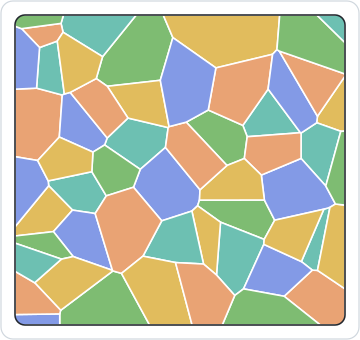
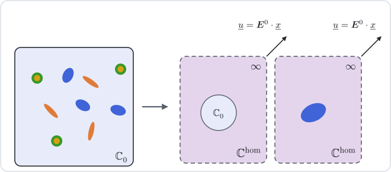
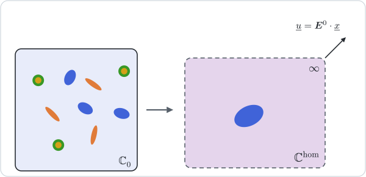

# [Self-consistent schemes](@id th-scheme-self-consistent)

!!! info "Before this page"
    [Homogenization schemes](@ref th-homogenization), for the average relations
    and the limits through which a crack family enters, and
    [Mori–Tanaka](@ref th-scheme-mori-tanaka), the matrix-based estimate these
    schemes depart from.

The schemes of the previous pages need a phase to play the role of the matrix.
When none does — a polycrystal, a granular assembly, a foam whose walls and
pores are equally connected — the reference medium has to be the effective
medium itself, and the estimate becomes a fixed point.



## [1. SelfConsistent: every phase in the effective medium](@id th-scheme-sc)



Each phase ``r``, the one called matrix included, is placed alone in the
infinite effective medium and loaded at infinity by a strain
``\boldsymbol E^0`` [hill1965composites, budiansky1965](@cite). The dilute
solution in that medium gives
``\langle\boldsymbol\varepsilon\rangle_r = \mathbb A_r^{\mathrm{dil}}(\mathbb C^{\mathrm{sc}}):\boldsymbol E^0``,
and the strain average fixes ``\boldsymbol E^0``:

```math
\mathbb C^{\mathrm{sc}} = \Big(\sum_r f_r\,\mathbb C_r:\mathbb A_r^{\mathrm{dil}}(\mathbb C^{\mathrm{sc}})\Big)
  :\Big(\sum_r f_r\,\mathbb A_r^{\mathrm{dil}}(\mathbb C^{\mathrm{sc}})\Big)^{-1} .
```

Multiplying by the bracket on the right and subtracting gives an equivalent form,

```math
\sum_r f_r\,(\mathbb C_r - \mathbb C^{\mathrm{sc}}):\mathbb A_r^{\mathrm{dil}}(\mathbb C^{\mathrm{sc}})
  = \sum_r f_r\,\mathbb N_r(\mathbb C^{\mathrm{sc}}) = 0 :
```

taken as reference, the effective medium receives no net contribution from its
phases. A crack family adds its two limits, evaluated in the effective medium:
``\kappa_c\,\varepsilon_c\,\mathbb H_c(\mathbb C^{\mathrm{sc}}):\mathbb C^{\mathrm{sc}}``
to the strain average and nothing to the stress average, which is the same as
adding ``\kappa_c\,\varepsilon_c\,\mathbb N_c(\mathbb C^{\mathrm{sc}})`` to the sum
above.

Because the reference softens with the soft phases, the estimate exhibits a
percolation threshold. Spherical voids in an isotropic solid make the stiffness
vanish at a porosity of one half, and randomly oriented penny-shaped cracks at a
density of 9/16 [budiansky1976](@cite). The threshold is a feature of the
scheme, not of every microstructure: the tutorial
[Porous materials and the self-consistent trap](@ref tut-porous-materials)
shows where it misleads.

The fixed point is solved numerically. Each iterate is projected on the
major-symmetric tensors, within its symmetry class: a transversely isotropic
estimate stays one, so the Hill tensor of a coaxial spheroid keeps its closed
form from one iterate to the next
([Degenerate shapes](@ref th-degenerate-shapes)). The default solver is a
damped Picard iteration (Anderson with memory 1), which accepts dual numbers.
Loading `NonlinearSolve.jl` activates the
`MeanFieldHomogenizationNonlinearSolveExt` extension, through which every SciML
nonlinear algorithm (`NewtonRaphson()`, `TrustRegion()`, `Anderson()`, …) is
available via the `algorithm` keyword of [`SelfConsistent`](@ref). An iterative
solve decides when to stop by comparing values, so that symbolic moduli are not
accepted.

## [2. AsymmetricSelfConsistent: the matrix keeps its role](@id th-scheme-asc)



The asymmetric variant [saevik2014](@cite) embeds the inclusions in the effective
medium, as the symmetric one does, but measures their contrast against the
matrix ``\mathbb C_m``, which has no shape and no concentration tensor of its
own:

```math
\mathbb C^{\mathrm{asc}} = \mathbb C_m
  + \sum_{i \ne m} f_i\,(\mathbb C_i - \mathbb C_m):\mathbb A_i^{\mathrm{dil}}(\mathbb C^{\mathrm{asc}}) .
```

The same fixed point is written on the compliance, with the stress
concentration tensor
``\mathbb C_i:\mathbb A_i^{\mathrm{dil}}(\mathbb C^{\mathrm{asc}}):\mathbb S^{\mathrm{asc}}``
of each inclusion in the effective medium,

```math
\mathbb S^{\mathrm{asc}} = \mathbb S_m
  + \sum_{i \ne m} f_i\,(\mathbb S_i - \mathbb S_m):\mathbb C_i:\mathbb A_i^{\mathrm{dil}}(\mathbb C^{\mathrm{asc}}):\mathbb S^{\mathrm{asc}}
  + \sum_c \kappa_c\,\varepsilon_c\,\mathbb H_c(\mathbb C^{\mathrm{asc}}) .
```

For solid phases the two forms are equivalent: multiplied by ``\mathbb S_m`` on
the left, the stiffness form becomes the compliance one multiplied by
``\mathbb C^{\mathrm{asc}}`` on the right, since
``(\mathbb S_i - \mathbb S_m):\mathbb C_i = \mathbb I - \mathbb S_m:\mathbb C_i``.
They differ in how the iteration converges, and the package iterates on the
stiffness when the Voigt mean is larger than the matrix stiffness in norm, on the
compliance otherwise. Cracks, which only the compliance form carries, force it.

The two self-consistent fixed points are related by a single term. Splitting
``\mathbb C_r - \mathbb C^{\mathrm{sc}} = (\mathbb C_r - \mathbb C_m) + (\mathbb C_m - \mathbb C^{\mathrm{sc}})``
in the symmetric condition gives

```math
\sum_{i \ne m} f_i\,(\mathbb C_i - \mathbb C_m):\mathbb A_i^{\mathrm{dil}}
  = (\mathbb C^{\mathrm{sc}} - \mathbb C_m):\sum_r f_r\,\mathbb A_r^{\mathrm{dil}} ,
```

where the asymmetric scheme has ``\mathbb C^{\mathrm{asc}} - \mathbb C_m`` alone
on the right. The two coincide when ``\sum_r f_r\,\mathbb A_r^{\mathrm{dil}} = \mathbb I``
at the solution. Every phase sharing one Hill tensor ``\mathbb P`` is such a case,
since then
``\sum_r f_r\,\mathbb A_r^{\mathrm{dil}} = \mathbb I - \mathbb P:\sum_r f_r\,\mathbb N_r = \mathbb I``
at the symmetric fixed point. With inclusions of a shape different from the one
attributed to the matrix, the two estimates differ.

Like Mori–Tanaka, the asymmetric scheme depends on which phase is the matrix. It
returns the matrix when the inclusions vanish, and the inclusion phase when a
single one remains without matrix.

## 3. Conduction and viscoelasticity

Both schemes carry over to conduction with order-2 tensors. In aging
viscoelasticity the Hill kernel is built for an isotropic reference, and the
reference of these schemes is the running estimate, so that every phase must
keep it isotropic; see [Aging linear Volterra behavior](@ref th-viscoelasticity).

## Where to go next

The self-consistent schemes place each inclusion in the final effective medium
at once. The next page, [The differential scheme](@ref th-differential-scheme),
builds the composite gradually instead, adding inclusions in small amounts to
the current effective medium. The syntax of the solvers and of their tolerances
is in [Homogenization schemes](@ref man-schemes-tolerances).
